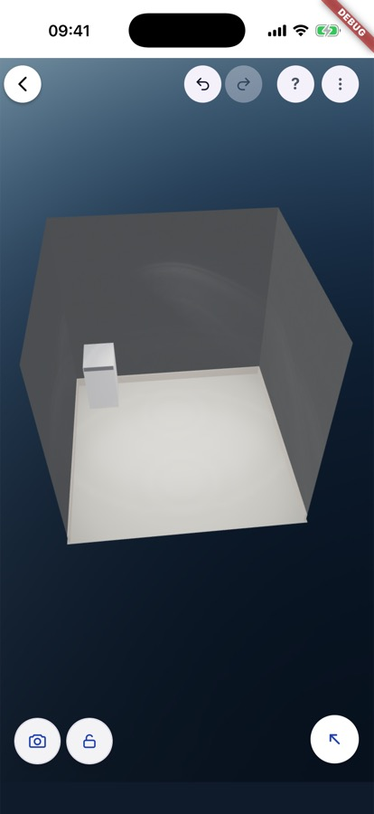

# Idish yuvish mashinasi (#302): mobil tekshiruv natijasi (2026-11-16)

#302 uchun alohida tekshiruv ro'yxati yo'q edi, bandlar PR tavsifidan olindi.

**Muhit:**
- Qurilma: iOS Simulator, iPhone 17 Pro.
- Ilova: andoza_ai_mobile `main` (`2a40e73`), debug build.
- Server: production `andozaai.uz`, `7f1a347a` (#302) deploy qilingan.
- Til: Русский.
- Xona: yangi usta orqali yaratilgan oshxona ("Кухня", 3.0 × 3.0 m).

> ⭐ bandlar haqiqiy telefonda emas, simulyatorda ko'rildi.

## Natijalar

| # | Band | Natija |
|---|---|---|
| 1 | Oshxonada Santexnika panelida "Idish yuvish mashinasi" bloki va qo'shish tugmasi | ✅ "ПОСУДОМОЕЧНАЯ МАШИНА", "Добавить посудомоечную машину" |
| 2 | Qatorda devor, kenglik (60/45 sm), "Убрать" | ✅ "стена А · 60 см · Убрать". Kenglik ro'yxatida faqat 60 va 45 sm; 45 tanlansa, saqlanadi |
| 3 | Nuqtalar: sovuq suv Ø20 va kanalizatsiya Ø50, 500 mm balandlikda, "(idish mashinasiniki)" | ✅ "Холодная вода · стена A · 50 см (посудомоечной машины)" va "Канализация · стена A · 50 см (посудомоечной машины)". Markazdan ±150/±100 mm oralig'i alohida o'lchanmadi |
| 4 | 3D: oq quti, old tomonining tepasida kulrang boshqaruv chizig'i | ✅ ⭐ (rasm) |
| 5 | Smeta: kran (uchlik bilan) 70 000 | ✅ "Кран для посудомоечной машины (с тройником)": 1 шт. × 70 000, `1 машина = 1 шт.` |
| 6 | Smeta: sifon (chiqishli) 90 000 | ✅ "Сифон для посудомоечной машины (с отводом)": 1 шт. × 90 000 |
| 7 | Smeta: "Ish: idish yuvish mashinasini ulash" 200 000 | ✅ "Работа: подключение посудомоечной машины": 1 шт. × 200 000 |
| 8 | Smeta: rozetka (IP44), kabel 3 m, rozetka ishi | ✅ "Розетка для посудомоечной машины (IP44)" 70 000. "Электрокабель (посудомоечная машина)" 3 м × 9 500 = 28 500. "Работа: установка розетки для посудомоечной машины" 50 000 |
| 9 | Mashinaning o'zi narxlanmaydi | ✅ smetada mashina qatori yo'q |
| 10 | Sig'maydigan kenglik rad etiladi va aytiladi | tekshirilmadi (3 m devorda ikkala kenglik ham sig'adi) |
| 11 | Mebelga tegish ogohlantirishi | tekshirilmadi |
| 12 | O'zbek va ingliz tilida nomlar, PDF | tekshirilmadi (faqat ruscha ko'rildi) |
| 13 | Do'kon kalitlari `kran_idish`, `sifon_idish` | tekshirilmadi (do'konda bunday mahsulot ko'rilmadi; o'rtacha narx olindi) |
| 14 | Kir yuvish mashinasi narxlari o'zgarmagan | ✅ shu kunning katta hammomida (ikki mashina) qatorlar avvalgidek: kran 60 000, sifon 70 000, ulash 150 000 |

Sinov xonasi (oshxona, ichida 45 sm idish yuvish mashinasi) keyingi tekshiruv uchun saqlab qo'yildi.
