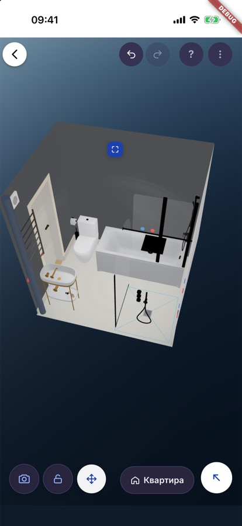
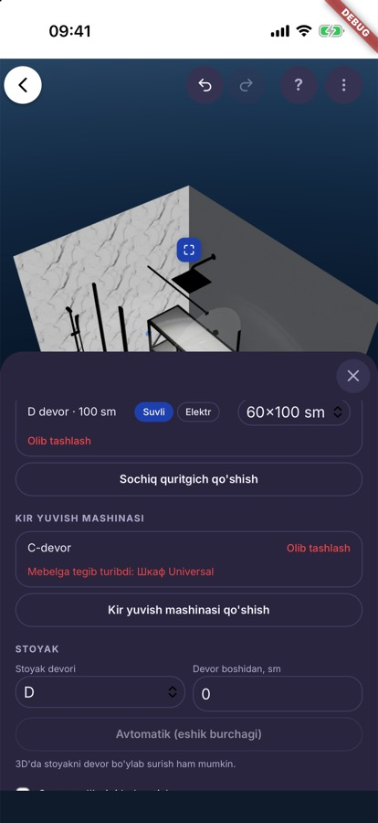
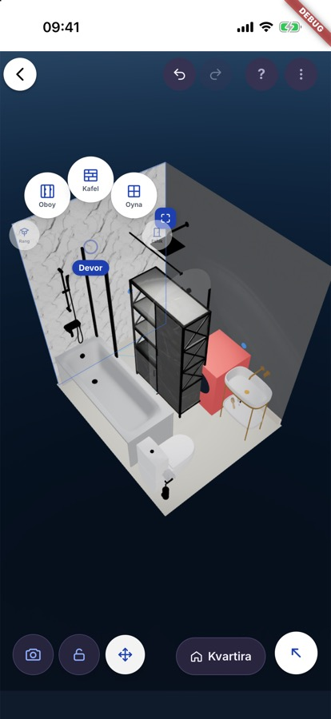
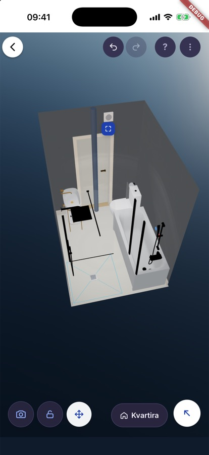
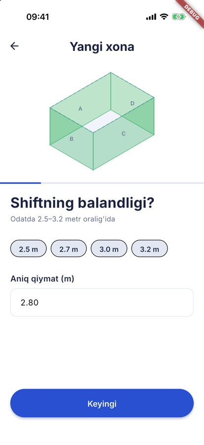
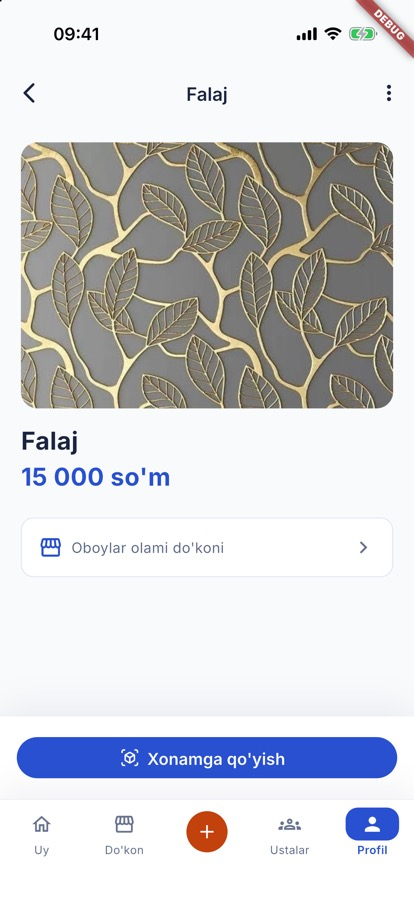

# Santexnika paketi va admin "Narxlar": mobil tekshiruv natijasi (2026-11-16)

Issue'lar (tekshiruv ro'yxatlari issue ichida): #279, #283, #285, #287, #289, #291, #296.

**Muhit:**
- Qurilma: iOS Simulator, iPhone 17 Pro.
- Ilova: andoza_ai_mobile 1.0.2+35, debug build.
- Server: production `andozaai.uz`, master `13ee186d`. #278–#294 hammasi deploy qilingan.
- Xona: "Hammom namunasi" → "Hammom" (5.00 m², shift 2.70 m).
- Til: Русский. Tarjima bandlari uchun English va O'zbekcha ham ko'rildi.
- #296 ilovada tekshirib bo'lmaydi, chunki ilovada admin bo'limi yo'q. U kompyuterdagi Chrome'da, admin hisobida, tor oynada (telefon kengligiga yaqin) tekshirildi.

> ⭐ bandlar haqiqiy telefonda emas, simulyatorda ko'rildi. Barmoq harakati sun'iy yuboriladi.

> Tekshiruvdan keyin hamma narsa boshlang'ich holatiga qaytarildi:
> - shkaf, kir yuvish mashinasi va sochiq quritgich o'chirildi;
> - trap belgisi o'chirildi;
> - stoyak 0 sm ga qaytarildi;
> - ventilyator belgisi yoqilgan holda qoldirildi (boshida ham yoqilgan edi);
> - "Tortuvchi ventilyator Ø100" narxi "Asl holiga" bilan qaytarildi;
> - ilova tili ruschaga qaytarildi.
>
> Jami summa: oldin **21 987 530**, oxirida **21 987 530** so'm. Yangi xona yaratilmadi.

## Qisqacha

| Issue | Natija |
|---|---|
| #279 kir yuvish mashinasi rozetkasi | ✅ uch qator uch tilda va PDF'da bor. Ikkinchi mashina bu xonaga sig'madi, shuning uchun 2 dona tekshirilmadi |
| #283 trap va qiyalik | ✅ 3D va smeta. Dushni surish va ikki dush tekshirilmadi |
| #285 ventilyator | ✅ 3D, stoyak bilan ko'chishi va smeta. Ø125 va hammom bo'lmagan xona tekshirilmadi |
| #287 sochiq quritgich o'lchami | ✅ ro'yxat, 3D, undo va smeta. ⚠️ sochiq quritgich eshik ramkasiga chiqib turadi |
| #289 mebelga tegish | ✅ yozuv va qizil rang chiqadi. ⚠️ mobil'da Santexnika bosqichidan chiqishning yo'li yo'q |
| #291 xona turi bo'yicha o'lcham | ❌ ilovaga taalluqli emas: ilovaning o'z ustasida "Xona turi" qadami yo'q |
| #296 admin "Narxlar" | ✅ Chrome'da (admin hisobi). Yangi narx bir daqiqada ilova smetasiga kirdi va qaytdi |

**Asosiy topilmalar:**
1. **#291 ilovaga yetib bormagan.** Ilova xonani web ustada emas, o'zining Flutter ustasida (`RoomWizardScreen`) ochadi. Unda qadamlar: shift balandligi → 4 devor → xulosa. "Xona turi" qadami yo'q, standart o'lcham 4.5 × 3.2 m. #290 faqat saytdagi `WizardPage`'ni o'zgartirgan.
2. **Sochiq quritgich eshikka chiqadi (#287).** D devorga qo'shilgan sochiq quritgich (100 sm) eshik ramkasining ustiga chiqib turadi. Bu 50×80 da ham bor, 60×100 da ko'proq. Joylashtirish eshikni chetlab o'tmaydi.
3. **Mobil'da Santexnika bosqichi yopilmaydi (#289, #283).** Santexnika paneli yopilgandan keyin ham mashina qizil, dush zonasining ko'k chiziqlari qoladi. Xona qayta ochilganda yo'qoladi. Sabab: `plumbingStage` faqat boshqa kategoriyaning to'liq paneli ochilganda o'zgaradi (`openPanelAt`). Chiroq va Mebel aylanma menyusida esa "Qo'shish ..." tugmasi chiqmadi.
4. **Yo'l-yo'lakay:** "Falaj" oboyi ("Oboylar olami", 15 000 so'm) ilova do'konining **"Mebel"** qatorida va Studio'dagi mebel ro'yxatida (Yotoqxona) turibdi. Ehtimol, do'kon uni mebel mahsuloti sifatida yuklagan.

## #279: kir yuvish mashinasi rozetkasi

| # | Band | Natija |
|---|---|---|
| 1 | Mashina qo'yilgach Santexnika bo'limida uchta qator | ✅ "Розетка для стиральной машины (IP44)": 1 шт. × 70 000, "ориентировочно". "Электрокабель (стиральная машина)": 3 м × 9 500 (do'kon: Stroy Master) = 28 500. "Работа: установка розетки для стиральной машины": 1 шт. × 50 000 |
| 2 | Ikkinchi mashina → 2 dona, 6 m, 2 dona | tekshirilmadi: "Добавить стиральную машину" bosilganda "На стенах нет места для стиральной машины" chiqdi (xonada vanna, dush, rakovina, unitaz, sochiq quritgich bor) |
| 3 | Rus va ingliz tilida tarjima | ✅ EN: "Washing machine socket (IP44)", "Electric cable (washing machine)", "Work: fitting the washing machine socket". UZ: "Kir yuvish mashinasi rozetkasi (IP44)", "Elektr kabel (kir yuvish mashinasi)", "Ish: kir yuvish mashinasi rozetkasini o'rnatish" |
| 4 | Mashinasiz xonada bu qatorlar yo'q | ✅ boshlang'ich smetada (mashinasiz) bu qatorlar yo'q edi |
| 5 | PDF'da ham bor | ✅ o'zbekcha PDF'da uchala qator bor. Ruscha va inglizcha PDF ochilmadi |
| 6 | Sinovdan keyin mashinani o'chirish | ✅ |

## #283: trap 3D'da va qiyalik smetada

| # | Band | Natija |
|---|---|---|
| 1 | Dush o'rtasida 15×15 sm kulrang panjara | ✅ ⭐ |
| 2 | Santexnika bosqichida ko'k zona va burchaklardan trapga chiziqlar | ✅ ⭐ |
| 3 | Boshqa bosqichda ko'k chiziqlar yo'qoladi, panjara qoladi | ✅ xona qayta ochilganda (boshqa bosqich). ⚠️ Mobil'da bosqichni almashtirish qiyin, yuqoridagi 3-topilmaga qarang |
| 4 | Dush surilganda yoki burilganda panjara va zona birga ketadi | tekshirilmadi |
| 5 | Belgi o'chirilganda panjara yo'qoladi | qisman: smeta qatorlari yo'qoldi (jami boshlang'ich summaga qaytdi). 3D'da panjaraning yo'qolishi alohida ko'rilmadi |
| 6 | Poddonli dush modelida panjara ko'rinmasligi | bu xonada kabina bor, panjara ko'rinadi |
| 7 | "Qiyalik styajkasi aralashmasi" | ✅ "Смесь для стяжки с уклоном": 3 мешка × 45 000 = 135 000, izohi `1.00 м² × 54 кг = 54.0 кг ÷ 25 кг → 3 мешка`. Dushning o'lchami bor (1.00 × 1.00 m), shuning uchun 0.81 m² misoli bu yerga to'g'ri kelmaydi |
| 8 | "Ish: dush zonasini trapga qiyalatish" | ✅ 1 м² × 150 000 = 150 000 |
| 9 | Ikki dushda maydonlar qo'shiladi | tekshirilmadi |
| 10 | Belgi o'chiq bo'lsa, qatorlar yo'q | ✅ |
| 11 | Rus, ingliz, PDF | ✅ EN: "Sloped screed mix", "Work: sloping the shower zone to the drain". UZ: "Qiyalik styajkasi aralashmasi", "Ish: dush zonasini trapga qiyalatish". O'zbekcha PDF'da bor |

## #285: ventilyator

| # | Band | Natija |
|---|---|---|
| 1 | Stoyak devorida, ~30 sm yonda, shiftga yaqin oq kvadrat, dumaloq panjarali | ✅ ⭐ (rasm 1) |
| 2 | Stoyak surilsa, ventilyator ham ko'chadi | ✅ stoyak 0 → 100 sm: ventilyator ham ko'chdi (rasm 4). Undo bilan ikkalasi birga qaytdi |
| 3 | Devor orqasidan qaralganda devor bilan yashiriladi | ✅ boshlang'ich kamerada D devor yashiringan, ventilyator ham ko'rinmaydi |
| 4 | Belgi o'chirilganda yo'qoladi | ✅ ⭐ |
| 5 | Hammom bo'lmagan xonada yo'q | tekshirilmadi |
| 6 | Qator nomi "Tortuvchi ventilyator Ø100" | ✅ (smetaning "Электрика и освещение" bo'limida) |
| 7 | Izohda hisob | ✅ `5.00 м² × 2.70 м = 13.5 м³ × 6 = 81 м³/ч → Ø100 = 1 шт. × 180 000` |
| 8 | ~6.1 m² dan katta hammomda Ø125, 260 000 | tekshirilmadi (xona 5.00 m²) |
| 9 | Rus/ingliz nom va izoh, PDF | ✅ RU м³/ч, EN "Extractor fan Ø100", m³/h, UZ "Tortuvchi ventilyator Ø100", m³/soat. O'zbekcha PDF'da bor |
| 10 | Kabel va o'rnatish qatorlari | ✅ "Электрокабель (вентилятор)" 3 м × 9 500, "Work: fitting the extractor fan" 100 000 |

**Kuzatish:** "От начала стены" 100 sm qilinganda, stoyak D devordagi eshikning oldidan o'tib qoldi. Bu foydalanuvchi qo'lda tanlagan joy, lekin eshik oldiga stoyak qo'yishga ruxsat berilmasa yaxshi bo'lardi.

## #287: sochiq quritgich o'lchami va do'kon mahsuloti

| # | Band | Natija |
|---|---|---|
| 1 | "O'lchami" ro'yxati: 50×50, 50×60, 50×80, 60×80, 60×100. Yangisi 50×80 | ✅ |
| 2 | 60×100 da narvon kattalashadi | ✅ ⭐ kengroq, balandroq, perekladinalar ko'p |
| 3 | Issiq suv nuqtalari orasi 50/60 sm | tekshirilmadi (ro'yxatda ikkala nuqta ham "D devor · 100 sm" deb ko'rinadi, oradagi masofa yozilmaydi) |
| 4 | Devor chetidagi sochiq quritgich 60 sm ga o'zgarsa, ichkariga suriladi | tekshirilmadi |
| 5 | Tor devorda "Bu o'lcham devorga sig'maydi" | tekshirilmadi |
| 6 | Kichik ekranda qator buzilmaydi | ✅ RU'da o'lcham ikkinchi qatorga tushadi, UZ'da "Olib tashlash" ikkinchi qatorga tushadi. Ikkalasi ham o'qiladi |
| 7 | Undo o'lchamni qaytaradi | ✅ undo 60×100 → 50×80, redo yana 60×100 |
| 8 | Do'kon mahsuloti ro'yxati | tekshirilmadi: "Do'kondan" ro'yxati chiqmadi, prodda `sochiq_quritgich` kalitli mahsulot yo'q shekilli |
| 9 | Smeta narxlari | ✅ "Полотенцесушитель (60×100)" 900 000 (EN "Heated towel rail (60×100)", UZ "Sochiq quritgich (60×100)"). 50×80 va elektr narxi alohida ko'rilmadi |

**⚠️ Topilma:** "Добавить полотенцесушитель" bilan qo'shilgan sochiq quritgich D devorda 100 sm ga tushdi va eshik ramkasining ustiga chiqib turibdi (rasm 1). Bu 50×80 da ham bor, 60×100 da ko'proq. #277 hujjatidagi bilan bir xil sabab: joylashtirish faqat kir yuvish mashinasini chetlab o'tadi, eshikni emas.

## #289: mashina yoki sochiq quritgich mebelga tegsa

| # | Band | Natija |
|---|---|---|
| 1 | Mashina mebelga tegsa, qizil "Mebelga tegib turibdi: <nom>" | ✅ mashina oldiga "Шкаф Universal" qo'yildi: "Mebelga tegib turibdi: Шкаф Universal" (rasm 2) |
| 2 | Santexnika bosqichida mashina 3D'da qizg'ish | ✅ ⭐ (rasm 3) |
| 3 | Mebeldan uzoqlashganda yozuv yo'qoladi | ✅ shkaf o'chirilgach yozuv yo'qoldi (mashina surilmadi, shkaf olib tashlandi) |
| 4 | Sochiq quritgich: past mebel ustida yozuv yo'q, baland shkaf oldida bor | tekshirilmadi |
| 5 | Boshqa bosqichda 3D qizil rangi yo'qoladi | ✅ xona qayta ochilganda mashina oq. ⚠️ Santexnika paneli yopilgandan keyin ham qizil qoladi (3-topilma) |
| 6 | Hech narsa o'zi surilmaydi | ✅ shkaf mashina oldiga qo'yildi, mashina joyida qoldi |
| 7 | Rus va ingliz tilida tarjima | tekshirilmadi (yozuv faqat o'zbekchada ko'rildi) |
| 8 | Kichik ekranda qator buzilmaydi | ✅ yozuv mashina qatorining ikkinchi qatorida |
| 9 | Osma mebel ostidagi sochiq quritgich | ko'rilmadi |

Mebel nomi katalogdagidek ruscha ("Шкаф Universal"). Bu ma'lumot, xato emas.

## #291: yangi xona tanlangan turiga mos o'lchamdan boshlanadi

**❌ Ilovaga taalluqli emas.** Ilovada "Yangi loyiha" → "3D Master" ilovaning o'z Flutter ustasini ochadi (`lib/screens/room_setup/room_wizard_screen.dart`):
- birinchi qadam "Shiftning balandligi?" (rasm 5);
- keyin A–D devorlar va xulosa;
- "Xona turi" qadami yo'q, standart o'lcham 4.5 × 3.2 m.

#290 faqat saytdagi `frontend/src/pages/wizard/WizardPage.tsx`'ni o'zgartirgan. Studio WebView ichida web ustaga olib boradigan yo'l ham yo'q. Saytdagi ustani telefon brauzerida tekshirish uchun Safari'da kirish kerak edi, parol kiritilmadi. Ustadan xona yaratmasdan chiqildi.

Taklif: xona turi kerak bo'lsa, ilova ustasiga ham qo'shish kerak (bu andoza_ai_mobile'dagi ish).

## #296: admin "Narxlar" bo'limi

Ilovada admin bo'limi yo'q. Shu sababli "Do'kon → Admin" kompyuterdagi Chrome'da, admin hisobida, tor oynada tekshirildi. Smetaga ta'siri ilovada ko'rildi.

| # | Band | Natija |
|---|---|---|
| 1 | Tablar qatorida "Narxlar", bosilganda guruhlab chiqadi | ✅ birinchi ochilishda tab yo'q edi, sahifa qayta yuklangach chiqdi (keshdagi eski JS bo'lsa kerak). Guruhlar: quvur va fitinglar, qismlar, ishlar, demontaj va shtroba, boyler, trap va qiyalik, plitka va gidroizolyatsiya, oshxona fartugi, sochiq quritgich, ventilyator, rozetka va kabel |
| 2 | Har qatorda nom, qiymat, birlik va "asl: …" | ✅ |
| 3 | O'zgartirib chiqilganda "●", "Asl holiga" va "Oxirgi o'zgarishlar" | ✅ "Tortuvchi ventilyator Ø100" 180 000 → 181 000. Log: "asl → 181,000" |
| 4 | 0 yoki manfiy son: xato, saqlanmaydi | ✅ 0 va -5 da "0 dan katta bo'lishi kerak", logga tushmadi. Kichik kamchilik: noto'g'ri qiymat maydonda qolib ketadi, eski qiymatga qaytmaydi |
| 5 | ~1 daqiqadan keyin smetada yangi narx | ✅ ilovada "Hammom" smetasi 21 987 530 → 21 988 530 (+1 000, ventilyator Ø100) |
| 6 | "Asl holiga" qiymatni qaytaradi | ✅ maydonda 180000, log "181,000 → asl". Ilova smetasi yana 21 987 530 |
| 7 | Qidiruv nom bo'yicha | ✅ "ventilyator" so'zi bilan faqat VENTILYATOR guruhining 6 qatori qoldi |
| 8 | Kichik ekranda jadval o'qiladi | ✅ tor oynada (Chrome eng tor oynasi, ~600 px). Telefonda ko'rilmadi |
| 9 | Admin bo'lmagan akkauntda tab yo'q | tekshirilmadi (saytga boshqa hisob bilan kirilmadi) |

## Yo'l-yo'lakay topilma: "Falaj" oboyi mebel qatorida

Ilova do'konining bosh sahifasida **"Mebel"** qatorining birinchi kartasi "Falaj" ("Oboylar olami", 15 000 so'm, oboy rasmi). Mahsulot sahifasida "Xonamga qo'yish" tugmasi bor. Studio'da Mebel → Yotoqxona ro'yxatida ham "Falaj" chiqdi. Ehtimol, do'kon oboy rasmini mebel mahsuloti sifatida yuklagan. Do'kon oboylari endi alohida "Oboy qo'shish" bo'limidan yuklanadi (#295), bu mahsulotni ko'chirish yoki o'chirish kerak bo'lishi mumkin.

## Umumiy eslatma

Studio WebView deploy'dan keyin ham eski JS'ni ushlab turdi: sochiq quritgich qatorida o'lcham ro'yxati yo'q edi. Studio yopilib qayta ochilgandan keyin yangi versiya yuklandi. Bu #278 tekshiruvidagi holatning o'zi, xato emas.
