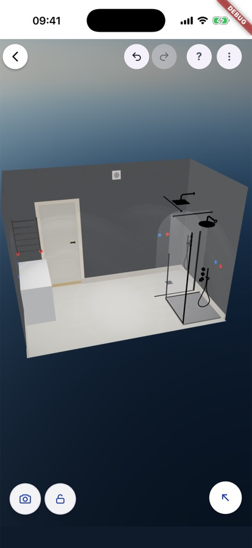
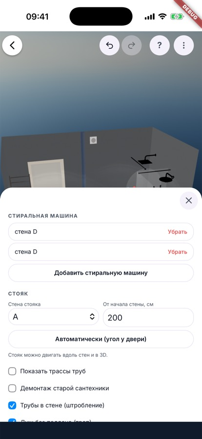
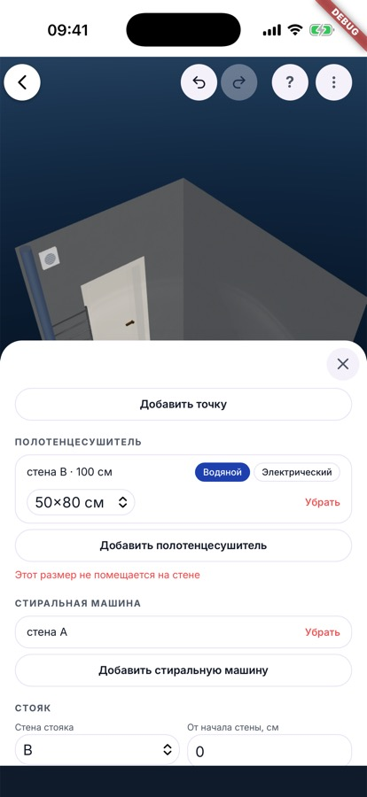
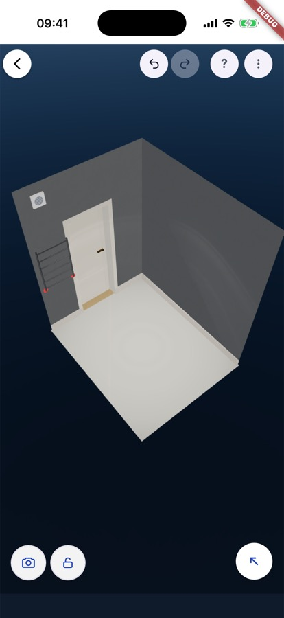
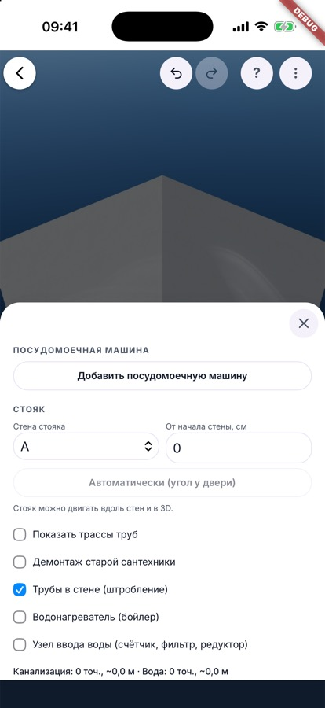

# Santexnika tuzatishlari va qolgan bandlar: mobil qayta tekshiruv (2026-11-16)

Nimani tekshirdik: andoza_ai_mobile #63 dagi uchta ro'yxat:
- issue tavsifining 3-bandi (o'tgan safar tekshirilmay qolganlar);
- #298 bo'yicha izoh;
- #299 bo'yicha izoh.

Shu bilan birga ilovadagi #64 (ustada "Xona turi") ham ko'rildi.

**Muhit:**
- Qurilma: faqat iOS Simulator, iPhone 17 Pro. Haqiqiy telefon va Android ishlatilmadi.
- Ilova: andoza_ai_mobile `main` (`2a40e73`, #64 bilan), debug build.
- Server: production `andozaai.uz` (#298 `60f7722e` va #299 `a72d4cc1` deploy qilingan).
- Til: Русский.
- Admin bandi: kompyuterdagi Chrome, admin hisobi.

> ⭐ bandlar haqiqiy telefonda emas, simulyatorda ko'rildi.

**Sinov xonalari.** Yangi usta orqali yaratildi va keyingi tekshiruvlar uchun saqlab qo'yildi. Har biri alohida loyiha "Mening uyim", 16.11.2026:

| Xona | Tur | O'lcham | Ichida |
|---|---|---|---|
| Katta hammom | Ванная | 4.0 × 2.3 m (9.2 m²), shift 2.8 m | A devorda 80 sm eshik, ikki dush, ikki kir yuvish mashinasi, sochiq quritgich 50×80, ventilyator. Trap belgisi oxirida o'chirildi |
| Tor hammom | Ванная | 2.5 × 2.0 m | B devorda (2 m) 70 sm eshik, bitta mashina, sochiq quritgich 50×80 |
| Yotoqxona | Спальня | 4.0 × 3.5 m | bo'sh |

## Qisqacha

| Ro'yxat | Natija |
|---|---|
| #64 ustada xona turi | ✅ tur tanlanadi, o'lcham turga moslashadi, Studio xonani to'g'ri tanidi |
| #298 sochiq quritgich eshik ramkasida emas | ✅ keng va tor devorda ham ramka ustiga chiqmaydi |
| #298 panel yopilganda Santexnika belgilari yo'qoladi | ✅ dush zonasining ko'k chiziqlari yo'qoladi. Qizil mashina qismi tekshirilmadi |
| #298 admin "Narxlar"da rad etilgan qiymat | ✅ eski qiymat qaytadi |
| #299 stoyak eshik oldida emas | ✅ maydonga eshik o'rtasi kiritilganda stoyak eshik yonida turadi. ⚠️ maydonda kiritilgan qiymat qoladi |
| 3-band: #279 ikki mashina | ✅ rozetka 2 dona, kabel 6 m, ish 2 dona |
| 3-band: #283 ikki dush, trap o'chirilsa | ✅ maydonlar qo'shiladi, panjara yo'qoladi. Dushni surish yoki burish tekshirilmadi |
| 3-band: #285 Ø125, hammom bo'lmagan xona | ✅ |
| 3-band: #287 tor devor | ✅ "Этот размер не помещается на стене". Suv nuqtalari oralig'i va chetga surilish tekshirilmadi |
| 3-band: #289 sochiq quritgich va mebel | tekshirilmadi |
| 3-band: #296 admin bo'lmagan akkaunt | tekshirilmadi (boshqa hisob bilan kirilmadi) |
| Uch tildagi PDF | tekshirilmadi |

**Yangi topilmalar:**
1. **Ikkinchi dush birinchisining ustiga tushadi.** Katta hammomda "Душ 1" va "Душ 2" ketma-ket qo'shilganda ikkalasi bir burchakka, bir-birining ustiga tushdi.
2. **Stoyak maydoni haqiqiy joyni ko'rsatmaydi (#299).** "От начала стены"ga 200 kiritildi (eshik o'rtasi). 3D'da stoyak to'g'ri, eshik yonida turibdi, lekin maydonda 200 qolaveradi.
3. **Ustada eshik o'lchami "sm" (ilova, #64 bilan bog'liq emas).** Ruscha interfeysda eshik "80×205 sm", "70×200 sm" deb chiqadi, "см" bo'lishi kerak.
4. **Xona va loyiha nomi turga qarab o'zgarmaydi (ilova).** Usta xonani "Mehmonxona ta'miri" (`roomSetupDefaultProjectName`), loyihani "Mening uyim" deb saqlaydi. Hammomning nomi ham "Mehmonxona ta'miri" bo'lib qoladi. Studio endi turni nomdan emas, `room_type` dan oladi, shuning uchun bu faqat ko'rinishga ta'sir qiladi.
5. **"Мои проекты" yangilanmaydi (ilova).** Usta orqali yaratilgan loyiha ro'yxatda pastga tortib yangilamaguncha ko'rinmadi.
6. **Admin "Narxlar" tarjima qilinmagan.** Sayt ruscha bo'lsa ham narx nomlari, guruhlari va birliklari o'zbekcha ("Kanalizatsiya quvuri Ø50", "so'm/m"). Faqat sarlavha, "исходно" va xato matni ruscha.

## #64: ustada "Xona turi"

| Band | Natija |
|---|---|
| Birinchi qadamda "Какая комната?" va 7 tur (Гостиная, Спальня, Детская, Кухня, Кабинет, Ванная, Балкон), ostida shift balandligi | ✅ ⭐ |
| "Ванная" → A 2.5 m, B 2.0 m | ✅ |
| "Спальня" → A 4.0 m, B 3.5 m | ✅ |
| Qo'lda o'zgartirilgan devor o'lchami saqlanadi | ✅ A 4.0 va B 2.3 qilindi, saqlandi (9.2 m²) |
| Studio xonani turi bo'yicha taniydi | ✅ nomi "Mehmonxona ta'miri" bo'lgan hammomda Santexnika panelida sochiq quritgich va kir yuvish mashinasi bo'limlari bor. Yotoqxonada aylanma menyuda "Сантехника" yo'q |

## #298 qayta tekshiruvi

| Band | Natija |
|---|---|
| Eshikli devorga qo'shilgan sochiq quritgich ramka ustiga chiqmaydi | ✅ ⭐ 4 m devorda (80 sm eshik) sochiq quritgich eshikning chap tomonida, ramkaga tegmaydi (rasm 1). 2 m devorda (70 sm eshik) ramkaga yonma-yon turadi, ustiga chiqmaydi (rasm 4) |
| Kir yuvish mashinasi ramkadan uzoq | ✅ katta hammomda ikkala mashina eshiksiz devorda. Tor hammomda mashina eshiksiz A devorga qo'yildi |
| Panel yopilgach mashinaning qizil rangi yo'qoladi | tekshirilmadi (mebel mashinaga tegib turgan holat qilinmadi) |
| Panel yopilgach dush zonasining ko'k chiziqlari yo'qoladi | ✅ ⭐ Santexnika paneli yopilgandan keyin ko'k chiziqlar yo'q, panjara qoladi |
| Admin "Narxlar": 0 kiritilsa xato, maydonda eski qiymat | ✅ "Uchlik Ø20": 0 kiritildi → "должно быть больше 0", maydonda 3000 qaytdi, "Последние изменения"ga yozuv tushmadi |

## #299 qayta tekshiruvi

| Band | Natija |
|---|---|
| "От начала стены"ga eshik oldiga tushadigan qiymat | ✅ ⭐ A devor 4 m, eshik o'rtada; 200 kiritildi → stoyak eshik ramkasining o'ng yonida turadi (rasm 2). ⚠️ Maydonda 200 qoladi (2-topilma) |
| 3D'da eshik tomonga sudrash | tekshirilmadi: simulyatorda stoyakni sudrab bo'lmadi |
| Deraza ostiga stoyak | tekshirilmadi (derazali xona yo'q edi) |
| Ventilyator stoyak bilan birga | ✅ ventilyator stoyak yonida, eshikning o'ng tomonida |

Kuzatish: endi stoyak faqat Santexnika paneli ochiq paytda ko'rinadi. Panel yopiq bo'lsa, ko'k quvur 3D'da yo'q.

## 3-band: o'tgan safar tekshirilmay qolganlar

| Band | Natija |
|---|---|
| #279 ikki mashina → rozetka 2 dona, kabel 6 m, ish 2 dona | ✅ "Розетка для стиральной машины (IP44)" 2 шт. × 70 000. "Электрокабель (стиральная машина)" 6 м × 9 500 = 57 000. "Работа: установка розетки…" 2 шт. × 50 000. Kran va sifon ham 2 dona |
| #283 ikki dushda maydonlar qo'shiladi | ✅ "Работа: уклон душевой зоны к трапу": `0.88 + 1.00 = 1.88 м² × 150 000` = 282 000. Styajka 5 qop. Trap 2 dona |
| #283 belgi o'chirilganda 3D'da panjara yo'qoladi | ✅ ⭐ |
| #283 dush surilganda yoki burilganda panjara va zona birga ketadi | tekshirilmadi |
| #285 ~6.1 m² dan katta hammomda Ø125 | ✅ "Вытяжной вентилятор Ø125" 260 000, `9.20 м² × 2.80 м = 25.8 м³ × 6 = 155 м³/ч → Ø125` |
| #285 hammom bo'lmagan xonada ventilyator yo'q | ✅ yotoqxona smetasida faqat elektr kabeli bor |
| #287 tor devorda "Bu o'lcham devorga sig'maydi" | ✅ tor hammomda 60×100 tanlanganda "Этот размер не помещается на стене", o'lcham 50×80 da qoldi (rasm 3) |
| #287 suv nuqtalari oralig'i 50/60 sm, chetdagi sochiq quritgich ichkariga suriladi | tekshirilmadi |
| #287 50×80 narxi | ✅ "Полотенцесушитель (50×80)" 650 000 |
| #289 sochiq quritgich past va baland mebel; yozuv rus va ingliz tilida | tekshirilmadi |
| #296 admin bo'lmagan akkauntda "Narxlar" yo'q | tekshirilmadi |
| Uch tildagi PDF | tekshirilmadi |

## Qolganlar

Keyingi tekshiruvda, iloji bo'lsa, haqiqiy telefonda:
- mebelga tegib turgan mashina panel yopilganda qizil rangini yo'qotishi;
- #289 sochiq quritgich bandlari;
- stoyakni 3D'da sudrash va deraza osti;
- dushni surish yoki burish;
- suv nuqtalari oralig'i;
- uch tildagi PDF;
- admin bo'lmagan akkaunt.

## Qo'shimcha: deploydan keyin Studio yangi versiyaga o'tadimi (#63 2-band, #300)

Haqiqiy frontend deploy kutildi: #302 (idish yuvish mashinasi), `7f1a347a`. Prod'dagi asosiy JS fayli `index-MIhg6QM9.js` dan `index-2Gtnxr2M.js` ga almashdi.

Oldinroq hujjatning o'zi (#301) deploy qilinganda fayl nomi o'zgarmagan edi. Build'ga commit belgisi kiritilmaydi, shuning uchun bunday deploy versiyani almashtirmaydi.

| Band | Natija |
|---|---|
| Deploydan oldin Studio ochilib, ilova fonga yuborildi; deploydan keyin ilova qaytarildi | ✅ ilova qayta ishga tushmadi (PID o'sha), sahifa o'zi qayta yuklandi. Logda: `StudioWebView: new web build deployed, reloading the page` |
| Versiya o'zgarmagan deploydan keyin (#301) qaytish | ✅ qayta yuklanmadi |
| Qayta yuklangandan keyin yana fonga yuborib qaytish | ✅ ikkinchi marta qayta yuklanmadi |
| Deploydan keyin yangi ochilgan Studio darhol yangi versiyada (#300) | ✅ yangi oshxona xonasida Santexnika panelida "Посудомоечная машина" bo'limi bor (#302 yangiligi) |
| Prod `sw.js` | ✅ `index.html` keshga olinmaydi, navigatsiya `NetworkFirst` (4 s), `sw.js` o'zi `no-cache` |

Yangi sinov xonasi: oshxona, "Кухня" turi, 3.0 × 3.0 m (usta turga mos o'lchamni berdi).

