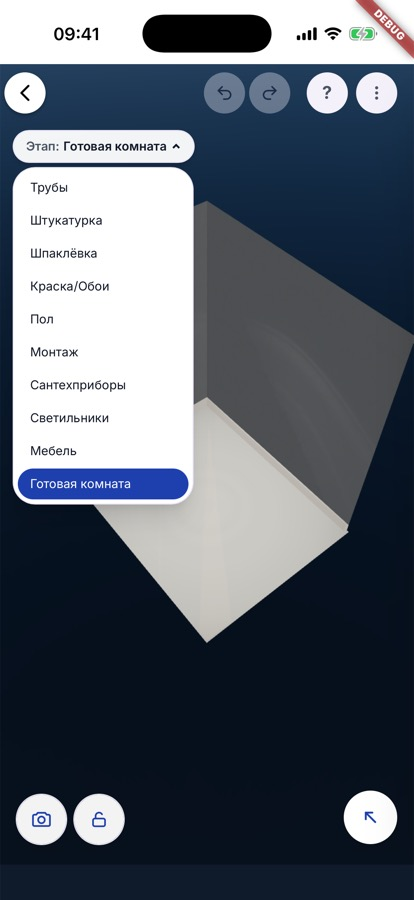
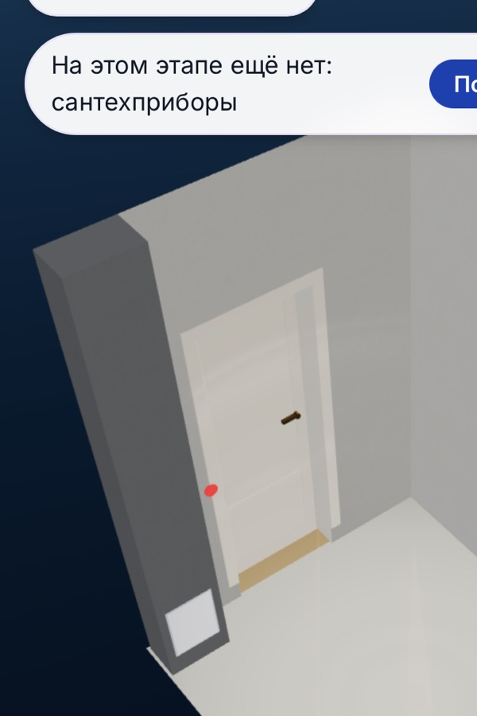
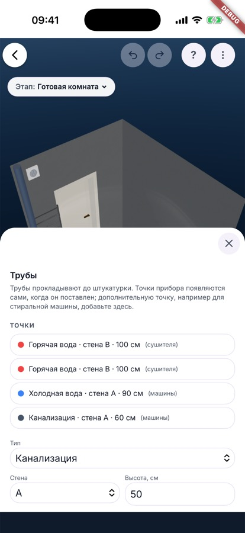
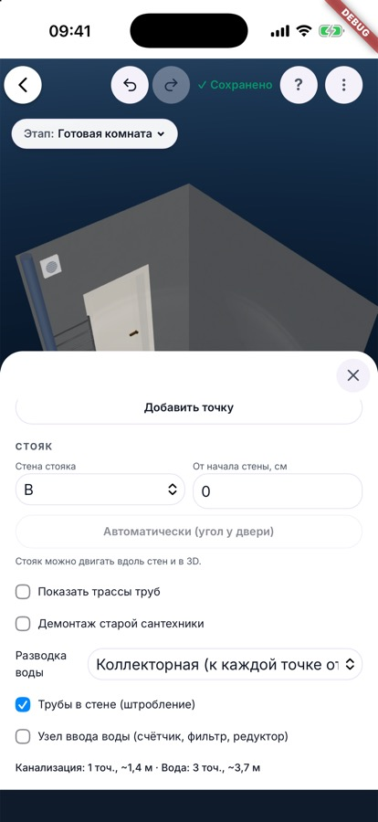
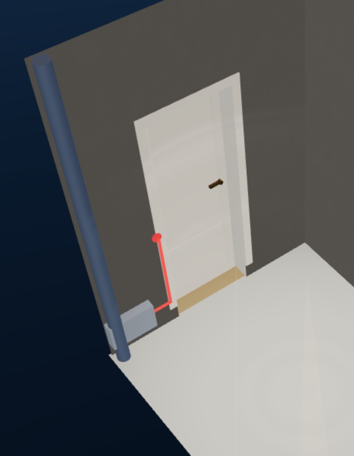
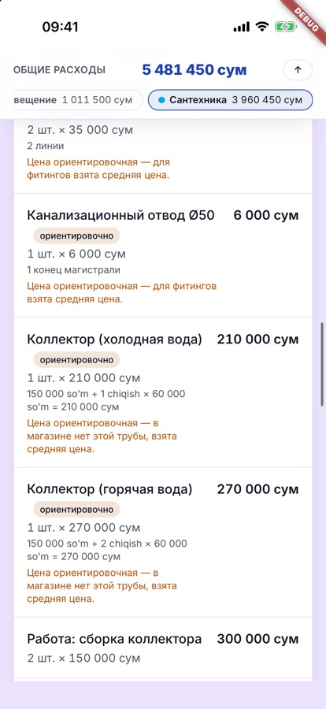

# Bosqichlar, kollektor va santexnika yangiliklari: mobil tekshiruv natijasi (2026-11-18)

Nimani tekshirdik: andoza_ai_mobile #63 dagi 2026-11-17/18 izohlari (andoza_ai #302, #306, #307, #308, #309, #310, #311/#312, #313). #314 ("(shishali)" dush) tekshiruv paytida prodga chiqdi, u #309 bandlarida eslatildi.

**Muhit:**
- Qurilma: faqat iOS Simulator, iPhone 17 Pro (402×874). Haqiqiy telefon va Android ishlatilmadi.
- Ilova: andoza_ai_mobile `main` (`2a40e73`), debug build.
- Server: production `andozaai.uz`, `d42f9e16` (#313) deploy qilingan. #314 (`79dab722`) keyinroq chiqdi, alohida tekshirilmadi.
- Til: Русский. O'zbek va ingliz tili tekshirilmadi (pastda sababi).
- Sinov xonalari (16.11.2026, "Mening uyim"): katta hammom 4.0 × 2.3 m (ikki dush, ikki mashina, sochiq quritgich, ventilyator), tor hammom 2.5 × 2.0 m (mashina, sochiq quritgich), yotoqxona 4.0 × 3.5 m.

> ⭐ bandlar haqiqiy telefonda emas, simulyatorda ko'rildi.

## Asosiy topilma: telefonda Jihozlar va Pol panellari ochilmaydi

#311 dan keyin telefonda faqat **Quvurlar** paneli ochiladi. **Jihozlar** paneliga ham, **Pol** bosqichining paneliga ham yo'l yo'q:
- Aylanma menyu → "Сантехприборы" → "Добавить ..." **Quvurlar** panelini ochadi (`useArcCategories.tsx`: `openPanelAt('quvurlar')`).
- Yuqoridagi "Этап: …" tugmasidan bosqich tanlansa, faqat 3D o'zgaradi, panel ochilmaydi (`ThreeDPage.tsx` `pickStage` → `setActivePhase` + `setViewStage`, `setShowPanel` yo'q).
- Telefonda panelni ochadigan joy faqat ikkita: `openPanelAt` (bo'yoq, chiroq, mebel, quvurlar, jihozlar ro'yxati bor, lekin `'jihozlar'` bilan hech kim chaqirmaydi) va devor menyusidagi bo'yoq paneli. `'pol'` uchun umuman yo'q.
- Simulyatorda: "Сантехприборы" bosqichida, vannani bosib va menyularni ko'rib, Jihozlar paneliga kirib bo'lmadi.

Natijada telefonda quyidagilar **qilib bo'lmaydi**: sochiq quritgich, kir yuvish va idish yuvish mashinasini qo'shish/o'zgartirish, boyler katagi (#308), vanna/dush to'sig'i (#309), bo'sh joy ogohlantirishlarini ko'rish (#310), issiq pol katagi (#307). Shu sabab bu bandlar pastda "❌ (bloklangan)" yoki "tekshirilmadi" deb belgilandi.

## Qisqacha

| Ro'yxat | Natija |
|---|---|
| #302 idish yuvish mashinasi (qolgan bandlar) | ❌ telefonda Jihozlar paneli yo'q: mashina qo'shib, enini almashtirib, "sig'maydi" va "mebelga tegib turibdi" yozuvini ko'rib bo'lmaydi. ru/en va PDF tekshirilmadi |
| #306 suv nuqtalari SNiP balandligida | ✅ yangi qo'yilgan vanna 80 sm, dush 120 sm; mashina va sochiq quritgich o'zgarmagan. ⚠️ eski xonada jihoz o'zgarmaguncha eski 105 sm qoladi |
| #307 issiq pol | ❌ telefonda Pol paneli ochilmaydi, katakni ko'rib bo'lmaydi |
| #308 stoyak qutisi, boyler, osma unitaz | ✅ quti va lyuk, Quvurlar bosqichida quvur. ⚠️ Shpaklovka bosqichida quti qora qoladi. Boyler ❌ (Jihozlar paneli yo'q). Osma unitaz tekshirilmadi |
| #309 vanna/dush to'sig'i | ❌ tanlovi Jihozlar panelida, telefonda ochilmaydi |
| #310 bo'sh joy ogohlantirishi | ❌ yozuv Jihozlar panelida, telefonda ko'rinmaydi |
| #311/#312 bosqichlar va 3D 0→100% | ✅ ko'pchilik bandlar. ❌ devor menyusidan rang tanlanganda 3D tayyor xonaga qaytmaydi. ❌ Jihozlar paneli (yuqorida) |
| #313 kollektor | ✅ tanlov, metr, 3D quti, smeta qatorlari, qaytarish. ❌ ruscha smetada formula o'zbekcha ("so'm", "chiqish") |

## Topilmalar

1. **Telefonda Jihozlar va Pol panellari ochilmaydi** (yuqorida batafsil). Eng muhim topilma: #302, #307, #308 (boyler), #309, #310 telefonda ishlatib bo'lmaydi. Taklif: "Сантехприборы" halqasining oxirgi tugmasi Jihozlarni ochsin (yoki ikki tugma: "Трубы" va "Приборы"); bosqich ro'yxatidan tanlanganda shu bosqichning paneli ham ochilsin (yoki 3D ustida "Panel" tugmasi).
2. **Ruscha smetada kollektor formulasi o'zbekcha (#313).** "Коллектор (холодная вода)": `150 000 so'm + 1 chiqish × 60 000 so'm = 210 000 сум`. Yana: kollektor qatori ostida "в магазине нет этой трубы" (kollektor quvur emas). Rasm 6.
3. **Eski xonada dush nuqtalari 105 sm qoladi (#306).** Katta hammom (16.11 da yaratilgan) ochilganda Quvurlar panelida dush nuqtalari "105 см (от прибора)". Xonaga vanna qo'shilgach, hamma jihozlarning nuqtalari qayta hisoblandi: dush 120 sm, vanna 80 sm. Sabab: `withFixturePoints` faqat mebel o'zgarganda chaqiriladi. Smeta ham saqlangan nuqtalarni olgani uchun eski xona smetasi eski balandlikda qolishi mumkin.
4. **Shpaklovka bosqichida stoyak qutisi qora (#308/#312).** Devorlar oq-kulrang (shpaklovka), quti esa tayyor devor rangida (to'q kulrang) qoladi. Suvoq va Bo'yoq bosqichlarida devor ham to'q bo'lgani uchun bilinmaydi. Rasm 2.
5. **Devor menyusidan rang tanlanganda 3D bosqichda qoladi (#312).** "Трубы" bosqichida devorni bosib "Цвет" → "Светло-серый" tanlandi: saqlandi, lekin yuqorida "Этап: Трубы" qoldi va devor yalang'och ko'rinishda qoldi. "Сантехприборы" bosqichida ham shunday. Ro'yxatda "3D tayyor xonaga qaytadi" deyilgan.
6. **"Мои проекты" ro'yxatida kartochka rasmi yo'q (ilova).** Profil → Мои проекты kartochkalarida faqat 3D belgisi turadi, Bosh sahifada esa shu loyihalarning rasmi bor. Bosh sahifadagi katta hammom rasmi tayyor xonani ko'rsatadi.
7. **O'chirish menyusida nom lotincha.** Ruscha interfeysda vannani bosib turilganda menyuda "Vanna 3" (tooltipda "Ванна 3").

## #313: kollektor sxemasi (tor hammom)

| Band | Natija |
|---|---|
| "Разводка воды": Тройниковая / Коллекторная, boshida Тройниковая | ✅ (rasm 3, 4) |
| Kollektor tanlansa "Вода: … м" ko'payadi | ✅ ~3,6 m → ~3,7 m |
| Quvur yo'llari yoqilganda har nuqtaga alohida quvur va kulrang kollektor qutisi | ✅ ⭐ "Трубы" bosqichida stoyak yonida kulrang quti, undan sochiq quritgich nuqtasiga alohida qizil quvur (rasm 5). Quvur yo'llari faqat panel ochiq paytda yoki Quvurlar bosqichida ko'rinadi |
| Smetada "Коллектор (холодная вода)", "(горячая вода)", "Работа: сборка коллектора", troynik yo'q | ✅ 210 000, 270 000, 2 × 150 000 = 300 000. Сантехника qatorlarida "Тройник PPR Ø20" yo'q. ❌ formula o'zbekcha (2-topilma) |
| Uchlikka qaytarilsa smeta avvalgiga qaytadi | ✅ jami 5 481 450 → 4 698 250 so'm, "Вода" ~3,6 m |
| uz/ru/en tarjima | ⚠️ panel ruscha to'g'ri; smeta formulasi ruscha emas. uz/en tekshirilmadi |

## #311/#312: bosqichlar va 3D 0→100%

| Band | Natija |
|---|---|
| Hammom tayyor xona holatida ochiladi, yuqori chapda "Этап: Готовая комната ▾" | ✅ ⭐ |
| Ro'yxatda Трубы, Штукатурка, Шпаклёвка, Краска/Обои, Пол, Монтаж, Сантехприборы, Светильники, Мебель, Готовая комната | ✅ (rasm 1) |
| Трубы: devor yalang'och, faqat nuqtalar, jihoz yo'q | ✅ ⭐ dush, vanna, mashina, sochiq quritgich, ventilyator yo'q; devor kulrang-jigarrang; nuqtalar va stoyak quvuri bor. Pol och rangda (yalang'och ekani aniq bilinmadi) |
| Banner "На этом этапе ещё нет: сантехприборы" va "Показать готовую комнату" | ✅ tugma 100% holatga qaytaradi |
| Штукатурка / Шпаклёвка | ✅ ⭐ Shpaklovkada devor oqish. ⚠️ quti qora (4-topilma) |
| Краска/Обои: bo'yoq chiqadi, pol hali yalang'och | ✅ bo'yoq chiqdi. Pol farqi bilinmadi (xonada pol tanlanmagan) |
| Пол / Монтаж | tekshirilmadi to'liq: xonada pol qoplamasi va rozetka yo'q, farq ko'rinmadi |
| Сантехприборы: jihozlar chiqadi | ✅ ⭐ ikki dush, ikki mashina, sochiq quritgich, ventilyator |
| Светильники / Мебель | tekshirilmadi (xonada chiroq va mebel yo'q) |
| Bosqichlardan keyin hech narsa o'chmagan | ✅ Tayyor xonaga qaytganda hammasi joyida |
| Devor menyusidan rang → 3D tayyor xonaga qaytadi | ❌ (5-topilma). Rang undo bilan qaytarildi |
| Kameralar yoki 360: 3D doim tayyor xona | ✅ "Трубы" bosqichidan "Камера 1" tanlanganda "Готовая комната" bo'ldi. Render ishga tushirilmadi |
| Quvurlar panelida nuqtalar, stoyak, quvur yo'llari, devor ichidagi quvurlar, buzish, suv kirish uzeli, yig'indi | ✅ hammasi bor (+ "Разводка воды"). Pol trapi tor hammomda dush yo'qligi uchun ko'rinmadi |
| Jihozlar paneli tarkibi | ❌ telefonda ochilmaydi (1-topilma) |
| Ikkala panel pastdan to'liq kenglikda | ✅ Quvurlar paneli pastdan to'liq kenglikda. Jihozlar: ochib bo'lmadi |
| Yotoqxonada Quvurlar va Jihozlar yo'q | ✅ ro'yxatda faqat Штукатурка … Мебель, Готовая комната; halqada "Сантехника" yo'q |
| Loyihalar ro'yxatidagi rasm tayyor xonani ko'rsatadi | ⚠️ Bosh sahifada rasm tayyor xona; yangilangani aniqlanmadi. "Мои проекты"da rasm umuman yo'q (6-topilma) |

Telefon jamoasiga savol bo'yicha: ilova studiyani `?phase=` bilan ochmaydi (`lib/` da `phase=` yo'q), bosqichlar ro'yxatiga tayanmaydi.

## #306: suv nuqtalari SNiP balandligida

| Band | Natija |
|---|---|
| Vanna nuqtalari 80 sm | ✅ katta hammomga "Ванна 3" qo'yildi: "Холодная/Горячая вода · стена C · 80 см", kanalizatsiya 15 sm. Keyin vanna o'chirildi |
| Dush nuqtalari 120 sm | ✅ vanna qo'shilgandan keyin ikkala dush "120 см". ⚠️ undan oldin 105 sm (3-topilma) |
| Oralig'i 15 sm | tekshirilmadi (panelda faqat balandlik ko'rinadi) |
| Mashina, sochiq quritgich o'zgarmagan | ✅ mashina 90/60 sm, sochiq quritgich 100 sm. Rakovina, unitaz, idish mashinasi bu safar ko'rilmadi |
| Smetada quvur metri biroz oshadi | tekshirilmadi |
| Eski xonani ochganda yangi balandlik | ❌ eski xona ochilganda 105 sm (3-topilma) |

## #308: stoyak qutisi, boyler, osma unitaz

| Band | Natija |
|---|---|
| Boshqa bosqichda stoyak o'rnida devor rangidagi quti, pastida oq lyuk | ✅ ⭐ katta va tor hammomda, shiftgacha, pastida oq lyuk. ⚠️ Shpaklovkada qora (rasm 2) |
| Quvurlar bosqichida kulrang quvur | ✅ ⭐ ko'k-kulrang quvur, quti yo'q |
| Boyler katagi | ❌ Jihozlar panelida, telefonda ochilmaydi |
| Osma unitaz qutisi | tekshirilmadi |
| Render | tekshirilmadi |
| Kamera devor orqasiga o'tganda quti yashirinadi | tekshirilmadi alohida (devor kesilgan ko'rinishda quti ko'rinmadi, lekin ataylab tekshirilmadi) |

## #302, #307, #309, #310

| Ro'yxat | Band | Natija |
|---|---|---|
| #302 | Sig'maydigan en, mebelga tegish, undo, kir mashinasi ro'yxati | ❌ Jihozlar paneli telefonda yo'q, mashina qo'shib ham bo'lmaydi |
| #302 | ru/en panel va smeta, PDF | tekshirilmadi: idish mashinali oshxona ro'yxatlarda topilmadi, yangisiga mashina qo'shib bo'lmaydi |
| #307 | Pol bosqichida "Issiq pol" katagi | ❌ telefonda Pol paneli ochilmaydi. Yotoqxonada ham yo'q (umuman panel yo'q). Smeta qatorlari tekshirilmadi |
| #309 | Vanna/dush to'sig'i tanlovi, 3D, smeta | ❌ tanlov Jihozlar panelida. Katta hammomdagi "Душ 1 (shisha)" o'z shishasi bilan chiqadi (#314 mavzusi), alohida tekshirilmadi |
| #310 | Bo'sh joy ogohlantirishi | ❌ yozuv Jihozlar panelida, telefonda ko'rinmaydi. Mebelni yaqin qo'yib sinab ko'rilmadi |

## Xonalar holati

- Tor hammom: "Разводка воды" Тройниковая ga qaytarildi, "Показать трассы труб" o'chirildi. Smeta 4 698 250 so'm (kollektorsiz).
- Katta hammom: qo'shilgan vanna o'chirildi, A devor rangi undo bilan qaytarildi. Dush nuqtalari endi 120 sm (vanna qo'shilganda qayta hisoblandi, bu #306 bo'yicha to'g'ri balandlik).
- Yotoqxona: o'zgartirilmadi.
- "Hammom namunasi" ochilmadi.

## Tekshirilmaganlar

- O'zbek va ingliz tili, uchala tildagi PDF: Jihozlar paneli ochilmagani uchun tarjima qilinadigan yangi matnlarning ko'pi telefonda ko'rinmaydi; vaqt shu blokni aniqlashga ketdi.
- Render (#308, #309, #312).
- Osma unitaz, boyler, to'siqlar, ogohlantirishlar, issiq pol: 1-topilma tuzatilgandan keyin qayta tekshirish kerak.
