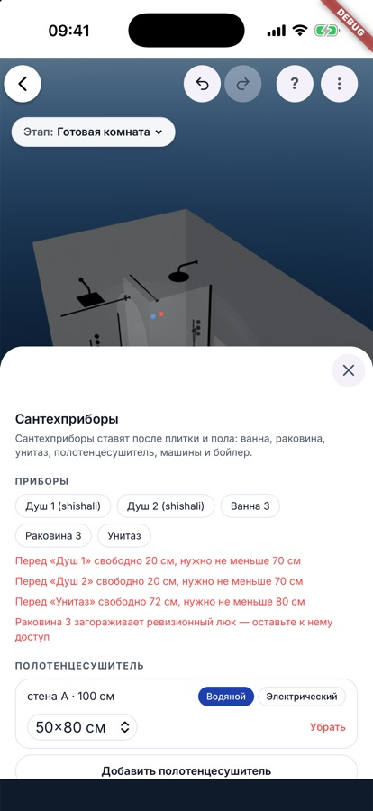
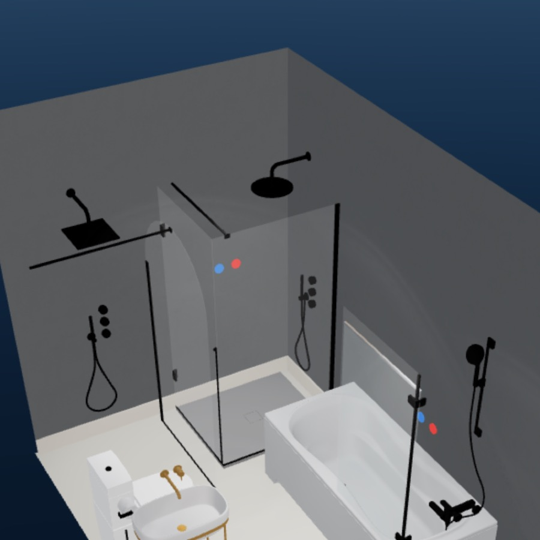
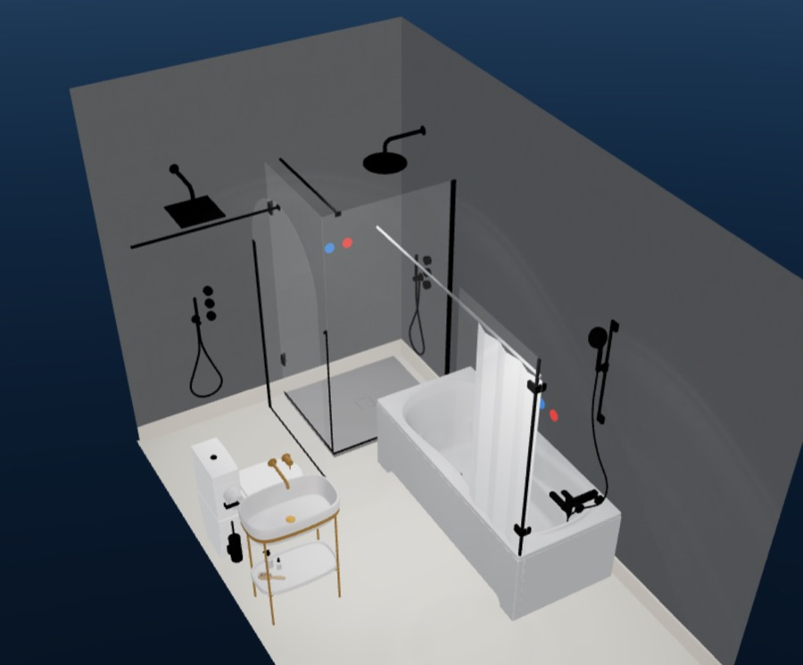
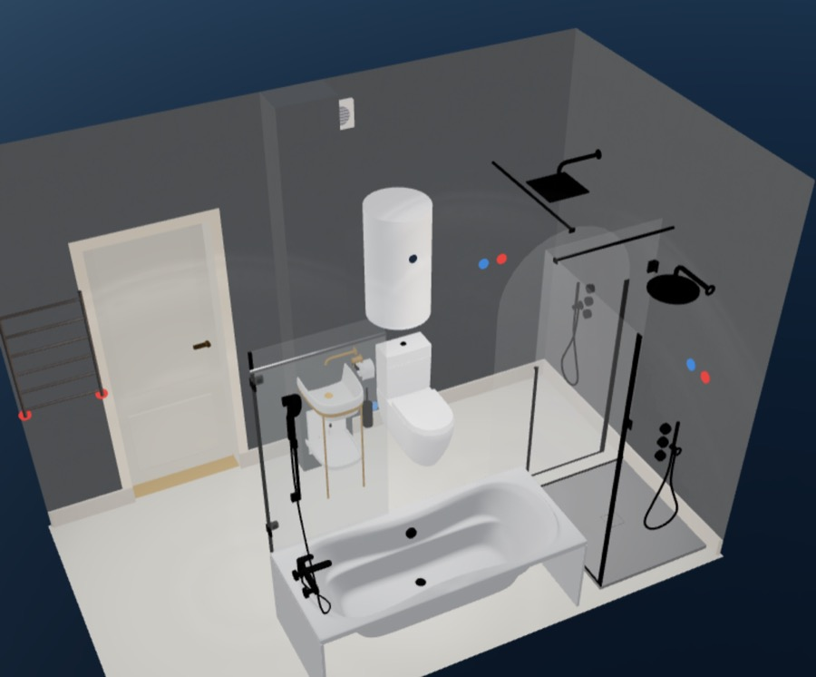
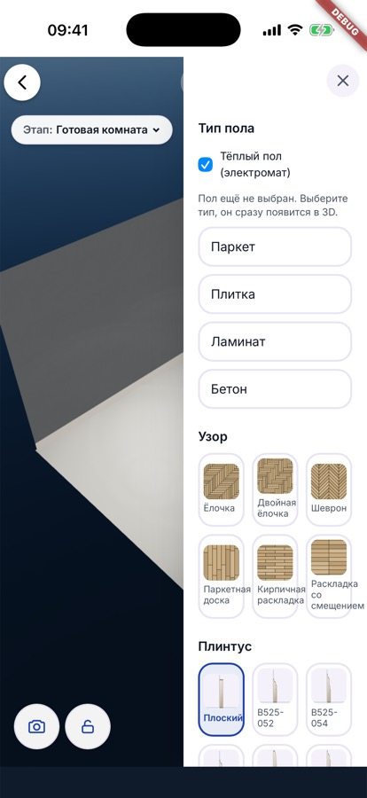
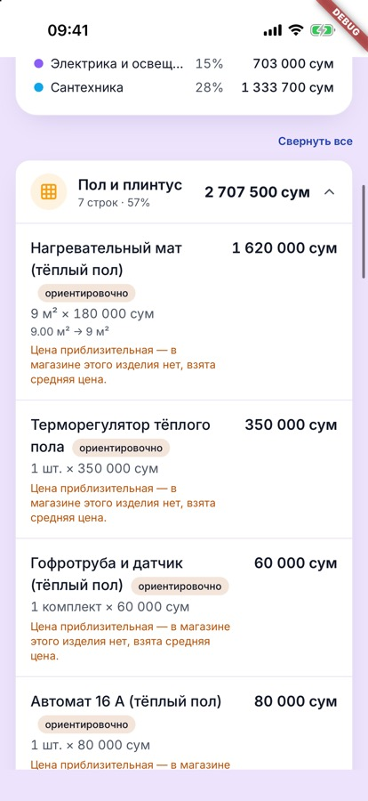
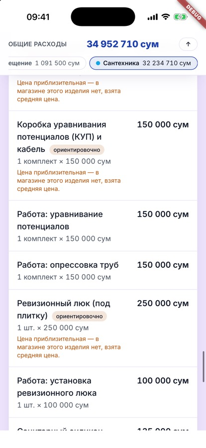
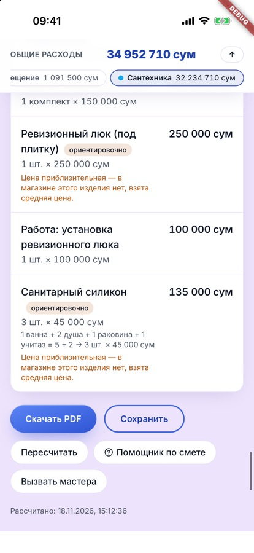
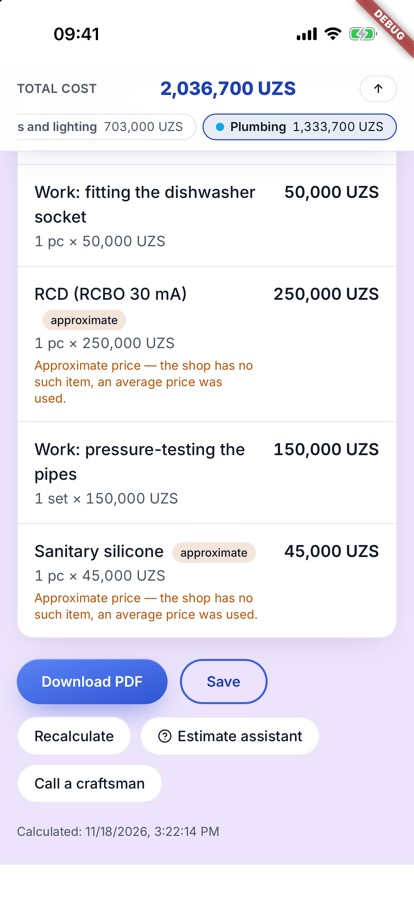

# Jihozlar va Pol panellari (#317) va bloklangan bandlar: mobil qayta tekshiruv (2026-11-18)

Bu #315 (`2026-11-18-bosqichlar-santexnika-mobil-natija.md`) ning davomi. U yerda telefonda Jihozlar va Pol panellari ochilmagani uchun bir qator bandlar bloklangan edi. andoza_ai #317 prodga chiqqandan keyin shu bandlar qayta tekshirildi.

**Muhit:**
- Qurilma: faqat iOS Simulator, iPhone 17 Pro (402×874). Haqiqiy telefon va Android ishlatilmadi.
- Ilova: andoza_ai_mobile `main` (`2a40e73`), debug build.
- Server: production `andozaai.uz`, #317 deploy qilingan (`index-DtMCIrYD.js`). Studio yopib, qayta ochildi.
- Til: asosan Русский; ingliz va o'zbek tilida qisqa tekshiruv. Oxirida til yana Русский qilib qo'yildi.
- Admin bandi: kompyuterdagi Chrome, admin hisobi, faqat o'qildi.
- Xonalar: oshxona 3.0 × 3.0 m (45 sm idish yuvish mashinasi), katta hammom 4.0 × 2.3 m (ikki "Dush (shishali)", ikki kir yuvish mashinasi, sochiq quritgich, ventilyator).

> ⭐ bandlar haqiqiy telefonda emas, simulyatorda ko'rildi.

## Qisqacha

| Ro'yxat | Natija |
|---|---|
| #317 halqadagi yangi tugmalar | ✅ "Панель приборов" Jihozlar panelini, "Панель пола" Pol panelini ochadi. ru, en ("Fixtures panel", "Floor panel"), uz ("Jihozlar paneli") |
| #302 idish yuvish mashinasi | ✅ qo'shish, olib tashlash, en 45/60, undo, kir mashinasi ro'yxati ta'sirlanmagan, smeta ru/en/uz. ⚠️ "sig'maydi" va "mebelga tegib turibdi" holatini hosil qilib bo'lmadi. ❌ PDF tugmasi javob bermadi |
| #307 issiq pol | ✅ oshxonada katak bor, 7 qator, 9 m² mat, saqlanadi, olib tashlansa qatorlar yo'qoladi, uz/ru/en |
| #308 boyler | ✅ ⭐ stoyak qutisi yonida oq silindr, eshik/vanna/dush ustiga tushmadi; smetada 4 qator. Osma unitaz: katalogda yo'q |
| #309 to'siqlar (+ #314) | ✅ "Ограждение ванны" Нет/Стекло/Шторка, 3D, smeta qatorlari, "Нет"ga qaytarildi. "(shishali)" dushga tanlov chiqmaydi, smesitel smetada bor. ⚠️ "Ванна 3" modelining o'zida shisha bor |
| #310 bo'sh joy ogohlantirishi | ✅ unitaz va dush uchun qizil yozuvlar chiqadi. Uzoqlashtirish va eshik bilan tekshirilmadi |
| #305 xavfsizlik qatorlari | ✅ hammomda 7 qator va silikon formulasi; oshxonada faqat UZO, opressovka, silikon. Admin "Narxlar"da guruh bor |
| #316 | ✅ "Раковина 3 загораживает ревизионный люк — оставьте к нему доступ". Osma unitaz: katalogda yo'q. Eshik va kollektor quvuri tekshirilmadi |
| #298 qizil mashina, #299 deraza ostida stoyak | tekshirilmadi |

## Topilmalar

1. **Studio smetasida "Скачать PDF" ishlamadi.** Oshxona smetasida (ru va uz) tugma 4 marta bosildi va har safar 10–12 s kutildi. Ulashish oynasi chiqmadi, ilova konteynerida yangi PDF paydo bo'lmadi (oxirgisi 15.11 dagi). Ilovada `webview_download.dart` bor, ya'ni avval ishlagan. Qayta tekshirish kerak, regressiya bo'lishi mumkin.
2. **"Ванна 3" modelining o'zida shisha panel bor, lekin "Ограждение ванны" taklif qilinadi.** "Стекло" yoki "Шторка" tanlanganda vannada ikkita to'siq ko'rinadi: modelning o'z shishasi (qora ramka) va yangi shisha yoki parda (rasm 2, 3). #314 dagi "(shishali)" dushlarga o'xshagan holat; smetada ham ortiqcha to'siq qatori chiqadi.
3. **Jihoz nomlari aralash tilda.** Ruscha panelda "Душ 1 (shishali)", o'chirish menyusida "Vanna 3", "Rakovina 3", "Unitaz".
4. **Yolg'iz "Душ 2" oldida 20 sm.** Vanna, rakovina va unitaz olib tashlangandan keyin ham "Перед «Душ 2» свободно 20 см, нужно не меньше 70 см" qoladi. Katta hammomda ikki dush yonma-yon turibdi, ehtimol birining oldi ikkinchisining shishasiga tegadi. Xato emasligi mumkin, faqat qayd etildi.
5. **#305 kichik:** inglizcha smetada "Branches 0.50 m × 60 000 UZS" (bo'shliq bilan), qolgan joylarda "60,000".

## #317: yangi tugmalar

| Band | Natija |
|---|---|
| Jihozlar halqasida "Панель приборов" | ✅ oshxonada va hammomda; Jihozlar paneli pastdan ochiladi |
| Pol halqasining oxirida "Панель пола" | ✅ Pol paneli o'ng yarimda ochiladi (rasm 5) |
| en / uz nomlari | ✅ "Fixtures panel", "Floor panel"; "Jihozlar paneli" (uz da Pol tugmasi ko'rilmadi) |
| Undo panel ochiq paytda | ⚠️ panel ochiqligida orqa fon bosilsa panel yopiladi, undo tugmasini panel yopilgandan keyin bosish kerak |

## #302: idish yuvish mashinasi (oshxona)

| Band | Natija |
|---|---|
| Panelda blok va qo'shish tugmasi | ✅ "ПОСУДОМОЕЧНАЯ МАШИНА", "стена А · 45 см · Убрать", "Добавить посудомоечную машину" |
| Qo'shish / olib tashlash | ✅ ikkinchi mashina D devorga 60 sm bilan qo'shildi, "Убрать" bilan olindi |
| En 45 → 60 → undo | ✅ 60 saqlandi, undo 45 ga qaytardi |
| "Этот размер не помещается" | tekshirilmadi: 3 m devorlarda joy yetarli, sig'maydigan holat hosil qilinmadi |
| Mebelga tegsa ogohlantirish va qizil rang | ⚠️ "Стеллаж Aurora" qo'yib, mashina tomonga suridi; 3D da old tomondan ustma-ust ko'rindi, lekin yozuv chiqmadi. Tegib turgani aniq tasdiqlanmadi. Stellaj o'chirildi |
| Kir mashinasi ro'yxatida idish mashinasi yo'q | ✅ "СТИРАЛЬНАЯ МАШИНА" bo'limida faqat qo'shish tugmasi; hammomdagi ikki mashina qatori o'zgarmagan (kran 2 × 60 000, ulash 2 × 150 000) |
| Smeta ru | ✅ kran 70 000, sifon 90 000, ulash 200 000, rozetka 70 000, kabel 3 m, rozetka ishi 50 000 |
| Smeta en | ✅ "Work: connecting the dishwasher", "Dishwasher socket (IP44)", "Electric cable (dishwasher)", "Work: fitting the dishwasher socket" (rasm 9) |
| Smeta uz | ✅ "Ish: idish yuvish mashinasi rozetkasini o'rnatish" va boshqalar |
| PDF | ❌ tugma javob bermadi (1-topilma) |

## #307: issiq pol (oshxona)

| Band | Natija |
|---|---|
| Oshxonada "Тёплый пол (электромат)" katagi, boshida belgilanmagan | ✅ |
| Yotoqxonada yo'q | tekshirilmadi bu safar (Pol paneli yotoqxonada ochilmadi) |
| Belgilansa "Пол и плинтус" da 7 qator | ✅ mat 9 m² × 180 000 = 1 620 000, termoregulyator 350 000, gofra va datchik 60 000, avtomat 16 A 80 000, kabel 5 m 47 500, mat yotqizish 9 m² × 50 000, termoregulyator o'rnatish 100 000 (rasm 6) |
| Mat maydoni | ✅ bo'sh 3 × 3 oshxonada "9.00 м² → 9 м²". Vanna/unitaz ayirilishi tekshirilmadi |
| Studio yopib ochilganda katak saqlangan | ✅ |
| Olib tashlansa qatorlar yo'qoladi | ✅ jami 4 744 200 → 2 036 700 |
| uz/ru/en | ✅ panel nomi uchala tilda ("Heated floor (electric mat)"). Smeta qatorlari faqat ruscha ko'rildi |

Oshxona smetasi: sessiya boshida 1 591 700 edi, endi 2 036 700. Farq 445 000 = #305 qatorlari (UZO 250 000 + opressovka 150 000 + silikon 45 000), mening o'zgarishim emas.

## #308 boyler, #309 to'siqlar, #314, #310, #316 (katta hammom)

Sinov uchun vaqtincha "Ванна 3", "Раковина 3" va "Унитаз" qo'yildi, keyin o'chirildi.

| Band | Natija |
|---|---|
| Boyler katagi → oq silindr stoyak devorida, qutidan keyin | ✅ ⭐ eshikli A devorda stoyak qutisining yonida, unitaz ustida; eshik, vanna, dush ustida emas (rasm 4) |
| Boyler smetada | ✅ boyler 1 800 000, ulash to'plami 120 000, kabel 5 m 47 500, o'rnatish 250 000 |
| Vanna bor xonada "Ограждение ванны": Нет / Стекло / Шторка, boshida Нет | ✅ |
| "(shishali)" dushlarga to'siq tanlovi yo'q (#314) | ✅ "Ограждение душа" chiqmadi |
| "(shishali)" dush smesiteli smetada (#314) | ✅ "Смеситель для душа" 2 × 550 000 |
| Poddonli/trapli dush → "Dush to'sig'i", Jaquar 16 250 000 | tekshirilmadi (katalogda poddonli dush yo'q, trap yoqilmadi) |
| Vanna + Стекло: 3D | ✅ ⭐ vanna chetida shisha panel (rasm 2). ⚠️ 2-topilma |
| Шторка: 2 m da tayoqcha, parda | ✅ ⭐ (rasm 3) |
| Smeta: shisha | ✅ "Шторка для ванны (стекло)" 1 200 000, "Работа: установка шторки на ванну" 150 000 |
| "Нет" tanlansa yo'qoladi | ✅ panelda "Нет"; 3D va smeta keyin alohida ko'rilmadi (vanna o'chirildi) |
| Render | tekshirilmadi |
| Unitaz oldida 80 sm dan kam → qizil yozuv | ✅ "Перед «Унитаз» свободно 72 см, нужно не меньше 80 см" (rasm 1) |
| Dush oldida 70 sm dan kam | ✅ "Перед «Душ 1/2» свободно 20 см, нужно не меньше 70 см" (4-topilma) |
| Uzoqlashtirsa yo'qoladi | ⚠️ vanna, rakovina, unitaz o'chirilgach unitaz va "Душ 1" yozuvi yo'qoldi, "Душ 2" qoldi. Surib tekshirilmadi |
| Gilam, hech narsa o'zi siljimaydi | tekshirilmadi / siljish kuzatilmadi |
| Lyuk oldida rakovina → ogohlantirish (#316) | ✅ "Раковина 3 загораживает ревизионный люк — оставьте к нему доступ" |
| Osma unitaz qutisi (#308, #316) | tekshirilmadi: prod katalogida nomida "osma" bo'lgan unitaz yo'q (faqat "Unitaz"; API `/api/v1/furniture` ham ko'rildi) |
| Eshik unitaz/vanna oldini kesadi (#316) | tekshirilmadi |
| Kollektor: stoyakdan kollektor qutisiga quvur (#316) | tekshirilmadi |

## #305: xavfsizlik va sinov qatorlari

| Band | Natija |
|---|---|
| Hammom: UZO 250 000 | ✅ "УЗО (дифавтомат 30 мА)" |
| Hammom: KUP va kabel 150 000, "Работа: уравнивание потенциалов" 150 000 | ✅ |
| Hammom: opressovka 150 000 | ✅ "Работа: опрессовка труб" 1 комплект |
| Hammom: revizion lyuk 250 000 + o'rnatish 100 000 | ✅ (rasm 7) |
| Silikon formulasi | ✅ vanna, rakovina, unitaz qo'yilganda "1 ванна + 2 душа + 1 раковина + 1 унитаз = 5 ÷ 2 → 3 шт. × 45 000" = 135 000 (rasm 8) |
| Oshxona: UZO, opressovka, silikon; KUP va lyuk yo'q | ✅ silikon "1 шт. × 45 000" (formulasiz) |
| Nuqtasiz xona o'zgarmagan | tekshirilmadi |
| en / uz | ✅ "RCD (RCBO 30 mA)", "Work: pressure-testing the pipes", "Sanitary silicone"; "UZO (difavtomat 30 mA)", "Ish: quvurlarni bosim bilan sinash (opressovka)", "Sanitariya silikoni" |
| Admin "Narxlar": "Santexnika: xavfsizlik va sinov" | ✅ UZO 250 000, KUP 150 000, potensiallar ishi 150 000, opressovka 150 000 so'm/xona, lyuk 250 000, lyuk ishi 100 000, silikon 45 000 so'm/tuba, "Bir tuba silikon necha buyumga" 2. Nomlar ruscha saytda ham o'zbekcha (#315 dagi eski topilma) |

## Xonalar holati

- Oshxona: idish mashinasi yana 45 sm, ikkinchi mashina va stellaj o'chirildi, issiq pol o'chirildi. Smeta 2 036 700 (farq faqat #305).
- Katta hammom: vanna, rakovina, unitaz o'chirildi; boyler o'chirildi; to'siq "Нет". Ventilyator belgisi joyida.
- Ilova tili yana Русский.

## Tekshirilmaganlar

- #298 (mebelga tegib turgan kir mashinasi panel yopilganda qizilligini yo'qotadi): mashinaga mebelni tekkizish simulyatorda ishonchli bo'lmadi, vaqt yetmadi.
- #299 (deraza ostida stoyak, 3D da sudrash): deraza qo'shish kerak edi, vaqt yetmadi.
- #316: eshik oldini kesib o'tishi, kollektor quvuri, osma unitaz (katalogda yo'q).
- Render (#308, #309).
- #302 "sig'maydi" holati.
- PDF uchala tilda (tugma ishlamadi).
- #319 (render/tayyor xonada nuqtalar ko'rinmasligi) bu tekshiruvga kirmagan. Tekshiruv paytida tayyor xonada suv nuqtalari (qizil/ko'k) hali ko'rinardi; #319 deploy bo'lganmi-yo'qmi aniqlanmadi.
