# Oshxona (#331, #332) va mobil tuzatishlar (#333): mobil tekshiruv (2026-11-18)

Tekshirilgan PR'lar:
- #331: oshxona moykasi, uning yonidagi idish yuvish mashinasi, «Вдоль стены, см» maydoni;
- #332: oshxona rozetkalari va smetadagi elektr qatorlari;
- #333: #330 dagi mobil topilmalarning tuzatishlari.

**Muhit:**
- Qurilma: faqat iOS Simulator, iPhone 17 Pro (402×874). Haqiqiy telefon va Android ishlatilmadi.
- Ilova: andoza_ai_mobile `fix/wizard-studio-quvurlar` debug build, prod'ga ulangan.
- Server: production `andozaai.uz`, oxirgi deploy `5a571c84` (completed/success), bundle `index-CRh3qfWD.js`.
  - Simulyator o'chiq edi; u qayta yoqildi va ilova qayta ishga tushirildi.
  - Tekshiruv paytida master `180caacf` (#336) ga o'tdi, lekin bundle o'zgarmadi.
- Til: Русский.
- «Рендер» ishlatilmadi.
- Xonalar:
  - Yangi oshxona 3.0 × 3.0 m (9 m²), 3D Master orqali yaratildi. Unda oshxona garnituri yo'q.
  - Bo'sh 2.5 × 2.0 hammom, sehrgar tekshiruvidan qolgan («Ремонт гостиной»). Unga unitaz va kir mashinasi qo'shildi.
  - 1.6 × 1.5 hammom, #330 dan qolgan. Undagi jihozlar o'chirilib, qayta qo'shildi.

> Barcha natijalar simulyatorda ko'rildi.

## Natijalar

| Band | Natija | Izoh |
|---|---|---|
| #331 Quvurlar panelida «Добавить мойку» tugmasi | ✅ | «МОЙКА» bo'limi bor, katalog bo'shligi haqida xabar yo'q. Rasm 2 |
| #331 moyka garnitur devoriga 3 ta suv nuqtasi bilan qo'yiladi | ✅ / ⚠️ | Moyka «стена A» ga qo'yildi. 3 nuqta chiqdi: holodnaya va goryachaya 55 sm, kanalizatsiya 50 sm, «(мойки)» belgisi bilan (rasm 3). Xonada garnitur yo'q, shuning uchun «garnitur devori» holati tekshirilmadi. ⚠️ Moyka 3D'da ko'rinmadi, kamera aylantirilgandan keyin ham (rasm 4, 6). 1-xato |
| #331 idish yuvish mashinasi moyka yonida | ✅ / ⚠️ | Mashina ham «стена A» da, 60 sm (rasm 5). U ham 3D'da ko'rinmadi, shuning uchun ikkalasi yonma-yon turgani ko'z bilan tasdiqlanmadi |
| #331 nuqta qo'shishda «Вдоль стены, см» maydoni | ✅ | Bo'sh qoldirilsa devor o'rtasi olinadi (placeholder 150). Rasm 2 |
| #331 smeta: moyka uchun qatorlar | ✅ | «Смеситель для кухни», «Сифон для кухонной мойки», «Гибкая подводка» 2 шт. Formulada «1 раковина» deb yozilgan, «мойка» emas (kichik). Rasm 10 |
| #332 elektr halqasida plita (32 A) rozetkasi | ✅ | Halqada «Розетка для плиты» (32A) bor, devorga past balandlikda qo'yildi. Rasm 7, 8 |
| #332 vityajka rozetkasi | ✅ | Halqadagi ikkinchi «Розетка для…» devorning yuqori qismiga qo'yildi (rasm 8). To'liq nomi halqada kesilgan |
| #332 smeta: rozetka, vyklyuchatel, montaj qatorlari | ✅ | «Розетка (одинарная)» 35 000, «Силовая розетка (плита, 32 А)» 120 000, «Выключатель (двухклавишный)» 45 000, «Автомат 32 А (линия плиты)» 80 000, «Электрокабель 3×6 мм² (линия плиты)» 10 м, «Работа: установка электроточек» 3 × 40 000. Rasm 9, 11 |
| #333 unitazga kirib turgan kir mashinasi qizil bo'ladi | tekshirilmadi | Bo'sh hammomga unitaz va mashina qo'shildi. Mashina D devorda, unitaz yonida, lekin unga tegmaydi (rasm 12). Panel ochiq holda mashinani unitaz tomonga sudrash uch marta urinildi, lekin mashina burchak tomonga ketdi yoki joyida qoldi (rasm 13). Unitazni 3D'da sudrab bo'lmadi (kamera aylandi). Ustma-ust holat hosil qilinmadi |
| #333 1.6 × 1.5 hammom: rakovina vanna ichiga tushmaydi | ✅ | Jihozlar o'chirilib, vanna → rakovina → unitaz tartibida qayta qo'shildi. Rakovina vannadan tashqarida (rasm 18) |
| #333 hali ham ustma-ust bo'lsa «… стоят друг в друге» ogohlantirishi | ✅ / ⚠️ | ✅ Yangi ogohlantirish chiqadi: «Ванна 5» va «Унитаз», «Раковина 3» va «Унитаз» (rasm 17). Qayta qo'shishdan oldin eski joylashuvda ham uchala juft uchun chiqdi (rasm 16). ⚠️ Unitaz rakovina ostida turibdi, PR'da yozilgan «≈3 sm vannaga kiradi» holatidan ko'ra ko'proq ustma-ust (rasm 18). 2-xato. Lyuk ogohlantirishi endi yo'q |
| #333 Pol bosqichida polni bosganda halqada «Панель пола» | ✅ | Halqa: «Паркет», «Плитка», «Панель пола» (rasm 14). Tugma Pol panelini ochadi, unda «Тёплый пол (электромат)» katagi bor (rasm 15) |

## Topilgan xatolar

1. **⚠️ Oshxonada moyka va idish yuvish mashinasi 3D'da ko'rinmaydi (#331).**
   - Takrorlash: 3D Master → «Кухня» → «Начать оформление» → Трубы → «Добавить мойку». Keyin Jihozlar panelida «Добавить посудомоечную машину» → panelni yoping → kamerani aylantiring.
   - Kutilgan: moyka va mashina A devorda ko'rinadi.
   - Haqiqiy: xona bo'sh ko'rinadi (rasm 4, 6). Panelda ikkalasi ham «стена A» da turibdi. Rozetkalar 3D'da chiziladi.
   - Shu sessiyada hammomga qo'shilgan unitaz va kir mashinasi 3D'da ko'rindi. Muammo faqat oshxona moykasi va idish mashinasida (garnitursiz xona) bo'lishi mumkin.
2. **⚠️ 1.6 × 1.5 hammomda unitaz rakovina ostiga tushadi (#333).**
   - Takrorlash: 1.6 × 1.5 hammom, D devorda eshik 70×200. Jihozlar panelida «Добавить прибор»: Vanna 5 → Rakovina 3 → Unitaz.
   - Natija: rakovina vannadan tashqarida (yaxshi). Unitaz esa rakovina bilan bir joyda turibdi (rasm 18).
   - Ogohlantirishlar to'g'ri: «Ванна 5 и Унитаз…», «Раковина 3 и Унитаз стоят друг в друге». Vanna oldida «свободно 26 см» ham chiqadi (u birinchi qo'shilgan).
   - PR'da unitaz faqat ~3 sm vannaga kiradi deyilgan.
3. **⚠️ Ilova sehrgari oshxonani «Готовая комната» da ochdi.**
   - Wizard tekshiruvida (`fix/wizard-studio-quvurlar` build) oshxona «Трубы» da ochilgan edi.
   - Bu safar simulyator qayta yoqilgandan keyin yangi oshxona «Этап: Готовая комната» da ochildi (rasm 1). Ro'yxatda «Трубы» bor.
   - Sabab aniqlanmadi. #318 dagi `useStageFromLink` xonaning turi kech kelganda ishlamagan bo'lishi mumkin. Bir marta ko'rildi.
4. **Kichik:**
   - Smeta formulasida moyka uchun «1 раковина» deb yozilgan.
   - Simulyator qayta yoqilgandan keyin Studio qorong'i (dark) mavzuda ochildi. Simulyatorning o'zi «light» rejimda.

## Rasmlar

1. 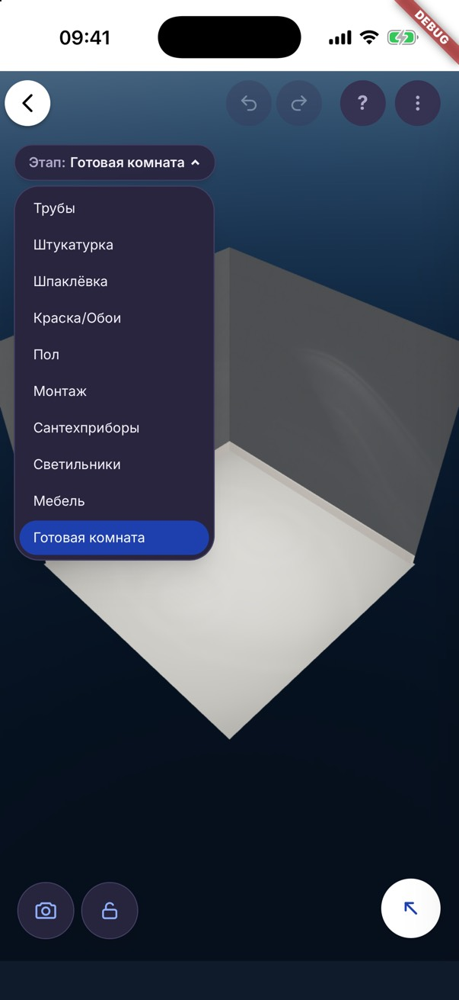
2. 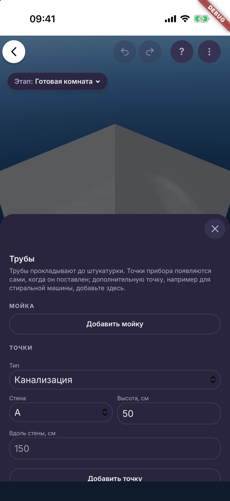
3. 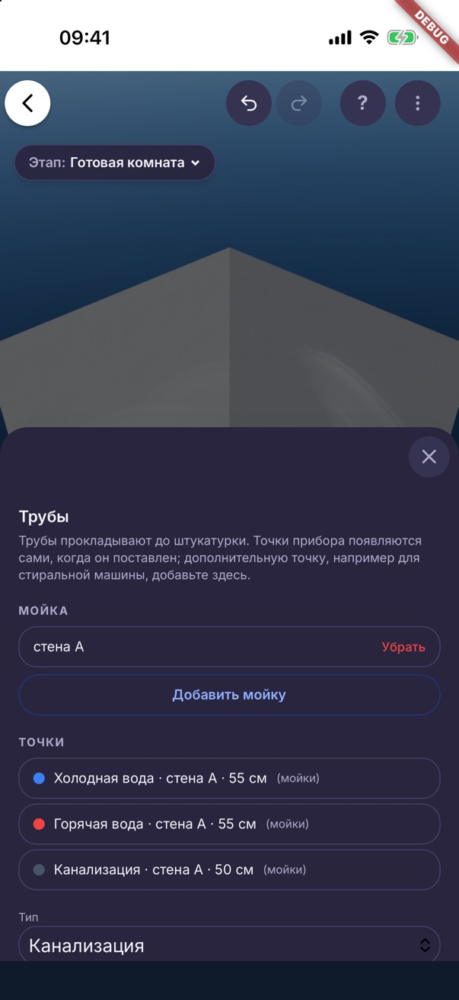
4. 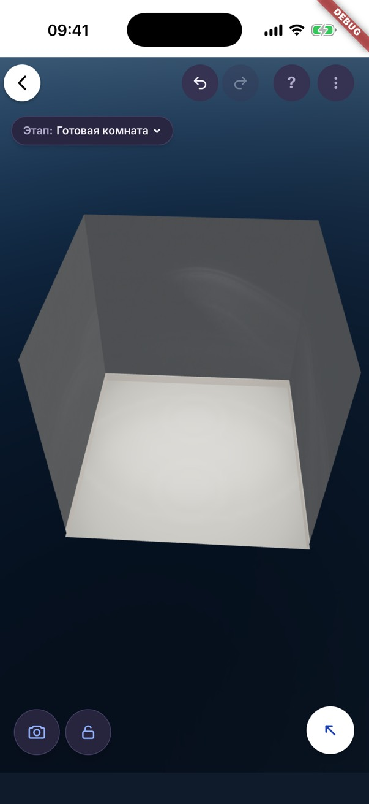
5. 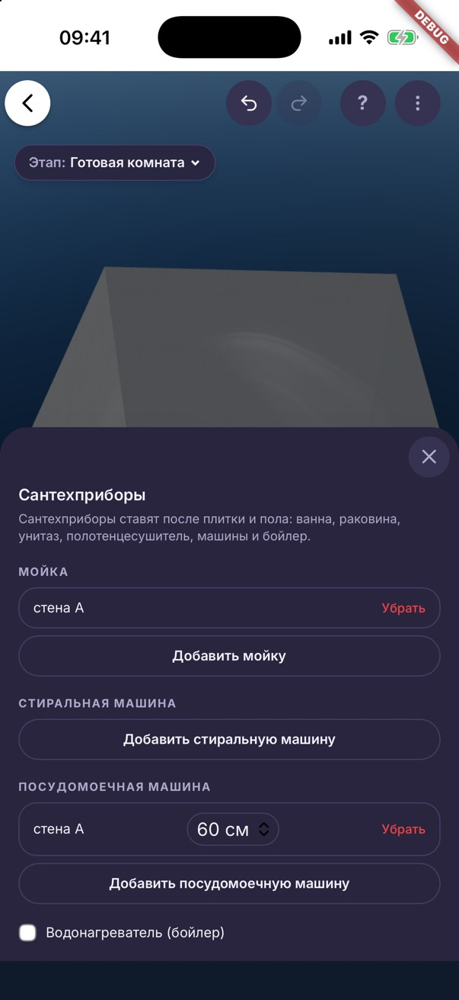
6. 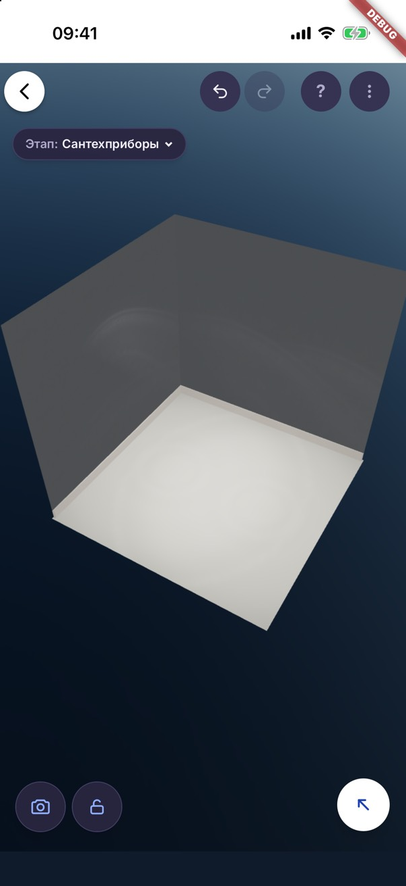
7. 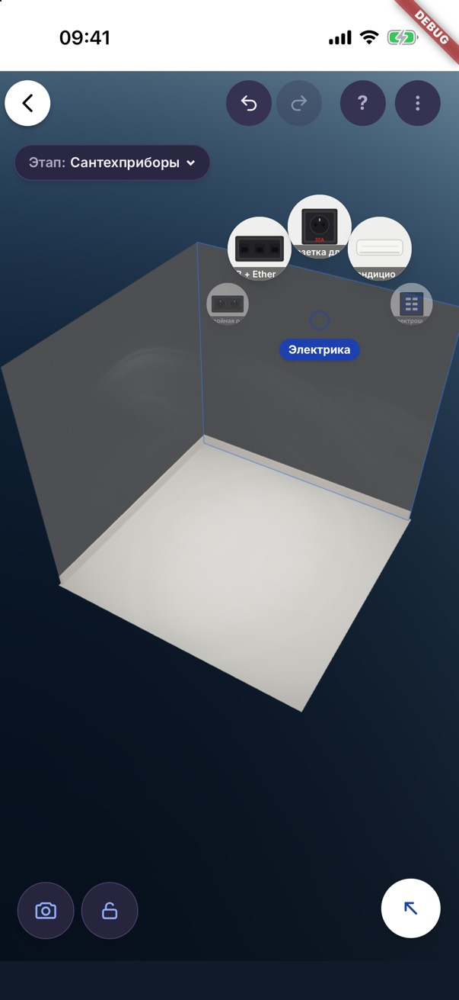
8. 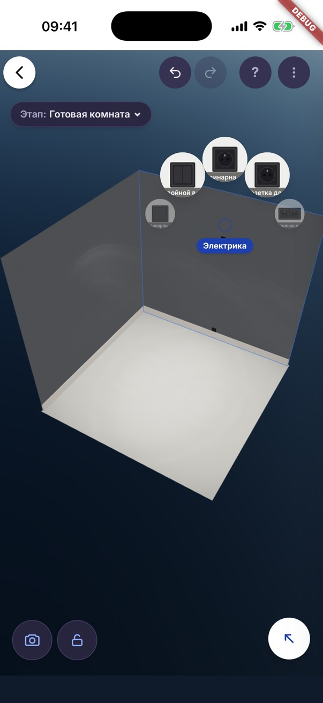
9. 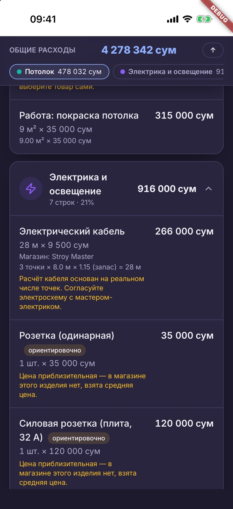
10. 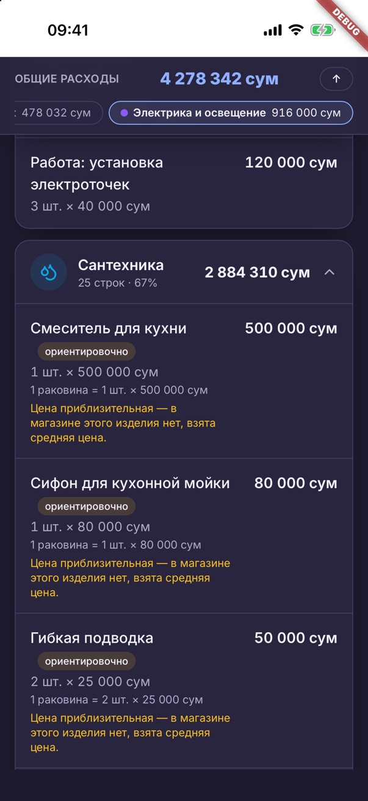
11. 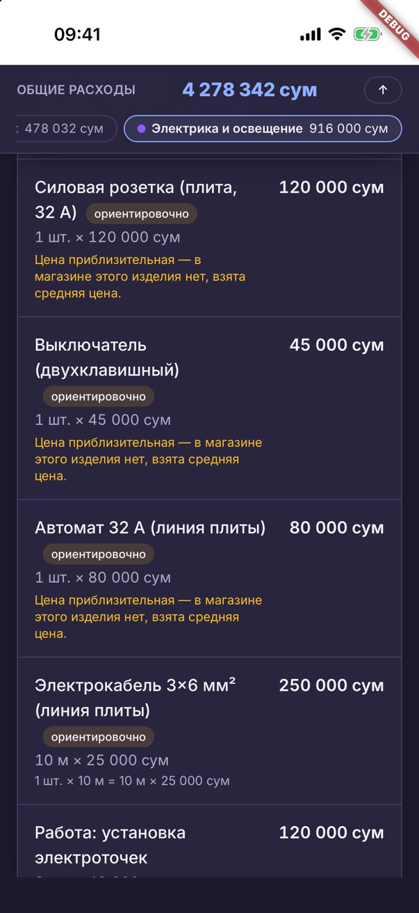
12. 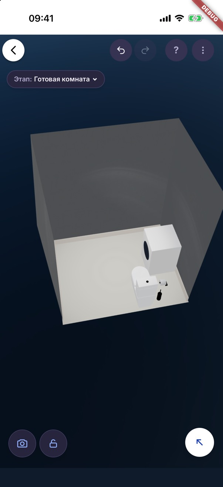
13. 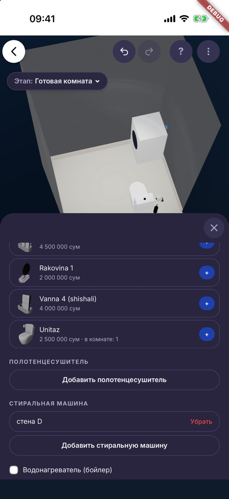
14. 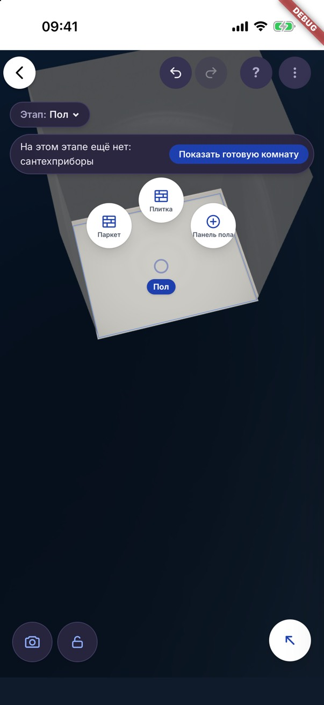
15. 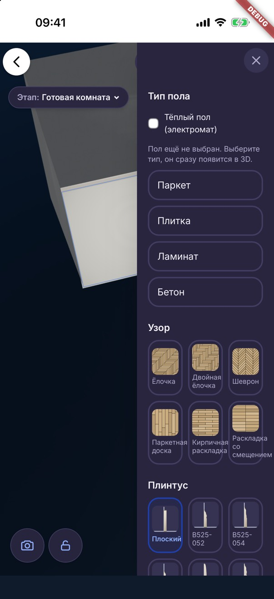
16. 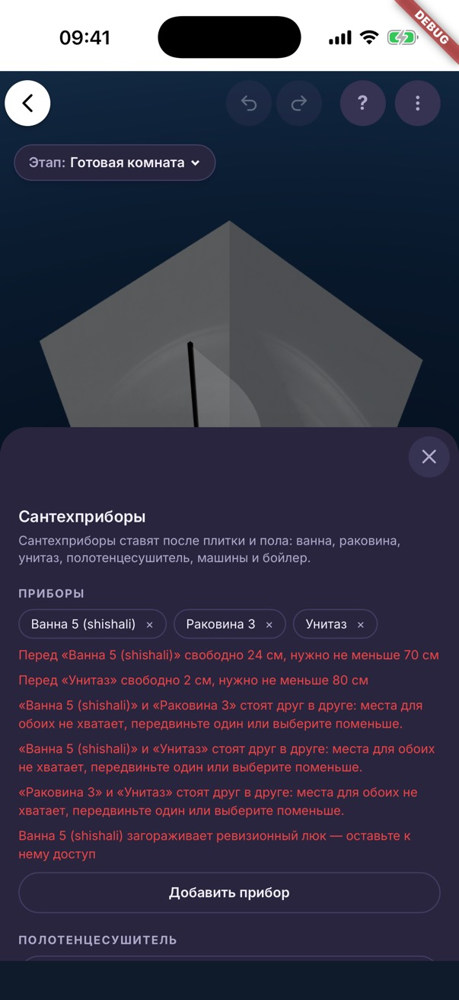
17. 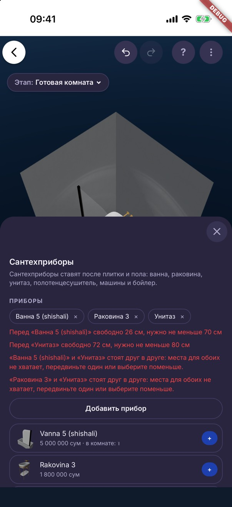
18. 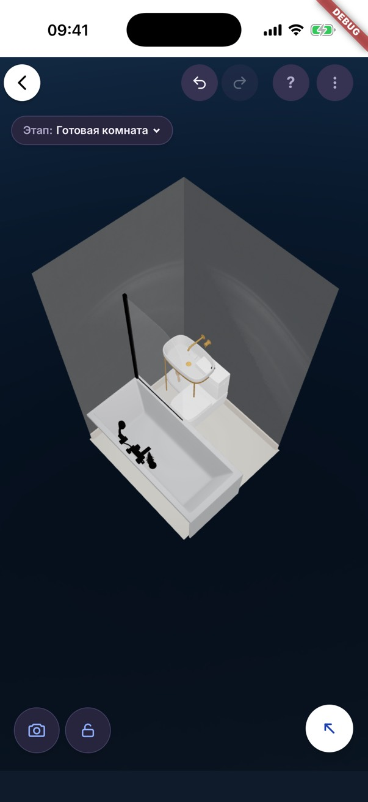

## Xonalar holati

- Yangi oshxona 3 × 3 m yaratildi. Unga moyka, idish yuvish mashinasi, plita va vityajka rozetkalari, ikki klavishli vyklyuchatel qo'shildi.
- Bo'sh 2.5 × 2.0 hammomga («Ремонт гостиной») unitaz va kir mashinasi qo'shildi. Kir mashinasi D devor bo'ylab biroz surildi.
- 1.6 × 1.5 hammomdagi vanna, rakovina va unitaz o'chirilib, shu tartibda qayta qo'shildi.
- Hech qanday xona o'chirilmadi.
