# Render, boyler va qolgan bandlar (#319, #298, #299, #316, PDF): mobil tekshiruv (2026-11-18)

andoza_ai master `69a1faa6` prodga chiqqandan keyin (deploy.yml muvaffaqiyatli tugadi) Studio iOS ilovasida qayta ochildi va quyidagi PR'lar telefonda tekshirildi: #319 (tayyor xonada nuqta/quvur yo'q, boyler joy topadi), #298 (qizil kir mashinasi), #299 (stoyak deraza ostida va 3D'da sudrash), #316 (eshik ochilish yoyi, kollektor quvuri) va Smeta PDF (#325 hali merge qilinmagan).

**Muhit:**
- Qurilma: faqat iOS Simulator, iPhone 17 Pro (402×874). Haqiqiy telefon va Android ishlatilmadi.
- Ilova: andoza_ai_mobile `main` (`d7666d9`, 1.0.2+35), debug build, prod'ga ulangan.
- Server: production `andozaai.uz`, master `69a1faa6` deploy qilingan, bundle `index-CuIDrXBj.js` (`curl https://andozaai.uz/` bilan olindi). Ilova to'liq qayta ishga tushirildi, Studio yangidan ochildi.
- Til: Русский.
- Xonalar:
  - «Моя квартира» ichidagi mavjud hammom, 4.5 m² (vanna, unitaz, rakovina, boyler, eshik). Faqat ko'rish uchun; bitta katak o'zgardi, pastda yozilgan.
  - Yangi sinov hammomi: «Mening uyim» loyihasi, 3D Master orqali yaratildi, 2.5 × 2.0 × 2.7 m. A devorda eshik, B devorda deraza. «Ванна 4», «Унитаз», «Раковина 3», kir yuvish mashinasi va boyler qo'shildi. Xona nomi boshida «Ремонт гостиной» edi, PDF uchun «Hammond QA» qilib o'zgartirildi.

> Barcha natijalar simulyatorda ko'rildi.

## Qisqacha

| Band | Natija | Izoh |
|---|---|---|
| #319 tayyor xonada nuqta, quvur yo'li, ochiq stoyak yo'q («Показать трассы труб» yoqiq bo'lsa ham) | ✅ | Ikkala hammomda. Rasm 1, 3, 14 |
| #319 Quvurlar bosqichida nuqtalar va quvurlar ko'rinadi | ✅ | Nuqtalar, trassa va ochiq stoyak bor. Rasm 2, 5 |
| #319 santexnika paneli ochiq turganda nuqtalar ko'rinadi | ✅ | Bosqich «Готовая комната» bo'lsa ham ochiq stoyak chiziladi. Rasm 7 |
| #319 panel ochiq turganda kamera/360 ga o'tilsa nuqtalar yo'qoladi | ⚠️ | Telefonda bu tartibni bajarib bo'lmaydi (2-topilma). Kamera 3 va 360 rejimida nuqta va quvur ko'rinmadi. Rasm 6 |
| #319 boyler eshik, deraza, vanna, dush ustiga tushmaydi | ✅ | Mavjud hammom: stoyak burchagi eshik yonida, vanna yon devorda (PR'dagi holatga yaqin). Boyler stoyak yonidagi bo'sh devorda chizildi. Yangi hammomda ham bo'sh devorda. Rasm 4, 14 |
| #319 joy umuman bo'lmasa, Jihozlar panelida ogohlantirish | tekshirilmadi | Ikkala xonada ham joy bor edi, joysiz holat hosil qilinmadi |
| #298 mebelga tegib turgan kir mashinasi qizil bo'ladi, panel yopilganda qizillik ketadi | tekshirilmadi | Hammomdagi «Мебель» halqasida faqat santexnika bor (shkaf yo'q). Telefonda mashinani 3D'da sudrab ham bo'lmaydi (1-topilma). Qo'shilgan mashina oq, ogohlantirish yo'q. Rasm 13 |
| #299 stoyak deraza ostida turishi mumkin | ✅ | B devor, 100 sm (deraza o'rtasi): stoyak shu joyda qoldi. Rasm 9. ⚠️ 4-topilma |
| #299 stoyak eshik oldiga qo'yilmaydi | ✅ | A devor, eshik 80–170 sm. 100 sm berilganda stoyak 67 sm ga surildi: 80 − 7 (nalichnik) − 6 (radius + havo). Rasm 10 |
| #299 stoyakni 3D'da sudrash | ❌ | Telefonda ishlamaydi, 1-topilma |
| #316 eshik ochilish yoyi bo'sh joy hisobiga kiradi | ✅ | Eshik bor: «Перед «Ванна 4» свободно 35 см», «Перед «Унитаз» свободно 19 см». Eshik o'chirilganda ikkala yozuv yo'qoldi. Eshik undo bilan qaytarildi. Rasm 15, 16 |
| #316 kollektor quvuri stoyakdan chiqadi | ✅ | «Коллекторная» tanlanganda kollektor qutisi stoyakka yopishib turadi, trassalar shu yerdan boshlanadi. Ulovchi quvur juda qisqa, qutining ichida qoladi, alohida ko'rinmaydi. Rasm 11 |
| PDF: kirillcha nomli xona | ❌ (ma'lum) | «Ошибка при скачивании PDF.» chiqdi: «Моя квартира» hammomida va yangi xonada («Ремонт гостиной»). Rasm 8, 17 |
| PDF: lotincha nomli xona | ✅ | Xuddi shu xona «Hammond QA» deb o'zgartirilgach PDF yaratildi (113 KB), iOS ulashish oynasi chiqdi. Rasm 18 |
| PDF (#325) | — | #325 hali merge qilinmagan (OPEN). Natija ma'lum sababga mos: `Content-Disposition` sarlavhasi latin-1 emas. **#325 deploy'dan keyin qayta tekshiriladi** |

## Topilgan xatolar

### 1. ❌ Telefonda stoyakni (va santexnika jihozlarini) 3D'da sudrab bo'lmaydi (#299)

Panel «Стояк можно двигать вдоль стен и в 3D.» deydi, lekin telefonda 3D'da sudrash ishlamaydi.

Takrorlash:
1. Hammomni Studio'da oching, telefon eni (lg dan tor).
2. ↖ halqa → «Сантехприборы» → oxirgi sahifa → «Добавить …» (Quvurlar paneli ochiladi).
3. Panelning tepasida, 3D ko'rinadigan qismida, ko'k stoyak quvurini barmoq bilan ushlab devor bo'ylab suring.
4. Kutilgan natija: stoyak devor bo'ylab siljiydi. Haqiqiy natija: hech narsa bo'lmaydi, kamera ham aylanmaydi. Panel yopiq bo'lsa, stoyak sudralmaydi.

Ehtimoliy sabab (kod bo'yicha):
- `Riser3D` stoyakni faqat `plumbingStage` yoqiq bo'lganda sudratadi. Telefonda bu faqat panel ochiq bo'lganda yoqiladi (`plumbingStageOn`).
- Panel ochiq paytida `DesignPanelDock` butun ekranga shaffof backdrop qo'yadi (`lg:hidden fixed inset-0 z-40`). U 3D canvas'ga teginishni o'tkazmaydi.
- Backdrop'ga tegilsa panel yopiladi va `plumbingStage` o'chadi.
- Natijada telefonda 3D'da sudrashning iloji yo'q. Sochiq quritgich va kir mashinasini sudrash ham shu shartga bog'liq, ehtimol ular ham ishlamaydi (tekshirilmadi).

### 2. ⚠️ «Panel ochiq + kamera/360» tartibi telefonda bajarilmaydi (#319)

- Kamera yoki 360 rejimida ↖ halqa tugmasi yo'qoladi, shuning uchun panelni ochib bo'lmaydi.
- Panel ochiq bo'lsa, u pastki kamera tugmasini yopib qo'yadi.
- Kamera 3 va 360 ga panel yopiq holda o'tilganda nuqta va quvur ko'rinmadi. Kamera tanlanganda bosqich o'zi «Готовая комната» ga o'tdi.
- PR maqsadi (renderda nuqta yo'q) telefonda bajarilgan, lekin PR'da yozilgan tartibni telefonda takrorlab bo'lmaydi.

### 3. ⚠️ Quvurlar bosqichida trassalar polda eshik ostidan o'tadi

Takrorlash:
1. Eshigi bor hammom, Quvurlar paneli → «Показать трассы труб» yoqing.
2. «Этап: Трубы» ni tanlang va eshikli devorni ko'radigan qilib aylantiring.
3. Kanalizatsiya va issiq suv chiziqlari pol sathida eshikli devor bo'ylab, eshik ochilgan joy ostidan o'tadi.

Ikkala hammomda ham ko'rindi (rasm 5, 11). Bu atayin qilingan sxema bo'lishi mumkin, faqat qayd etildi.

### 4. ⚠️ Deraza ostidagi stoyak 3D'da derazani kesib o'tadi (#299)

- Stoyak B devorda 100 sm ga qo'yilganda poldan shiftgacha chiziladi.
- Natijada deraza oynasining oldidan o'tadi (rasm 9).
- PR bo'yicha deraza stoyakni surmaydi, demak qoida bajarilgan. Lekin real hayotda bunday joy kamdan-kam bo'ladi. Kerak bo'lsa, ogohlantirish chiqarish mumkin.

### 5. Kichik

- Santexnika paneli «Этап: Трубы» paytida halqadan ochilganda bosqich yorlig'i o'zi «Готовая комната» ga o'zgaradi. Nuqtalar panel ochiqligi sababli ko'rinadi, lekin yorliq chalg'itadi.
- «Мебель → Ванная» halqasida ruscha interfeysda nomlar lotincha: «Vanna 3», «Rakovina», «Unitaz» (avvalgi QA'da ham bor edi).

## Rasmlar

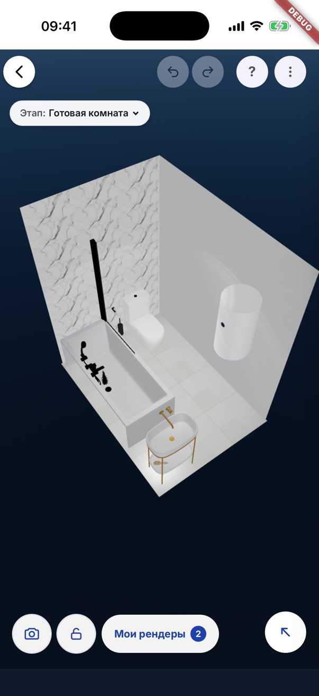
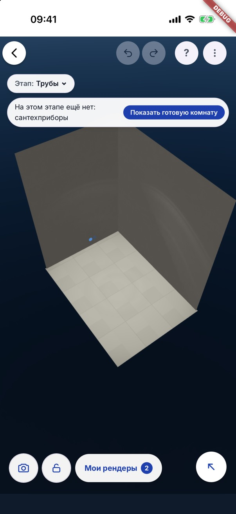
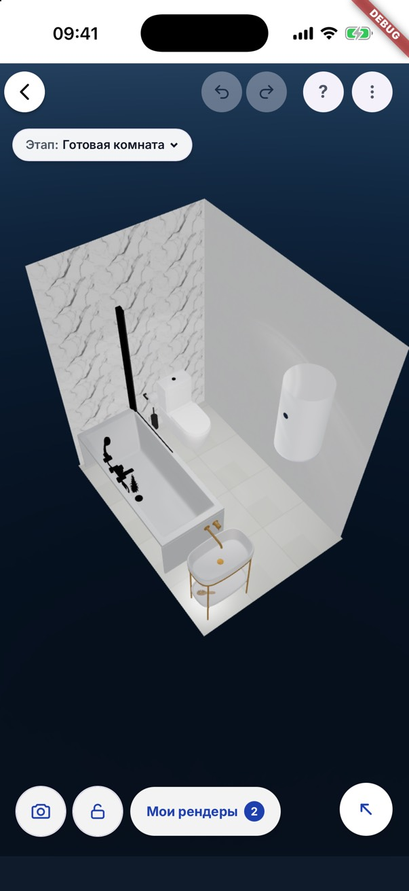
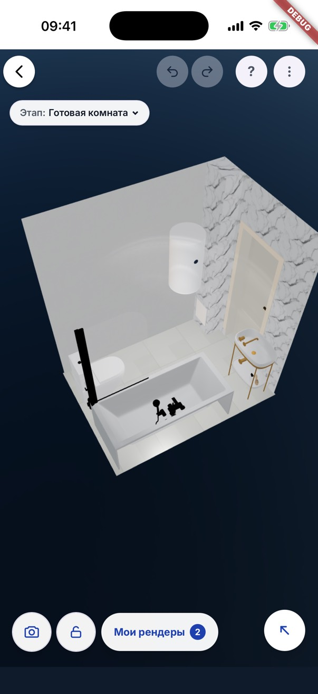
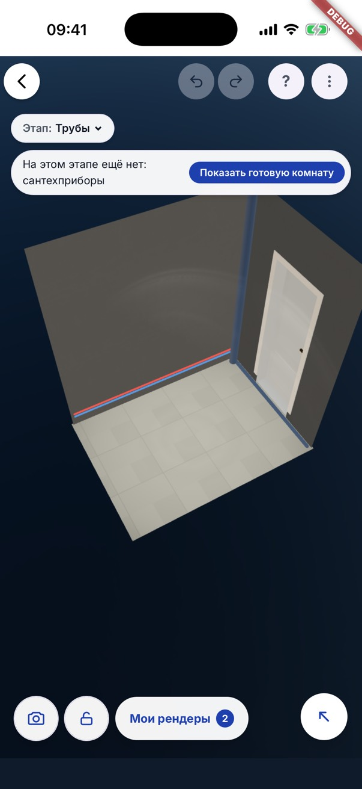
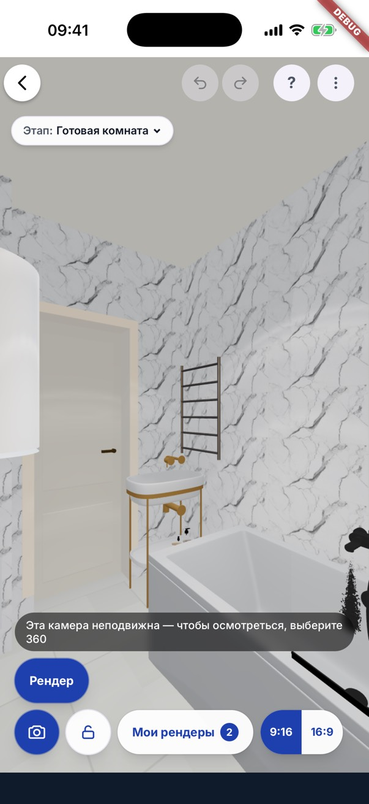
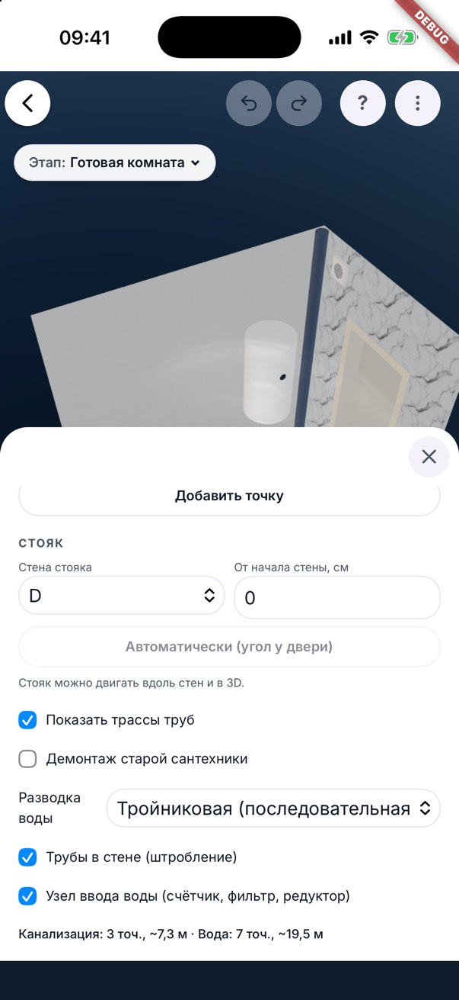
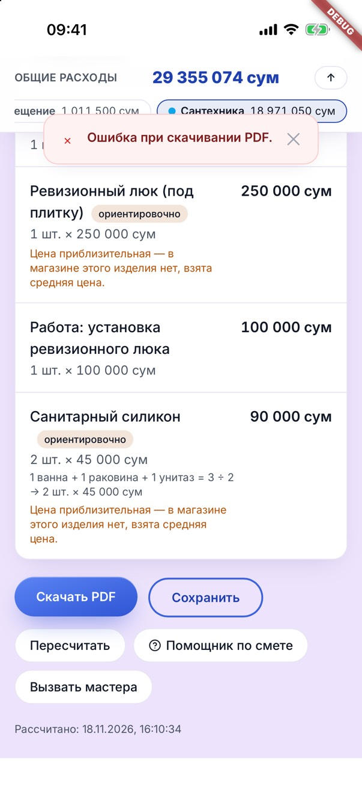
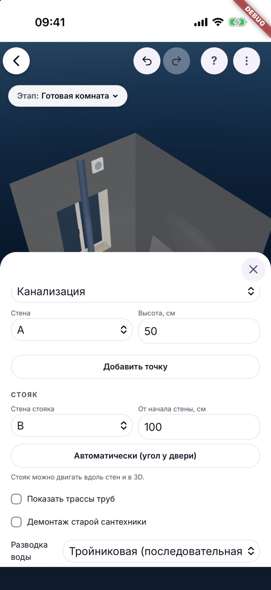
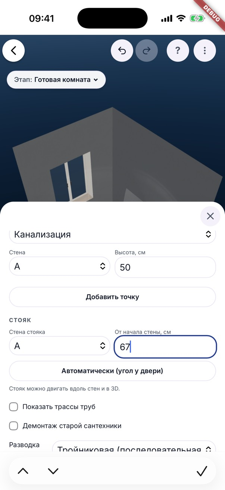
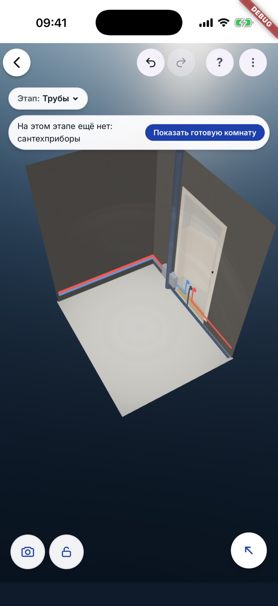
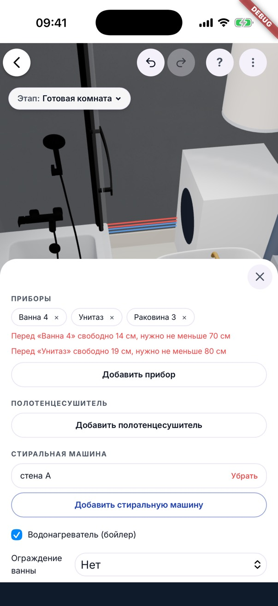
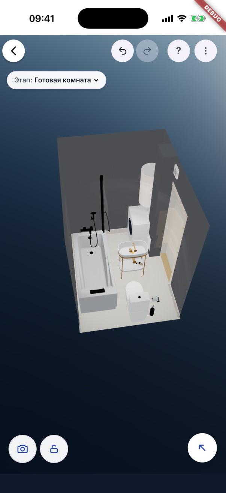
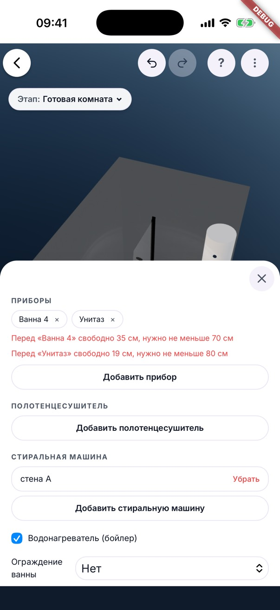
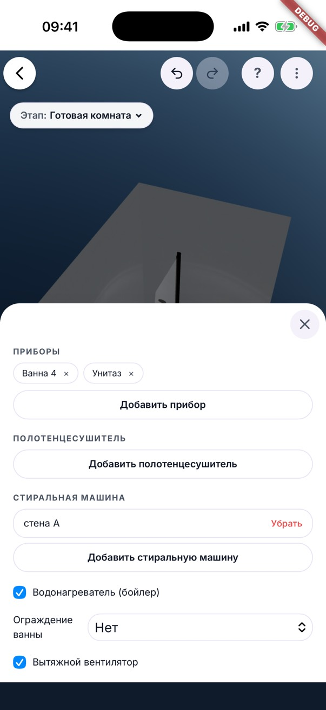

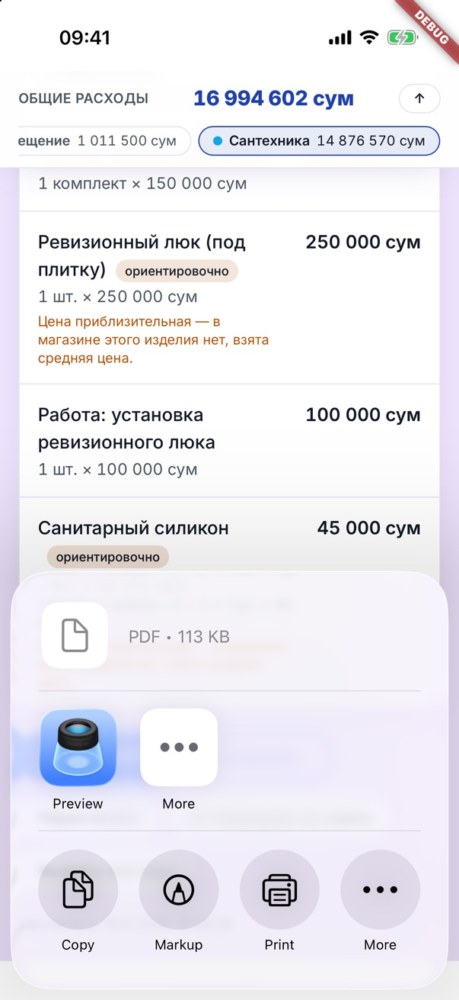

## Xonalar holati

- «Моя квартира» hammomi (4.5 m²): Quvurlar panelida «Показать трассы труб» katagi yoqib qo'yilgan, qaytarib o'chirilmadi. #319 dan keyin u faqat Quvurlar bosqichida ta'sir qiladi. Boshqa narsa o'zgarmadi.
- Yangi sinov hammomi («Mening uyim» / «Hammond QA»):
  - qo'shilganlar: «Ванна 4», «Унитаз», kir mashinasi (A devor), boyler, B devorda deraza;
  - «Раковина 3» olib tashlandi;
  - A devordagi eshik o'chirilib, undo bilan qaytarildi (qaytgani 3D'da alohida ko'rilmadi);
  - stoyak qo'lda A devor, 67 sm; suv taqsimoti «Коллекторная»; «Показать трассы труб» yoqiq.
  - Xona o'chirilmadi.
- Ilova tili Русский.

## Tekshirilmaganlar

- #319: joy umuman bo'lmaganda Jihozlar panelidagi ogohlantirish.
- #298: mebelga tegib turgan kir mashinasining qizil rangi. Hammom halqasida mebel yo'q, telefonda sudrash ishlamaydi.
- #299: 3D'da sudrash (1-topilma sababli bajarilmadi).
- PDF uchala tilda; kirillcha nom #325 deploy'dan keyin qayta tekshiriladi.
