# #305–#328 bo'yicha yakuniy mobil tekshiruv (2026-11-18)

Bu bugungi to'rtinchi mobil QA hujjati. Avvalgi uchtasi:
- #315: `2026-11-18-bosqichlar-santexnika-mobil-natija.md`
- #322: `2026-11-18-jihozlar-pol-panellari-qayta-mobil-natija.md`
- #327: `2026-11-18-render-boyler-qoldiqlar-mobil-natija.md`

Bu safar tekshirildi:
- #328: telefonda stoyak, sochiq quritgich va kir mashinasini 3D'da surish;
- #298: qizil kir mashinasi;
- #325: kirillcha nomli xonada PDF;
- andoza_ai_mobile #63 dagi oxirgi ikki izohning bandlari: #318, #320, #321, #323, #324, #326.

Oxirida #305–#328 PR'larining umumiy jadvali bor.

**Muhit:**
- Qurilma: faqat iOS Simulator, iPhone 17 Pro (402×874). Haqiqiy telefon va Android ishlatilmadi.
- Ilova: andoza_ai_mobile `main` (`d7666d9`, 1.0.2+35), debug build, prod'ga ulangan.
- Til: Русский.
- Server: production `andozaai.uz`.
  - Boshida master `92af89b4` (#328) deploy qilingan, bundle `index-s9nXgDfh.js`. Ilova qayta ishga tushirildi.
  - Tekshiruv davomida #329 (`e269182c`) ham prodga chiqdi, oxirida bundle `index-iG9YMdrY.js` edi. Yangi xonalar bilan ishlangan bandlarning bir qismi shu bundle'da ko'rilgan bo'lishi mumkin.
- Xonalar:
  - «Mening uyim» → «Hammond QA», 2.5 × 2.0 m. #327 dagi sinov hammomi (vanna, unitaz, rakovina, kir mashinasi, boyler, eshik, deraza). #328 va #298 shu yerda tekshirildi.
  - Yangi hammom, 2.5 × 2.0 × 2.7 m. Ilovadagi 3D Master orqali yaratildi, nomi standart (kirillcha) qoldi. Eshik yo'q (sehrgarda qo'shilmadi). #318, #323, #324, #326, PDF shu yerda tekshirildi.
  - Kichik hammom, 1.6 × 1.5 m. 3D Master orqali yaratildi, D devorda 70×200 eshik bor. #326 va #320 ning kichik xona bandi shu yerda tekshirildi.
  - «Моя квартира», 4.5 m². Faqat «Показать трассы труб» katagi ko'rildi.
- Foydalanuvchi so'rovi bilan «Рендер» tugmasi bu safar ishlatilmadi.

> Barcha natijalar simulyatorda ko'rildi.

## (a) Bu tekshiruv natijalari

| Band | Natija | Izoh |
|---|---|---|
| #328 Quvurlar paneli ochiq turganda stoyakni 3D'da surish | ✅ | A 67 sm dan A 0 sm ga surildi, saqlandi. Panel maydoni 0 ga yangilandi, suv quvuri ~18.9 m dan 24.2 m ga oshdi. Rasm 1 |
| #328 sochiq quritgichni 3D'da surish | ✅ | Jihozlar paneli ochiq holda sochiq quritgich surildi. Panel yozuvi darhol yangilanmadi («стена A · 100 см» qoldi). Rasm 2 |
| #328 kir mashinasini 3D'da surish | ✅ | A/B burchagiga surildi. Rasm 3 |
| #328 panel ustida kamera aylanadi | ✅ | Panel ochiq qoladi |
| #328 panel × bilan yopiladi | ✅ | |
| #328 santexnika bo'lmagan panel (Pol paneli, o'ng yarim) yonida bosilganda yopiladi | ✅ | Rasm 4. Bo'yoq devor panelini telefonda ochish yo'li topilmadi, shuning uchun Pol paneli bilan tekshirildi |
| #298 mebel yoki jihozga tegib turgan kir mashinasi qizil bo'ladi | ❌ | Mashina unitazga kirib turibdi (yuqoridan qaraganda unitaz mashina eshigi oldida). Mashina qizil emas, mashina qatorida «Мебелга тегиб турибди» yozuvi yo'q. Rasm 3. 2-xato |
| #298 panel yopilganda qizillik ketadi | tekshirilmadi | Qizil holat hosil bo'lmadi |
| PDF: kirillcha nomli xona (#325) | ✅ | Yangi hammomda «Скачать PDF»: PDF yaratildi (111 KB), iOS ulashish oynasi ochildi. Rasm 11 |
| #319 render: tayyor xonada nuqta yo'q | foydalanuvchi so'rovi bilan tekshirilmadi | «Рендер» ishlatilmadi. Ko'rsatma kelishidan oldin bitta kadr («Кадр с камеры 1») olingan edi, unda nuqta ko'rinmadi. Bu natija hisobga olinmadi |
| #318 sehrgarda «Начать оформление» studio'ni Quvurlar bosqichida ochadi | ❌ | Ikkala yangi hammom ham «Этап: Готовая комната» da ochildi. Ro'yxatda Трубы bor, hech bir bosqich ✓ belgilanmagan. Rasm 6. 1-xato |
| #318 Quvurlar «bajarildi ✓» deb belgilanmaydi | ✅ | Bosqichlar ro'yxatida ✓ yo'q |
| #323 Quvurlar panelidan jihoz qo'shish | ✅ | «Добавить прибор» → katalog. Vanna, rakovina, unitaz qo'shildi, nuqtalar o'zi paydo bo'ldi. Rasm 7 |
| #323 Jihozlar panelidan jihoz qo'shish | ✅ | Jihozlar panelida ham «Добавить прибор» bor. Rasm 9 |
| #321 Bo'yoq devor panelida «Плитка» yorlig'i | tekshirilmadi | Telefonda Bo'yoq devor panelini ochish yo'li topilmadi (3-xato). Devor halqasida «Плитка» bor, lekin Pol bosqichida u kulrang (o'chiq) |
| #320 avtomatik jihozlar lyukni to'smaydi, yangi xonada lyuk ogohlantirishi yo'q | ✅ / ❌ | 2.5 × 2.0 hammomda ogohlantirish yo'q. 1.6 × 1.5 hammomda «Ванна 5 (shishali) загораживает ревизионный люк» chiqdi. Rasm 9, 16 |
| #324 plitka tovari tanlanmaganda nom | ✅ | Pol 600×600 «Простая»: «Плитка: Керамогранит … RC DAMAR BL, 600×600 мм», «Товар не выбран: взята средняя цена магазина». #324 bo'yicha shu o'lchamdagi plitkalar medianasi nomi bilan chiqadi; o'lcham topilmaganda «(средняя цена)» bo'ladi. O'lchamsiz holat ko'rilmadi. Rasm 13 |
| #324 «Потолок» guruhi: grunt, namga chidamli bo'yoq, «Работа: покраска потолка» | ✅ | 3 qator. Rasm 10 |
| #324 kafel polda plintus yo'q (3D va smeta) | ✅ | 3D'da pol chetida plintus yo'q. Smetada «Пол и плинтус» guruhida faqat plitka qatori. Rasm 12, 13 |
| #324 bo'yoq butun bankada | ✅ | «5.0 м² × 2 слоя ÷ 9.0 м²/л = 1.1 л → 1 банка (2.5 л) = 2.5 л». Rasm 10 |
| #324 ruscha issiq pol formulasida «(под приборами)» | tekshirilmadi | Bu safar Pol panelini ochib bo'lmadi: pol halqasida faqat «Паркет» / «Плитка», «Панель пола» yo'q edi |
| #326 2.5 × 2.0 hammom: vanna → rakovina → unitaz Quvurlar panelidagi «Добавить прибор» orqali | ✅ | Bo'sh joy ogohlantirishi yo'q, lyuk ogohlantirishi yo'q. Rasm 8, 9 |
| #326 unitaz stoyak yonida, vanna burchakda, hech narsa boshqasini to'smaydi | ✅ | Stoyak A 0 sm. Unitaz A devorda 20 sm, vanna B devor bo'ylab burchakda, rakovina D devorda. Xonada eshik yo'q edi, PR'dagi «eshik 0.7 m» holati bu xonada tekshirilmadi. Rasm 8 |
| #326 kichik xona 1.6 × 1.5: jihozlar devorlarga qo'yiladi; joy yetmasa ogohlantirish oxirgi qo'shilganda | ❌ | Uchala jihoz A devorga qo'yildi, rakovina va unitaz vannaning ichida turibdi. Ogohlantirishlar: vanna oldida 24 sm, unitaz oldida 2 sm, vanna lyukni to'sadi. Ya'ni ogohlantirish birinchi qo'shilgan vannaga ham tushdi, ustma-ust turish haqida esa ogohlantirish yo'q. Rasm 15, 16. 4-xato |
| «Моя квартира»: «Показать трассы труб» o'chirish | ✅ | Katak allaqachon o'chiq edi, o'zgartirilmadi |

## (b) #305–#328 umumiy jadvali

Belgilar: ✅ ishlaydi, ❌ ishlamaydi, ⚠️ qisman yoki kichik xato bor. «#315», «#322», «#327» tegishli hujjatni, «shu» esa shu hujjatni bildiradi.

| PR | Mavzu | Natija | Qaysi hujjatda |
|---|---|---|---|
| #305 | Smeta: УЗО, КУП, bosim sinovi, lyuk, silikon | ✅ ⚠️ | #322. Inglizcha smetada son formati aralash (kichik). Bugun yangi hammomning ruscha smetasida УЗО, КУП, ревизионный люк va силикон qatorlari yana ko'rindi (shu) |
| #306 | Vanna va dush nuqtalari SNiP balandligida | ✅ ⚠️ | #315. Eski xonada jihoz o'zgarmaguncha dush 105 sm qoladi |
| #307 | Issiq pol (elektr mat) | ✅ | #322 (oshxona). Bugun hammomda Pol paneli ochilmadi, «(под приборами)» ko'rilmadi |
| #308 | Stoyak qutisi, lyuk, boyler, osma unitaz qutisi | ✅ ⚠️ | #315 (quti/lyuk), #322 (boyler). Shpaklovka bosqichida quti qora qoladi |
| #309 | Vanna/dush to'sig'i | ✅ ⚠️ | #322. «Ванна 3» ning o'z shishasi bor edi; #329 shu holatni tuzatgan (bu yerda qayta tekshirilmadi) |
| #310 | Jihoz oldida bo'sh joy ogohlantirishi | ✅ | #322, #327, shu |
| #311 | Santexnika bosqichi: Quvurlar va Jihozlar | ✅ | #315, #322 (#317 dan keyin) |
| #312 | 3D bosqichga qarab | ✅ ❌ | #315. Devor menyusidan rang tanlanganda 3D tayyor xonaga qaytmaydi |
| #313 | Kollektor sxemasi | ✅ ❌ | #315. Ruscha smetada kollektor formulasi o'zbekcha |
| #314 | «(shishali)» dushga to'siq yo'q | ✅ | #322 |
| #316 | Osma unitaz qutisi, eshik va lyuk ogohlantirishi, kollektor quvuri | ✅ | #322 (lyuk), #327 (eshik, kollektor) |
| #317 | Telefonda Jihozlar va Pol panellari | ✅ ⚠️ | #322. Bugun yangi hammomda pol halqasida «Панель пола» chiqmadi (5-xato) |
| #318 | Sehrgar yangi hammomni Quvurlar'da ochadi | ❌ | shu. Ilovaning o'z (Flutter) sehrgarida ishlamaydi, 1-xato |
| #319 | Renderda nuqta va quvur yo'q, boyler joy topadi | ✅ ⚠️ | #327. Render bandi bugun foydalanuvchi so'rovi bilan tekshirilmadi. «Joy yo'q» ogohlantirishi ko'rilmadi |
| #320 | Avtomatik jihozlar lyukni to'smaydi | ✅ ❌ | shu. 2.5 × 2.0 da ✅, 1.6 × 1.5 da lyuk ogohlantirishi chiqdi |
| #321 | Bo'yoq devor panelida «Плитка» yorlig'i | tekshirilmadi | shu. Telefonda Bo'yoq devor paneli ochilmaydi, 3-xato |
| #323 | Quvurlar/Jihozlar panelidan jihoz qo'shish | ✅ | shu |
| #324 | Hammom smetasi: plitka o'lchami, shift, plintus, banka | ✅ | shu. «(под приборами)» tekshirilmadi |
| #325 | Kirillcha nomli xonada PDF | ✅ | shu (#327 da ❌ edi, #325 dan oldin) |
| #326 | Avtomatik joylashtirishda bo'sh joy | ✅ ❌ | shu. 2.5 × 2.0 da ✅, 1.6 × 1.5 da jihozlar ustma-ust, 4-xato |
| #328 | Telefonda stoyak, sochiq quritgich, mashinani 3D'da surish | ✅ | shu |

PR emas, lekin shu turkumda tekshirilgan:
- #298 (qizil kir mashinasi): ❌, shu hujjat.
- #299 (stoyak deraza ostida, eshik oldida emas, 3D'da surish): ✅. #327 da 3D'da surish ❌ edi, #328 dan keyin ✅.
- #302 (idish yuvish mashinasi): ✅, #322. Ziddiyat holati ko'rilmadi.

## (c) Ochiq qolgan xatolar

### Bu tekshiruvda topilganlar

1. **❌ Ilovaning sehrgari yangi hammomni Quvurlar'da ochmaydi (#318).**
   - #318 faqat sayt sehrgarini (`WizardPage`) tuzatgan. Ilovada sehrgar Flutter'da yozilgan.
   - Ilovadagi sehrgar «Начать оформление» bosilganda `context.go('/studio/${roomId}')` qiladi (`lib/screens/room_setup/room_wizard_screen.dart`, `_goStudio`). `?phase=` berilmaydi, `studioRoomPath` da ham bunday parametr yo'q.
   - Shuning uchun studio «Готовая комната» da ochiladi.
   - Takrorlash: ilova → + → «3D Мастер» → «Ванная» → Далее ×5 → «Начать оформление». Kutilgan: «Этап: Трубы». Haqiqiy: «Этап: Готовая комната».
   - Tuzatish ilova reposida kerak: hammom yoki oshxona uchun `?phase=quvurlar` qo'shish (#318 dagi `useStageFromLink` buni qabul qiladi).
2. **❌ Unitazga kirib turgan kir mashinasi qizil bo'lmaydi (#298).**
   - Takrorlash: «Hammond QA» → Jihozlar paneli ochiq holda kir mashinasini 3D'da unitaz tomonga suring, toki unitaz kosasi mashina eshigi oldida tursin.
   - Kutilgan: mashina qizil, qatorda ogohlantirish.
   - Haqiqiy: mashina oq, ogohlantirish yo'q (rasm 3).
3. **⚠️ Telefonda Bo'yoq devor panelini ochish yo'li yo'q (#321).**
   - Devor halqasidagi «Цвет» va «Обои» ichki halqa ochadi, panelga olib bormaydi.
   - Kategoriya halqasidagi «Панель» faqat halqa bo'sh bo'lganda chiqadi.
   - Shuning uchun #321 dagi «Плитка» yorlig'iga telefonda yetib bo'lmadi.
4. **❌ 1.6 × 1.5 hammomda jihozlar ustma-ust qo'yiladi (#326, #320).**
   - Takrorlash: 3D Master, «Ванная», A 1.6 m, B 1.5 m, D devorda 70×200 eshik → «Начать оформление» → Quvurlar paneli → «Добавить прибор»: Vanna 5, Rakovina 3, Unitaz.
   - Natija: uchalasi A devorda, rakovina va unitaz vanna ichida (rasm 15).
   - Ogohlantirishlar (rasm 16): vanna oldida 24 sm, unitaz oldida 2 sm, vanna lyukni to'sadi. Ustma-ust turish haqida ogohlantirish yo'q.
   - PR kutgani: kamomad faqat oxirgi qo'shilgan jihozda. «Devorda joy yo'q → eski qoida» holatiga tushgan bo'lishi mumkin.
5. **⚠️ Yangi hammomda «Панель пола» chiqmadi (#317).**
   - Pol bosqichida polni bosganda halqada faqat «Паркет» va «Плитка» bor edi.
   - #322 da shu halqaning oxirida «Панель пола» bor edi.
   - Natijada issiq pol katagi va «(под приборами)» bu safar tekshirilmadi. Qaysi shartda chiqishi aniqlanmadi.
6. **⚠️ Boyler keyin qo'shilgan sochiq quritgich bilan ustma-ust (#319).**
   - «Hammond QA» da A devorga sochiq quritgich (100 sm) qo'shilgandan keyin boyler u bilan bir joyda chizildi (rasm 2).
   - Boyler keyin qo'shilgan narsadan qochmaydi.
7. **Kichik (ilova):**
   - Ruscha sehrgarda eshik o'lchami «70×200 sm» deb yoziladi, «см» o'rniga (rasm 14).
   - Katalogda «в комнате: 1» dagi «1» kesilib «ı» bo'lib ko'rinadi (rasm 7 dan keyingi holat).
   - Jihoz nomlari aralash tilda: «Ванна 5 (shishali)», «Vanna 5 (shishali)».
   - Sochiq quritgich surilgandan keyin panel yozuvi darhol yangilanmaydi.

### Avvalgi hujjatlardan, hali ochiq

- #312: devor menyusidan rang tanlanganda 3D tayyor xonaga qaytmaydi (#315).
- #313: ruscha smetada kollektor formulasi o'zbekcha (#315).
- #306: eski xonada dush nuqtasi 105 sm qoladi (#315).
- #308: Shpaklovka bosqichida stoyak qutisi qora (#315).
- #305: inglizcha smetada son formati aralash (#322).
- #319: «panel ochiq + kamera/360» tartibini telefonda bajarib bo'lmaydi (#327).
- #299: deraza ostidagi stoyak 3D'da derazani kesib o'tadi (#327).
- Quvurlar bosqichida trassalar polda eshik ostidan o'tadi (#327).

## Rasmlar

1. 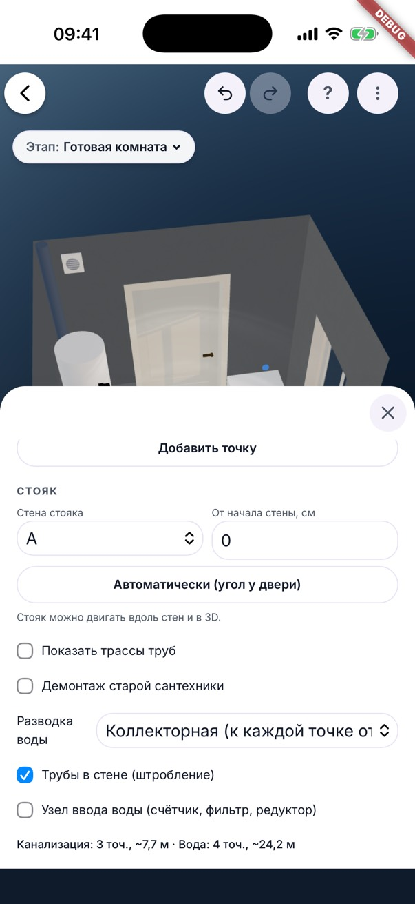
2. 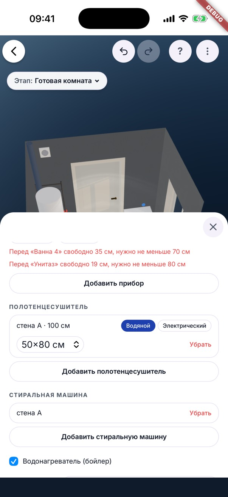
3. 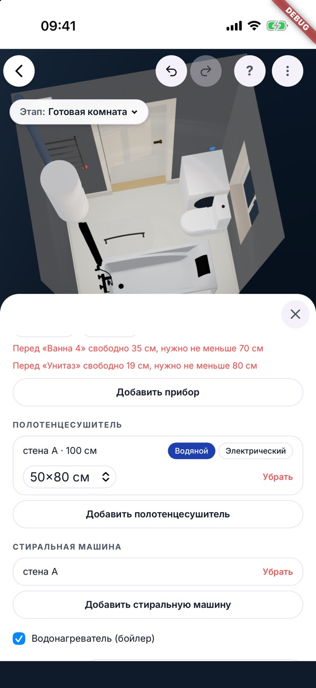
4. 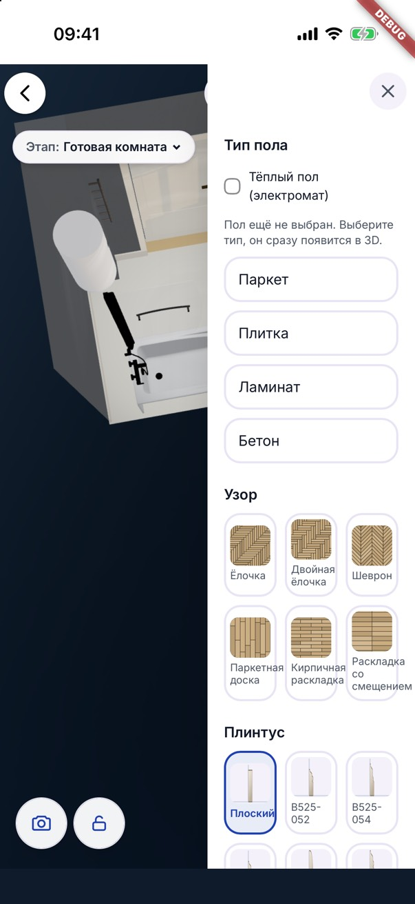
5. (render kadri qo'shilmadi: foydalanuvchi so'rovi bilan render tekshirilmadi)
6. 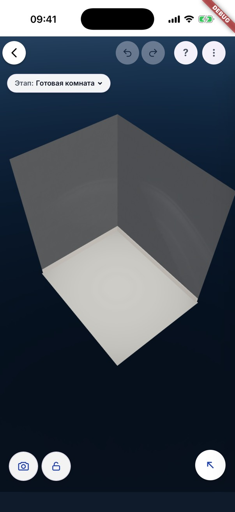
7. 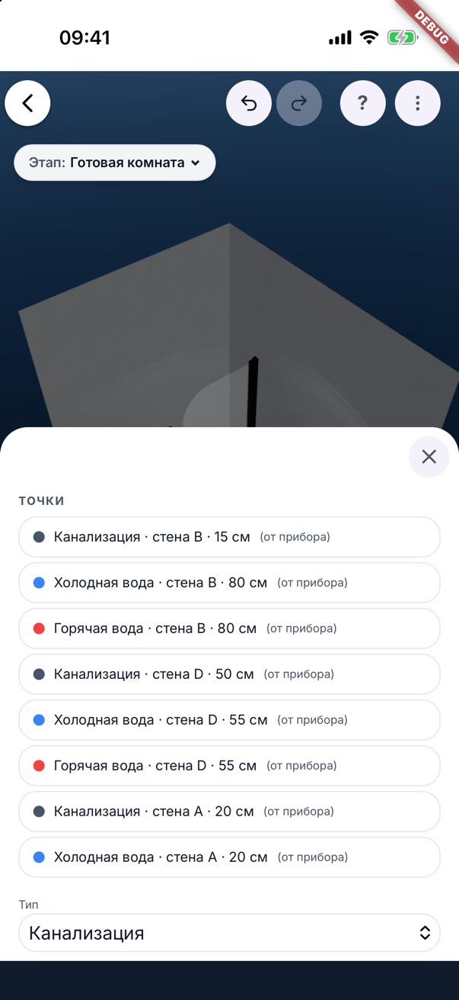
8. 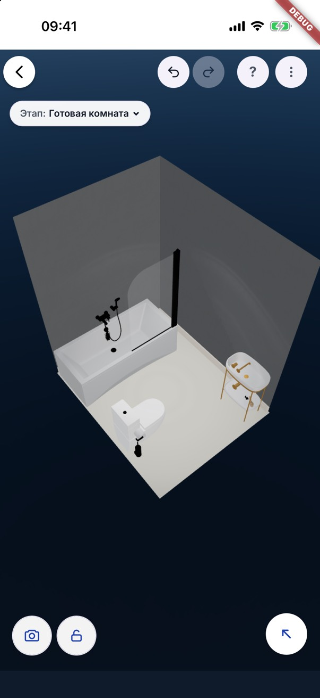
9. 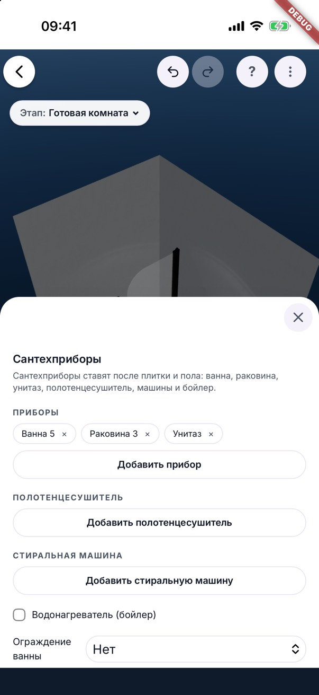
10. 
11. 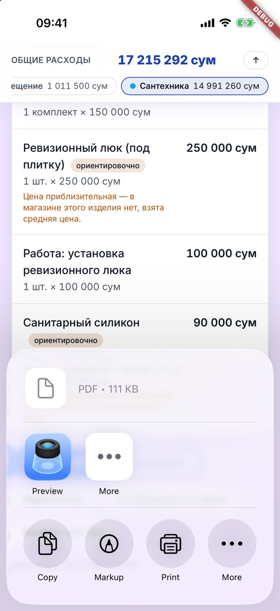
12. 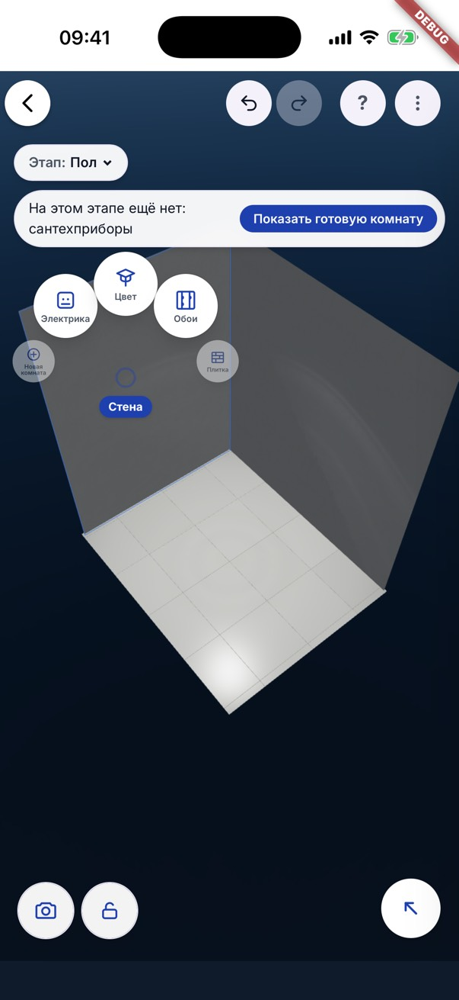
13. 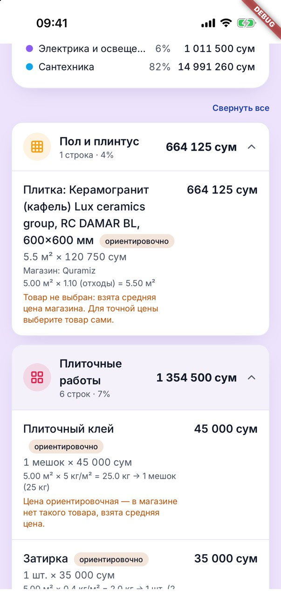
14. 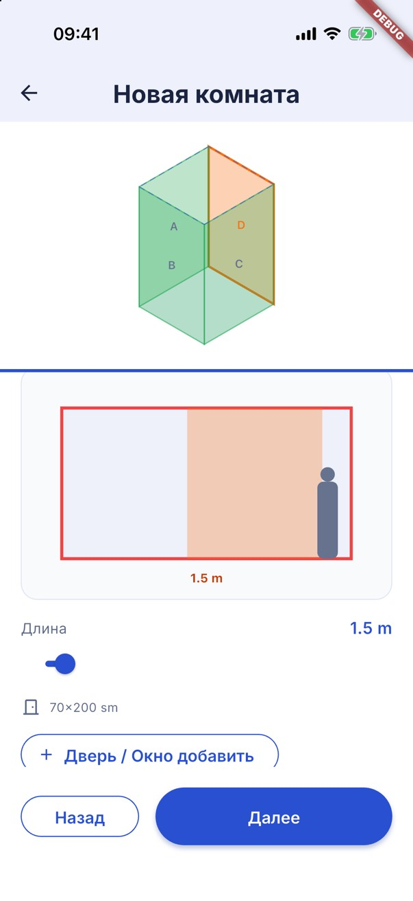
15. 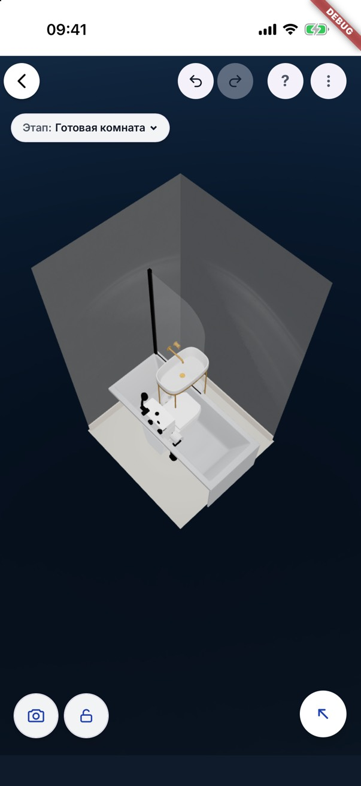
16. 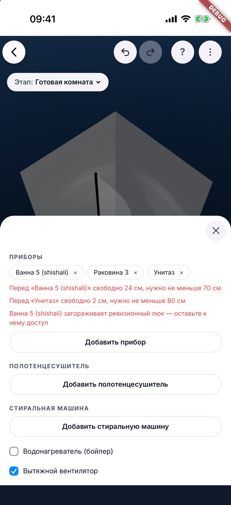

## Xonalar holati

- «Hammond QA»: stoyak A 0 sm ga, kir mashinasi A/B burchagiga surildi. Sochiq quritgich qo'shildi. Qolgani o'zgarmadi.
- Ikki yangi sinov hammomi (2.5 × 2.0 va 1.6 × 1.5) qoldi. 2.5 × 2.0 hammom poliga 600×600 plitka qo'yildi.
- «Моя квартира»: o'zgartirilmadi.
- Hech qanday xona o'chirilmadi.
