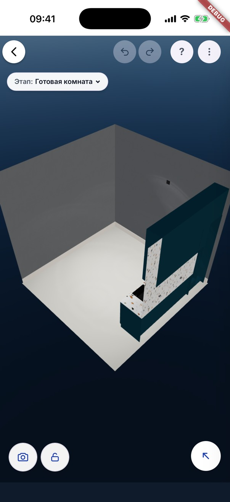
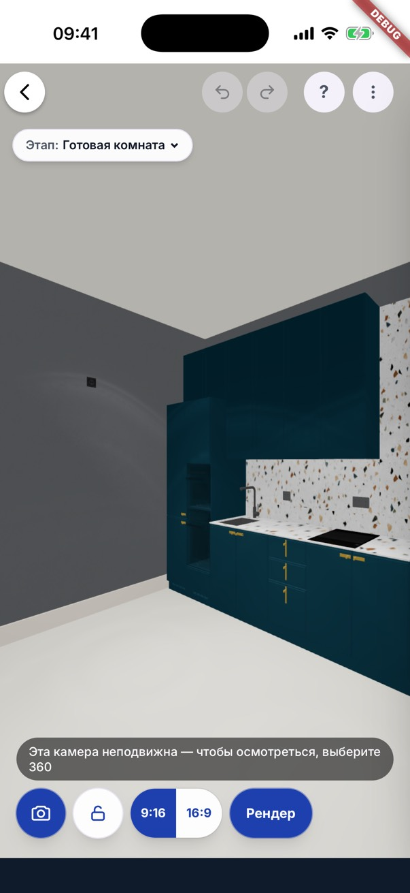
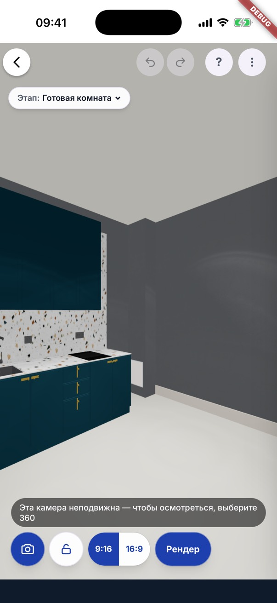
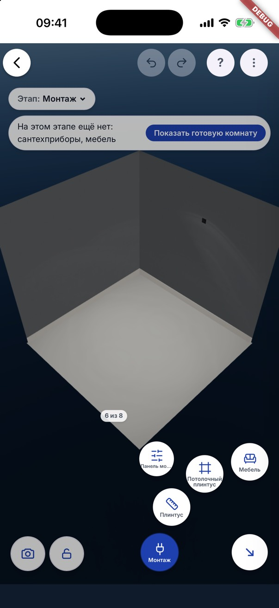
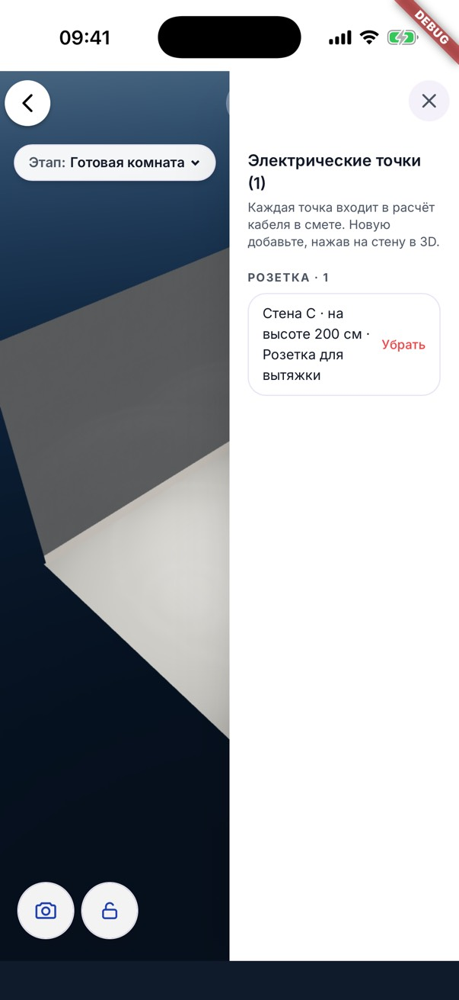
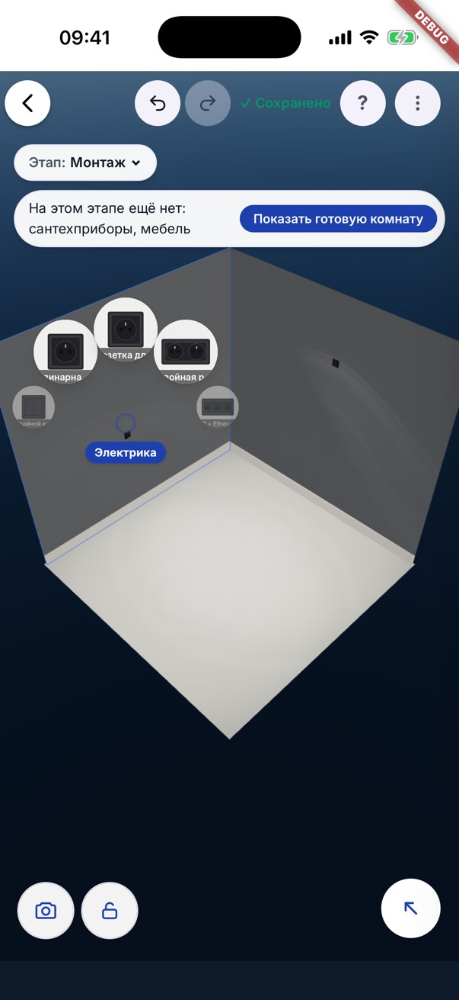
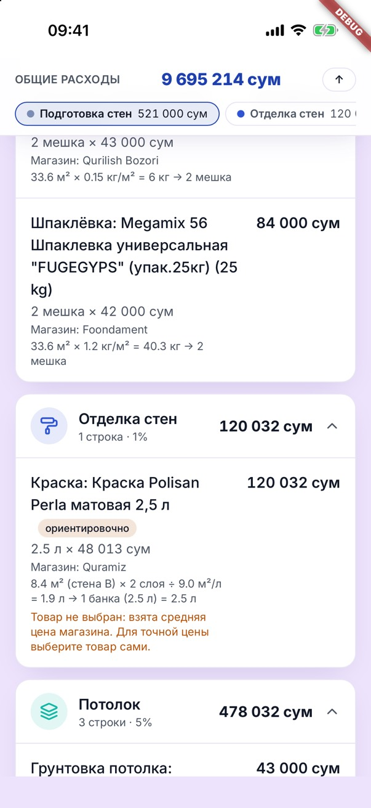
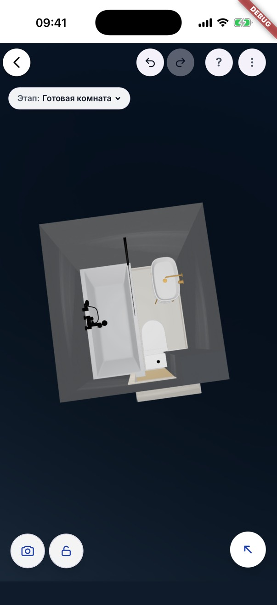
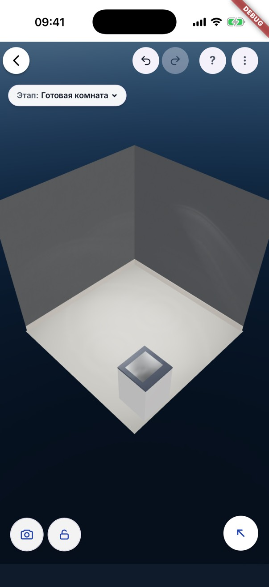
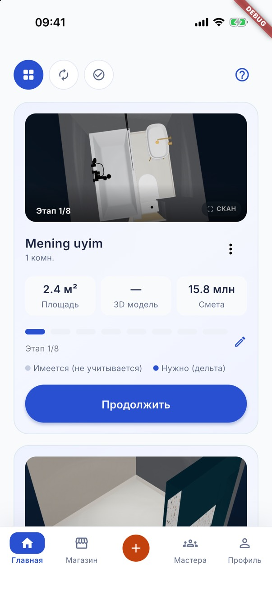

# #338, #345, #347, #348 tuzatishlari: mobil qayta tekshiruv (2026-11-19)

Tekshirilgan PR'lar:
- #340 va #341: andoza_ai#338 (oshxona moykasi 3D'da, kichik hammomda unitaz, «1 мойка»);
- #346: andoza_ai#345 (telefonda Montaj ro'yxati, rozetkadan keyingi bosqich, to'plam ostidagi mashina);
- #347: boshqa joyda o'chirilgan xonani avtosaqlash qayta yaratmaydi;
- #348: emallar devor bo'yog'i sifatida taklif qilinmaydi va narxlanmaydi.

**Muhit:**
- Qurilma: faqat iOS Simulator, iPhone 17 Pro (402×874). Haqiqiy telefon va Android ishlatilmadi.
- Ilova: andoza_ai_mobile `main` 74e397e debug build, prod'ga ulangan. Tekshiruvdan oldin ilova to'liq yopilib, qayta ochildi.
- Server: production `andozaai.uz`, oxirgi deploy `f163dc2d` (#348, completed/success), bundle `index--JHHZG24.js`.
- Til: Русский.
- «Рендер» bosilmadi. «Камеры» ro'yxatidan faqat kamera tanlandi.
- Xonalar:
  - «Кухня» 3 × 3 m: bugungi #341 tekshiruvidan qolgan (moyka, idish mashinasi, «Oshxona to'plami 2», vityajka rozetkasi).
  - Yangi hammom 1.6 × 1.5 m, D devorda eshik 70×200, 3D Master orqali shu tekshiruvda yaratildi.
  - Yangi oshxona 3 × 3 m (faqat moyka), shu tekshiruvda yaratildi va #347 uchun o'chirildi.

> Barcha natijalar simulyatorda ko'rildi.

## Natijalar

| Band | Natija | Izoh |
|---|---|---|
| #338 (PR #340): oshxona moykasi 3D'da ko'rinadi | ✅ | To'plamsiz yangi oshxonada «Добавить мойку» → moyka «стена D» da va 3D'da ko'rinadi (rasm 09) |
| #338 (PR #340): 1.6 × 1.5 hammomda Vanna → Rakovina → Unitaz: unitaz rakovina ostiga tushmaydi | ✅ | Vanna 5 → Rakovina 3 → Unitaz. Rakovina vanna yonida, unitaz undan alohida, stoyak qutisi yonida (rasm 08). Kechagi 2-xato endi yo'q |
| #338 (PR #340/#341): smetada «1 мойка» | ✅ | Bugungi #341 tekshiruvida ko'rilgan (smesitel, sifon, podvodka, silikon qatorlari). Smeta o'zgarmadi |
| #345 (PR #346): ↖ menyuda «Монтаж» → «Панель монтажа», unda «… · Розетка для вытяжки» | ✅ / ⚠️ | Menyuda yangi «Монтаж» bo'limi bor, ichida «Панель мо…» (rasm 04). Panelda: «Стена C · на высоте 200 см · Розетка для вытяжки» (rasm 05). ⚠️ Panel ochilganda bosqich yorlig'i «Готовая комната» ga o'tadi (1-kuzatuv) |
| #345 (PR #346): Монтаж bosqichida rozetka qo'yilgach, yorliq Монтаж'da qoladi | ✅ | Devor → «Электрика» → «Одинарная розетка». Yorliq «Этап: Монтаж» bo'lib qoldi (rasm 06). Tekshiruvdan keyin rozetka «Отменить» bilan olib tashlandi |
| #345 (PR #346): to'plam ichidagi idish mashinasi uning ostida yoki yonida chizilmaydi | ✅ | Umumiy ko'rinishda va Камера 2 da oq korpus endi yo'q (rasm 01, 02). Камера 3 dagi burchakdagi oq to'rtburchak stoyak lyuki, mashina emas (rasm 03) |
| #347: boshqa joyda o'chirilgan xona avtosaqlash bilan qaytmaydi | ⚠️ qisman | O'z test oshxonam Studio'da ochildi, so'ng yopildi va bosh sahifadagi ⋮ → «Удалить проект» bilan o'chirildi. Ilova qayta ishga tushirilgach ham xona ro'yxatda yo'q (rasm 10). Bitta simulyatorda Studio ochiq turganda xonani boshqa joyda o'chirib bo'lmadi (ikkinchi qurilma yoki veb-sessiya yo'q). Shuning uchun «Эта комната удалена…» xabari tekshirilmadi |
| #348: devor bo'yoqlari ro'yxatida alkid emallar yo'q | tekshirib bo'lmadi | Telefonda devor bo'yog'i mahsulotlari ro'yxatiga yo'l topilmadi. Devor halqasidagi «Цвет» faqat rang namunalarini, ↖ «Цвет» faqat 114 ta oboyni ko'rsatadi. 2-kuzatuv |
| #348: smeta emallarni devor bo'yog'i sifatida narxlamaydi | ✅ | Oshxonaning bir devoriga rang berildi. Smetada «Краска: Краска Polisan Perla матовая 2,5 л», 48 013 сум/л, «Товар не выбран: взята средняя цена» (rasm 07). Emal emas |

## Kuzatuvlar

1. **Kichik: «Панель монтажа» ochilganda bosqich «Готовая комната» ga o'tadi (#346).**
   - Takrorlash: «Этап: Монтаж» → ↖ → «Монтаж» → «Панель мо…».
   - Panel ochiladi, lekin yorliq «Этап: Готовая комната» bo'ladi. Panel yopilgandan keyin Montaj'ni qayta tanlash kerak.
   - Ehtimoliy sabab: `openPanelAt` → `openPhasePanel` hali ham `setViewStage('full')` ni chaqiradi. #346 buni faqat `placeElectricalAt` uchun tuzatgan.
   - Panel telefonda pastdan chiqadigan varaq emas, ekranning o'ng yarmini egallaydi (rasm 05).
2. **Telefonda devor bo'yog'i mahsulotlari ro'yxati ochilmaydi (#348 tekshiruvi).**
   - Devor halqasi → «Цвет»: faqat rang namunalari. ↖ → «Цвет»: oboylar, oxirida panel tugmasi yo'q.
   - `WallSection` (DesignPanel `boyoq`) ga telefondan yo'l topilmadi, shuning uchun ro'yxatdagi filtr ko'rilmadi. Smeta qismi tekshirildi.
3. **Eslatma: burchak menyusidagi buyumni bosish va «Добавить прибор» ro'yxati har xil ishlaydi.** Vanna 5 ni ↖ menyudan bosganda «Для «Vanna 5 (shishali)» нет места у стены» chiqdi (keyin u devorga turdi). Shuning uchun Rakovina 3 «Добавить прибор» orqali, unitaz esa menyudan qo'shildi.

## Prod'da yaratilgan, o'zgartirilgan yoki o'chirilgan xonalar

- Yaratildi: hammom 1.6 × 1.5 m (loyiha «Mening uyim»), Vanna 5, Rakovina 3, Unitaz bilan.
- Yaratildi va o'chirildi: oshxona 3 × 3 m (loyiha «Mening uyim», faqat moyka). #347 uchun o'chirildi.
- O'zgartirildi: bugungi «Кухня» 3 × 3 m. Bir devoriga rang berildi; vaqtincha qo'yilgan rozetka bekor qilindi.
- Boshqa xonalarga tegilmadi.

## Rasmlar

- 01. 
- 02. 
- 03. 
- 04. 
- 05. 
- 06. 
- 07. 
- 08. 
- 09. 
- 10. 
