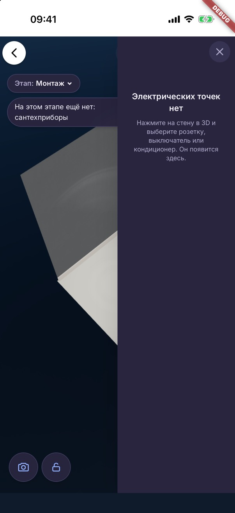
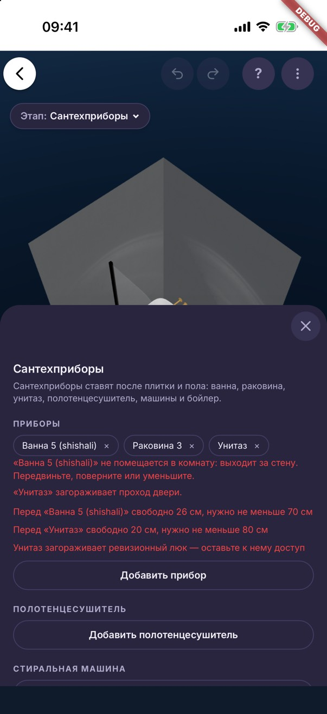
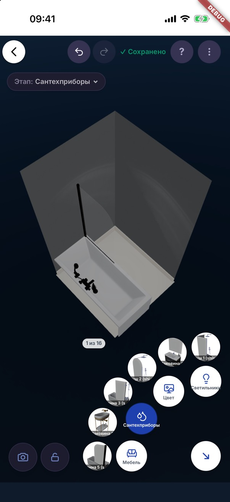
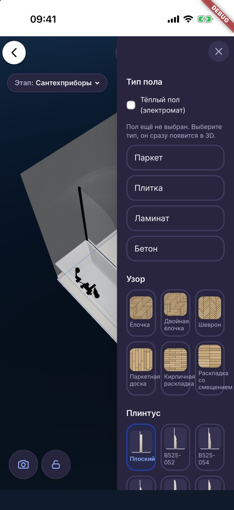
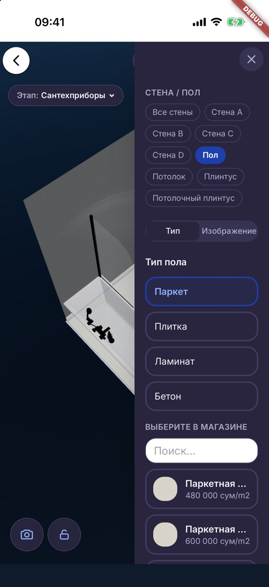
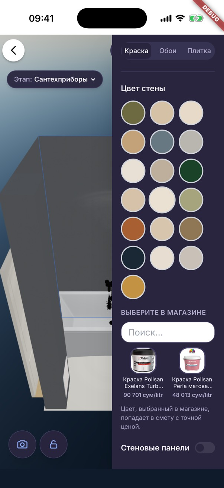
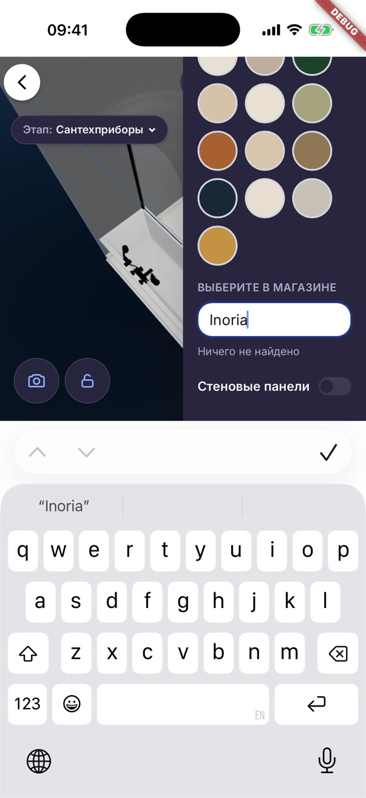

# #350 tuzatishlari (PR #351): mobil qayta tekshiruv (2026-11-19)

**Muhit:**
- Qurilma: faqat iOS Simulator, iPhone 17 Pro (402×874).
- Ilova: andoza_ai_mobile `main` 74e397e debug build, prod'ga ulangan. Ilova qayta o'rnatilmadi; tekshiruvdan oldin to'liq yopilib, qayta ochildi.
- Server: production `andozaai.uz`. `f48a56c5` (#351) va keyingi `333da4fc` deploylari completed/success. Bundle `index-BQ3TsZ_5.js`.
- Til: Русский. Studio bu safar qorong'i (dark) mavzuda ochildi.
- «Рендер» bosilmadi.
- Xona: shu kungi 1.6 × 1.5 hammom (D devorda eshik 70×200).

> Barcha natijalar simulyatorda ko'rildi.

## Natijalar

| Band | Natija | Izoh |
|---|---|---|
| 1. «Этап: Монтаж» → ↖ → «Монтаж» → «Панель монтажа»: yorliq Монтаж'da qoladi | ✅ | Panel ochildi, yorliq «Этап: Монтаж» (rasm 01) |
| 1. Boshqa panellar: Jihozlar (Сантехприборы) | ✅ | Монтаж'dan ↖ → «Сантехприборы» → «Панель пр…»: yorliq «Сантехприборы» ga o'tdi. Монтаж bosqichida jihozlar ko'rinmaydi, shuning uchun bu PR'da yozilgan «o'z bosqichiga oldinga o'tish». «Готовая комната» ga o'tmadi (rasm 02) |
| 1. Boshqa panellar: Pol | ✅ | «Сантехприборы» bosqichida polni bosib → «Панель пола»: yorliq «Сантехприборы» da qoldi (rasm 04) |
| 2. ↖ «Цвет» oxirida «Панель краски», u devor bo'yog'i ro'yxatini ochadi | ✅ | «Цвет» kategoriyasi endi 115 ta (oxirgisi «Панель кр…», rasm 05). Panelda «Стена A» → «Краска» → «Выберите в магазине» |
| 2. Ro'yxatda alkid emallar yo'q (#348) | ✅ | Ro'yxatda faqat 2 ta bo'yoq: «Краска Polisan Exelans Turbo» 90 701 сум/л va «Краска Polisan Perla матовая» 48 013 сум/л (rasm 06). «Inoria» qidirilsa «Ничего не найдено» (rasm 07) |
| 3. 1.6 × 1.5 hammomda ↖ menyudan «Vanna 5»: noto'g'ri «нет места у стены» yo'q | ✅ | Hammomdagi jihozlar olib tashlandi, so'ng ↖ → «Сантехприборы» → «Ванна 5». Ogohlantirish chiqmadi, vanna devor bo'ylab turdi (rasm 03) |

## Kuzatuvlar

1. **Eslatma: Jihozlar panelidagi ogohlantirish.** Tekshiruvdan oldin (eski joylashuvda) panel «Ванна 5 (shishali)» не помещается в комнату: выходит за стену» ni ko'rsatgan edi (rasm 02). U jihozlar #351 dan oldin qo'yilgan edi. Qayta qo'yilgan vanna uchun bu tekshirilmadi.
2. **Montaj, Pol va Bo'yoq panellari** telefonda hamon o'ng yarim panel bo'lib ochiladi (PR #351 da alohida ko'rib chiqish uchun qoldirilgan).

## Prod'da o'zgartirilgan xonalar

- 1.6 × 1.5 hammom: Ванна 5, Раковина 3 va Унитаз olib tashlandi, so'ng faqat Ванна 5 ↖ menyudan qayta qo'shildi. Hozir xonada faqat vanna bor.
- Boshqa xonalarga tegilmadi. Hech narsa o'chirilmadi.

## Rasmlar

- 01. 
- 02. 
- 03. 
- 04. 
- 05. 
- 06. 
- 07. 
