# Oshxona qayta tekshiruvi (#341) va kameralar (#342): mobil tekshiruv (2026-11-19)

Tekshirilgan PR'lar:
- #341: oshxona garnituri moyka devoriga qo'yiladi, ikkinchi moyka chizilmaydi, sehrgar xona nomini saqlaydi, smeta matnlari, vityajka rozetkasi;
- #342: «Камеры» stansiyalari mebel ichida turmaydi.

**Muhit:**
- Qurilma: faqat iOS Simulator, iPhone 17 Pro (402×874). Haqiqiy telefon va Android ishlatilmadi.
- Ilova: andoza_ai_mobile `main` 74e397e debug build (#67 va #68 bor), prod'ga ulangan.
- Server: production `andozaai.uz`.
  - Boshida oxirgi deploy `399a2dec` (#342) edi.
  - Tekshiruv paytida `4e0bf056` (#343, render panoramasi choki) deploy bo'ldi, taxminan 11:48 da. #343 faqat render panoramasiga tegadi, u tekshirilmadi.
- Til: Русский.
- «Рендер» bosilmadi. «Камеры» ro'yxatidan faqat kamera tanlandi.
- Tekshiruv o'rtasida simulyator o'zi o'chib qoldi. U qayta yoqildi va ilova qayta ishga tushirildi; ilova qayta o'rnatilmadi va login so'ramadi.
- Xonalar:
  - Yangi oshxona 3.0 × 3.0 m (9 m²), 3D Master orqali shu sessiyada yaratildi (0-qadam). Unga moyka, idish yuvish mashinasi, «Oshxona to'plami 2» va vityajka rozetkasi qo'shildi.
  - Bo'sh xona 20 m² (oldingi sehrgar tekshiruvidagi «Спальня»). Unda faqat kameralar ko'rildi, hech narsa o'zgartirilmadi.

> Barcha natijalar simulyatorda ko'rildi.

## 0-qadam: sovuq ishga tushirishdan keyin sehrgar oshxonasi

Ilova to'liq yopilib, qayta ochildi. 3D Master → «Кухня» → «Начать оформление».

- Studio 4, 8, 15 va 25 soniyada ham «Этап: Трубы» ni ko'rsatdi (rasm 00a, 00b). #330 dagi 3-xato bu safar takrorlanmadi.
- #67 logi: WebView `/studio/:id?phase=quvurlar&app=1&lang=ru` ni ochdi, keyin `/studio/:id/ichkarida?phase=quvurlar…` ga o'tdi.

## Natijalar

| Band | Natija | Izoh |
|---|---|---|
| #341 Avval moyka va idish mashinasi, keyin Mebel'dan «Oshxona to'plami 2»: garnitur moyka devoriga qo'yiladi va qisqartiriladi | ✅ | Moyka va mashina «стена D» ga qo'yildi (rasm 01). Ikkalasi 3D'da ko'rindi; kechagi 1-xato endi yo'q (rasm 02). Garnitur xabar bilan qo'yildi: «Oshxona to'plami 2» подогнан под стену, Длина 2.21 м (в каталоге 4.00 м)» (rasm 03). Garnitur mashina bilan bir devorda, uning yonida (rasm 04, 13). Garnitur tanlanganda «2,21 × 0,63 m · 10 000 000 сум» yozuvi chiqdi |
| #341 Faqat garniturning moykasi ko'rinadi | ✅ | Alohida qo'shilgan moyka endi chizilmaydi. Garnitur ichida bitta moyka va kran bor (rasm 13, 14) |
| #341 Sehrgar oshxonasi Studio va xonalar ro'yxatida «Кухня» deb nomlanadi | ✅ / ⚠️ | ✅ Studio'dagi bir necha avtosaqlashdan keyin ham bosh sahifa ⋮ → «Комнаты» ro'yxatida «Кухня» (rasm 06). ⚠️ Mobil Studio'da xona nomi hech qayerda ko'rinmaydi (sarlavha yo'q), shuning uchun «Studio'da» qismi faqat ro'yxat orqali tasdiqlandi |
| #341 Smetada «Работа: установка мойки» va «1 мойка» | ✅ | «Работа: установка мойки» 1 шт. × 250 000 сум (rasm 09). «1 мойка» smesitel, sifon, gibkaya podvodka va silikon qatorlarida (rasm 07, 08, 10) |
| #341 Garnitur formulasi «… сум ÷ 4.00 м = … сум/м × X м» | ✅ | «10 000 000 сум ÷ 4.00 м = 2 500 000 сум/м × 2.21 м», jami 5 525 000 сум. Endi «so'm» emas, «сум» (rasm 10) |
| #341 Montaj ro'yxatida «Розетка для вытяжки» | ⚠️ tekshirib bo'lmadi | Halqadagi «Розетка для…» devorning yuqori qismiga qo'yildi (rasm 11). Lekin telefonda Montaj ro'yxati (DesignPanel'dagi `MontajSection`) ochilmaydi: Montaj bosqichida burchak menyusida panel tugmasi yo'q, rozetkani bosish faqat uni belgilaydi. 1-xato |
| #342 Garnitur bor xonada Камера 1…4: kadr mebel ichidan olinmaydi | ✅ | To'rt kameraning hammasi xonani ko'rsatadi, bir rangli kadr yo'q. Kamera 1 da old planda stoleshnitsa chekkasi ko'rinadi, lekin kamera uning ichida emas (rasm 12–15) |
| #342 Bo'sh xonada kameralar xonani burchaklardan ko'rsatadi | ✅ | 20 m² bo'sh xonada Kamera 1…4: har biri qarama-qarshi burchakni devorlar, shift va pol bilan ko'rsatadi (rasm 16–19) |

## Topilgan xatolar

1. **⚠️ Telefonda Montaj ro'yxati ochilmaydi (#341 R5).**
   - Takrorlash: oshxona → «Этап: Монтаж» → devorni bosing → «Электрика» → «Розетка для…» (32A emas). Rozetka devorning yuqorisida paydo bo'ladi. Keyin ro'yxatni ochib ko'ring.
   - Kutilgan: Montaj ro'yxati ochiladi, unda «… · Розетка для вытяжки».
   - Haqiqiy: ro'yxatga yo'l yo'q. Burchak menyusida (↖) Montaj uchun panel tugmasi yo'q (faqat Светильники, Цвет, Сантехприборы, Мебель). Rozetkani bosish uni faqat belgilaydi.
   - Kodda `openPanelAt` faqat `boyoq | chiroq | mebel | quvurlar | jihozlar | pol` ni qabul qiladi. `placeElectricalAt` esa `openPhasePanel('montaj')` ni chaqiradi, lekin `setShowPanel(true)` ni chaqirmaydi. Shuning uchun mobil'da panel yopiqligicha qoladi, bosqich esa «Готовая комната» ga o'tadi.
2. **Kichik: rozetka qo'shilgandan keyin bosqich «Готовая комната» ga o'tadi.** Montaj bosqichida rozetka qo'yilgach, yorliq «Этап: Готовая комната» bo'ladi. Keyingi rozetka uchun Montaj'ni qayta tanlash kerak (yuqoridagi `openPhasePanel` → `setViewStage('full')`).
3. **Kichik: idish yuvish mashinasining oq korpusi garnitur ostidan chiqib turadi.** Kamera 2 da garnitur tagida oq quti ko'rinadi (rasm 13). Kamera 3 da u garnitur oxirida, burchak yonida (rasm 14). Mashina garnitur bilan bir qatorda, lekin garnitur o'z ichida mashina joyini qoldirmaydi.

## Prod'da yaratilgan yoki o'zgartirilgan xonalar

- Yangi loyiha «Mening uyim», xona «Кухня» 3.0 × 3.0 m (0-qadamda yaratildi). Qo'shildi: moyka (D devor), idish yuvish mashinasi 60 sm (D devor), «Oshxona to'plami 2» (2.21 m), vityajka rozetkasi. Smeta 9 587 182 сум.
- 20 m² bo'sh xona: faqat ko'rildi.
- Hech qanday xona o'chirilmadi.

## Rasmlar

- 00a. 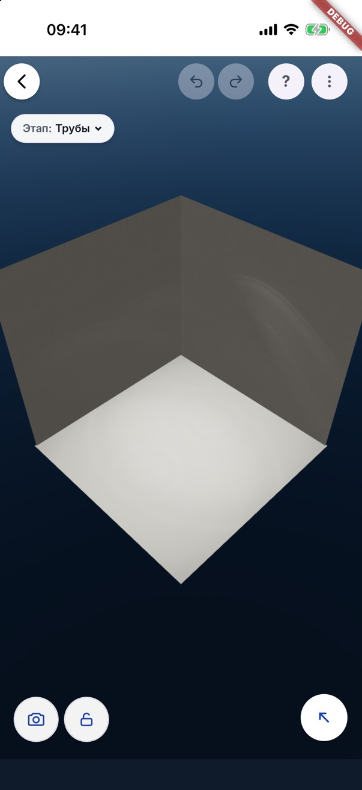
- 00b. 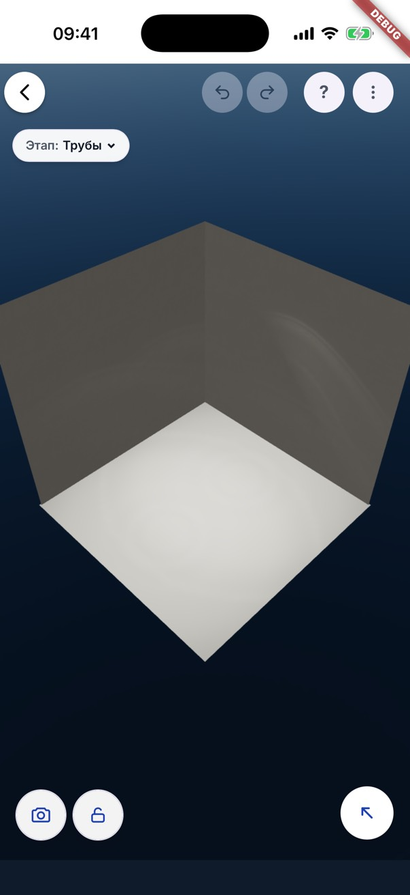
- 01. 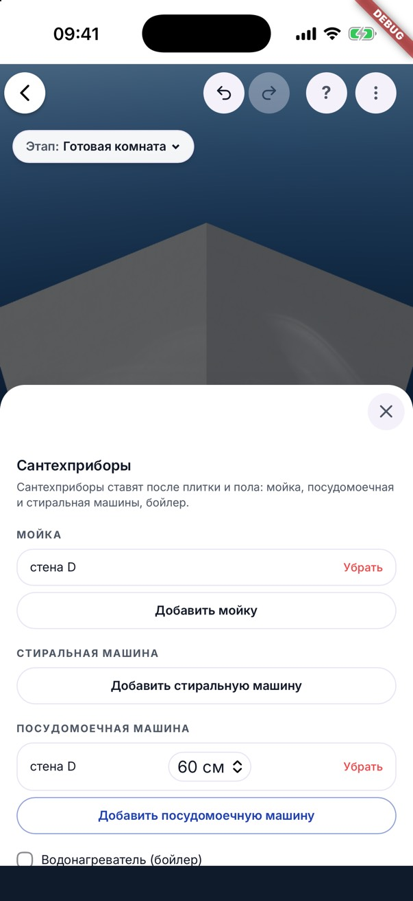
- 02. 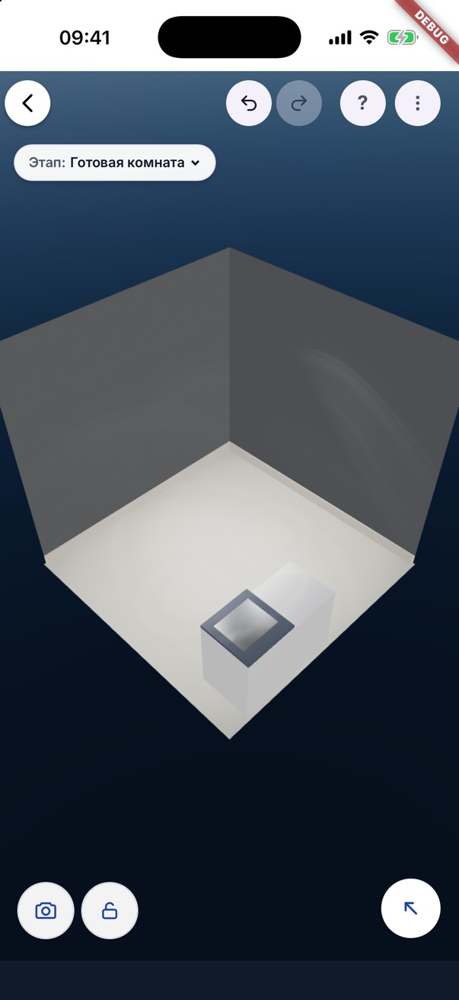
- 03. 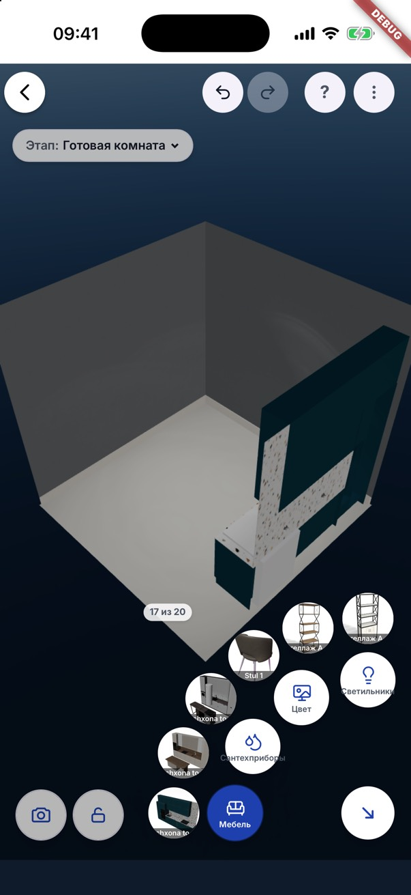
- 04. 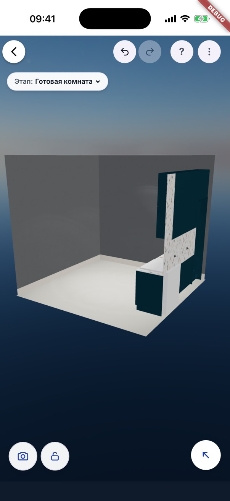
- 06. 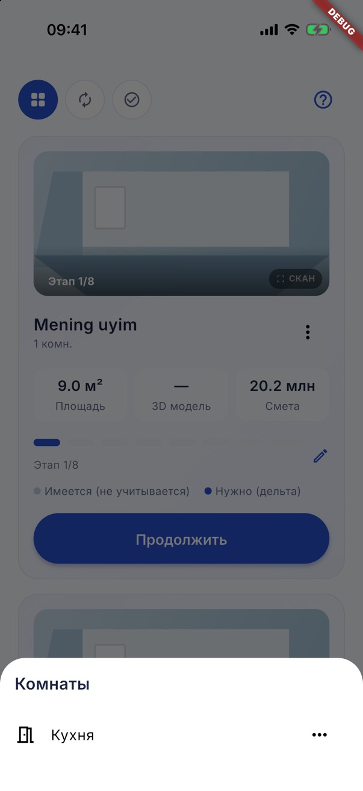
- 07. 
- 08. 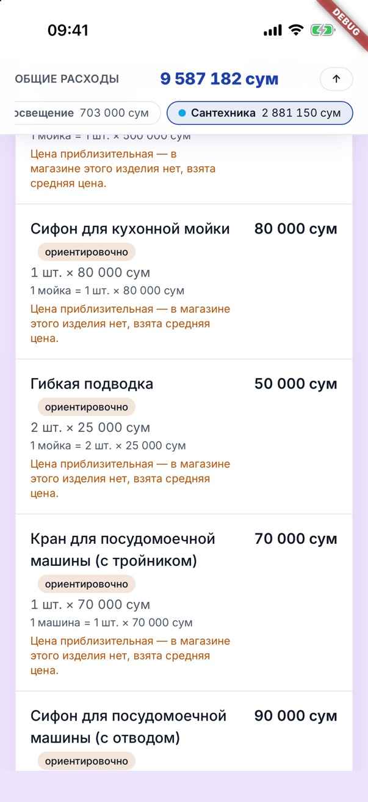
- 09. 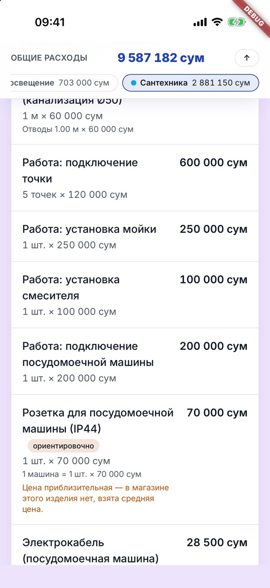
- 10. 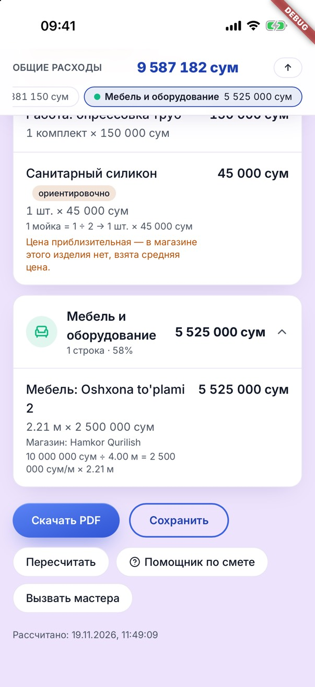
- 11. 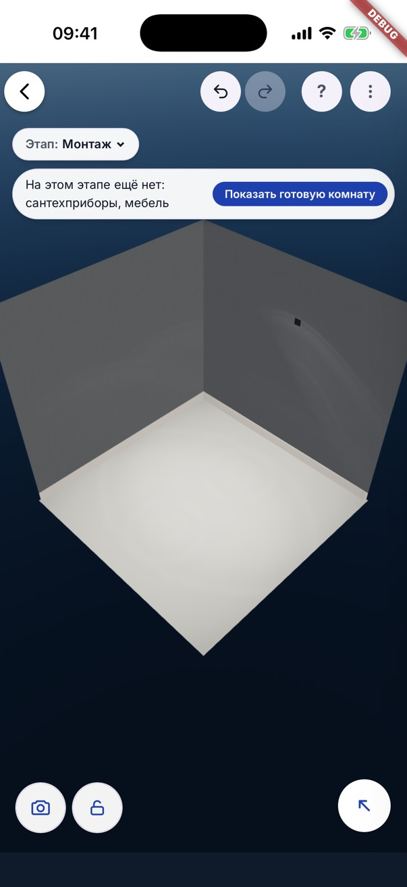
- 12. 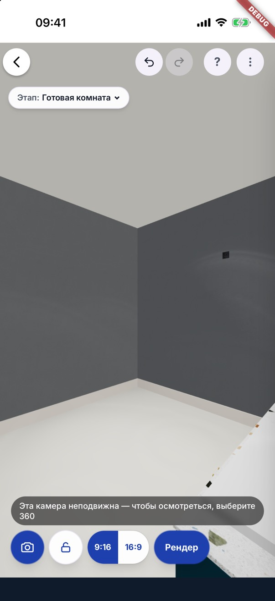
- 13. 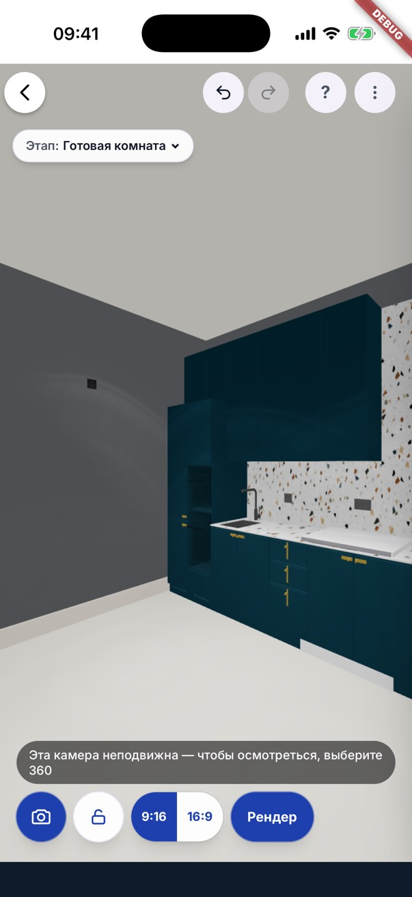
- 14. 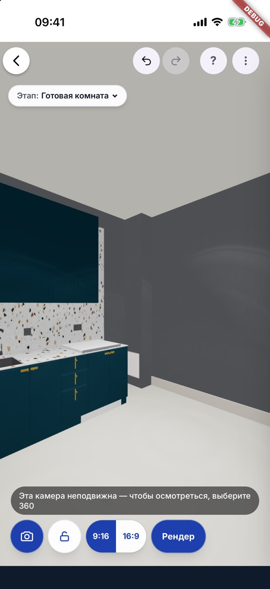
- 15. 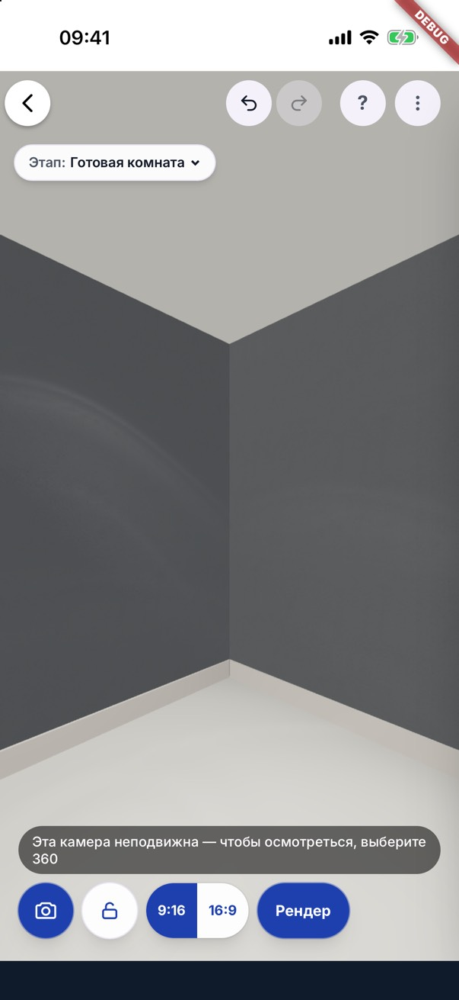
- 16. 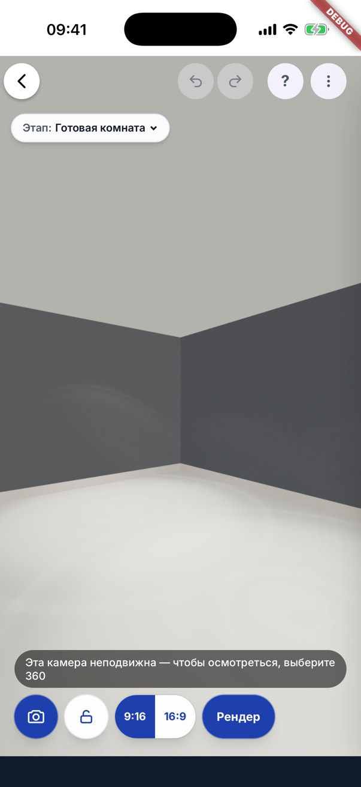
- 17. 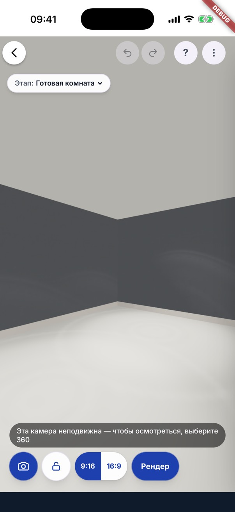
- 18. 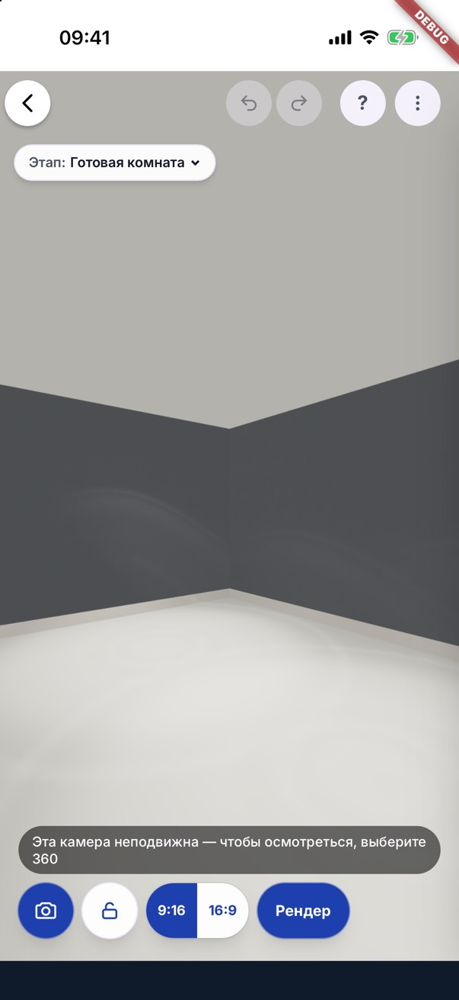
- 19. 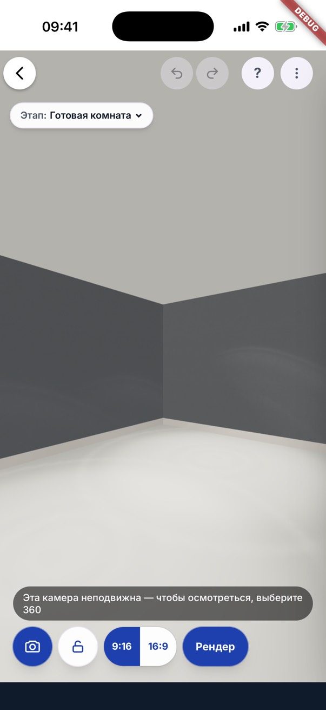
