# #353 smeta, #357/#336 jihozlar, #335 oshxona: mobil tekshiruv (2026-11-21)

**Muhit:**
- Qurilma: faqat iOS Simulator, iPhone 17 Pro (402×874).
- Ilova: andoza_ai_mobile 1.0.3+36 debug build (`main` d37384f, mehmon rejimi va yangi pastki «sehrli» menyu), prod'ga ulangan, egasining akkauntida. Ilova qayta o'rnatilmadi.
- Server: production `andozaai.uz`, deploy `f2b3c60e` (#357) completed/success. Bundle `index-CGTp5o1a.js`.
- Til: O'zbekcha.
- «Рендер» bosilmadi.
- Xonalar: faqat shu tekshiruvda 3D Master orqali yaratilgan o'zimning test xonalarim:
  - oshxona 3 × 3 m (birinchi);
  - hammom 2.5 × 2.0 m;
  - oshxona 3 × 3 m (ikkinchi, bo'yoq/kafel uchun).
- Telefonda Studio'dagi 3D jihozlarni (sochiq quritgich, kir yuvish mashinasi, stoyak) barmoq bilan tanlab ham, sudrab ham bo'lmadi. Bosilganda tegish devor, pol yoki plintusga o'tadi. Shu sababli «sudrash» bandlari ⚠️ (quyida).

> Barcha natijalar simulyatorda ko'rildi.

## Natijalar

### #353 — Smeta: do'konlar xaritada

| Band | Natija | Izoh |
|---|---|---|
| Tepada «Do'konlar xaritada» xaritasi | ✅ | Xarita umumiy summa va «Xarajat taqsimoti» kartasidan keyin, qatorlardan oldin turadi. Sarlavha «Belgini bosing — o'sha do'kon qatorlariga o'tadi». Pastida «Ba'zi do'konlar xaritada yo'q: joyini hali kiritmagan» (rasm 07) |
| Belgini bosish o'sha do'kon guruhiga o'tadi | ✅ | Belgi bosilganda «Quramiz» guruhiga o'tdi (rasm 08). Ikkinchi oshxonada xaritada 2 ta belgi bor edi (Quramiz va Foondament) |
| Qatorlar do'konlar bo'yicha guruhlangan (nom, qatorlar soni, jami, manzil, telefon/Telegram) | ✅ | Misol: «Hamkor Qurilish · 1 ta qator · 4 972 500 so'm», «Chilonzor», telefon (rasm 06); «Quramiz · Mustaqillik shoh ko'chasi, 107», telefon va Telegram (rasm 08). «Do'konlar bo'yicha / Bo'limlar bo'yicha» almashtirgichi ishlaydi |
| Qatorlarda rasm (mahsulotsiz qatorda belgi) | ✅ | Mahsulot qatorlarida rasm bor (oshxona to'plami, bo'yoq, shtukaturka). Mahsulotsiz qatorlarda belgi chiqadi: grunt — bolg'a, «Devor plitkasi (o'rtacha narx)» — valik |
| «Yandex/Google Xaritalar» xarita ilovasini ochadi | ❌ | **Simulyatorda hech qanday xarita ilovasi ham, Safari ham ochilmadi.** Ikkala tugma bosilganda Studio yopilib, ilovaning bosh sahifasiga («Uy») qaytdi. Yandex birinchi oshxonada, Google hammomda sinab ko'rildi, natija bir xil (rasm 13). Ochiq ilovalar ro'yxatida faqat andoza.ai bor edi |
| Joyi kiritilmagan do'konda «Xaritadagi joyi kiritilmagan» | ✅ | «Chilonzor · Xaritadagi joyi kiritilmagan» (rasm 06), «Sergeli · …», hammomdagi «Hansgrohe» da faqat shu yozuv. Bunday do'konlarda Yandex/Google tugmasi yo'q |

### #357 — sochiq quritgich va kir yuvish mashinasi

| Band | Natija | Izoh |
|---|---|---|
| Ikkinchi «Sochiq quritgich qo'shish» birinchisining ustiga tushmaydi | ⚠️ | 3D'da ikkinchi quritgich birinchisining yoniga, unga tegib qo'yildi. Ikkalasi alohida ko'rinadi: 3 ta ustun va 3 ta quvur nuqtasi (rasm 10). Lekin Jihozlar panelida ikkalasi ham «A devor · 100 sm» deb yozilgan (rasm 09). Panel yozuvi joyni noto'g'ri ko'rsatadi |
| Sudralgan quritgich boshqasining yonida to'xtaydi | ⚠️ tekshirilmadi | Telefonda quritgichni tanlab/sudrab bo'lmadi. Ingichka quvurlar bosilganda tegish devorga o'tadi va devor halqasi ochiladi |
| Stoyakni mashina ustiga sudrash: mashina bo'sh joyga o'tadi | ⚠️ tekshirilmadi | Stoyak ham, mashina ham telefonda sudralmadi |

### #336 — hammom: stoyak qutisi

| Band | Natija | Izoh |
|---|---|---|
| Quritgich yoki mashina stoyak burchagiga sudralganda stoyak qutisiga kirmaydi | ⚠️ | Sudrab bo'lmadi. Panel orqali qo'shilgan mashina D devorga, stoyak burchagi yoniga tushdi. Yuqoridan qaraganda u quti chetidan tashqarida, qutiga kirmagan (rasm 11, 12). Quritgichlar stoyak qutisidan uzoqda, A devorda |

### #335 — oshxona

| Band | Natija | Izoh |
|---|---|---|
| Montaj bosqichida devor bosilganda halqa «Elektr» da ochiladi | ✅ | «Bosqich: Montaj» → devor: halqa markazida «Elektr», chapda «Yangi xona», o'ngda «Rang» (rasm 05). Taqqoslash uchun: «Tayyor xona» va «Quvurlar» bosqichida markazda «Rang» |
| Oshxona «Jihozlar» matnida vanna/unitaz yo'q | ✅ | «…moyka, idish va kir yuvish mashinalari, boyler», vanna/unitaz yo'q (rasm 02) |
| Mebel kartasida o'lcham toza («0.37×4 m» kabi) | ✅ | Tanlangan to'plam kartasi: «Oshxona to'plami 3 · 2.21 × 2.39 m · 9 000 000 so'm» (rasm 04). Smetada esa «2.21 m × 2 250 000 so'm» (rasm 06) |
| Fartuk qo'shilganda smetadagi bo'yoq maydoni kamayadi | ⚠️ | Telefonda alohida «fartuk» (qisman kafel) bandi topilmadi. Devor halqasida faqat Rang, Oboy, Kafel, Oyna, Eshik, Elektr, Yangi xona bor. Uning o'rniga B devorga kafel berildi: oldin smetada «8.4 m² (devor B)» bo'yoq bor edi (rasm 14). Kafeldan keyin bo'yoq qatori yo'qoldi va «Devor plitkasi 8.40 m² × 1.10 = 9.24 m² (devor B)» paydo bo'ldi (rasm 15). Ya'ni kafel bo'yoq maydonini to'g'ri ayiradi, lekin qisman fartuk alohida tekshirilmadi |
| Ilova sehrgari yangi oshxonani «Кухня»/«Oshxona» deb ataydi | ⚠️ tekshirilmadi | Ilovada xona nomi ko'rinadigan joy topilmadi. Bosh sahifadagi kartada faqat loyiha nomi «Mening uyim · 1 xona» chiqadi |

### Boshqa bandlar

| Band | Natija | Izoh |
|---|---|---|
| #347 — ikki qurilma/oyna: biri xonani o'chiradi, ikkinchisida «Эта комната удалена…» | tekshirilmadi | Faqat bitta simulyator bor. O'z test xonam bilan ikkinchi oynani xavfsiz ochishning imkoni bo'lmadi |
| Eski #264 — quritgich, mashina va stoyak ustma-ust tushmaydi | ⚠️ | Qo'shishda ustma-ust tushmadi: quritgichlar yonma-yon, mashina stoyak yonida (rasm 10, 12). Sudrash bilan tekshirib bo'lmadi, panel yozuvi «100 sm» ikkalasida bir xil |
| Eski #274 — oshxona fartugi: kafel yoki skinali | ⚠️ | «Oshxona to'plami» modelining o'zida naqshli fartuk ko'rinadi (rasm 16). Devorga kafel berish ishlaydi va smetaga tushadi (rasm 15). Skinali yoki alohida fartuk bandi telefonda topilmadi |
| #343 | — | egasining ko'rsatmasi bilan tekshirilmadi (render krediti) |

## Kuzatuvlar (yangi xatolar)

1. **Smetadagi «Yandex Xaritalar» / «Google Xaritalar» Studio'ni yopadi.** Takrorlash: oshxona yoki hammom → ⋮ → Smeta → manzili bor do'kon (masalan Quramiz) → «Google Xaritalar». Studio yopiladi va ilova «Uy» ga qaytadi, xarita ochilmaydi (rasm 13).
2. **Jihozlar panelida ikkinchi quritgich ham «A devor · 100 sm».** 3D'da u birinchisining yonida turibdi (rasm 9 va 10). Takrorlash: hammom → Jihozlar paneli → «Sochiq quritgich qo'shish» ni 2 marta bosing.
3. **Telefonda 3D jihozlarni tanlab/sudrab bo'lmaydi.** Takrorlash: hammomga quritgich va mashina qo'shing, so'ng ularni bosing yoki uzoq bosib sudrang. Tegish devor, pol yoki plintusga o'tadi. Shu sabab #357/#336 sudrash bandlarini telefonda tekshirib bo'lmaydi.
4. **Smeta ↔ 3D almashgandan keyin «Ortga» (undo) o'chib qoladi.** Takrorlash: devorga kafel bering → ⋮ → Smeta → ↑ → 3D. Undo tugmasi faol emas.
5. **Eslatma: boshlang'ich bosqich bir xil emas.** Birinchi oshxona «Bosqich: Tayyor xona» da ochildi (rasm 01). Hammom va ikkinchi oshxona «Quvurlar» da ochildi.

## Prod'da yaratilgan yoki o'zgartirilgan xonalar

Hammasi shu tekshiruvda egasining akkauntida 3D Master orqali yaratilgan yangi xonalar.

- **Oshxona 3 × 3 m (birinchi):** moyka (D devor), «Oshxona to'plami 3».
- **Hammom 2.5 × 2.0 m:**
  - Rakovina 3;
  - 2 ta sochiq quritgich (suvli, 50×80);
  - kir yuvish mashinasi (D devor).
- **Oshxona 3 × 3 m (ikkinchi):**
  - B devor avval bo'yaldi, keyin kafel berildi (Marmar oq, 300×600);
  - Mebel → Oshxona to'plami qo'shildi.

Egasining boshqa xonalari faqat bir marta ochildi: kartaga tasodifan tegilganda bo'sh 12 m² xona ochildi va darhol yopildi. Unda hech narsa o'zgartirilmadi. Hech qanday xona o'chirilmadi.

## Rasmlar

- 01. 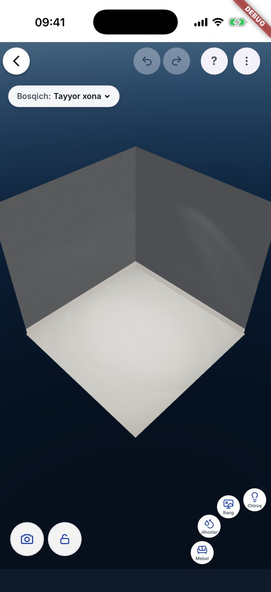
- 02. 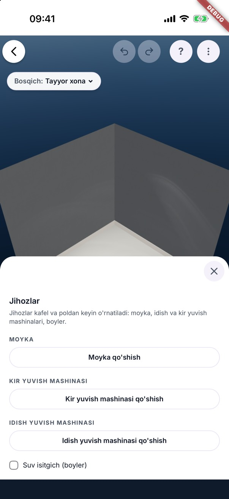
- 03. 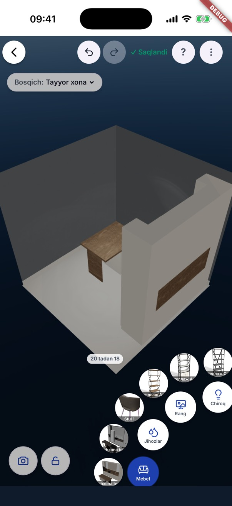
- 04. 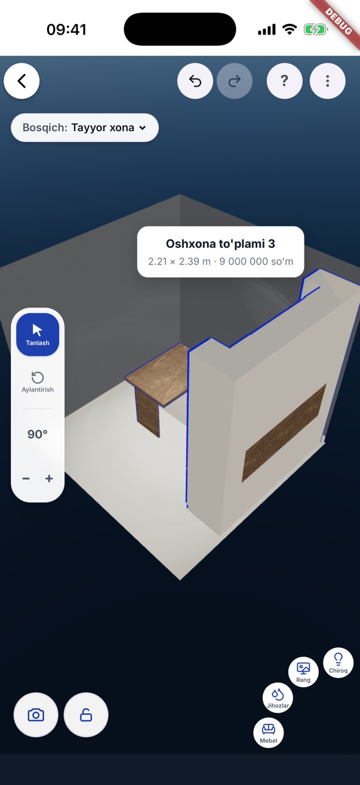
- 05. 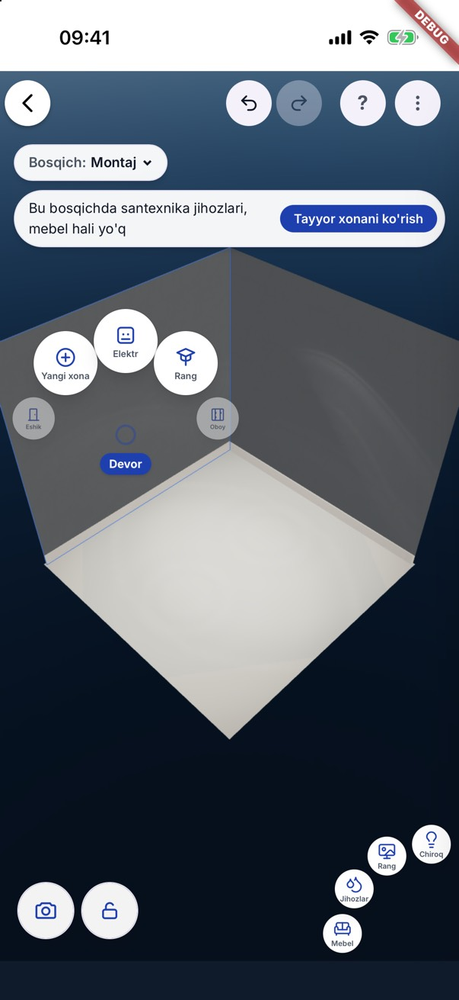
- 06. 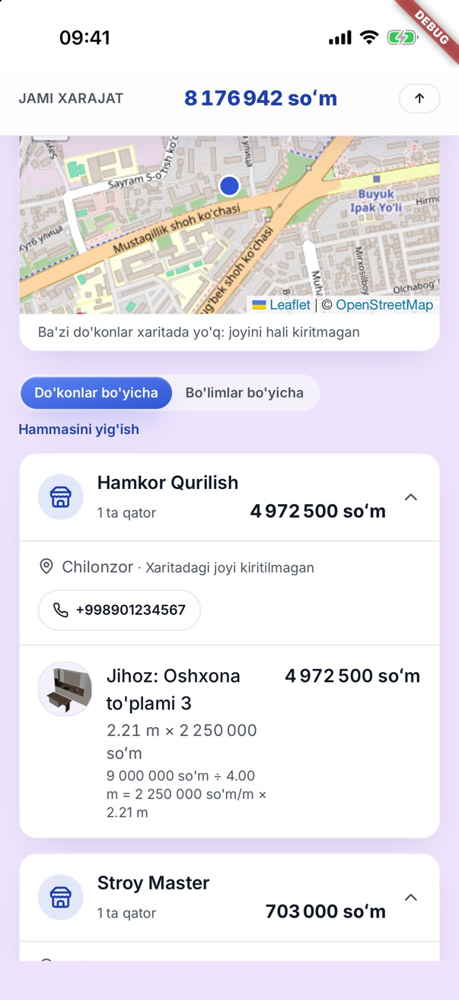
- 07. 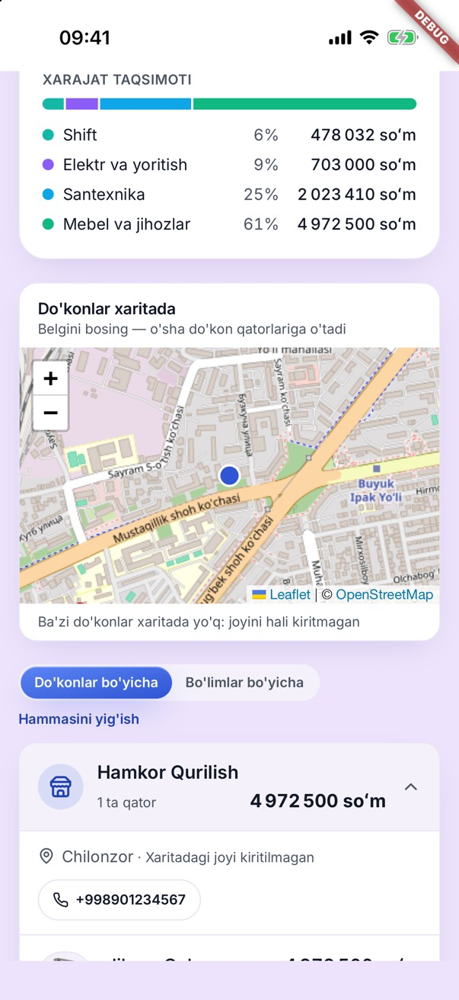
- 08. 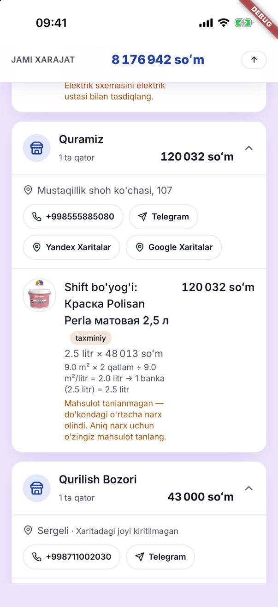
- 09. 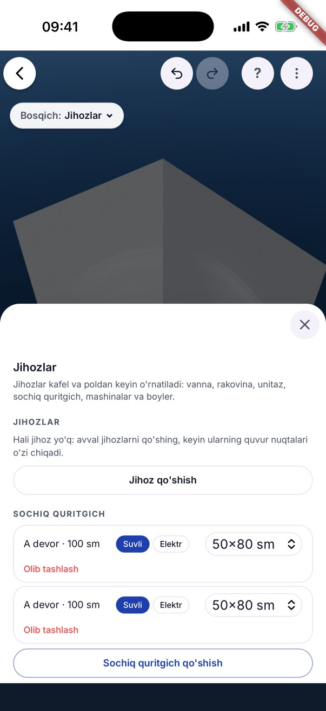
- 10. 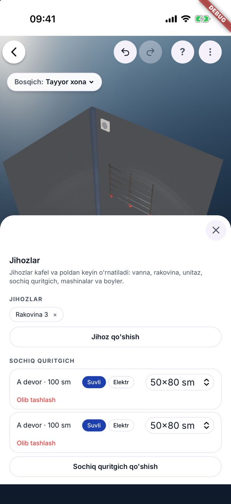
- 11. 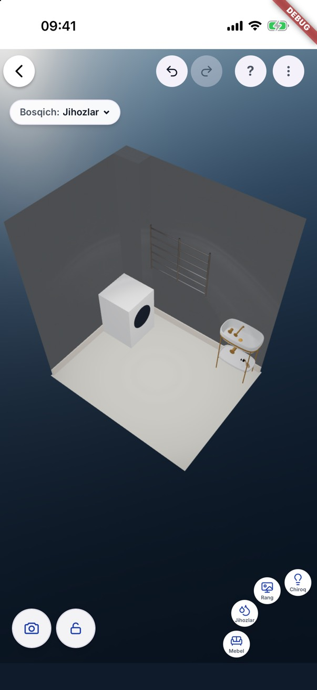
- 12. 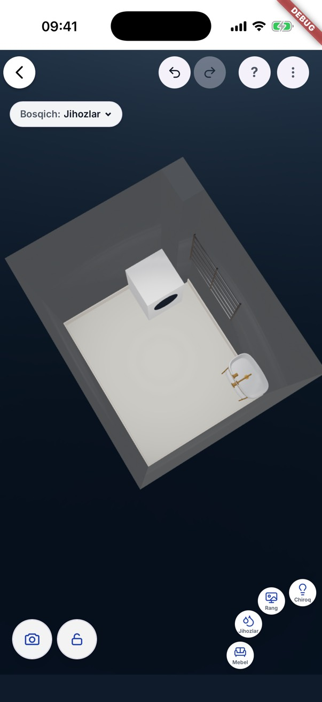
- 13. 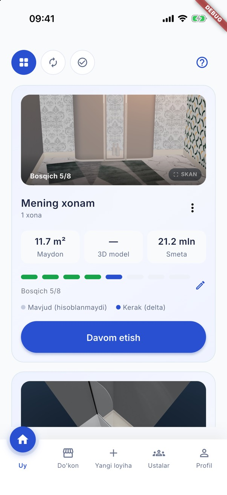
- 14. 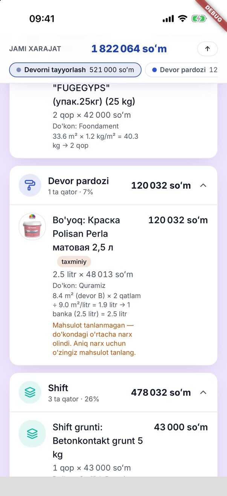
- 15. 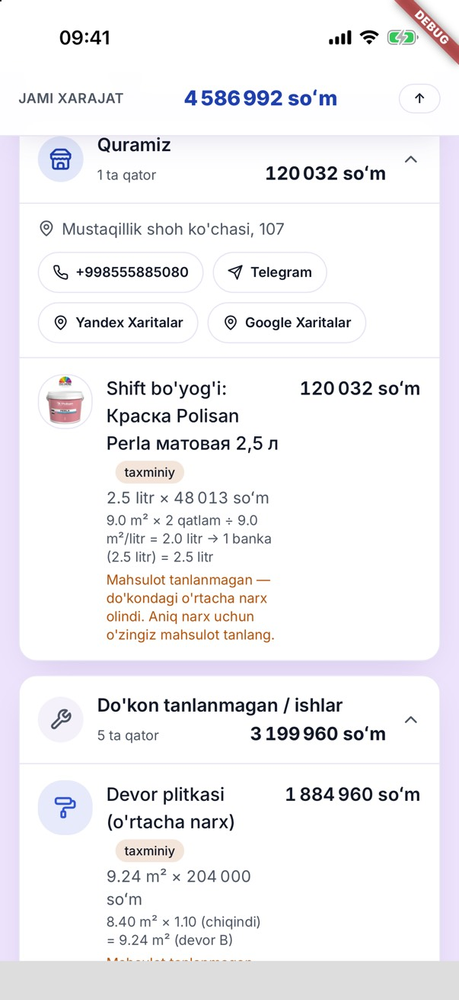
- 16. 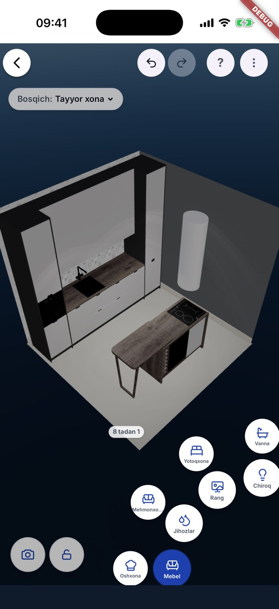
