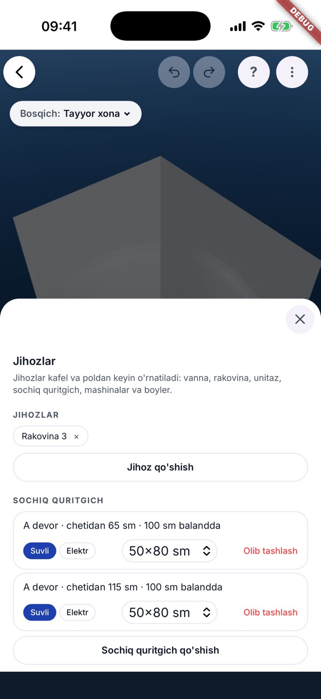
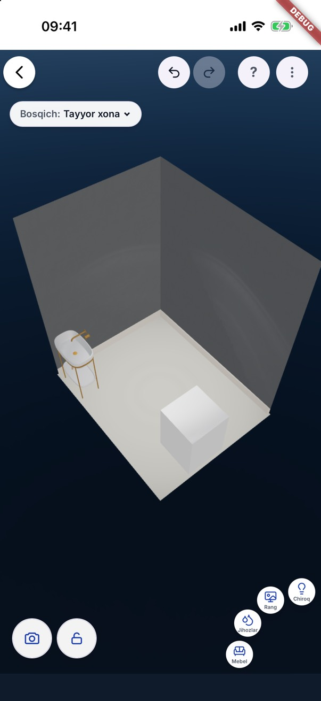
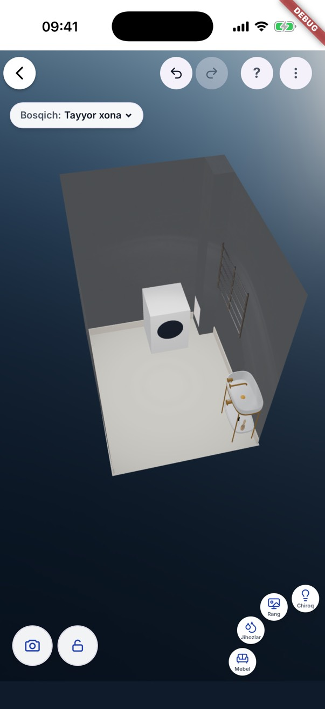
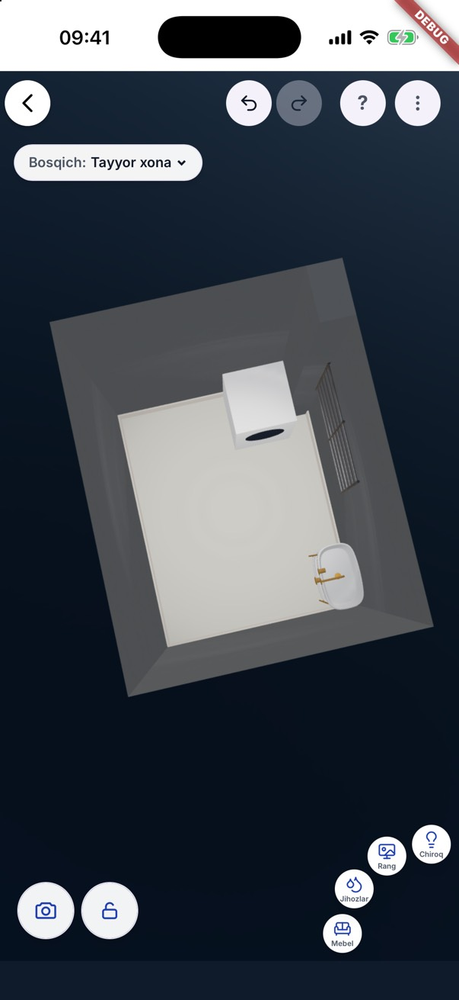
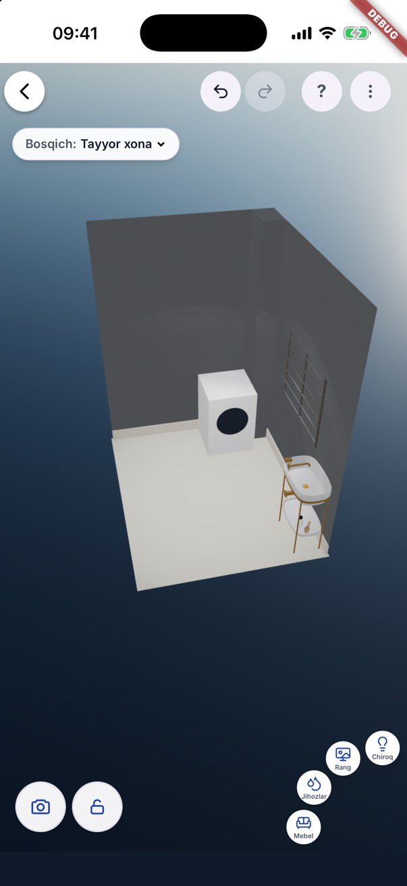
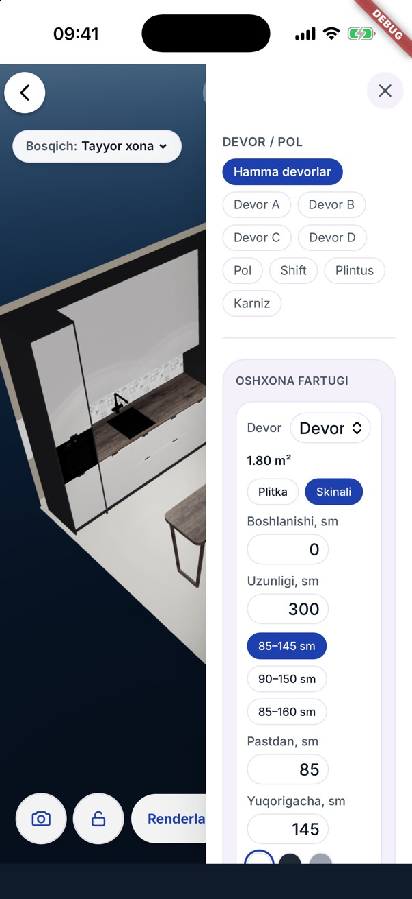
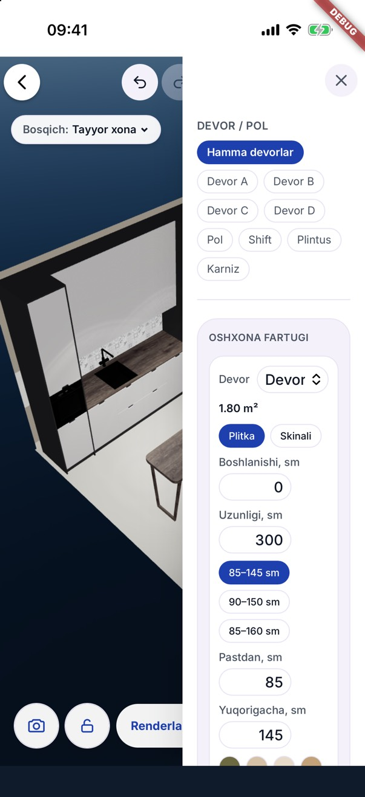
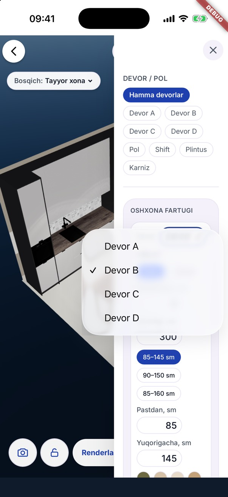
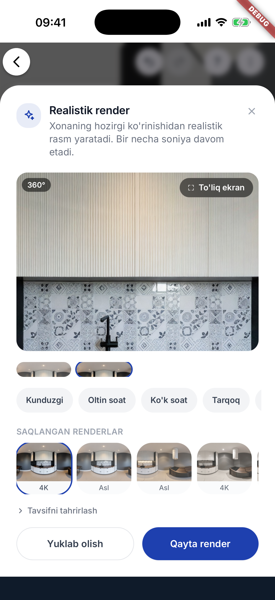

# #363 tuzatishlari: mobil tekshiruv (2026-11-21, uchinchi pass)

**Muhit:**
- Qurilma: faqat iOS Simulator, iPhone 17 Pro (402×874).
- Ilova: andoza_ai_mobile 1.0.3+36 debug build va mobil #72/#73 tuzatishlari, prod'ga ulangan, egasining akkauntida.
  - Ilova qayta o'rnatilmadi.
  - Tekshiruvdan oldin to'liq yopilib, qayta ochildi.
- Server: production `andozaai.uz`, deploy #363 (`gh run list`: completed/success). Bundle `index-BFQt68W_.js`.
- Til: O'zbekcha (qayta ochilgandan keyin ham o'zbekcha).
- «Рендер» bosilmadi.
- Xonalar (faqat o'zimning test xonalarim):
  - hammom 2.5 × 2.0 m;
  - oshxona 3 × 3 m («Oshxona to'plami» B devorda).

> Barcha natijalar simulyatorda ko'rildi.

## Natijalar

### 1. Jihozni bosish va sudrash (#357, #336, #264)

| Band | Natija | Izoh |
|---|---|---|
| «Tayyor xona» bosqichida kir mashinasi bosilganda Jihozlar paneli ochiladi | ✅ | Panel ochildi. Quritgichlar «A devor · chetidan 65 sm» va «chetidan 115 sm» (rasm 01) |
| Panel yopiq holda mashinani sudrash | ✅ | Mashina joyidan siljidi va «Saqlanmoqda…» chiqdi (rasm 02) |
| #336: mashina stoyak burchagiga sudralganda stoyak qutisiga kirmaydi | ✅ | Mashina burchakka sudraldi va quti chetida to'xtadi. Yuqoridan qaraganda qutiga kirmagan (rasm 03, 04) |
| #357: quritgich ikkinchisining ustiga sudralganda uning yonida to'xtaydi | ✅ | Yuqoridagi quritgich pastdagisi ustiga sudraldi. Ikkalasi yonma-yon qoldi, ustma-ust emas (rasm 05) |
| #357: stoyak mashina ustiga sudralganda mashina bo'sh joyga o'tadi | ⚠️ tekshirilmadi | «Tayyor xona» da stoyak qutisini barmoq bilan ushlab bo'lmadi: sudrash kamerani aylantirdi |
| #264: uchalasi ustma-ust tushmaydi | ⚠️ | Quritgichlar, mashina va stoyak qutisi bir-biriga kirmadi (rasm 04–06). Lekin sudrashdan keyin pastki quritgich rakovinaning tepasiga, uning chetiga juda yaqin keldi (rasm 06). Stoyakni sudrash tekshirilmadi |

### 2. Fartuk joylashuvi (#274, #335)

| Band | Natija | Izoh |
|---|---|---|
| «Hamma devorlar» tanlangan holda qo'shilgan fartuk to'plam turgan devorga tushadi | ✅ | Eski fartuk olib tashlandi, «Hamma devorlar» tanlangan holda «Fartuk qo'shish» bosildi. Yangi fartuk «Devor B» da, to'plam ham shu devorda (rasm 08, 09) |

### 3. Telefonda fartuk kartasi

| Band | Natija | Izoh |
|---|---|---|
| Karta panelga sig'adi, o'ngda hech narsa kesilmaydi | ⚠️ | Karta endi ustun bo'lib joylashgan: «1.80 m²», «Boshlanishi», «Uzunligi», «Pastdan», «Yuqorigacha» to'liq ko'rinadi (rasm 07, 08). Lekin devor tanlagichida faqat «Devor ⌃» yozuvi bor, harf (B) kesilgan. Qaysi devor ekanini faqat ro'yxatni ochib ko'rish mumkin (rasm 09) |

### #343

| Band | Natija | Izoh |
|---|---|---|
| #343 — 360 panorama to'plamga qarab ochiladi | ✅ | Egasi bevosita ruxsat bergandan keyin **bitta** 360 render qilindi (to'plamli oshxona, «Tayyor xona»). Ko'ruvchi to'plamga qarab ochildi: fartuk, yuqori shkaflar va jo'mrak o'rtada; saqlangan render eskizi ham to'plam markazda (rasm 10) |
| #343 — fartuk va shkaflar ustida xira vertikal tasma yo'q | ✅ | Plitka va shkaf eshiklari toza, chok ko'rinmaydi (rasm 10) |

## Kuzatuvlar (yangi xatolar)

1. **Fartuk kartasida devor tanlagichi harfni ko'rsatmaydi.** Takrorlash: telefonda «Bo'yoq paneli» → fartuk kartasi. Tanlagichda faqat «Devor ⌃» ko'rinadi, «Devor B» emas (rasm 07–09).
2. **Sudralgan quritgich rakovina tepasiga juda yaqin tushadi.** Takrorlash: hammomda yuqoridagi quritgichni rakovina tomonga, ikkinchi quritgich ustiga sudrang. Ikkalasi siljiydi va pastkisining uchi rakovina chetiga tegay deb qoladi (rasm 06).
3. **Stoyak qutisini «Tayyor xona» da sudrab bo'lmaydi.** Takrorlash: stoyak qutisini uzoq bosib sudrang. Kamera aylanadi, stoyak siljimaydi.
4. **Eslatma: «Rend…» tugmasi.** Studio'ning pastida, sehrli menyu yonida «Renderla…» tugmasi bor. Menyu arkasi ochilganda u «Oboy» doiralari ostida qoladi. Tasodifan bosilib ketishi mumkin. Bosilmadi.

## Prod'da o'zgartirilgan xonalar

Faqat o'zimning test xonalarim o'zgartirildi:
- **Hammom 2.5 × 2.0 m:** kir mashinasi stoyak burchagiga sudraldi; yuqoridagi quritgich ikkinchisi ustiga sudraldi (ikkalasi A devor bo'ylab siljidi).
- **Oshxona 3 × 3 m (ikkinchi):** eski skinali fartuk olib tashlandi; «Hamma devorlar» bilan yangi plitka fartuk qo'shildi (B devor, 0–300 sm, 85–145 sm).

Egasining xonalariga tegilmadi. Hech narsa o'chirilmadi. «Рендер» bosilmadi.

## Rasmlar

- 01. 
- 02. 
- 03. 
- 04. 
- 05. 
- 06. 
- 07. 
- 08. 
- 09. 
- 10. 
