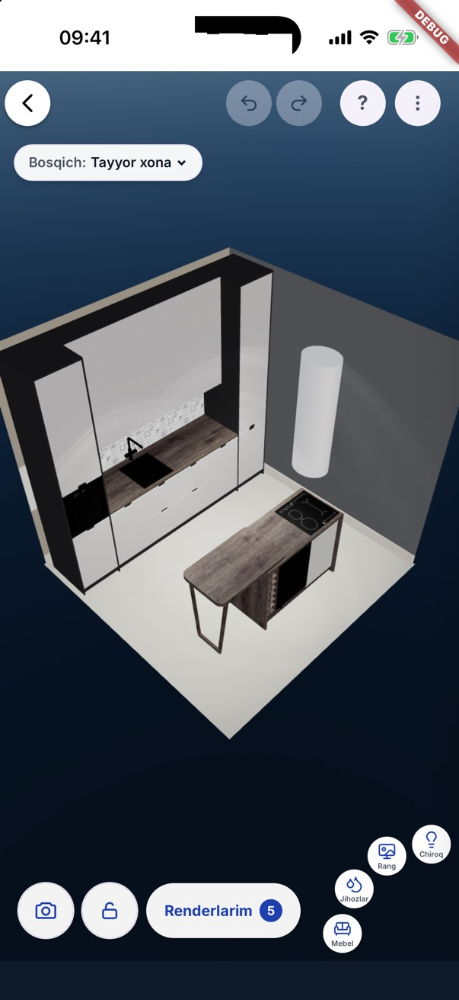
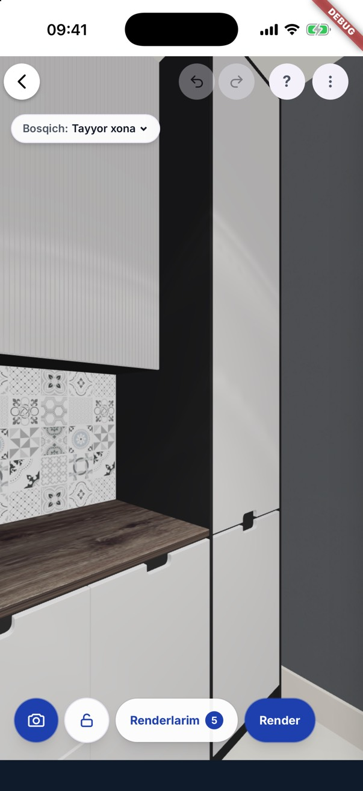
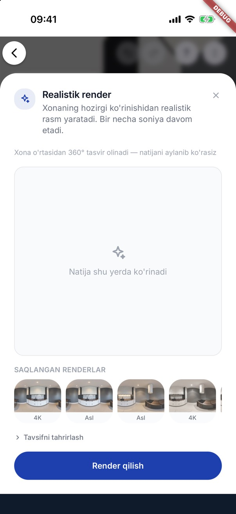
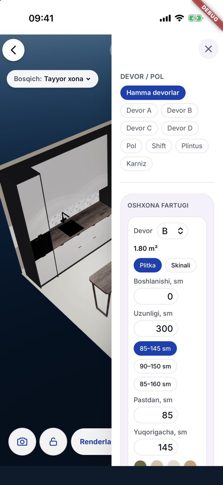
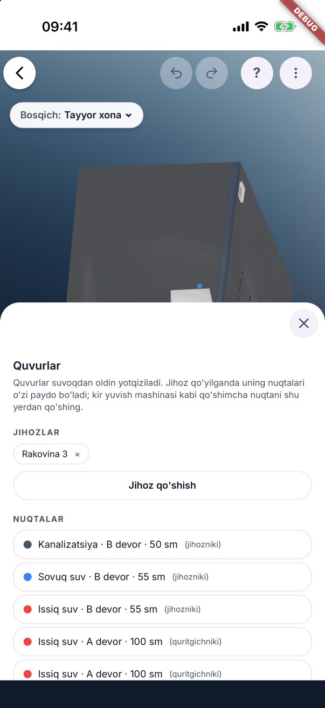
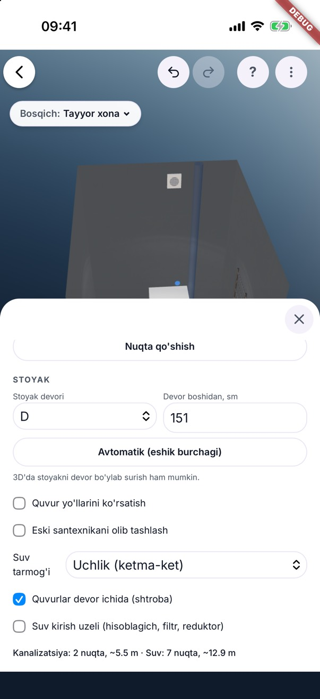
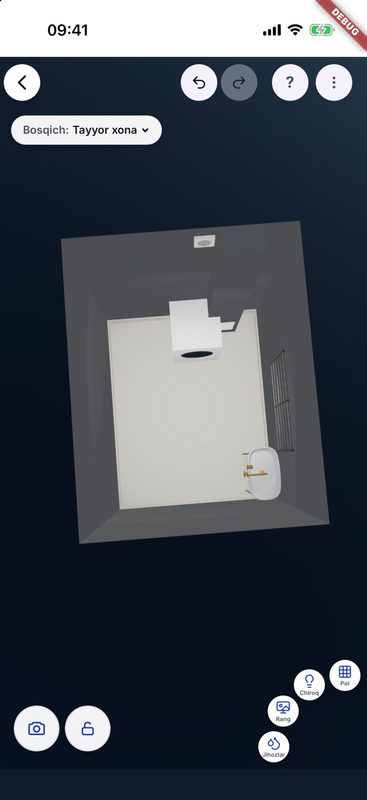
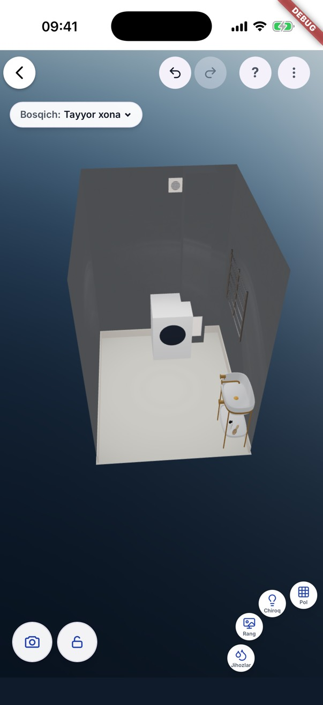
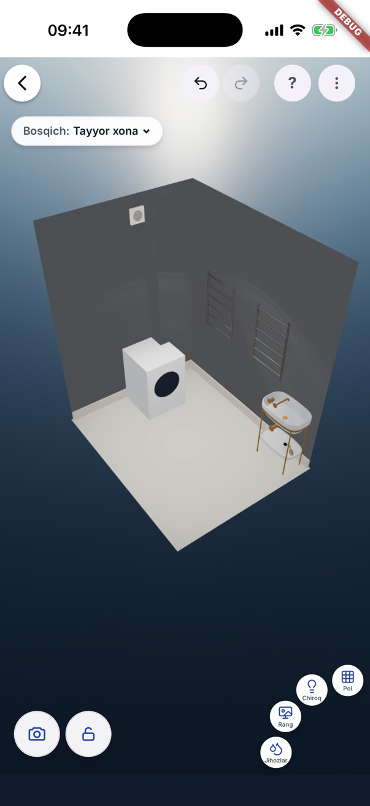
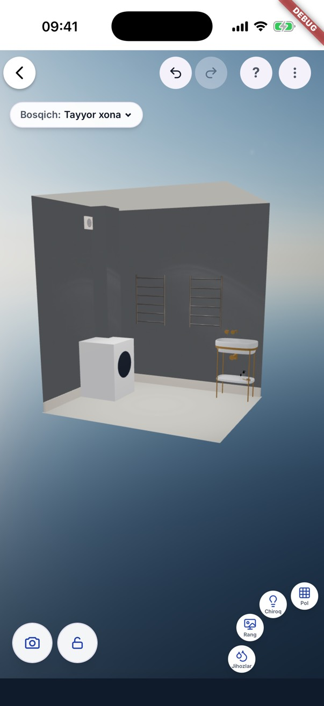

# #366 tuzatishlari: mobil tekshiruv (2026-11-21, to'rtinchi pass)

**Muhit:**
- Qurilma: faqat iOS Simulator, iPhone 17 Pro (402×874).
- Ilova: andoza_ai_mobile 1.0.3+36 debug build va mobil #72/#73 tuzatishlari, prod'ga ulangan, egasining akkauntida.
  - Ilova qayta o'rnatilmadi.
  - Tekshiruvdan oldin to'liq yopilib, qayta ochildi.
- Server: production `andozaai.uz`, deploy #366 (`gh run list`: completed/success). Bundle `index-wR8W1mbi.js`.
- Til: O'zbekcha.
- Render boshlanmadi.
  - 360 «Render» tugmasi faqat oyna ochilishini tekshirish uchun bosildi.
  - «Render qilish» va «Qayta render» bosilmadi.
  - Oyna × bilan yopildi.
- Xonalar (faqat o'zimning test xonalarim):
  - oshxona 3 × 3 m;
  - hammom 2.5 × 2.0 m.

> Barcha natijalar simulyatorda ko'rildi.

## Natijalar

### 1. 360 «Render» tugmasi (#365)

| Band | Natija | Izoh |
|---|---|---|
| Oshxona → Kameralar → 360 → «Render» faqat oynani ochadi | ✅ | «Realistik render» oynasi ochildi. Unda «Natija shu yerda ko'rinadi» yozuvi va saqlangan renderlar ro'yxati bor. Hech narsa boshlanmadi (rasm 02, 03) |
| «Saqlangan renderlar» soni o'zgarmaydi | ✅ | «Renderlarim» soni oldin 5 edi, oyna × bilan yopilgandan keyin ham 5 (rasm 01, 04) |

### 2. Stoyakni sudrash (#357, #264)

| Band | Natija | Izoh |
|---|---|---|
| «Tayyor xona» da stoyak qutisini bosish «Quvurlar» ni ochadi | ✅ | Burchakdagi qutini bosganda «Quvurlar» oynasi ochildi. Stoyak ko'k quvur bo'lib ko'rindi. Oynada «3D'da stoyakni devor bo'ylab surish ham mumkin» degan izoh bor (rasm 06) |
| Stoyakni sudrash mumkin | ✅ | Oyna ochiq turganda stoyak barmoq bilan sudraldi. «Stoyak devori» A, 0 sm dan D, 151 sm ga o'zgardi. Smeta ham yangilandi: kanalizatsiya ~5.2 → ~5.5 m, suv ~12.0 → ~12.9 m (rasm 07) |
| #357: stoyak mashina ustiga sudralganda mashina bo'sh joyga o'tadi | ✅ | Mashina D devor bo'ylab chapga, bo'sh joyga surildi. Rakovina yoki quritgich ustiga tushmadi. Yuqoridan qaraganda mashina stoyak qutisining yonida turibdi (rasm 08) |
| #264: stoyak, quritgichlar va mashina ustma-ust tushmaydi | ✅ | Ko'zda hech qaysi biri bir-biriga kirmagan (rasm 08, 10, 12) |

### 3. Rakovina yonidagi quritgich (#264)

| Band | Natija | Izoh |
|---|---|---|
| Quritgich rakovina tomon sudralganda rakovina oralig'iga tushmaydi | ✅ | Birinchi urinish: quritgich rakovinaga qarab sudraldi, lekin teskari tomonga, rakovinadan uzoqroqqa surilib qoldi (rasm 09, 10). Ikkinchi urinish: o'ng quritgich to'g'ridan-to'g'ri rakovina ustiga sudraldi. U rakovinaning chap chetida to'xtadi (rasm 11). Old tomondan qaralganda quritgichning o'ng cheti rakovina chetiga taqalib turibdi, ustiga chiqmagan (rasm 12) |

### 4. Fartuk kartasi (#274)

| Band | Natija | Izoh |
|---|---|---|
| Fartuk devor tanlagichida harf to'liq ko'rinadi | ✅ | Oshxona → Rang → «Bo'yoq paneli» → «Oshxona fartugi»: «Devor» yonidagi tanlagichda «B» to'liq ko'rinadi, kesilmagan (rasm 05) |

## Kuzatuvlar (yangi xatolar)

Yangi xato topilmadi. Ikkita kichik kuzatuv bor:

1. **Quritgich rakovina chetiga juda yaqin turadi.** Rakovinaning gorizontal oralig'iga kirmaydi, lekin pastki cheti rakovina va jo'mrakdan sal yuqorida turibdi (rasm 12). Bu xato emas, faqat kuzatuv.
   - Takrorlash: hammomda quritgichni rakovina ustiga sudrang. U rakovina chetida, jo'mrakka juda yaqin to'xtaydi.
2. **Rakovina tomon sudralgan quritgich teskari tomonga surilishi mumkin.** Birinchi urinishda quritgich men sudragan joyga emas, rakovinadan uzoqroqqa ketdi (rasm 09). Ehtimol, bo'sh joyni qidirish shunday ishlaydi.
   - Takrorlash: hammomda quritgichni bir oz rakovina tomon sudrang. U rakovinadan uzoqlashadi.

## Prod'da o'zgartirilgan xonalar

- **Hammom 2.5 × 2.0 m:**
  - stoyak A devor 0 sm dan D devor 151 sm ga sudraldi;
  - kir mashinasi D devor bo'ylab chapga surildi;
  - quritgichlar A devor bo'ylab ikki marta sudraldi.
- **Oshxona 3 × 3 m:** o'zgartirilmadi. Faqat render oynasi va «Bo'yoq paneli» ochildi.

## Rasmlar

- 01. 
- 02. 
- 03. 
- 04. 
- 05. 
- 06. 
- 07. 
- 08. 
- 09. 
- 10. 
- 11. 
- 12. 
