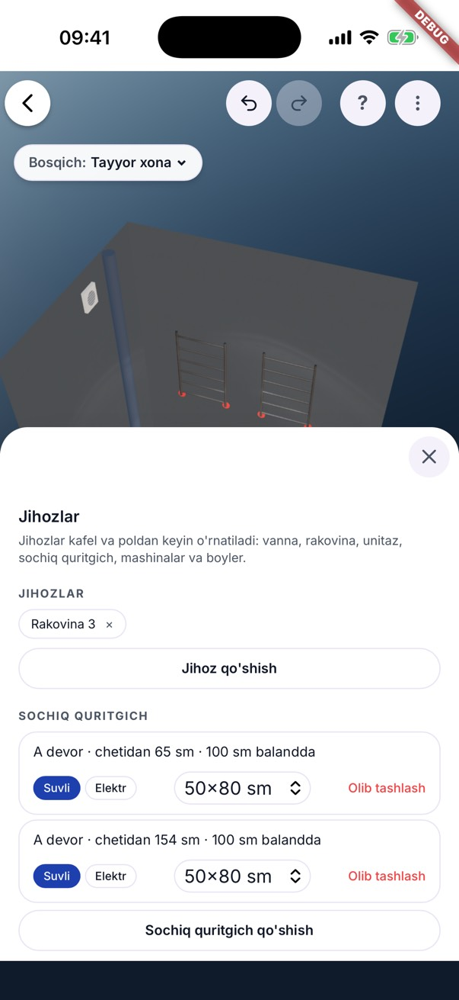
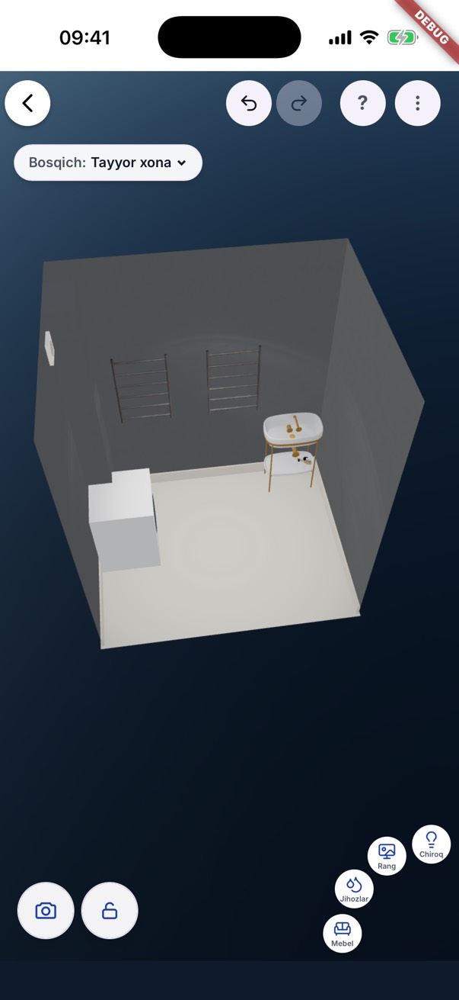
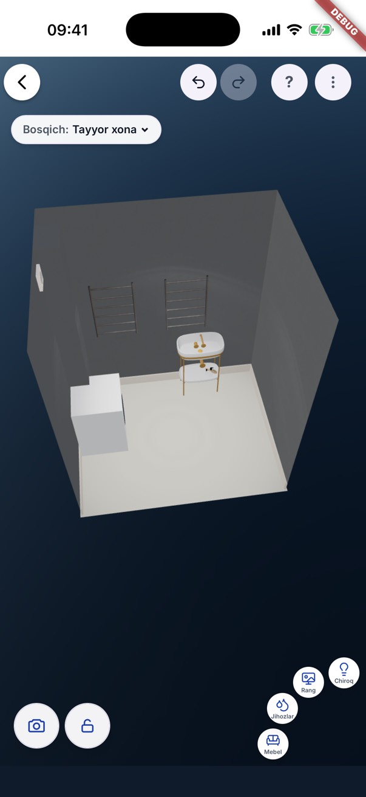

# #368 quritgichni surish: telefonda tekshiruv (2026-11-21)

**Nima tekshirildi:** web PR #368 (`fix/rail-drag`, mobil QA #367 dagi ikki kuzatuv). Checklist: mobil issue #63, oxirgi izoh.

**Muhit:**
- Qurilma: iOS Simulator, iPhone 17 Pro (402×874).
- Ilova: andoza_ai_mobile 1.0.3+36 debug build, prod'ga ulangan, egasining akkauntida.
  - Ilova qayta o'rnatilmadi, akkauntdan chiqilmadi.
- Server: production `andozaai.uz`, deploy #368 (`gh run list`: «Deploy to server» completed/success).
  - Bundle: `index-r9zp0Bhp.js` (`curl https://andozaai.uz/` shu nomni chiqardi).
  - Xona to'liq yopilib qayta ochildi. WebView keshiga shundan keyin yozilgan sahifa ham `index-r9zp0Bhp.js` ga ishora qiladi.
- Til: O'zbekcha.
- Xona: hammom 2.5 × 2.0 m («Mening uyim», 5.0 m²). A devorda ikki quritgich (50×80 sm) va «Rakovina 3» (0.41 × 0.62 m).
- **Bosqich: ikkala band ham «Tayyor xona» bosqichida tekshirildi.** Rasmlarda yuqori chapdagi «Bosqich: Tayyor xona» yozuvi ko'rinadi.
- Render, AI va boshqa pullik tugmalar bosilmadi.

> Panelda quritgich joyi «chetidan N sm» deb ko'rsatiladi. Bu quritgich **markazi** (kod: `positionMm / 10`). Quritgich eni 50 sm, ya'ni markazdan har tomonga 25 sm.

## Natijalar

| # | Band | Bosqich | Natija | Nima ko'rildi |
|---|---|---|---|---|
| 1 | Quritgich rakovina tomonga surilganda rakovinadan taxminan 5 sm narida to'xtaydi, chetiga tegmaydi | Tayyor xona | ✅ | Ikkinchi quritgich «chetidan 115 sm» dan rakovinaga qarab, rakovinadan ancha o'tkazib sudraldi. U **«chetidan 154 sm»** da to'xtadi (rasm 01). Shu natija xona qayta ochilgandan keyin ham takrorlandi. Quritgichning o'ng cheti 154 + 25 = 179 sm da. Old tomondan qaraganda quritgich va rakovina orasida aniq bo'shliq bor, quritgich rakovinaga tegmaydi (rasm 02). Ko'zda bo'shliq taxminan 3–5 sm (rakovina gardishi kameraga yaqinroq, shuning uchun aniq o'lchab bo'lmaydi). Rakovinaning devordagi aniq joyi UI'da ko'rsatilmaydi, shuning uchun 5 sm ni raqam bilan tasdiqlab bo'lmadi. Raqamlar mos keladi: rakovina 62 sm, chap cheti 184 sm da bo'lsa, o'ng cheti 246 sm da, burchakdan 4 sm. Ko'rinish ham shunday. |
| 2 | Rakovina ustida qolgan eski quritgich qisqa surilganda surilgan tomonga chiqadi, teskari tomonga sakramaydi | Tayyor xona | ⚠️ tekshirib bo'lmadi | Xonada rakovina ustida turgan eski quritgich yo'q edi. Shu holatni yaratish uchun rakovina 2-quritgich tagiga (~35 sm chapga) surildi. Xona qayta ochildi: quritgich «chetidan 154 sm» da rakovina ustida qoldi (rasm 03). Keyin quritgich qisqa (~10 sm) o'ngga, uzoq o'ngga va chapga sudraldi. **Hech qaysi holatda joyidan qimirlamadi**: panelda 154 sm qoldi, «orqaga» tugmasi faollashmadi. Teskari tomonga sakrash ko'rilmadi, lekin «surilgan tomonga chiqish» ham ko'rilmadi. Sabab (kod bo'yicha, `nearestFree`): rakovina 62 sm + ikki tomonda 5 sm, 1-quritgich 65 sm da turibdi. Shuning uchun A devorda rakovinaning hech bir tomonida 50 sm lik bo'sh joy qolmaydi va funksiya `null` qaytaradi. Quritgich o'lchamlari faqat 50 sm va undan keng (50×50 … 60×100), joy ochib bo'lmadi. Bu xonada ikki tomonda ham bo'sh joy bo'lgan holatni yaratib bo'lmadi, shuning uchun bandni tasdiqlay olmayman. |

## Boshqa kuzatuvlar

1. **Rakovina ustida qolgan quritgichni umuman surib bo'lmaydi va hech qanday xabar chiqmaydi** (2-band holati).
   - Agar ikki tomonda ham joy bo'lmasa, quritgich barmoq ostida qimirlamaydi. Foydalanuvchi buning sababini bilmaydi.
   - Takrorlash: 2-bandda yozilgandek rakovinani quritgich tagiga suring, xonani qayta oching, quritgichni suring.
2. **Panel × bilan yopilgandan keyin quritgichni bosish uni qayta ochmaydi.**
   - Xona ochilgandan keyin quritgichni birinchi bosishda «Jihozlar» paneli ochiladi. × bilan yopilgach, quritgichni yana bosish panelni ochmadi (4 martadan ko'p urinildi). Rakovinani bosish esa uning kartasini ko'rsatdi.
   - Xona yopilib qayta ochilgandagina panel yana ochiladi.
   - Takrorlash: hammom, «Tayyor xona» → quritgichni bosing (panel ochiladi) → × → quritgichni yana bosing.
3. **Ikki barmoq bilan yaqinlashtirish (pinch) quritgich ustidan boshlansa, quritgichni suradi.**
   - 2-quritgich 154 sm dan 115 sm ga (1-quritgich yoniga) surilib ketdi, kamera yaqinlashmadi.
4. Quritgichni uzoq bosib olish uchun barmoq aynan ingichka trubaga tushishi kerak. Trubalar orasiga bosilsa, hech narsa bo'lmaydi. Bu kichik qulaylik masalasi.

## Prod'da o'zgartirilgan narsalar

- **Hammom 2.5 × 2.0 m:**
  - 2-quritgich: 115 → 154 sm → … → yana **115 sm** ga qaytarildi (xona qayta ochilib tekshirildi: 65 sm va 115 sm).
  - «Rakovina 3»: ~35 sm chapga surildi va qo'lda qaytarildi.
    - Xona oraliqda qayta ochilgani uchun «orqaga» bilan qaytarib bo'lmadi.
    - Rakovina taxminan eski joyida, lekin bir necha sm (~4 sm gacha) burchakka yaqinroq bo'lishi mumkin.
    - Buni tekshirish uchun 2-quritgich yana rakovinaga qarab surildi: u avvalgidan ~4 sm o'ngroqda to'xtadi.

## Rasmlar

- 01. 
- 02. 
- 03. 
