# Fartuk (#274, #335) va #359 tuzatishlari: mobil tekshiruv (2026-11-21, ikkinchi pass)

**Muhit:**
- Qurilma: faqat iOS Simulator, iPhone 17 Pro (402×874).
- Ilova: andoza_ai_mobile 1.0.3+36 debug build, prod'ga ulangan, egasining akkauntida. Ilova qayta o'rnatilmadi.
- Server: production `andozaai.uz`.
  - Fartuk bandlari (rasm 01–10) eski bundle `index-CGTp5o1a.js` da tekshirildi.
  - Keyin #360 deploy (`gh run list`: completed/success) chiqqani uchun ilova to'liq yopilib, qayta ochildi (o'rnatmasdan). Shundan keyingi bandlar (rasm 11–14) yangi bundle `index-BE4o3BgY.js` da tekshirildi.
- Til: O'zbekcha. Qayta ochilgandan keyin ilova inglizchada ochildi (pastda kuzatuv).
- Xonalar (faqat o'zimning test xonalarim):
  - oshxona 3 × 3 m (ikkinchi, «Oshxona to'plami» bilan);
  - hammom 2.5 × 2.0 m.

> Barcha natijalar simulyatorda ko'rildi.

## Natijalar

### Fartuk «Bo'yoq paneli» orqali (#274, #335 K11)

Yo'l: ↖ → «Rang» → ro'yxat oxiridagi «Bo'yoq paneli» → «Oshxona fartugi» → «Fartuk qo'shish».

| Band | Natija | Izoh |
|---|---|---|
| Fartuk qo'shish joyi topiladi | ✅ | «Bo'yoq paneli» da «Oshxona fartugi» → «Fartuk qo'shish» bor (rasm 02) |
| Oldin: smetadagi devor bo'yog'i | — | B devor (to'plam turgan devor) qayta bo'yoqqa o'tkazildi. Smetada «8.4 m² (devor B) × 2 qatlam» (rasm 01) |
| Plitka fartuk: bo'yoq maydoni fartuk maydoniga kamayadi | ✅ | Fartuk 300 × 60 sm (85–145 sm) = 1.8 m². Bo'yoq «6.6 m² (devor B)» bo'ldi: 8.4 − 1.8 = 6.6 (rasm 04) |
| Plitka fartuk: smetada fartuk qatori bor | ✅ | «Do'kon tanlanmagan / ishlar» guruhida (rasm 05): • «Fartuk plitkasi (o'rtacha narx) 3.00 m × 0.60 m = 1.80 m² × 1.10 = 1.98 m²» — 403 920 so'm; • «Ish: fartuk plitkasini terish 1.8 m²» — 234 000; • «Plitka yelimi» — 45 000; • «Zatirka» — 35 000 |
| Plitka fartuk: 3D | ⚠️ | «Tayyor xona» da B devor to'plam va uning o'z modelidagi fartuk bilan to'silgan, yangi fartuk aniq ko'rinmaydi (rasm 03) |
| Skinali'ga almashtirish: smeta | ✅ | Plitka qatorlari o'rniga (rasm 09): • «Skinali (shisha fartuk) 3.00 m × 0.60 m = 1.80 m² × 450 000» — 810 000 so'm; • «Ish: skinali o'rnatish 1.8 m²» — 144 000. Bo'yoq 6.6 m² da qoldi (rasm 08) |
| Skinali: 3D | ✅ | «Montaj» bosqichida (mebel ko'rinmaydi) B devorda butun uzunlik bo'ylab, 85–145 sm balandlikda oq skinali chizig'i aniq ko'rinadi (rasm 10). «Tayyor xona» da to'plam bilan to'silgan (rasm 07) |

### #359 tuzatishlari (PR #360), yangi bundle

| Band | Natija | Izoh |
|---|---|---|
| Panel YOPIQ holda sochiq quritgich / kir mashinasi / stoyakni 3D'da bosib tanlash va sudrash | ❌ | Kir mashinasi bosilganda «Pol» halqasi ochiladi. Uzoq bosib sudralganda mashina joyidan qimirlamadi (rasm 11). Quritgich va stoyak ham avvalgidek tanlanmaydi. Taqqoslash uchun katalogdan qo'yilgan «Sink 3» bosilganda tanlanadi va «Rotate» kartasi chiqadi (rasm 12) |
| #357: sudralgan quritgich boshqasining yonida to'xtaydi; stoyak mashina ustiga sudralganda mashina bo'sh joyga o'tadi | ⚠️ tekshirilmadi | Telefonda bu jihozlarni sudrab bo'lmaydi (yuqoridagi band) |
| #336: quritgich yoki mashina stoyak burchagiga sudralganda qutiga kirmaydi | ⚠️ tekshirilmadi | Sudrab bo'lmaydi |
| #264: uchalasi hech qachon ustma-ust tushmaydi | ⚠️ | Panel orqali qo'shilganda ustma-ust emas: quritgichlar 50 sm oraliqda, mashina D devorda (rasm 13). Sudrash bilan tekshirib bo'lmadi |
| Panelda ikki quritgich turli joyni ko'rsatadi | ✅ | «wall A · 65 cm from its end · 100 cm high» va «wall A · 115 cm from its end · 100 cm high». Ikkalasi ham endi «A devor · 100 sm» emas (rasm 13) |
| Smeta → 3D'ga qaytgandan keyin «Ortga» (undo) faol qoladi | ✅ | O'zgartirish → ⋮ → Smeta → 3D: undo faol (rasm 14). Bosilganda o'zgartirish bekor bo'ldi va «Saved» chiqdi |

### #343 (render)

| Band | Natija | Izoh |
|---|---|---|
| #343 — fartuk va shkaflar ustida xira vertikal tasma yo'q | ✅ | Egasi bevosita ruxsat bergandan keyin **bitta** 360 render qilindi (oshxona, to'plam bilan, 4K'gacha avtomatik oshirildi). Fartuk plitkasi va yuqori shkaf eshiklari toza, chok yoki xira tasma yo'q (rasm 16) |
| #343 — render to'plamga qarab ochiladi | ❌ | Panorama to'plamga emas, qarshidagi kulrang devorga qarab ochildi; to'plam faqat o'ng pastki burchakda ko'rinadi (rasm 15). To'plamni ko'rish uchun aylantirish kerak |

## Kuzatuvlar (yangi xatolar)

- #343: 360 render to'plamga qarab emas, qarshidagi devorga qarab ochiladi (rasm 15). Rasmning o'zida tasma yo'q (rasm 16).

1. **Yangi fartuk standart bo'yicha «Devor A» ga qo'yiladi, to'plam turgan devorga emas.** Takrorlash: oshxona to'plami B devorda → «Bo'yoq paneli» → «Fartuk qo'shish». Fartuk «Devor A» da paydo bo'ladi, qo'lda B ni tanlash kerak (rasm 02).
2. **Fartuk kartasi telefonda panel chetidan chiqib ketadi.** Takrorlash: telefonda «Bo'yoq paneli» → «Fartuk qo'shish». O'ngdagi «1.8 m²» yozuvi va «Boshlanishi»/«Yuqorigacha» maydonlari kesilgan (rasm 02, 06).
3. **Panel orqali qo'shilgan jihozlar telefonda 3D'da tanlanmaydi.** Takrorlash (yangi bundle'da ham): hammomda kir mashinasi yoki quritgichni bosing yoki sudrang. Tegish pol/devorga o'tadi, katalogdan qo'yilgan rakovina esa tanlanadi (rasm 11, 12).
4. **Eslatma: til.** Ilova sovuq qayta ishga tushirilgandan keyin interfeys o'zbekchadan inglizchaga o'tdi (rasm 11–14).

## Prod'da o'zgartirilgan xonalar

Faqat o'zimning test xonalarim o'zgartirildi:
- **Oshxona 3 × 3 m (ikkinchi):** B devor kafeldan yana bo'yoqqa o'tkazildi va B devorga fartuk qo'shildi (avval plitka, keyin skinali, oq; 0–300 sm, 85–145 sm). Bosqich «Montaj» da qoldi.
- **Hammom 2.5 × 2.0 m:** «Water heater» belgilanib, undo bilan qaytarildi, ya'ni o'zgarish yo'q.

Egasining xonalariga tegilmadi. Hech narsa o'chirilmadi. «Рендер» bosilmadi.

## Rasmlar

- 01. 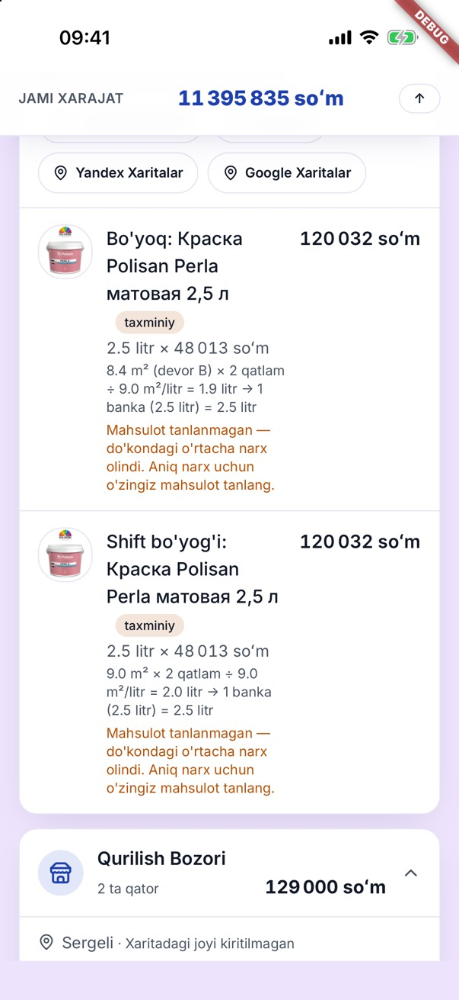
- 02. 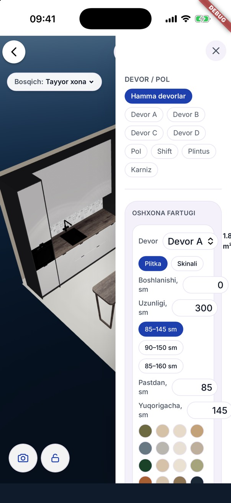
- 03. 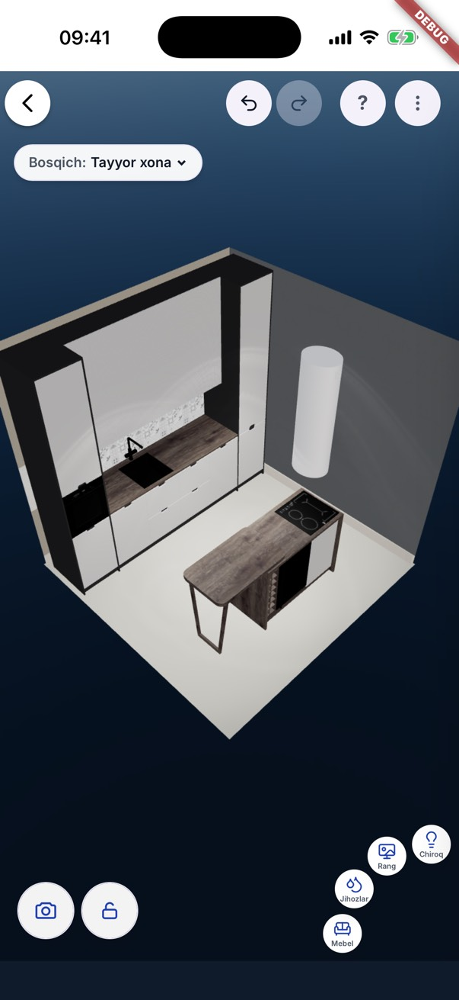
- 04. 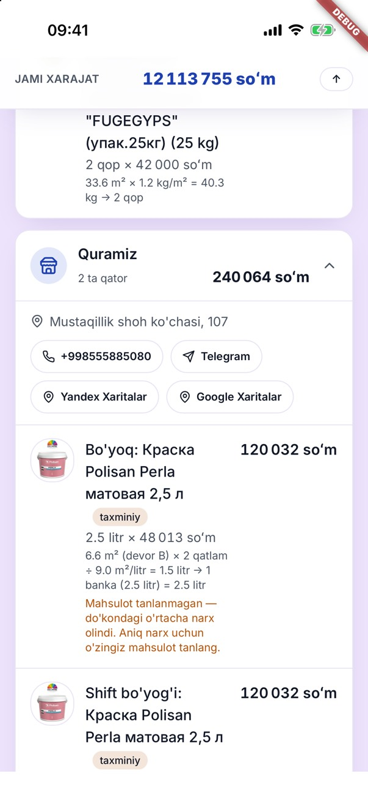
- 05. 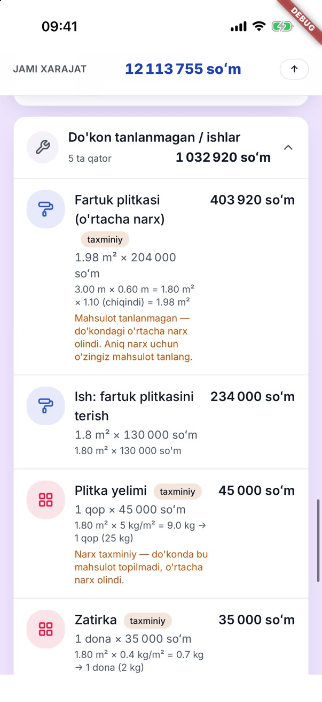
- 06. 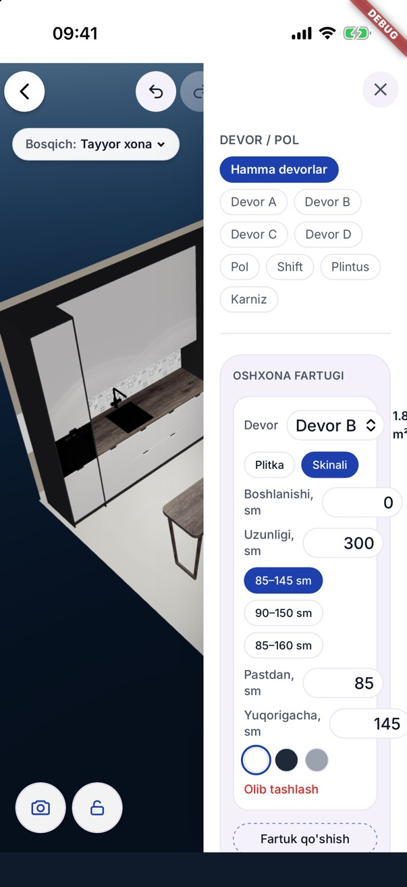
- 07. 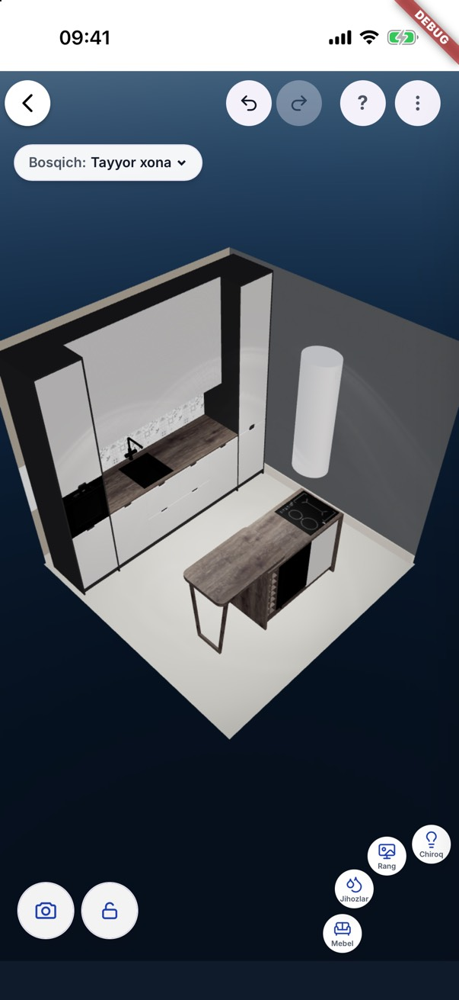
- 08. 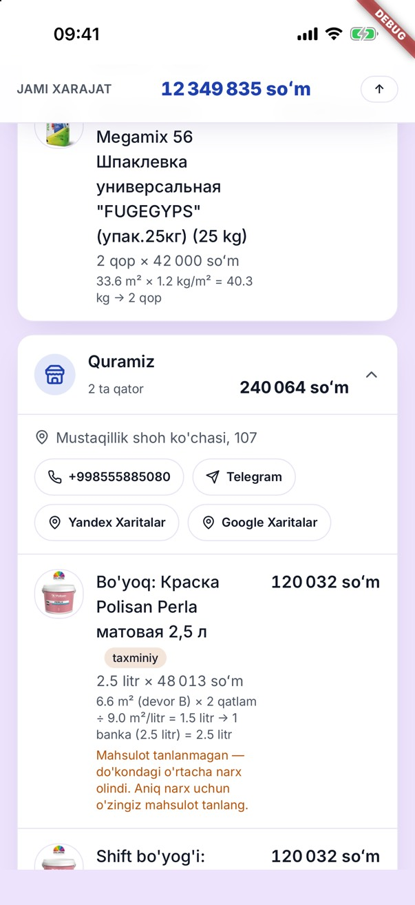
- 09. 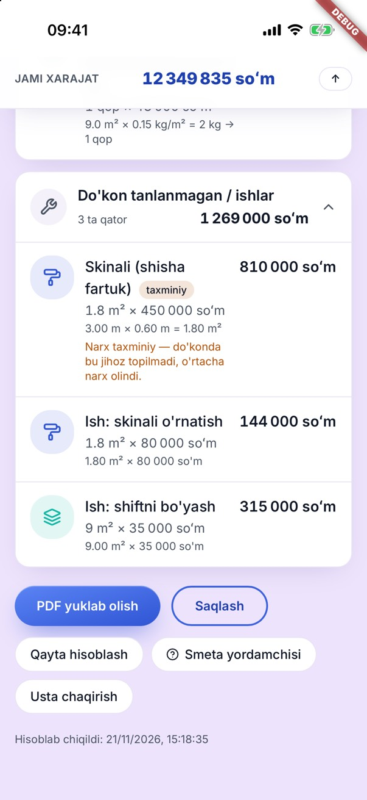
- 10. 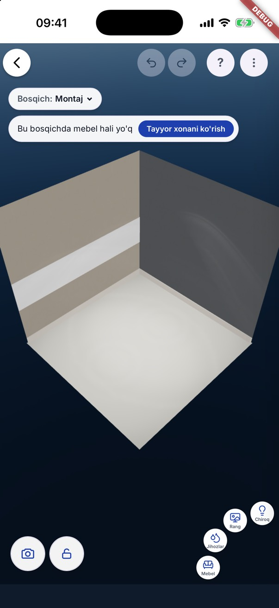
- 11. 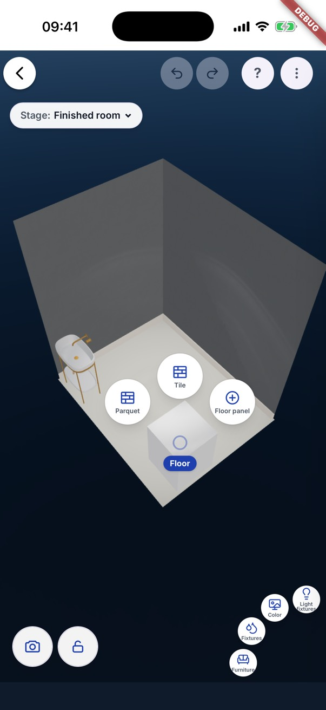
- 12. 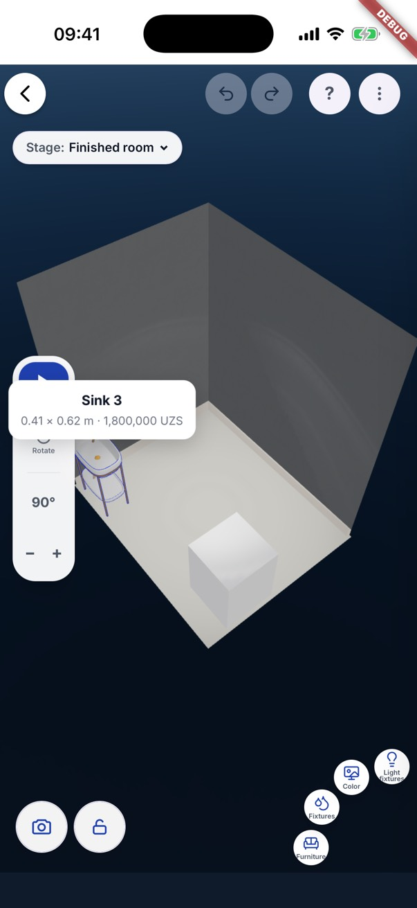
- 13. 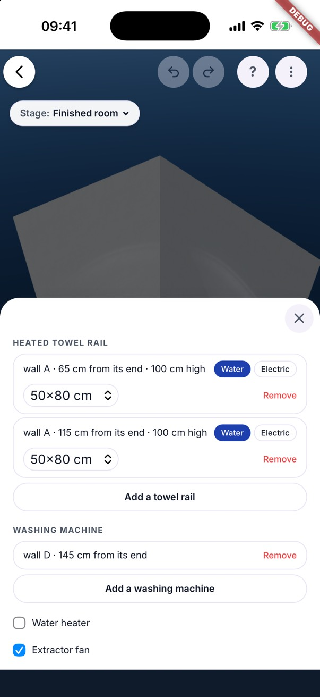
- 14. 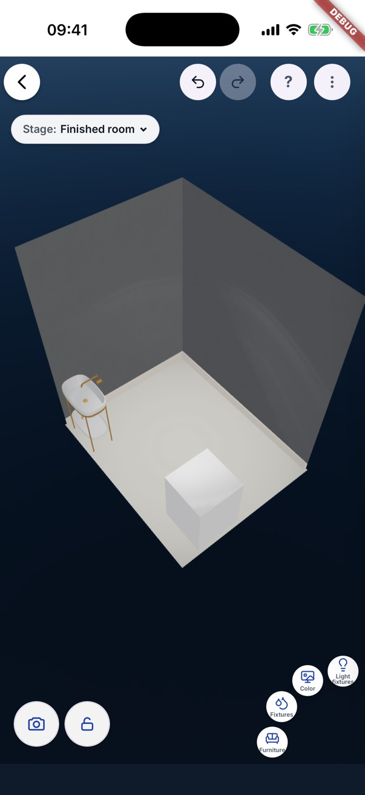
- 15. 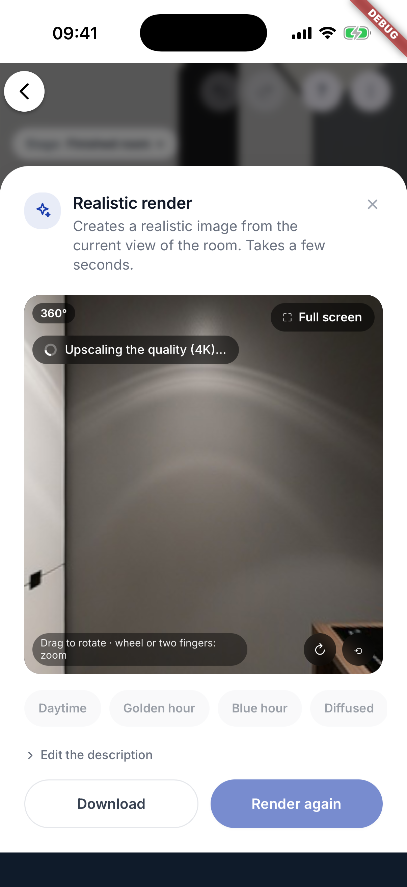
- 16. 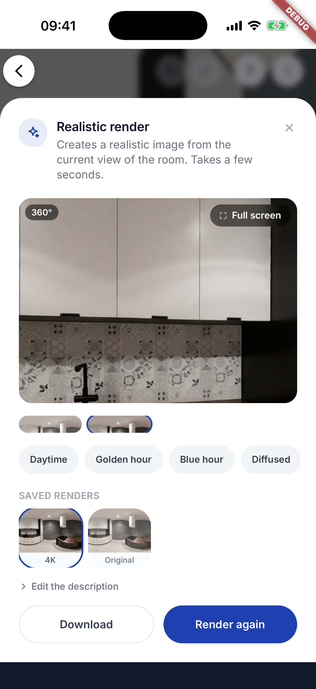
