# #371 quritgich: telefonda tekshiruv (2026-11-22)

**Nima tekshirildi:** web PR #371 (issue #370, a–d bandlari). Mobil QA #369 dagi kuzatuvlar uchun tuzatish: joy yo'qligi xabari, × dan keyin bosish, quritgich ustidan pinch, trubalar orasidan ushlash.

**Muhit:**
- Qurilma: iOS Simulator, iPhone 17 Pro (402×874).
- Ilova: andoza_ai_mobile 1.0.3+36 debug build, prod'ga ulangan, egasining akkauntida (til: o'zbekcha).
  - Ilova qayta o'rnatilmadi, akkauntdan chiqilmadi.
- Server: production `andozaai.uz`, deploy `c40a334` («Deploy to server» completed/success, 2026-11-22 09:49 UTC).
  - Bundle: `index-l7YhHo-Y.js` (`curl https://andozaai.uz/` shu nomni chiqardi).
  - Ilova to'liq qayta ishga tushirildi, xona yangidan ochildi. WebView keshidagi xona sahifasi ham `index-l7YhHo-Y.js` ga ishora qiladi.
- Xona: hammom 2.5 × 2.0 m («Mening uyim», 5.0 m²). A devorda ikki quritgich (50×80 sm, «chetidan 65 sm» va «chetidan 115 sm») va «Rakovina 3».
- **Bosqich: hamma bandlar «Tayyor xona» bosqichida tekshirildi.** Har bir rasmda yuqori chapdagi «Bosqich: Tayyor xona» yozuvi ko'rinadi (xabar chiqqan rasmda yozuv xabar ostida qoladi, shuning uchun yonida bir necha soniya oldingi holat ham berilgan).
- Render, AI va boshqa pullik tugmalar bosilmadi.

> Simulatorda ikki barmoqli harakatda (pinch) ikkala barmoq **bir vaqtda** tegadi. Haqiqiy telefonda birinchi barmoq oldinroq tegishi mumkin. c bandi natijasini shuni hisobga olib o'qing.

## Natijalar

| # | Band | Bosqich | Natija | Nima ko'rildi |
|---|---|---|---|---|
| a | Bo'sh joyi yo'q quritgich surilganda xabar **bir marta** chiqadi | Tayyor xona | ✅ | Xonada bunday holat yo'q edi. Uni yaratish uchun 2-quritgich 158 sm ga, «Rakovina 3» esa uning tagiga (~45 sm chapga) surildi. Shunda A devorda 50 sm lik bo'sh joy qolmaydi. Keyin 2-quritgich chapga sudraldi. Yuqorida **bitta** xabar chiqdi: «Quritgichni surib bo'lmaydi: bu devorda 50 sm bo'sh joy yo'q.» (rasm 04). Quritgich joyidan qimirlamadi, panel ochilmadi. Ikkinchi marta uzoqroq, oldinga-orqaga sudralganda ham faqat bitta xabar chiqdi. Xabar bir necha soniyada o'zi yopildi. |
| b1 | Quritgichni bosish → «Jihozlar» paneli ochiladi; × → yana bosish → yana ochiladi | Tayyor xona | ✅ | Birinchi bosishda panel ochildi (rasm 01). × bilan yopildi, o'sha quritgich yana bosildi va panel yana ochildi (rasm 02). Yana 2 marta takrorlandi (1- va 2-quritgich), har safar ochildi. Bitta istisno: × dan keyingi **birinchi** bosish ishlamadi, ikkinchisi ochdi. Bu quritgichga xos emas, pastdagi 1-kuzatuvga qarang. |
| b2 | Quritgichni surib qo'yib yuborish panelni ochmasligi kerak | Tayyor xona | ✅ ⚠️ | 4 marta surildi, panel bir marta ham ochilmadi (rasm 03, 10). Lekin birinchi surishdan keyin panel o'rniga devorning menyusi («Devor»: Kafel / Oboy / Oyna) ochildi (rasm 03). Barmoq oxirida ~0.3 s devor ustida turib qoldi. Qolgan 3 surishda menyu chiqmadi. d bandiga qarang: uzoq bosish devor menyusini ochadi. |
| c1 | Pinch bir barmoq quritgich ustida boshlansa: kamera yaqinlashadi, quritgich surilmaydi | Tayyor xona | ❌ | **1-quritgich** ustidan boshlangan pinch kamerani yaqinlashtirmadi. Uning o'rniga quritgichni **65 → 86 sm** ga surdi (rasm 06, 07). «Orqaga» tugmasi faollashdi, u bilan 65 sm ga qaytarildi. **2-quritgich** (158 sm, o'ng chegarada) ustidan 3 marta pinch qilindi: kamera ham yaqinlashmadi, quritgich ham qimirlamadi (rasm 05, chap). Bu quritgich barmoq yo'nalishida (o'ngga) chegarada turgani uchun bo'lishi mumkin. Taqqoslash uchun xuddi shunday pinch quritgichdan tashqarida qilinganda kamera yaxshi yaqinlashdi (rasm 05, o'ng). |
| c2 | Bir barmoq bilan surish avvalgidek ishlaydi (6 px dan keyin boshlanadi) | Tayyor xona | ✅ | Bosib darhol (~0.1 s) surish ikkala quritgichni ham surdi: 115 → 158 sm, 158 → 115 sm, trubadan ham, trubalar orasidan ham (rasm 10, 11). Tegib qo'yib yuborish (siljimasdan) surmadi, panelni ochdi. |
| d | Trubalar orasidan uzoq bosib ushlash | Tayyor xona | ❌ (sabab topildi) | Uzoq bosish (~0.8 s barmoq qimirlamaydi, keyin suriladi) quritgichni **ushlamaydi**, bu **trubalar orasida ham (rasm 08), truba ustida ham (rasm 09)** shunday. Ikkala holatda ham devorning menyusi («Devor») ochiladi, quritgich joyida qoladi. Qisqa bosib darhol surish esa trubadan ham (rasm 10), trubalar orasidan ham (rasm 11) ishlaydi. Demak muammo trubalar orasida emas, **uzoq bosishda**: devorning uzoq bosish menyusi quritgichdan oldin ishlaydi. Bir marta (2 urinishdan 1) trubalar orasidan qisqa surish quritgichni surmadi: kamera biroz aylandi va qo'yib yuborilganda panel ochildi (rasm 12). Takroran urinishda surildi. |
| 5 | Mashina va stoyak ustidan pinch | — | eslatma | Checklist bo'yicha bu hali eski holatda. Tekshirilmadi va xato deb hisoblanmaydi. |

### d bandi: takrorlash
1. Hammom, «Tayyor xona». Kamera boshlang'ich ko'rinishdan barmoq bilan ~270° aylantirilgan, A devor (quritgichlar va rakovina) to'g'rida, biroz yuqoridan qaraydi. Kamera uzoqlashtirilgan, xona butun ko'rinadi (rasm 08, chap).
2. Quritgich oldida hech qanday jihoz yo'q. Rakovina o'ng tomonda, burchakda.
3. Barmoqni 2-quritgichning ikki trubasi orasiga (yoki o'ng trubaning ustiga) qo'ying, ~0.8 s qimirlatmang, keyin devor bo'ylab o'ngga suring.
4. Natija: devor menyusi ochiladi, quritgich qimirlamaydi, «orqaga» faollashmaydi.
5. Xuddi shu joydan barmoqni ~0.1 s ushlab darhol sursangiz, quritgich suriladi.

## Boshqa kuzatuvlar

1. **Panel yoki menyu yopilgandan keyingi birinchi harakat yo'qoladi.**
   - Jihozlar paneli × bilan yoki devor menyusi bo'sh joyni bosib yopilgach, keyingi **bitta** harakat hech narsa qilmaydi. Ikkinchi harakat odatdagidek ishlaydi.
   - 5 marta ko'rildi: quritgichni bosish, quritgichni surish, rakovinani surish, «orqaga» (undo) tugmasi va uzoq bosish.
   - «Orqaga» tugmasi oddiy HTML tugma, shuning uchun bu faqat 3D sahnaga xos emas.
   - Takrorlash: quritgichni bosing (panel) → × → «orqaga» tugmasini yoki quritgichni bir marta bosing → hech narsa bo'lmaydi; yana bosing → ishlaydi.
2. **Quritgich surilganda kamera biroz aylanadi.** Har surishda xona bir necha piksel siljiydi (rasm 04: chapda va o'ngda ventilyator o'rni). PR'da «kamera bosilgan joyiga qaytariladi» deyilgan, lekin to'liq qaytmaydi. Kichik masala.
3. **Bir marta butun sahifa kattalashib ketdi (brauzer zoom).** Pinch quritgichdan tashqarida, panel yopilgandan keyingi birinchi harakat sifatida qilindi. Sahifa kattalashdi: yuqori o'ngdagi tugmalar va «Bosqich» yozuvi ekrandan chiqib ketdi, pastki tugmalar kattalashdi. Teskari pinch qaytarmadi, faqat xonani yopib qayta ochish yordam berdi. `index.html` dagi viewport'da `maximum-scale`/`user-scalable=no` yo'q. Rasm ilova qilinmadi, chunki unda «Bosqich» yozuvi ko'rinmaydi.
4. Test o'rtasida simulator bir marta o'chib qoldi (tashqi sabab, ilovaga bog'liq emas). Qayta yoqildi, ilova o'zi kirdi. O'sha paytdagi o'zgarish (2-quritgich 158 sm) saqlangan edi, keyinroq qaytarildi.

## Prod'da o'zgartirilgan narsalar

Hammasi joyiga qaytarildi va xona qayta ochilib tekshirildi (rasm 13).

- **Hammom 2.5 × 2.0 m («Mening uyim», 5.0 m²):**
  - 2-quritgich: 115 → 158 sm (b2 va a bandlari uchun) → yana **115 sm** ga sudrab qaytarildi. U 1-quritgichga tegib to'xtaydi, shuning uchun aniq 115 sm.
    - c/d bandlarida yana ikki marta qisqa surildi va har safar «orqaga» bilan qaytarildi.
  - 1-quritgich: c bandidagi pinch uni 65 → 86 sm ga surdi, «orqaga» bilan **65 sm** ga qaytarildi.
  - «Rakovina 3»: a bandi uchun ~45 sm chapga surildi, «orqaga» bilan aniq qaytarildi (burchakda, avvalgi joyida).
  - Yakuniy holat, xona qayta ochilgandan keyin: «A devor · chetidan 65 sm» va «A devor · chetidan 115 sm», rakovina burchakda.

## Rasmlar

- 01. 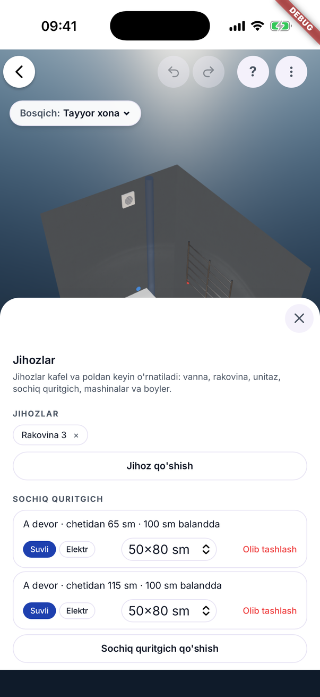
- 02. 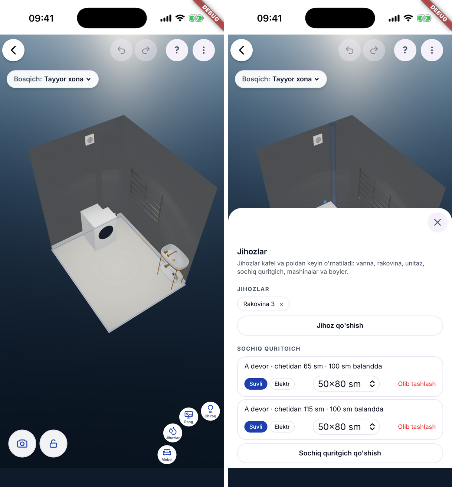
- 03. 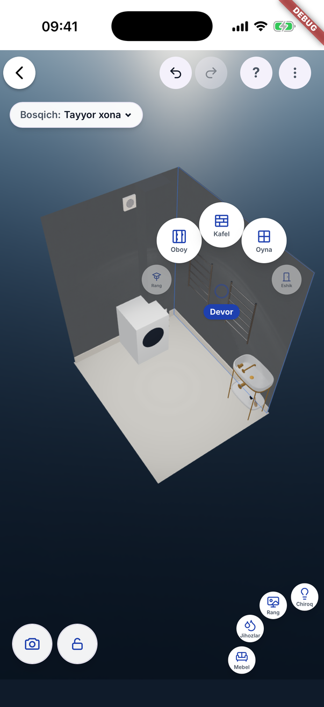
- 04. 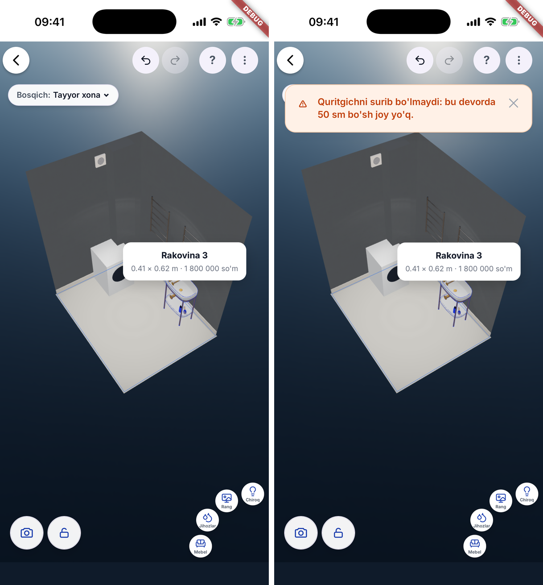
- 05. 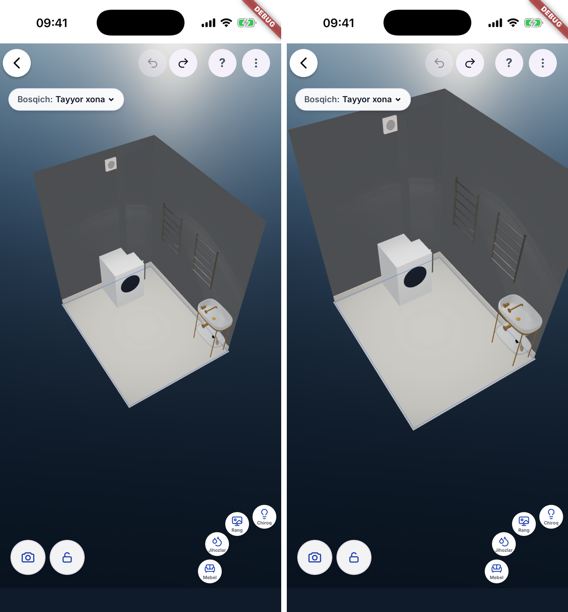
- 06. 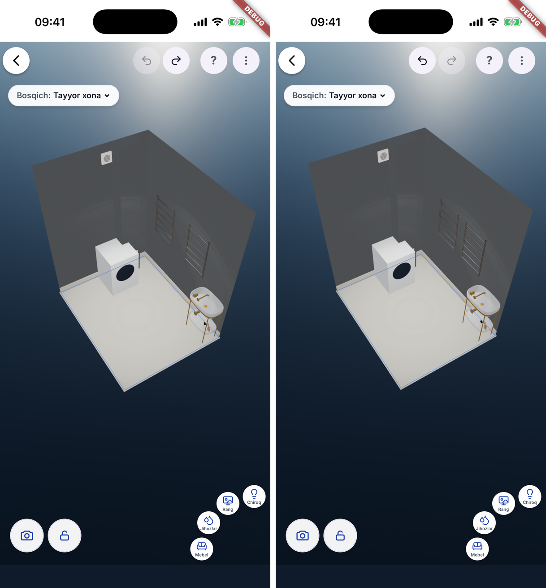
- 07. 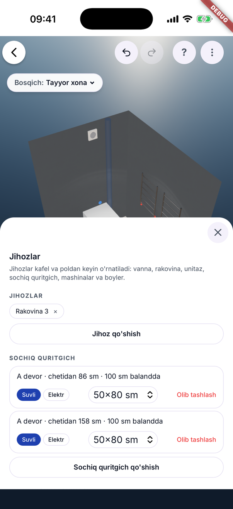
- 08. 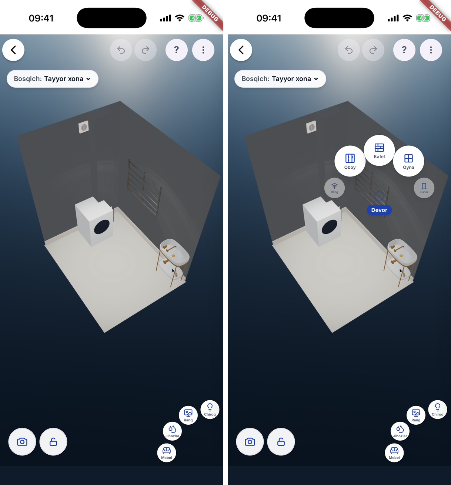
- 09. 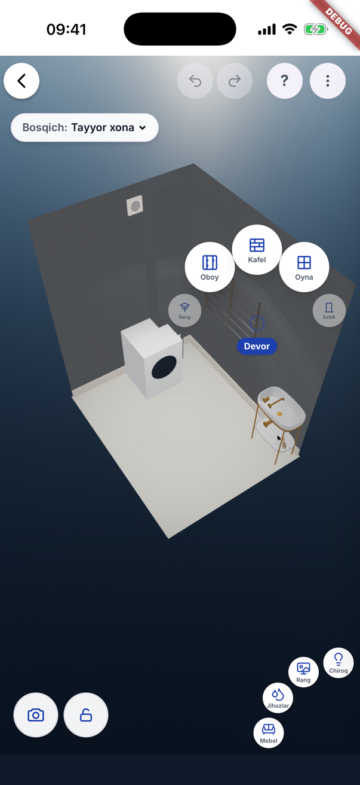
- 10. 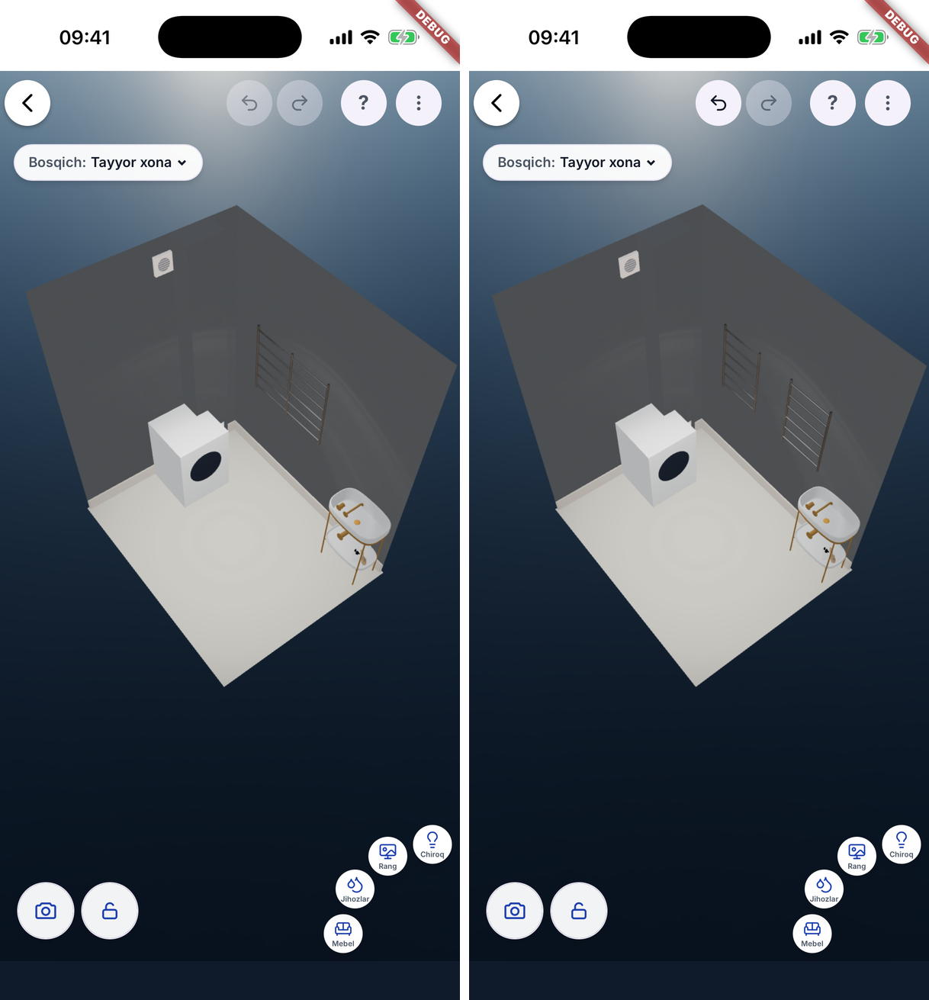
- 11. 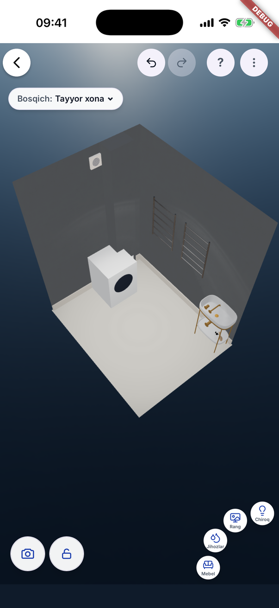
- 12. 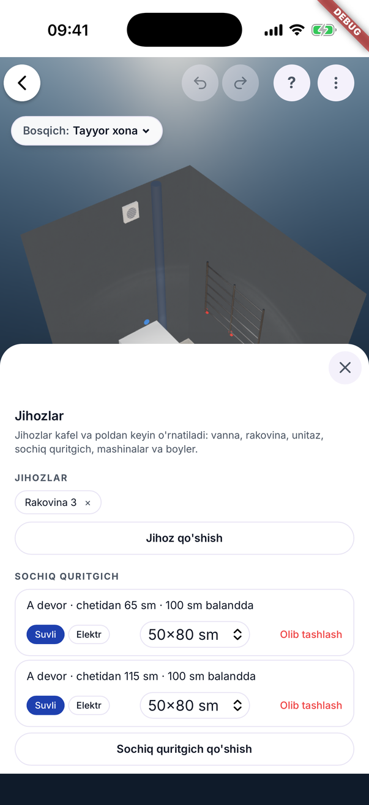
- 13. 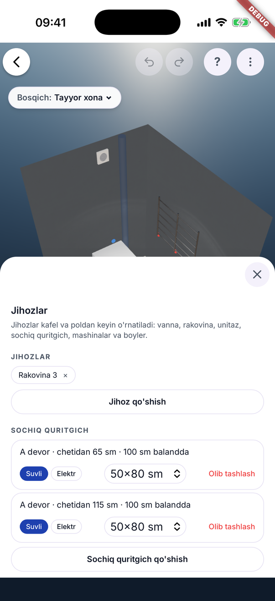
