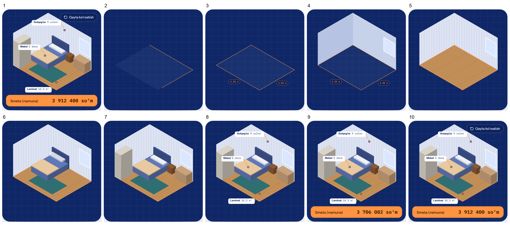
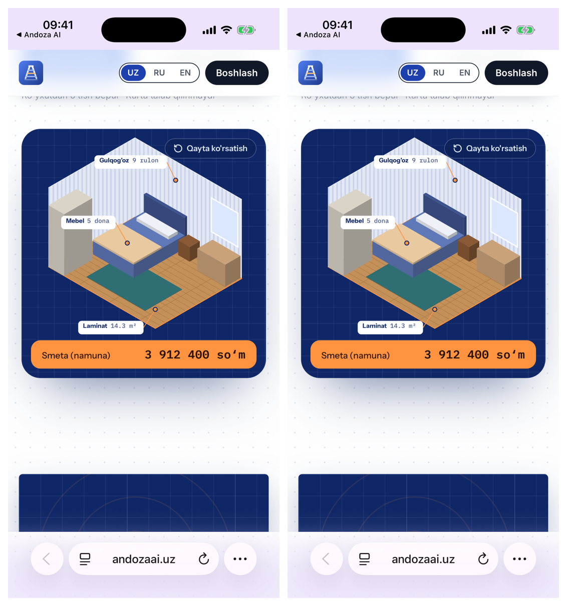
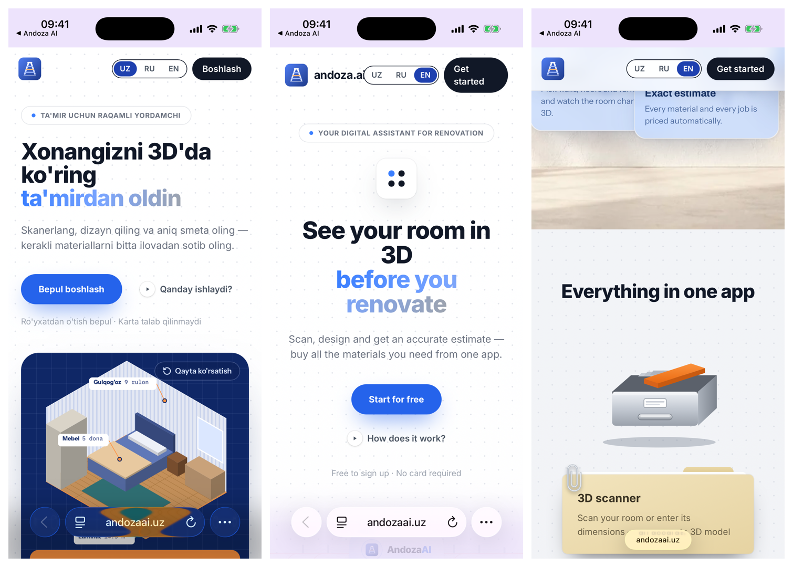
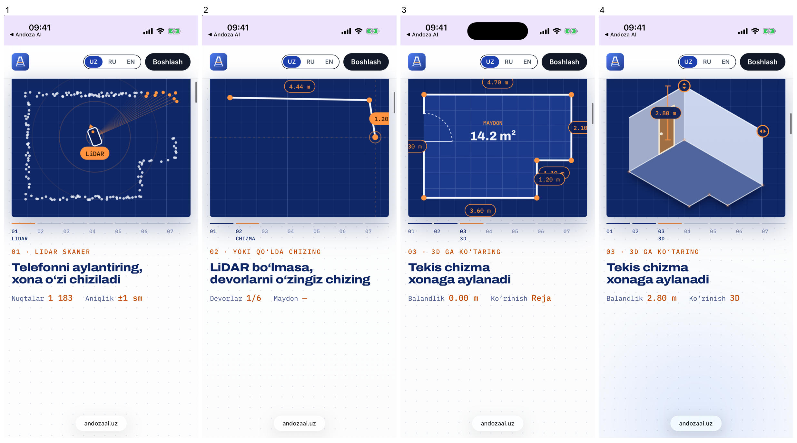
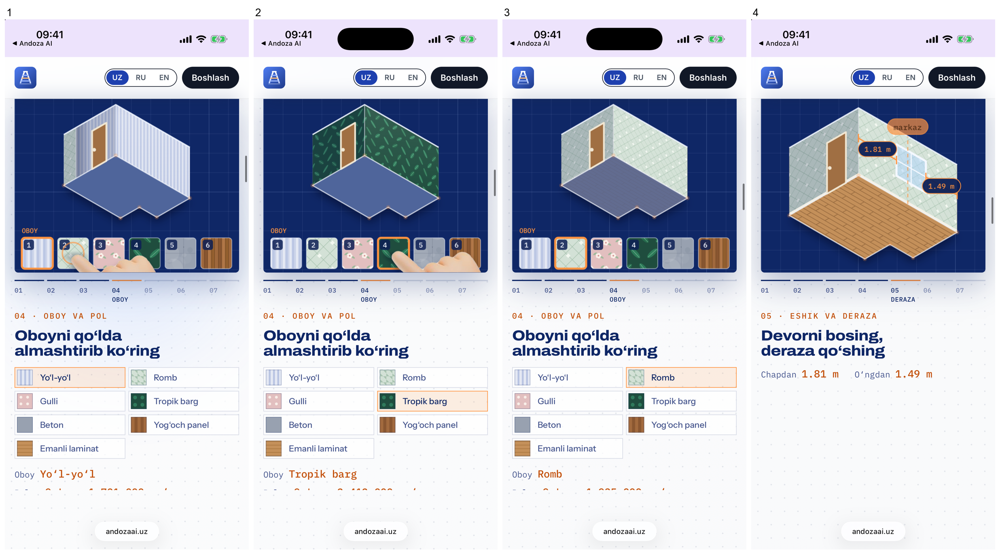
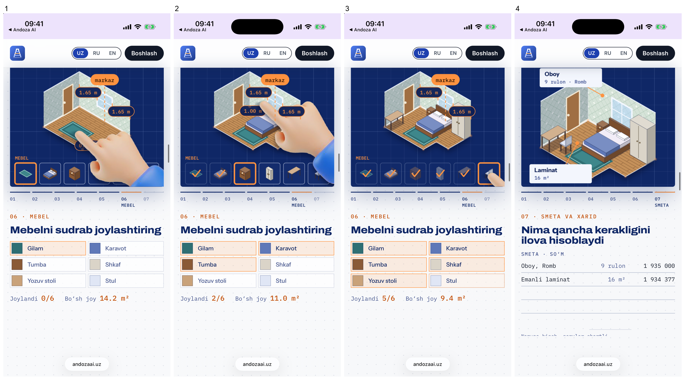
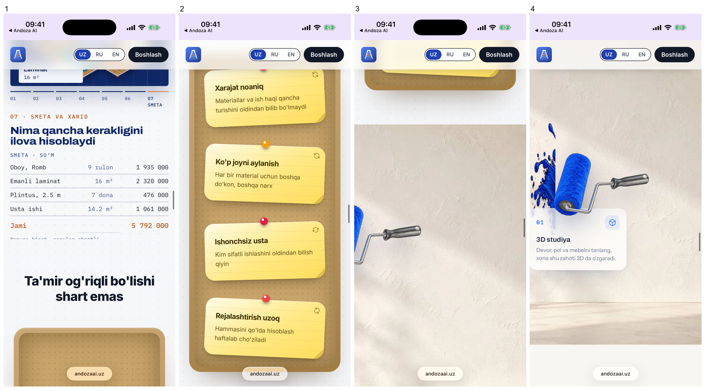
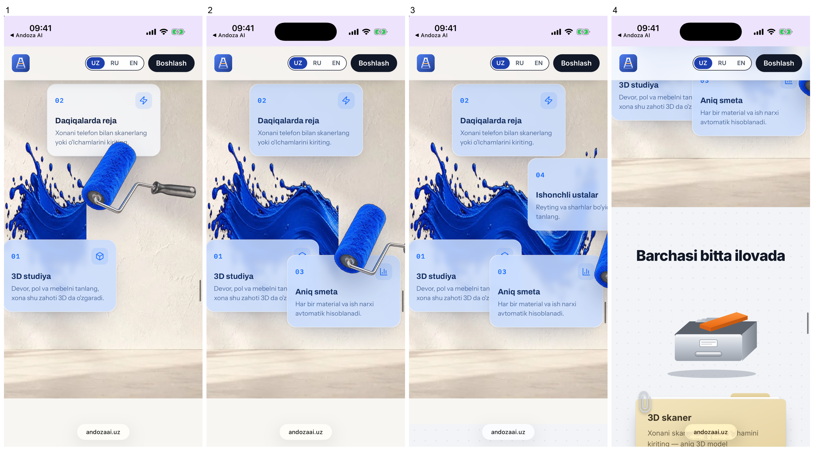
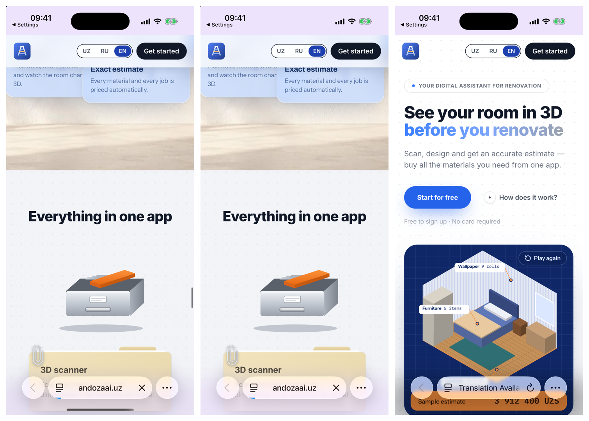

# #376 landing: telefonda tekshiruv (2026-11-22)

**Nima tekshirildi:** web PR #376 (yangi landing). Hero kartasida xona o'zi yig'iladi, story sahnalari va «undefined» o'lchamlar tuzatilgan, paint-story bo'limida yangi matnlar bor.

**Muhit:**
- Qurilma: iOS Simulator, iPhone 17 Pro, mobil Safari, eni 402 px.
- Sahifa: `https://andozaai.uz/landing`. Kirilgan foydalanuvchi `/` dan loyihalarga yuboriladi.
- Til: Safari ingliz tilida ochdi. Asosiy tekshiruv **UZ** tilida qilindi (sahifadagi UZ/RU/EN tugmasi bilan), menyu EN da ham ko'rildi. Oxirida til EN holatida qoldirildi, ya'ni boshlang'ich holatda.
- **Bundle va deploy vaqti:**
  - Sahifa 17:16 da ochildi. 1–6 bandlar shu ochilgan sahifada, sahifani qayta yuklamasdan, 17:16–17:23 oralig'ida tekshirildi.
  - Shu paytda web PR **#378** («Landing sections, phase 1: labels inside the canvas, shorter pins, notes turn themselves») deploy qilinayotgan edi: 17:17–17:22. Deploy tugagach `curl /` → `index-B99qEl39.js`.
  - Demak 1–6 bandlar **#378 dan oldingi** landingda (#376 holati) ko'rilgan. Sahifa allaqachon ochiq edi, deploy uni qayta yuklamadi.
  - 7-band (Reduce Motion) sahifa qayta ochilgandan keyin, **#378 bundle'ida** tekshirildi.
  - 6-banddagi «yorliqlar kesiladi» muammosini #378 tuzatishi kerak. Uni yangi bundle'da qayta ko'rish kerak (pastga qarang).
- Hech qanday tugma (Boshlash, Bepul boshlash) bosilmadi, ro'yxatdan o'tilmadi.

## Natijalar

| # | Band | Bo'lim | Natija | Nima ko'rildi |
|---|---|---|---|---|
| 1 | Hero: xona ~7 s da bir marta yig'iladi, oxirida «Qayta ko'rsatish» ishlaydi | Hero | ✅ | Ko'k karta matn ostida. Sahifa ochilganda xona allaqachon tayyor holatda edi (rasm 02). «Qayta ko'rsatish» bosilib, ~0.8 s oraliqda kadrlar olindi (rasm 01). Tartib: bo'sh karta → **chizma** («4.20 m», «3.40 m») → **devorlar** (deraza bilan) → **gulqog'oz va laminat** → **mebel** (karavot, gilam, keyin shkaf va tumbalar) → **narx yorliqlari** (Gulqog'oz 9 rulon, Mebel 5 dona, Laminat 14.3 m²) → **«Smeta (namuna)»** raqami sanaladi (3 706 082 → **3 912 400 so'm**). Hammasi ~7 s (17:18:11 → 17:18:18). Animatsiya paytida «Qayta ko'rsatish» tugmasi yo'qoladi, oxirida qaytib chiqadi. Animatsiya bir marta o'ynadi, takrorlanmadi. |
| 2 | Yorliqlar (Gulqog'oz, Mebel, Laminat) ekran chetida kesilmaydi; gorizontal skroll yo'q | Hero | ✅ | Uchala yorliq ham kartaning ichida, to'liq o'qiladi (rasm 02). Sahifani chapga surib ko'rildi: gorizontal siljish yo'q (rasm 02 o'ng). |
| 3 | Menyu: logo kesilmaydi; tor ekranda faqat ikonka yoki «Boshlash» | Menyu | ✅ ⚠️ | **UZ:** ikonka + UZ/RU/EN + «Boshlash», hammasi bir qatorda (rasm 03 chap). **EN, pastga surilgan sahifa:** ikonka + «Get started» (rasm 03 o'ng). **Lekin** Safari sahifani birinchi ochganda (EN, sahifa tepasida) menyuda «andoza.ai» yozuvi ham bor edi va uning «i» harfi til tugmasining chegarasiga tegib, qisman ostida qolgan. «Get started» ikki qatorga bo'lingan (rasm 03 o'rta). Shu kadrda hero ham boshqacha edi (markazda, ikonka plitkasi bilan). Til UZ ga o'tkazilgandan keyin bu ko'rinish qaytmadi. #378 bundle'ida EN tepada faqat ikonka + «Get started» chiqdi (rasm 09). Bu ochilish paytidagi oraliq holat (yoki keshdagi eski versiya) bo'lishi mumkin. |
| 4 | Story sahnalari: matnlar bir-birining ustiga chiqmaydi; reja sahnasida o'lcham «… m», «undefined» emas | Story | ✅ | 01–07 sahnalarning sarlavha va matnlari ustma-ust chiqmadi (rasm 04–07). Reja sahnasida (03 «3D ga ko'taring», «Ko'rinish: Reja») o'lchamlar «4.70 m», «3.60 m», «1.20 m», «2.10…», «…30 m», maydon «14.2 m²». **«undefined» bir marta ham ko'rinmadi.** 3D ko'rinishda «2.80 m», deraza sahnasida «1.81 m» va «1.49 m», mebel sahnasida «1.65 m» va «1.00 m». Kuzatuvlar: reja sahnasida «1.10 m» yorlig'i «1.20 m» yorlig'i ostida qisman qoladi (rasm 04, 3-kadr). 04 va 07 sahnalarda matn blokining eng pastki qatori (narx qatori, «Namuna hisob, narxlar shartli») yarmigacha qirqilgan (rasm 05, 07). |
| 5 | «Paint-story» bo'limida yangi matnlar, «Fast Performance» kabi shablon matn yo'q | Paint-story | ✅ ⚠️ | To'rt karta ham bor: **«3D studiya»**, **«Daqiqalarda reja»**, **«Aniq smeta»**, **«Ishonchli ustalar»**, har biri o'zbekcha izoh bilan (rasm 08). «Fast Performance» yoki boshqa inglizcha shablon matn sahifaning hech bir joyida ko'rinmadi. Joylashuvda muammo bor: «Aniq smeta» kartasi «3D studiya» kartasining matnini yopib qo'yadi («Devor, pol va mebelni tan…» uziladi). «Ishonchli ustalar» kartasi ekranning o'ng chetida kesilgan («Reyting va sharhlar bo'yi…»). Animatsiya paytida rolik «Daqiqalarda reja» matni ustidan o'tadi. |
| 6 | Ma'lum muammo: story canvas'dagi o'lcham yorliqlari ekran chetida kesiladi (faqat qayd) | Story | qayd | Tasdiqlandi (#376 holatida). Reja sahnasida chap chetda «…30 m», o'ng chetda «2.10…». Chizma sahnasida (02) o'ng chetda «1.20…» (rasm 04). Yuqorida «4.70 m» va «4.44 m» canvas tepasiga yopishib turibdi. #378 «labels inside the canvas» deb shuni tuzatishga qaratilgan, lekin u 1–6 bandlarda tekshirilmagan. |
| 7 | Reduce Motion yoqilganda tayyor xona darhol ko'rinadi | Hero | ✅ (#378 bundle) | Settings → Accessibility → Motion → Reduce Motion yoqildi, `/landing` qayta ochildi va 0.3 s oraliqda kadrlar olindi. Sahifa chizilishi bilanoq hero'da **tayyor xona** turibdi: yorliqlar (Wallpaper 9 rolls, Furniture 5 items) va «Sample estimate 3 912 400 UZS» bilan. Yig'ilish animatsiyasi yo'q (rasm 09). Reduce Motion keyin o'chirildi. |

## Boshqa kuzatuvlar

1. **Deploy test o'rtasida bo'ldi.** #378 (17:17–17:22) ochiq sahifani yangilamadi. Lekin 7-banddagi qayta ochishdan boshlab sahifa yangi bundle'da. Agar #378 dan keyingi landingni to'liq tekshirish kerak bo'lsa (ayniqsa 6-band: yorliqlar canvas ichida), alohida qisqa test kerak.
2. EN tilida hero smetasi «UZS» bilan, UZ da «so'm» bilan ko'rsatiladi. Bu kutilgan bo'lishi mumkin.
3. «Ta'mir og'riqli bo'lishi shart emas» bo'limidagi sariq yozuvlar (Xarajat noaniq, Ko'p joyni aylanish, Ishonchsiz usta, Rejalashtirish uzoq) o'qiladi, ustma-ust chiqmaydi (rasm 07).
4. 04 sahnada (Oboy va pol) «barmoq» rasmi namunalar ustida yuradi va ba'zan «2» raqamini yopadi. Bu animatsiyaning bir qismi.

## Prod'da o'zgartirilgan narsalar

- Prod ma'lumotlari o'zgartirilmadi (landing faqat ko'rildi).
- Safari'da landing tili UZ ↔ EN almashtirildi (brauzerning o'zida saqlanadi). Oxirida boshlang'ich holatdagidek **EN**.
- Simulator sozlamasi: **Reduce Motion yoqildi va yana o'chirildi** (Settings → Accessibility → Motion, oxirgi holat: o'chiq). Shu ekranda «Prefer Cross-Fade Transitions» qatori faqat Reduce Motion yoqilganda chiqadi. U o'zgartirilmadi.
- Simulator oxirida yana andoza_ai_mobile ilovasiga qaytarildi.

## Rasmlar

- 01. 
- 02. 
- 03. 
- 04. 
- 05. 
- 06. 
- 07. 
- 08. 
- 09. 
