# #377 interaktiv qo'llanma: telefonda tekshiruv (2026-11-22)

**Nima tekshirildi:** web PR #377 (`feat/interactive-studio-tour`). Eski 7 kartali «?» yordami o'rniga telefonda birinchi marta ochiladigan interaktiv qo'llanma:
- 3 ta «qil» qadami (devor/polni bosish, yoy menyusidan mebel qo'shish, bosqichni almashtirish), qo'l animatsiyasi va o'zi keyingi qadamga o'tishi bilan;
- keyin 5 ta ko'rsatish qadami (menyu, orqaga, qulf, kamera, «?»);
- qo'llanmada qo'shilgan mebel «mashq»: oxirida qoldirish yoki olib tashlash so'raladi; ilovaning Back tugmasi, Studio yopilishi yoki ilova o'ldirilishidan keyin so'ramasdan olib tashlanadi.

Ilgari faqat kompyuter brauzerida telefon kengligida tekshirilgan edi. Bu birinchi tekshiruv haqiqiy ilova WebView'ida.

**Muhit:**
- Qurilma: iOS Simulator, iPhone 17 Pro (402×874), til: o'zbekcha.
- Ilova: andoza_ai_mobile 1.0.3+36 debug build (21-noyabr 14:50 da yig'ilgan, `AndozaStudioTour` kanali #61 bilan bor), prod'ga ulangan, egasining akkauntida.
  - Ilova qayta o'rnatilmadi, akkauntdan chiqilmadi.
- Server: production `andozaai.uz`.
  - Boshlashda (17:56) va oxirida (18:07) `curl https://andozaai.uz/` → `index-Oa4jQCjJ.js` (kutilgani shu). Oraliqda deploy bo'lmadi.
  - Xona to'liq yopilib qayta ochildi (17:57), WebView yangi bundle'ni yukladi va qo'llanma o'zi ochildi.
- Xona: hammom 2.5 × 2.0 m («Mening uyim», 5.0 m², 18.0 mln). Ichida «Rakovina» (chap burchakda) va kir yuvish mashinasi (oq quti). Boshlang'ich bosqich: «Tayyor xona», «orqaga» o'chiq (rasm 01).
- Studio ilovasi mavzusi soatga bog'liq (06:00–17:59 kunduzgi, keyin tungi). Tekshiruv 18:00 dan oshganda tungi mavzuga o'tdi, shuning uchun rasm 19 dan boshlab karta va tugmalar to'q rangda. Bu xato emas.
- Render, AI va boshqa pullik tugmalar bosilmadi.

## Natijalar

| # | Band | Qadam | Natija | Nima ko'rildi |
|---|---|---|---|---|
| 1 | Hamma 8 qadam: devor/pol → mebel (Mebel → xona → buyum) → bosqich → menyu, orqaga, qulf, kamera, «?» | 1/8 … 8/8 | ✅ ⚠️ | Xona qayta ochilgach, 3D ko'ringan zahoti qo'llanma o'zi ochildi: «Devor yoki polga bosing», 1/8 (rasm 02). Devor bosildi → 2/8 «Mebel qo'shing: Mebel → xona → buyum» (rasm 04). Mebel → «Vanna» → «Vanna 5» → 3/8 «Bosqichni almashtiring» (rasm 07–08). Ro'yxatdan «Mebel» → 4/8 «Smeta va PDF shu yerda» (menyu, rasm 10–11). «Keyingi» → 5/8 «Oxirgi amalni bekor qilish» (rasm 12) → 6/8 «Kamerani qotirish» (rasm 13) → 7/8 «Tayyor kameralar va render» (rasm 14). **Bu yerda simulator burildi (7-band)** va qo'llanma kamera qadamini tashlab, «?» qadamini **7/7** deb ko'rsatdi (rasm 15–16). Shuning uchun birinchi o'tishda «8/8» yozuvi chiqmadi; burilmasa 8/8 bo'lishi kerak edi. «Tushunarli» → mashq savoli (rasm 17). |
| 2 | Qo'l nishonni ko'rsatadi (1-qadamda devorni, mebelni emas); harakatdan keyin ✓ va keyingi qadam o'zi boshlanadi | 1/8, 2/8, 3/8 | ✅ | 1/8: qo'l ikki devor burchagini, devor ustini bosadi; rakovina va mashinaga emas (rasm 03). 2/8: qo'l yuqoridan «Mebel» tugmasiga (rasm 04), keyin «Vanna»ga va birinchi buyumga (rasm 07). 3/8: qo'l ro'yxatdagi birinchi boshqa bosqich «Quvurlar»ga (rasm 09). Buyum qo'shilganda yoy markazida ✓ chiqdi (rasm 08), bosqich almashganda «Bosqich» yonida ✓ chiqdi (rasm 10); ikkalasida ham keyingi qadam o'zi boshlandi. 1-qadamdagi ✓ kadrga tushmadi (600 ms), lekin 2/8 o'zi ochildi. Qo'l ~2.4 s ko'rinib yo'qoladi va 10 s harakatsizlikdan keyin yana chiqadi, shuning uchun ba'zi kadrlarda yo'q. |
| 3 | «Qil» qadamlarida faqat nishon bosiladi: sarlavha («Orqaga», «?», «Ko'proq»), kamera paneli va boshqa yoy kategoriyalari bloklangan | 1/8, 2/8 | ✅ | 2/8 da xiralashgan «?» joyi (318, 90), kamera tugmasi (40, 795) va «Jihozlar» bosildi: hech narsa ochilmadi, 2/8 qoldi (rasm 05). «Mebel» ochilgandan keyin kulrang «Jihozlar» bosildi: yana hech narsa (rasm 06). Ilovaning o'z «Orqaga» tugmasi qo'llanma davomida yashirin (5-band). «Ko'proq» alohida bosilmadi, u «?» bilan bir qatorda va xuddi shunday xiralashgan. 1/8 da sarlavha karta ostida qoladi. |
| 4 | Oxirida «Mashqda qo'shilgan mebel qoldirilsinmi?» → «Olib tashlash» faqat mashq mebelini olib tashlaydi; avvalgi mebel qoladi (qayta ochib tekshirish) | savol | ✅ | Savol chiqdi, bosqich o'zi «Tayyor xona»ga qaytdi, mashq vannasi mashina bilan ustma-ust ko'rinadi (rasm 17). «Olib tashlash» → vanna yo'qoldi, rakovina va mashina joyida, ilovaning «Orqaga» tugmasi qaytdi (rasm 18). Xona yopilib qayta ochildi: rakovina + mashina, vanna yo'q, «orqaga» o'chiq, qo'llanma qayta ochilmadi (rasm 19). |
| 5 | Ilovaning tizim Back'i qo'llanmani yopadi va mashq mebelini so'ramasdan olib tashlaydi; ilovaning o'z Back tugmasi qo'llanma ochiqligida yashirin | 3/8 (qayta ko'rish) | ⚠️ | **Yashirin Back: ✅.** Birinchi o'tishda ham, «?» bilan qayta ko'rishda ham chap yuqoridagi oq «‹» tugmasi qo'llanma davomida yo'q (rasm 02, 21) va tugagach qaytadi (rasm 18). **Tizim Back: iOS'da sinab bo'lmaydi.** iPhone'da tizim Back tugmasi yo'q; uning o'rnidagi chap chetdan surish ishora ikki marta (tez va sekin) qilindi, qo'llanma 3/8 da ochiq qoldi, mebel o'zgarmadi (rasm 22). Ilova `PopScope(canPop: false)` ishlatadi, iOS'da bu chetdan surishni butunlay o'chiradi, shuning uchun `andoza:tour-skip` yo'li iOS'da hech qachon ishlamaydi. Bu Android'da tekshirilishi kerak. iOS foydalanuvchisi qo'llanmani faqat «O'tkazib yuborish» bilan yopa oladi. |
| 6 | Mebel qadamida buyum qo'yilgandan keyin ilovani o'ldirish, xonani qayta ochish → mashq buyumi yo'q | 3/8 → kill | ✅ | «?» bilan qayta ko'rishda «Vanna 5» qo'yildi; qadam 600 ms da o'zi 3/8 ga o'tdi, shuning uchun ilova 3/8 da (vanna qo'yilgan holda) o'ldirildi: `simctl terminate` 18:04:37 (rasm 21). Ilova qayta ishga tushirildi, hammom ochildi: yuklanish paytida vanna bir lahza ko'rindi (rasm 23), keyin olib tashlandi va toolbar'da «✓ Saqlandi» chiqdi (rasm 24). Natija: rakovina + mashina, «orqaga» o'chiq (rasm 25). |
| 7 | Qo'llanma o'rtasida simulatorni burish uni to'xtatmaydi va mebelni so'ramasdan olib tashlamaydi | 7/8 | ✅ ⚠️ | 7/8 da chapga burildi: qo'llanma ochiq qoldi, mashq vannasi joyida (rasm 15). O'ngga qaytarildi: qo'llanma ochiq, keyin savol odatdagidek chiqdi (rasm 16–17). **Lekin:** burishdan keyin kamera qadami tashlab ketildi va hisoblagich 7/8 dan **7/7** ga o'zgardi: «Qo'llanmani istalgan payt qayta ko'ring» ko'rsatildi. Landshaftda kamera tugmasi ekranda ko'rinib turibdi (rasm 15 chap pastda), ya'ni nishon yo'qolmagan. Kodga ko'ra resize/orientationchange paytida nishon bir lahza o'lchanmasa, qadam «yo'qolgan» deb darhol tashlanadi (`StudioTour.tsx`, `vanish`). Portretga qaytgach ham 7/7 qoldi. |

## Boshqa kuzatuvlar

1. **Burish ko'rsatish qadamini tashlab yuboradi (7-band).**
   - 7/8 «Tayyor kameralar va render» ochiq turganda burish → kamera qadami yo'qoldi, hisoblagich 7/7 bo'ldi.
   - Kamera tugmasi landshaftda ham ko'rinadi, demak bu nishonning yo'qligi emas, burish paytidagi bir lahzalik o'lchov.
   - Tavsiya: resize/orientationchange'da ham `VANISH_MS` kutish (hozir burishda «darhol hal qilinadi»).
2. **iOS'da tizim Back yo'q (5-band).** Mashq mebelini so'ramasdan olib tashlash yo'llaridan iOS'da faqat Studio yopilishi va ilovani o'ldirish qoladi. Ilovaning o'z Back tugmasi qo'llanma davomida yashirin, chetdan surish o'chiq. Bu kutilgan bo'lishi mumkin, lekin topshiriqdagi «tizim Back» bandi Android'da alohida tekshirilishi kerak.
3. **«Olib tashlash»dan keyin «orqaga» tugmasi faol qoladi** (rasm 18, oq). Qo'llanmadan oldin u o'chiq edi (rasm 01). Uni bosish vannani qaytarishi mumkin; prod'ni o'zgartirmaslik uchun bosilmadi. Xona qayta ochilganda tarix tozalanadi va «orqaga» o'chiq (rasm 19).
4. **Mashq vannasi mavjud mashina bilan ustma-ust tushdi** (rasm 17). 5 m² xonada katta vannaga joy kam, qo'l esa doim halqadagi birinchi buyumni («Vanna 5») ko'rsatadi. Qo'llanma oxirida baribir olib tashlash taklif qilinadi, lekin kichik xonada foydalanuvchi qo'shgan buyum boshqasining ichida ko'rinadi.
5. **Bosqich qadamidan keyin xira fonda «Bosqich: Mebel» qoladi** (rasm 13–14). Savol chiqqanda bosqich «Tayyor xona»ga o'zi qaytdi (rasm 17), ya'ni bosqich prod'da o'zgarmadi.
6. **Yoy tugmalariga birinchi bosish ba'zan yo'qoldi** (qayta ko'rishda). 1/8 dagi ✓ tugashidan oldin bosilgan «Mebel», keyin halqa ochilish animatsiyasi paytida bosilgan «Vanna» hech narsa qilmadi; ikkinchi bosish ishladi. Bu animatsiya paytidagi bosish bo'lishi mumkin, birinchi o'tishda (sekinroq bosilganda) bunday bo'lmadi.
7. Qayta ko'rishda (`?`) qo'llanma 1/8 dan boshlandi va ilovaning «Orqaga» tugmasi yana yashirildi (rasm 20–21), ya'ni `AndozaStudioTour` kanali qayta ko'rishda ham ishlaydi.

## Prod'da o'zgartirilgan narsalar

Hammasi joyiga qaytarildi. Xona yopilib qayta ochilgandan keyin tekshirildi (rasm 19, 25).

- **Hammom 2.5 × 2.0 m («Mening uyim», 5.0 m²):**
  - 1-o'tish: «Vanna 5» qo'shildi (mashq) → oxirida «Olib tashlash» bilan olib tashlandi.
  - 2-o'tish («?» bilan): «Vanna 5» yana qo'shildi → ilova o'ldirildi → qayta ochilganda qo'llanmaning o'zi olib tashladi («✓ Saqlandi»).
  - Bosqich: qo'llanma 3-qadamida «Tayyor xona» → «Mebel», qo'llanma savoli oldidan o'zi «Tayyor xona»ga qaytdi. 2-o'tishda bosqich o'zgartirilmadi.
  - 1-qadamda devor bosildi (faqat tanlash, hech narsa o'zgarmadi).
  - Rakovina va mashina qimirlatilmadi.
  - Yakuniy holat: rakovina chap burchakda, mashina joyida, bosqich «Tayyor xona», «orqaga» o'chiq.
- WebView localStorage'da `studio.tour.v2.done = 1` qoldi (qo'llanma tugatilgan). Mashq yozuvi (`studio.tour.practice.<roomId>`) qayta ochilgandan keyin tozalangan.

## Rasmlar

- 01. 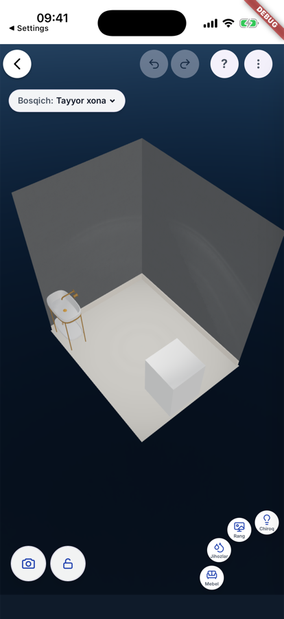
- 02. 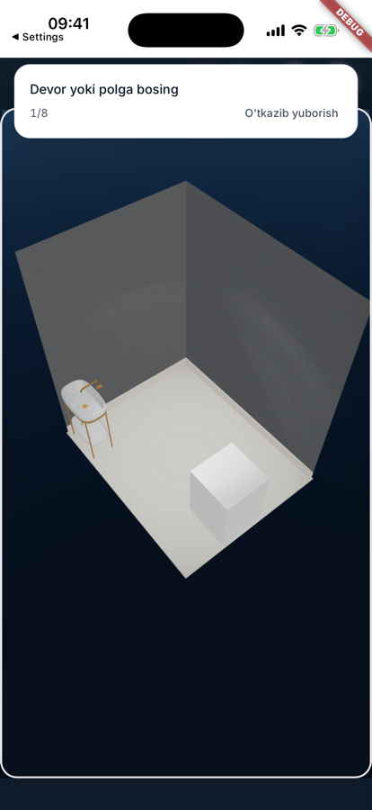
- 03. 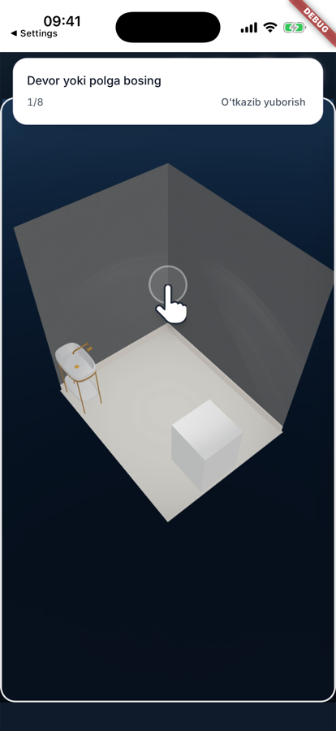
- 04. 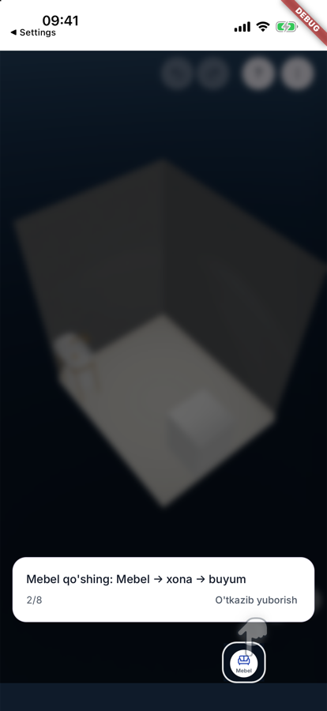
- 05. 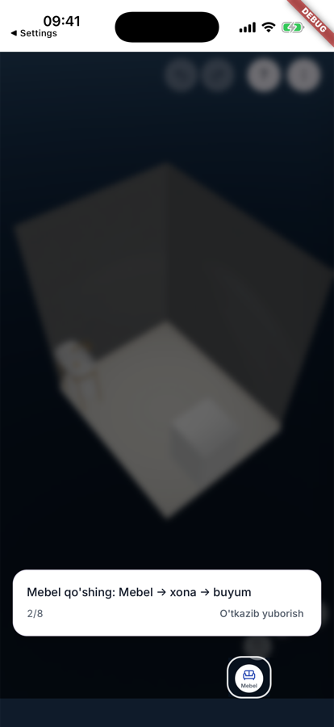
- 06. 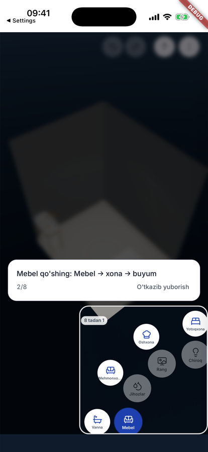
- 07. 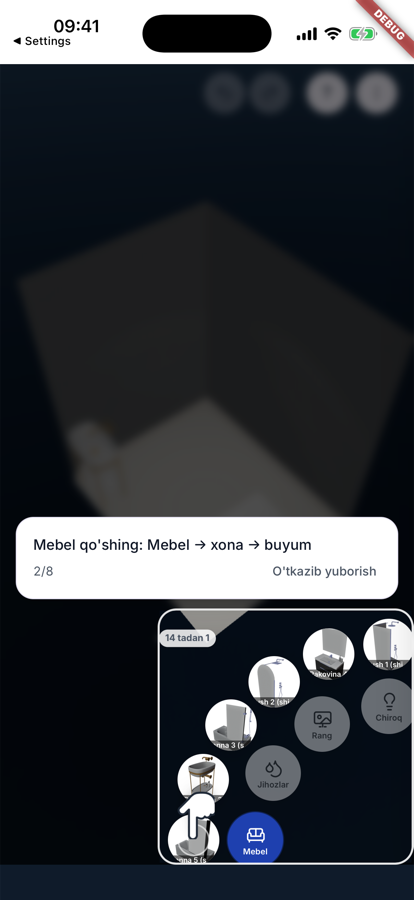
- 08. 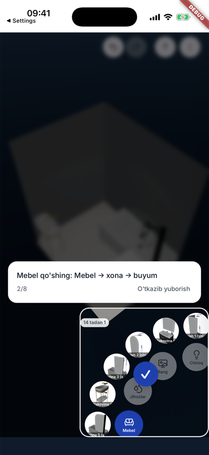
- 09. 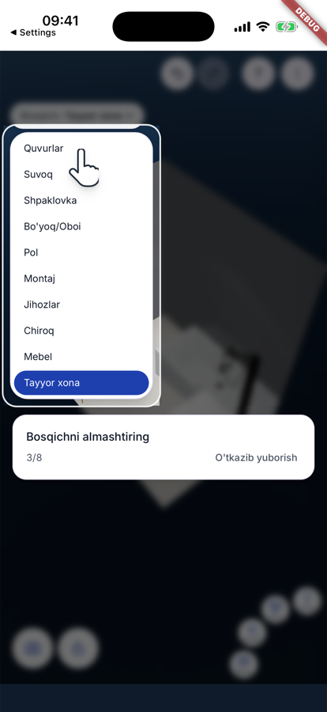
- 10. 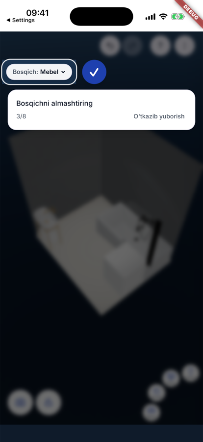
- 11. 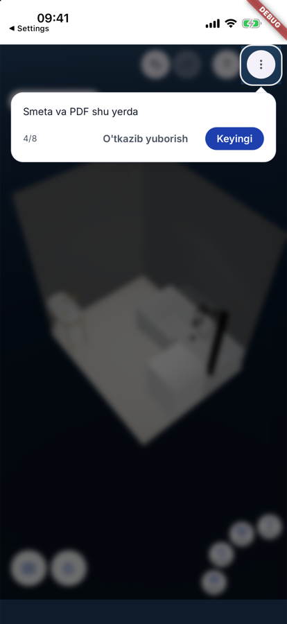
- 12. 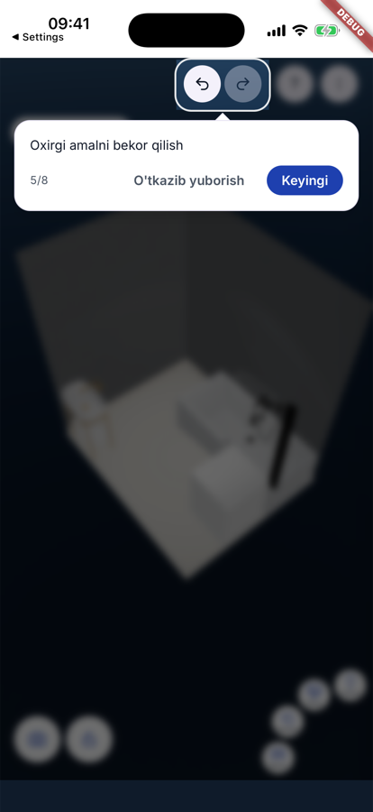
- 13. 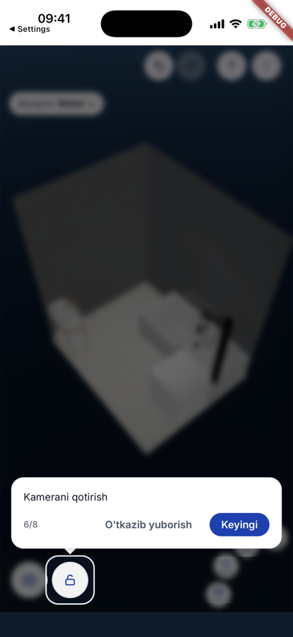
- 14. 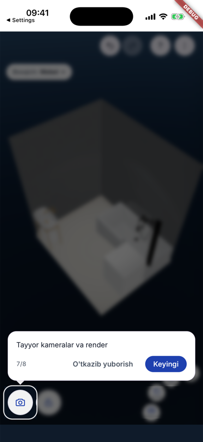
- 15. 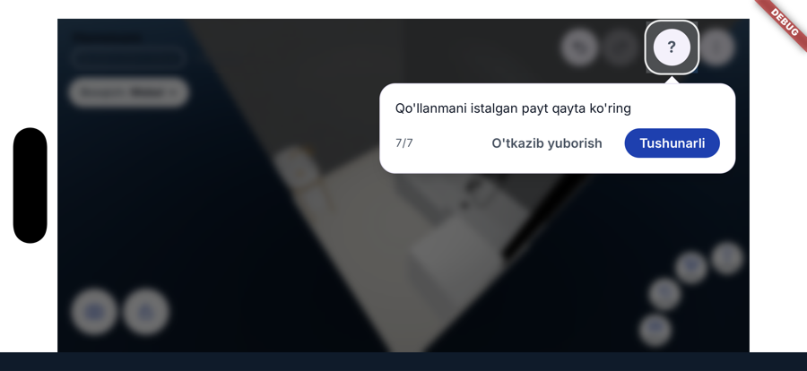
- 16. 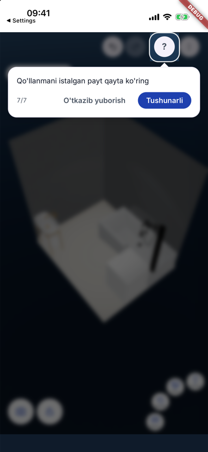
- 17. 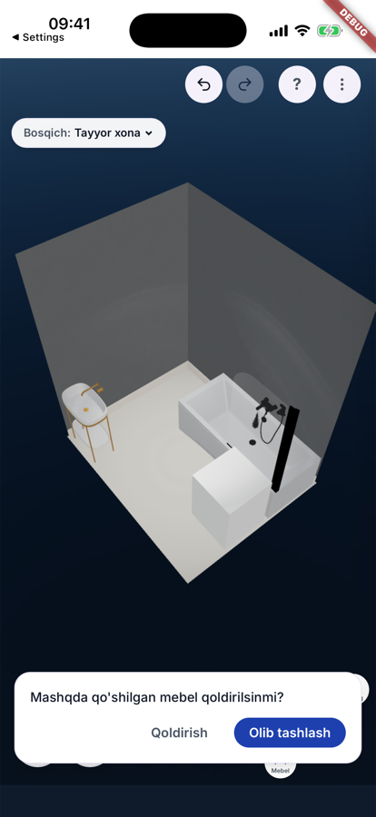
- 18. 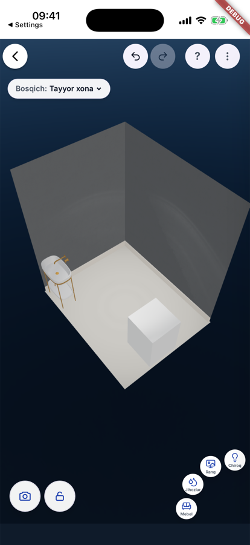
- 19. 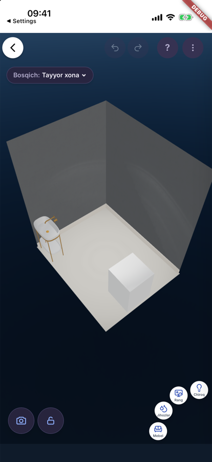
- 20. 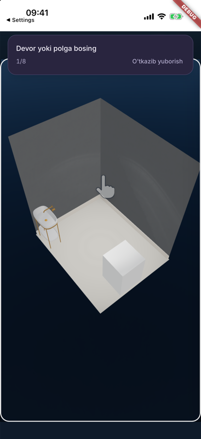
- 21. 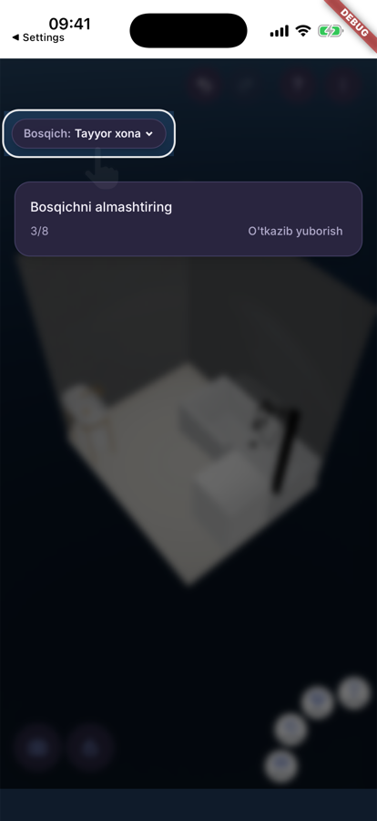
- 22. 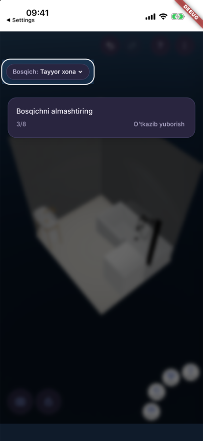
- 23. 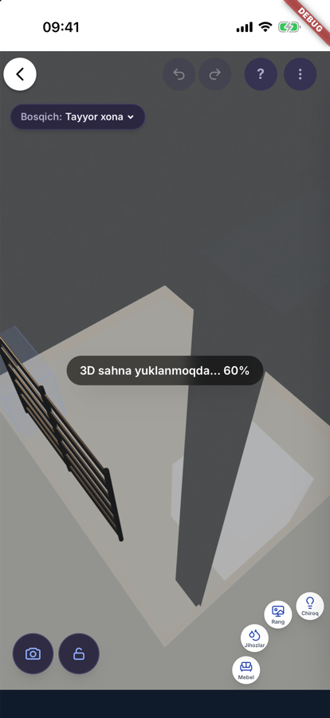
- 24. 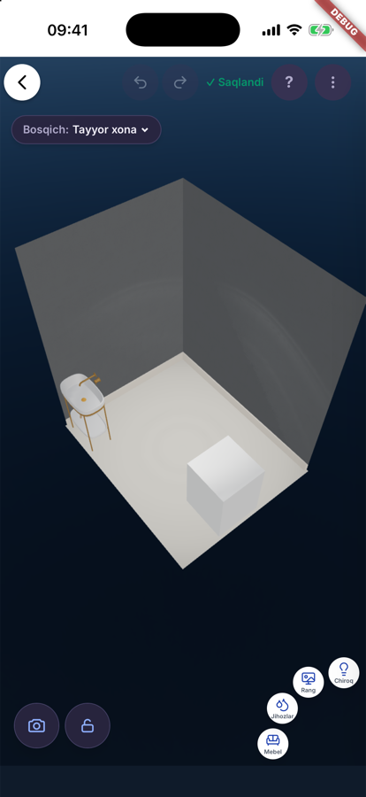
- 25. 
