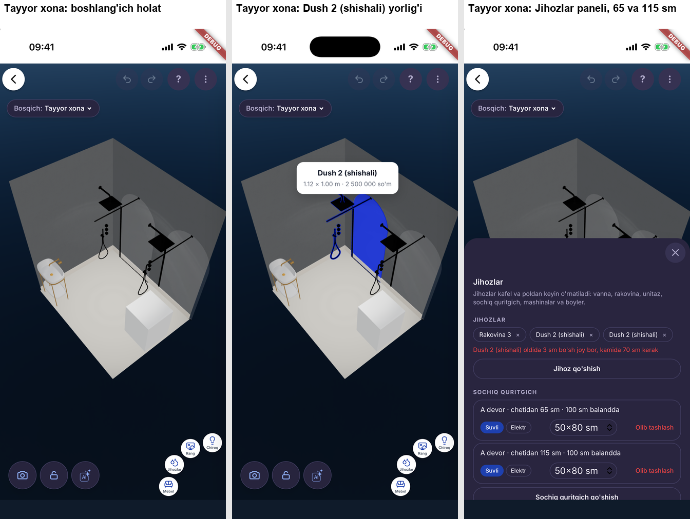
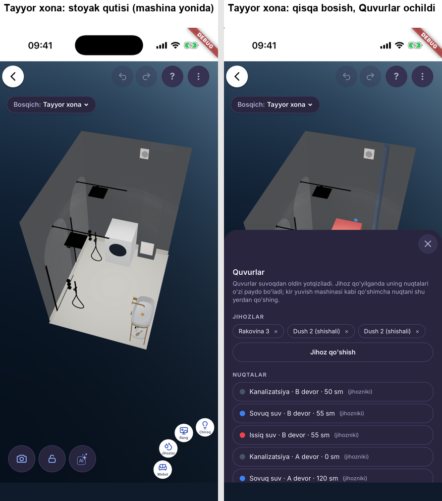
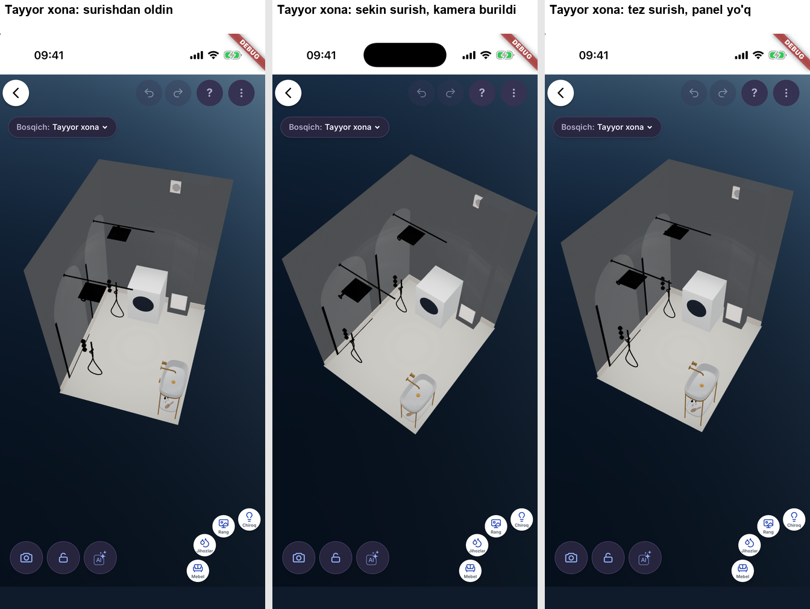
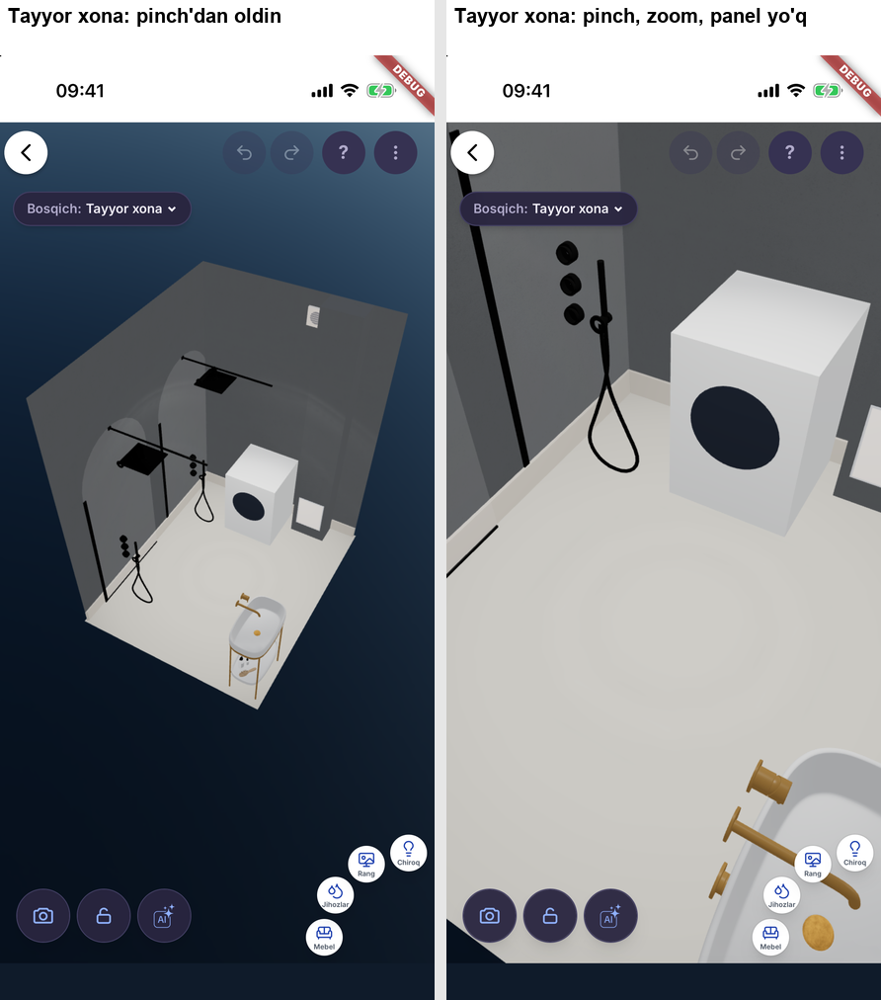
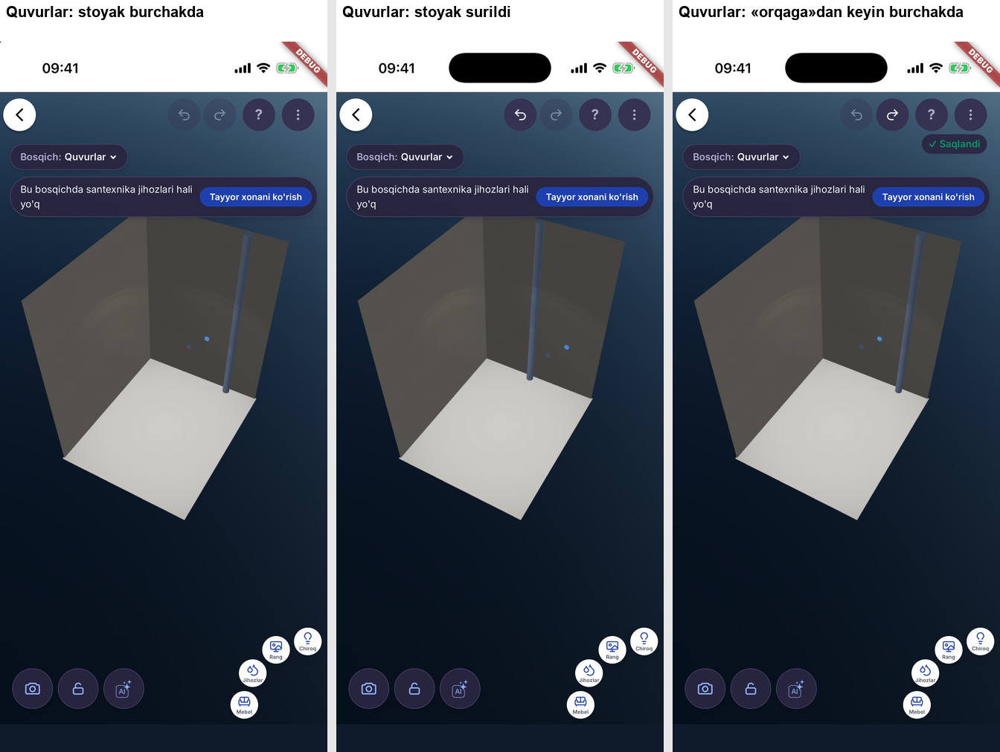
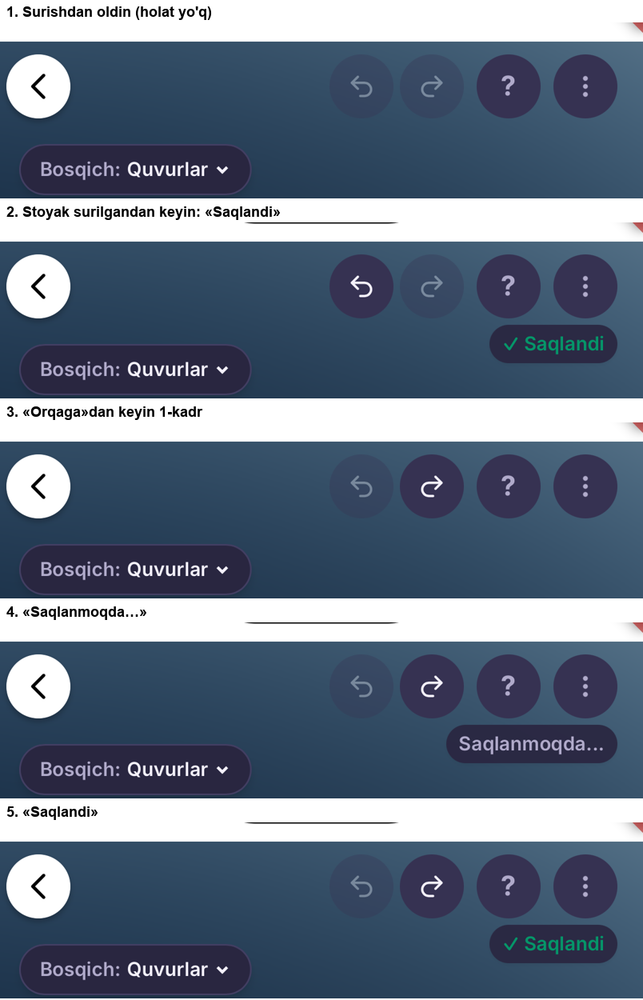
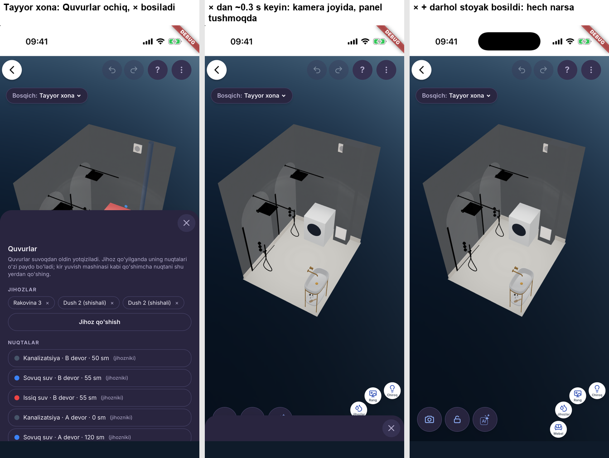
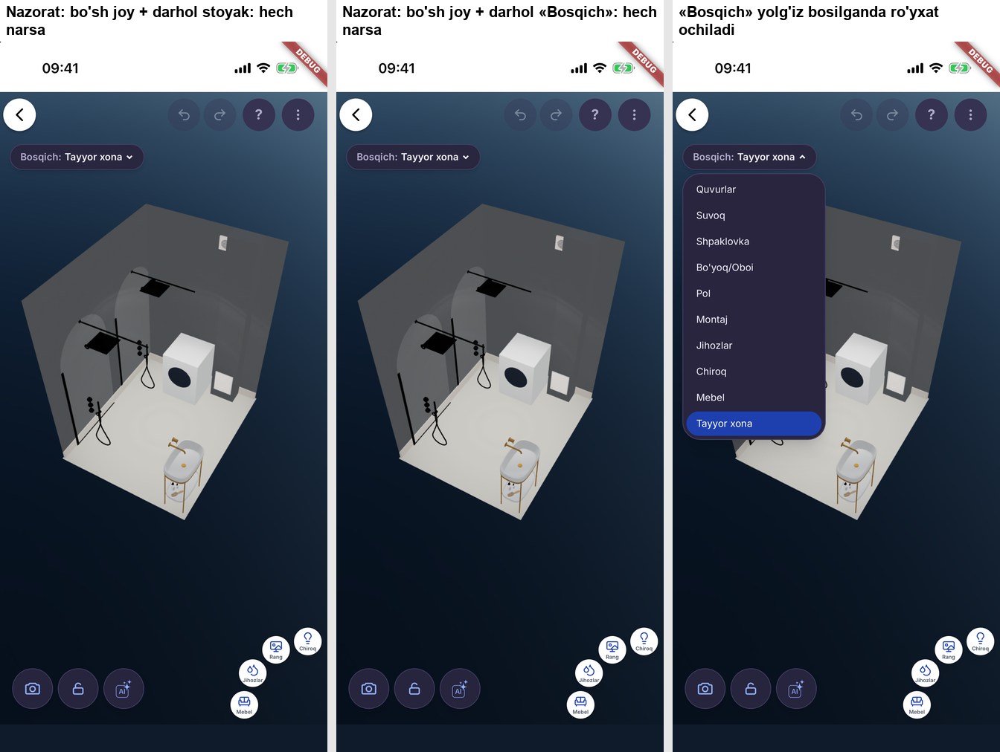
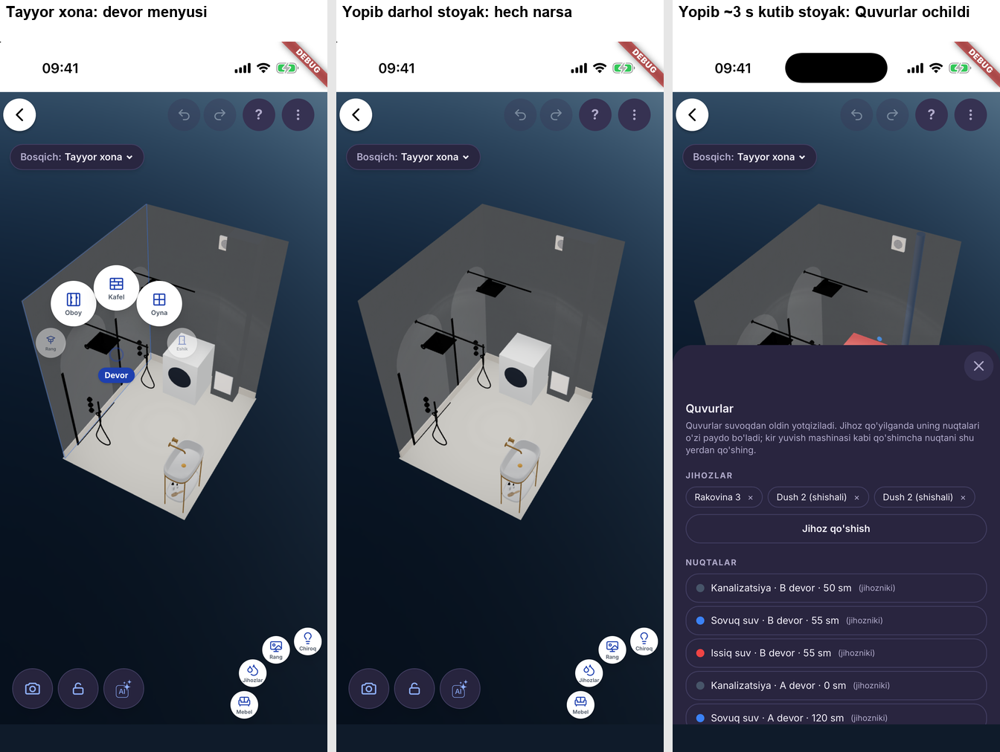
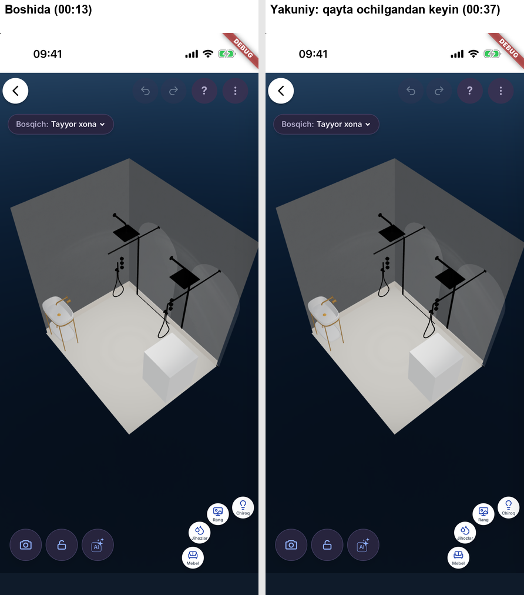

# #381 hammom (QA #380 tuzatishlari): telefonda tekshiruv (2026-11-23)

**Nima tekshirildi:** web PR #381 (`fix(studio): QA #380 hammom — stoyak qutisi, sheet, saqlash holati, quritgich sakrashi`). U #375 telefon QA'sida (`docs/qa/2026-11-22-375-hammom-telefon.md`) topilgan xatolarni tuzatadi:
- 1/2: «Tayyor xona»dagi stoyak qutisini surish va pinch qilish panelni ochmasligi;
- 3a: × dan keyingi tez bosish yo'qolmasligi;
- 3b: devor menyusidan keyingi birinchi bosish (kod o'zgarmagan, qayta tekshiruv);
- 4/5: saqlash holati tugmalar qatorini siljitmasligi;
- 6: rakovina ustidagi quritgichning teskari tomonga sakramasligi.

**Muhit:**
- Qurilma: iOS Simulator, iPhone 17 Pro (Andoza) (402×874).
- Ilova: andoza_ai_mobile 1.0.3+36 debug build, prod'ga ulangan, egasining akkauntida (til: o'zbekcha).
  - Ilova qayta o'rnatilmadi, akkauntdan chiqilmadi.
- Server: production `andozaai.uz`.
  - `curl https://andozaai.uz/` → `index-BT6a_PAG.js` (23:58 va 00:04 da bir xil). Bu web sessiya aytgan `index-D0_UUuea.js` dan keyingi bundle, `index-CL8o7dWf.js` emas.
  - Simulator yangidan yoqildi va ilova 23:59 da noldan ishga tushirildi, ya'ni WebView eski sahifani saqlab qolmagan. Xona 00:13 da ochildi.
- Xona: hammom «Mening uyim», 5.0 m² (bosh sahifada «Yana ko'rsatish»dan keyin, yog'och stol rasmli kartaning tepasida).
- **Bosqich:** 1–3 va 4/5 bandlar «Tayyor xona» bosqichida. Stoyakning o'zi surilishi va saqlash holati «Bosqich: Quvurlar» da (1-band ikkinchi qismi), keyin bosqich yana «Tayyor xona» ga qaytarildi. Har bir rasmda yuqori chapda «Bosqich: …» ko'rinadi.
- Render, AI va boshqa pullik tugmalar bosilmadi.

> **Xona topshiriqdagidan farq qiladi.** Xona ochilganda A devorda ikkita **«Dush 2 (shishali)»** (1.12 × 1.00 m, shisha to'siqli) turibdi. «Jihozlar» panelida: «Rakovina 3», ikkita «Dush 2 (shishali)», sochiq quritgichlar «A devor · chetidan 65 sm» va «chetidan 115 sm» (50×80 sm). Panelda qizil ogohlantirish: «Dush 2 (shishali) oldida 3 sm bo'sh joy bor, kamida 70 sm kerak» (rasm 01). Kir yuvish mashinasi va stoyak qutisi bor.
> Dushlarni bu sessiya qo'shmagan: xona ochilganda «orqaga» tugmasi o'chiq edi. Ular #375/#377 QA'laridan keyin qo'shilgan.
> **Quritgichlar panelda bor, lekin 3D da ko'rinmaydi** (na «Tayyor xona», na «Jihozlar» bosqichida). Shuning uchun quritgichga bog'liq 6-band tekshirib bo'lmadi, 3a band esa quritgich o'rniga stoyak qutisi va mashina bilan sinaldi.

## Natijalar

| # | Band | Bosqich | Natija | Nima ko'rildi |
|---|---|---|---|---|
| 1a | Stoyak qutisini qisqa bosish «Quvurlar» panelini ochadi | Tayyor xona | ✅ | Stoyak qutisi mashina yonida, burchakda (oq kichik quti). Bir marta bosilganda **«Quvurlar» paneli ochildi**, 3D da ko'k vertikal stoyak va nuqtalar ko'rindi (rasm 02). Bu keyin 3b va boshqa bandlarda yana 4 marta takrorlandi, har safar ochildi. |
| 1b | Qutini surish kamerani buradi, panel **ochilmaydi** | Tayyor xona | ✅ | Qutidan boshlab sekin (0.7 s, ~100 pt chapga) va tez (0.25 s, yuqoriga-o'ngga) surildi. Ikkala holatda **kamera burildi, panel ochilmadi**, «orqaga» tugmasi o'chiq qoldi, quti joyida (rasm 03). #375 dagi «surishda panel ochiladi» xatosi takrorlanmadi. |
| 1c | Stoyakning o'zi «Bosqich: Quvurlar» da suriladi | Quvurlar | ✅ | Bosqich «Quvurlar» ga o'tkazildi: xonada faqat ko'k stoyak va nuqtalar, tepada «Bu bosqichda santexnika jihozlari hali yo'q» xabari. Stoyak ~45 pt chapga surildi: **stoyak devor bo'ylab surildi**, kamera qimirlamadi, «orqaga» faollashdi (rasm 05 o'rta). «Orqaga» bilan stoyak aynan burchakka qaytdi (rasm 05 o'ng). Quvurlar panelidan surish alohida sinalmadi. |
| 2 | Qutida pinch: kamera yaqinlashadi, panel ochilmaydi | Tayyor xona | ✅ | Ikki barmoq quti ustida bir vaqtda tegdi va yoyildi. **Kamera kuchli yaqinlashdi, panel ochilmadi**, «orqaga» o'chiq (rasm 04). #375 dagi «pinch oxirida Quvurlar ochiladi» takrorlanmadi. Keyin pinch bilan uzoqlashtirildi. |
| 3a | × dan keyin <0.5 s ichida bosish yo'qolmaydi | Tayyor xona | ⚠️ | **Ketma-ket ikki bosish (×, darhol nishon) 4 marta ham yo'qoldi:** mashina (2 marta), stoyak qutisi, sheet chizig'idan yuqoridagi devor (rasm 07). Har birida nishonni alohida bosish panel yoki menyuni ochadi. × dan keyin kamera darhol joyiga qaytadi, nishon qimirlamaydi (rasm 07 o'rta). **Lekin nazorat ham yo'qoldi:** hech qanday panel ochiq bo'lmaganda bo'sh polni bosib darhol stoyakni bosish ham, bo'sh polni bosib darhol «Bosqich» tugmasini (HTML) bosish ham hech narsa qilmadi. «Bosqich» yolg'iz bosilganda ro'yxat ochiladi (rasm 08). Demak WebView'da **tez ketma-ket ikkinchi bosish umuman yo'qoladi**, sheet'ga bog'liq emas (pastda, 1-kuzatuv). Sheet tuzatishining o'zini shu sababli alohida ajratib bo'lmadi. Ikki bosish orasidagi vaqt o'lchanmadi (ikkita buyruq ketma-ket yuborildi, taxminan 0.1–0.4 s). |
| 3b | Devor menyusidan keyin stoyakni birinchi bosish | Tayyor xona | ⚠️ | Devor bosilib menyu ochildi («Devor»: Oboy, Kafel, Oyna, Rang, Eshik), bo'sh joy bosib yopildi. **Darhol (ketma-ket) stoyak bosilganda hech narsa bo'lmadi** (rasm 09 o'rta). **~3 s kutib bosilganda «Quvurlar» paneli birinchi bosishda ochildi** (rasm 09 o'ng). Takrorlash: Tayyor xona → devorni bosish → menyu ochiladi → bo'sh polni bosish → 0.5 s ichida stoyak qutisini bosish → panel ochilmaydi. Bu 3a dagi umumiy «tez ikkinchi bosish yo'qoladi» holatining o'zi bo'lishi mumkin. Normal tezlikda xato takrorlanmadi. |
| 4/5 | Surishdan keyin saqlash holati tugmalar qatori ostida, tugmalar siljimaydi | Quvurlar | ✅ | Stoyak surilgach o'ngda, qator ostida **«✓ Saqlandi»** pill chiqdi. «Orqaga»dan keyin ketma-ket kadrlarda: yo'q → **«Saqlanmoqda…»** → «✓ Saqlandi» (rasm 06). Hamma kadrlarda «orqaga», «oldinga», «?», «⋮» tugmalari **aynan bir xil pikselda**. Pill «Bosqich» tugmasi va bosqich xabari bilan ustma-ust tushmaydi, yuqori panel ostida o'ng chetda turadi. **«Saqlanmadi / Qayta urinish»** chiqmadi (ikkala saqlash ham muvaffaqiyatli), shuning uchun u alohida ko'rilmadi. «Tayyor xona» bosqichida surish bo'lmagani uchun pill shu bosqichda ko'rilmadi. |
| 6 | Rakovina ustidagi quritgich joy yo'q tomonga surilganda joyida qoladi, xabar chiqadi | — | ⚠️ tekshirilmadi | Quritgichlar 3D da ko'rinmaydi (yuqoriga qarang), ularni surib bo'lmadi. Xonani qayta qurish (dushlarni olib tashlash, rakovinani surish) prod'dagi boshqa o'zgarishlarni buzishi mumkin edi, shuning uchun qilinmadi. Bu band avvalgi tartibdagi xonada qayta tekshirilishi kerak. |

## Boshqa kuzatuvlar

1. **Tez ketma-ket ikkinchi bosish WebView'da yo'qoladi** (3a, 3b ning asosiy sababi bo'lishi mumkin).
   - Takrorlash: «Tayyor xona», hech qanday panel ochiq emas. Bo'sh polni bosish, darhol (≈0.1–0.4 s) boshqa joyni bosish: stoyak qutisi ham, HTML «Bosqich» tugmasi ham javob bermaydi (rasm 08).
   - Ikkinchi bosish birinchisidan ~260 pt uzoqda bo'lsa ham yo'qoladi. iOS WKWebView ikki marta bosishni (double-tap, zoom yoki `dblclick`) kutib, ikkinchi bosishni yutayotgan bo'lishi mumkin. Tavsiya: canvas va UI konteyneriga `touch-action: manipulation` qo'yib qayta sinash.
   - Simulator bosishlarni sun'iy yuboradi. Haqiqiy telefonda ham shundaymi, tekshirish kerak.
2. **Sochiq quritgichlar 3D da ko'rinmaydi.** «Jihozlar» panelida ikkala quritgich bor (A devor, 65 va 115 sm, 100 sm balandda, 50×80), lekin 3D da hech bir burchakdan ko'rinmadi, «Jihozlar» bosqichida ham. A devorda ikkita 1.12 m li dush turibdi. Quritgichlar dush ichida qolib, ko'rsatilmayotgan bo'lishi mumkin. Agar bu ataylab bo'lmasa, xato.
3. **Dush oldida joy yetmaydi** degan qizil ogohlantirish «Jihozlar» panelida doim turibdi (3 sm, kamida 70 sm kerak). Dushlar qo'shilgandan beri xona tartibi «noto'g'ri» holatda.
4. **Panel ochilganda kamera alohida ko'rinishga o'tadi** («Jihozlar» va «Quvurlar»da yuqoridan qaraladi, mashina qizil quti bo'lib ko'rinadi), × dan keyin darhol eski ko'rinishga qaytadi. Bu kutilgan bo'lsa kerak, faqat qayd.
5. Studio tungi mavzuda (to'q fon). Bu soatga bog'liq, xato emas (#377 QA'sida ham qayd qilingan).
6. Bosh sahifada «Mening uyim» nomli kartalar juda ko'p (9.0, 12.0, 20.0 m² …). Kerakli 5.0 m² hammom ikkinchi «Yana ko'rsatish»dan keyin chiqdi. «Loyihalarim» ro'yxatida maydon ko'rsatilmaydi, u yerdan topish yanada qiyin.

## Prod'da o'zgartirilgan narsalar

Hammasi joyiga qaytarildi. Xona yopilib qayta ochilgandan keyin tekshirildi (rasm 10, boshlang'ich kadr bilan bir xil, «orqaga» o'chiq).

- **Hammom «Mening uyim» (5.0 m²):**
  - Stoyak: «Bosqich: Quvurlar» da ~45 pt surildi → «orqaga» bilan aniq burchakka qaytdi. Ikkala holat serverga saqlandi («Saqlandi»), oxirgisi asl joy.
  - Bosqich: «Tayyor xona» → «Quvurlar» → (ro'yxatda «Jihozlar» bir marta ko'rildi) → **«Tayyor xona»**. Oxirgi holat boshlang'ichdagidek «Tayyor xona».
  - Kamera burildi va yaqinlashtirildi (saqlanmaydi, qayta ochilganda boshlang'ich ko'rinish).
  - Devor menyusi va plintus menyusi ochilib, hech narsa tanlanmay yopildi. Bitta boshqa (bo'sh) xonada pol menyusi tasodifan ochilib, hech narsa tanlanmay yopildi.
  - Dushlar, rakovina, mashina, quritgichlar o'zgartirilmadi.
- Ilova sozlamalari o'zgartirilmadi.

## Rasmlar

- 01. 
- 02. 
- 03. 
- 04. 
- 05. 
- 06. 
- 07. 
- 08. 
- 09. 
- 10. 
