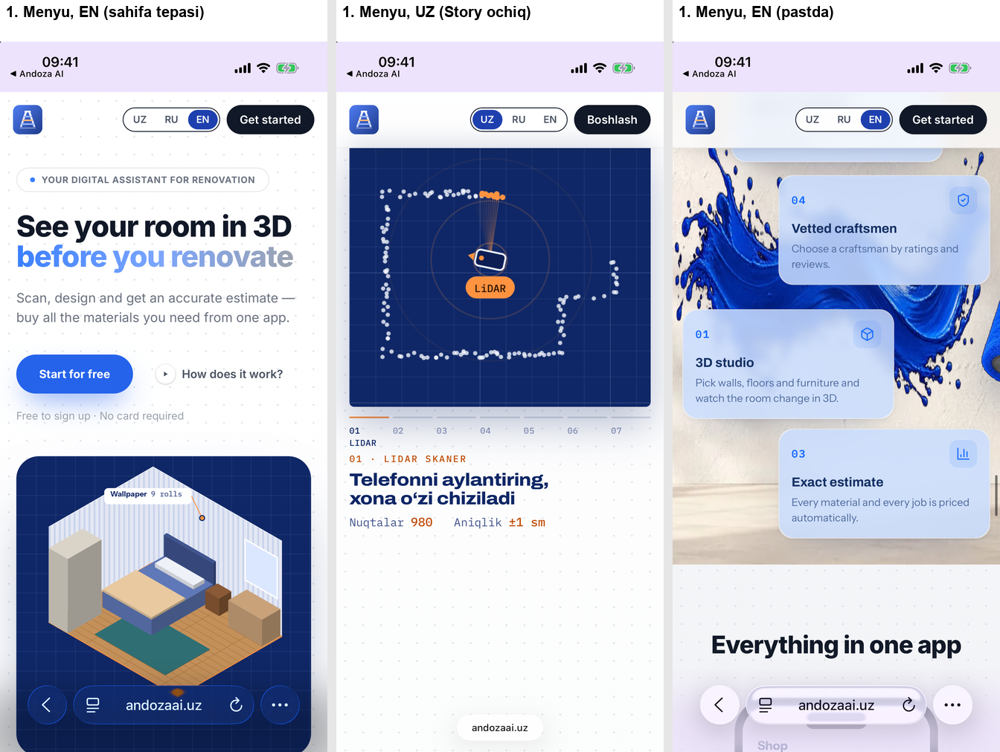
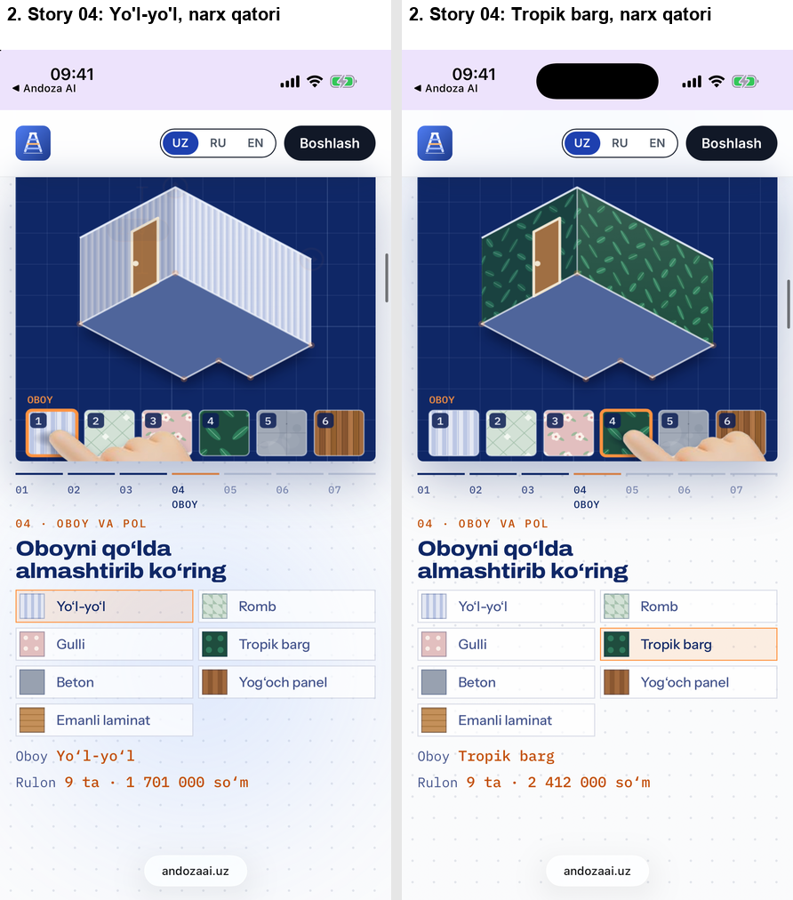
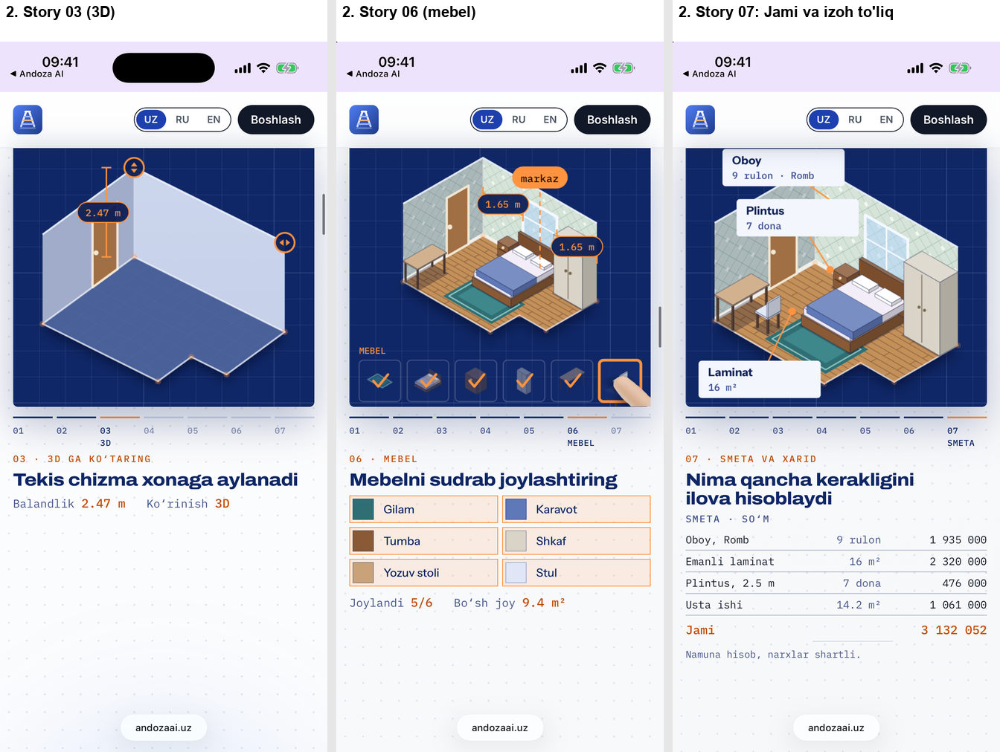
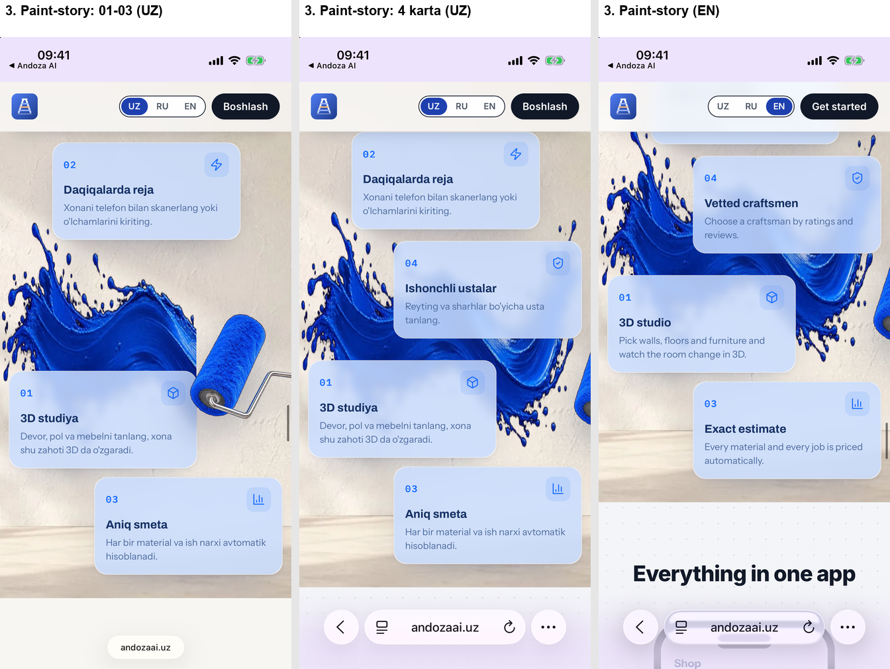
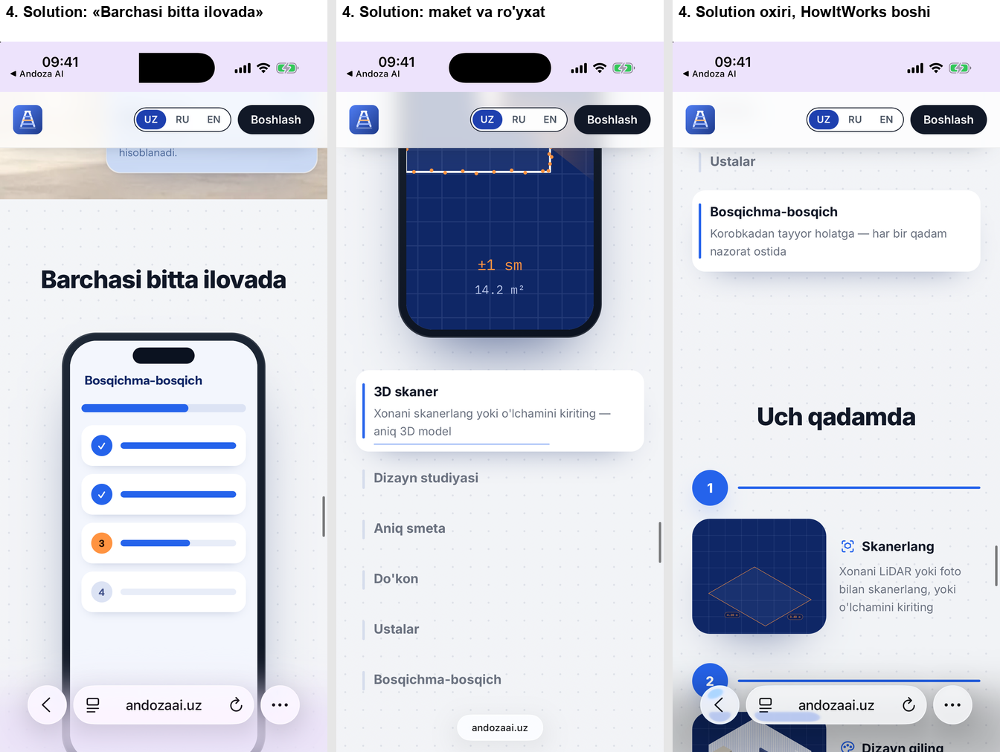
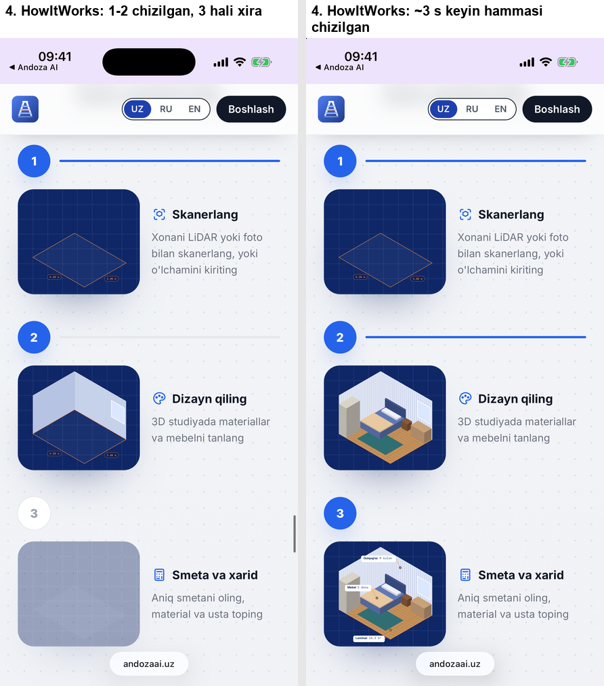

# #382 landing (QA #380 tuzatishlari): telefonda tekshiruv (2026-11-23)

**Nima tekshirildi:** web PR #382 («Landing: telefon QA tuzatishlari»). U #376 telefon QA'sida (`docs/qa/2026-11-22-376-landing-telefon.md`) topilgan uchta kamchilikni tuzatadi:
- EN menyuda «andoza.ai» yozuvi til tugmasiga tegishi;
- story 04 va 07 sahnalarida pastki qatorning qirqilishi;
- paint-story kartalarining ustma-ust tushishi va «Ishonchli ustalar» kartasining o'ng chetda kesilishi.

Yana yangi Solution bo'limi (telefon maketi) va HowItWorks (rasmlar chiziladi) telefonda qanday ko'rinishi qaraldi.

**Muhit:**
- Qurilma: iOS Simulator, iPhone 17 Pro (Andoza), mobil Safari, eni **402 px**.
  - Topshiriqda 375–402 px deyilgan. Simulatorda faqat 402 px bor, 375 px alohida tekshirilmadi (pastga qarang).
- Sahifa: `https://andozaai.uz/landing`. Safari sahifani **EN** tilida ochdi (#376 dan qolgan holat).
- **Bundle:** `curl https://andozaai.uz/` → `index-BT6a_PAG.js` (23:58 va 00:04 da, ikkalasida bir xil). Bu web sessiya aytgan `index-D0_UUuea.js` dan keyingi bundle, `index-CL8o7dWf.js` emas.
  - Sahifa ochilgach Safari'da qayta yuklandi (00:04), shundan keyin hamma bandlar shu yuklangan sahifada ko'rildi (00:04–00:10).
- Hech qanday tugma (Boshlash, Bepul boshlash, Get started) bosilmadi, ro'yxatdan o'tilmadi.

## Natijalar

| # | Band | Bo'lim | Natija | Nima ko'rildi |
|---|---|---|---|---|
| 1 | EN tilida logo til tugmasiga tegmaydi | Menyu | ✅ | **EN, sahifa tepasi** (Safari ochgan birinchi holat, qayta yuklangandan keyin): chapda faqat ikonka, keyin UZ/RU/EN va «Get started». «andoza.ai» yozuvi umuman chiqmaydi. Ikonka bilan til tugmasi orasida ~100 px bo'sh joy (rasm 01 chap). **UZ:** ikonka + UZ/RU/EN + «Boshlash», bir qatorda (rasm 01 o'rta). **EN, pastga surilgan:** xuddi shunday, «Get started» bir qatorda (rasm 01 o'ng). #376 dagi «i harfi til tugmasi ostida» holati qaytmadi. |
| 2 | Story: pastki qatorlar qirqilmaydi | Story | ✅ | Asosiy tekshiruv **UZ** da (kamchilik shu tilda topilgan edi). **04 «Oboy va pol»:** sakkizta namuna nomi va pastki ikki qator («Oboy Yo'l-yo'l», «Rulon 9 ta · 1 701 000 so'm») to'liq o'qiladi. Oboy almashganda ham («Tropik barg», «2 412 000 so'm») narx qatori butun (rasm 02). **07 «Smeta va xarid»:** sahna mahkamlangan (pinned) holatda to'rt qator, **«Jami»** qatori va «Namuna hisob, narxlar shartli.» izohi to'liq ko'rinadi (rasm 03 o'ng). 03 va 06 sahnalarda ham matn kesilmadi (rasm 03). |
| 3 | Paint-story kartalari ustma-ust tushmaydi; «Ishonchli ustalar» kesilmaydi | Paint-story | ✅ | To'rt karta ham ko'rinib turgan kadrda (rasm 04 o'rta): 02 «Daqiqalarda reja» tepada, 04 «Ishonchli ustalar», 01 «3D studiya», 03 «Aniq smeta» pastda, zinapoya bo'lib. **Hech biri boshqasining matnini yopmaydi.** «Ishonchli ustalar» kartasi to'liq ekran ichida, «Reyting va sharhlar bo'yicha usta tanlang.» to'liq o'qiladi. Kartalar sticky menyu ostiga kirmaydi. Rolik «3D studiya» kartasi yonidan o'tadi, matn ustidan emas (rasm 04 chap). EN da ham («Vetted craftsmen», «Exact estimate») kartalar ustma-ust emas (rasm 04 o'ng). |
| 4a | Yangi Solution bo'limi (telefon maketi) telefonda | Solution | ✅ | Sarlavha «Barchasi bitta ilovada», ostida telefon maketi. Maket ichida «Bosqichma-bosqich» ekrani: progress chizig'i, ikkita belgilangan, bitta sariq (3) va bitta bo'sh (4) qadam (rasm 05 chap). Maket ostida oltita band ro'yxati: «3D skaner» (faol, izoh bilan), «Dizayn studiyasi», «Aniq smeta», «Do'kon», «Ustalar», «Bosqichma-bosqich» (rasm 05 o'rta). Hammasi ekran eniga sig'adi, gorizontal siljish yo'q. Kuzatuv: 874 pt balandlikda maket va ro'yxatning faol bandi bir ekranga to'liq sig'maydi, shuning uchun qaysi band maketda ko'rsatilayotgani darhol tushunarli emas (pastda, 1-kuzatuv). |
| 4b | HowItWorks (rasmlar chiziladi) telefonda | HowItWorks | ✅ | Sarlavha «Uch qadamda» (rasm 05 o'ng). Uch qadam bitta ustunda: rasm chapda, matn o'ngda. Bo'limga kelganda 1 va 2-rasm chizilgan, 3-rasm hali xira (rasm 06 chap). ~3 s ichida 3-rasm ham chizildi va raqam doirasi ko'k bo'ldi (rasm 06 o'ng). Rasmlar: 1 chizma (reja), 2 jihozlangan xona, 3 narx yorliqli xona. Matnlar («Skanerlang», «Dizayn qiling», «Smeta va xarid») to'liq. Kuzatuv: 3-rasmdagi yorliqlar («Gulqog'oz», «Mebel», «Laminat») telefonda juda mayda, o'qib bo'lmaydi (pastda, 2-kuzatuv). |

## Boshqa kuzatuvlar

1. **Solution: maket va faol band bir ekranda emas.** 402×874 da telefon maketi ekranning katta qismini egallaydi, ro'yxat esa ostida. Maketni ko'rib turganda qaysi band faolligi ko'rinmaydi, ro'yxatga tushganda maketning faqat pastki qismi qoladi (rasm 05). Ikki marta ko'rilganda ham maketda «Bosqichma-bosqich» ekrani turgan edi, ro'yxatda esa birinchi marta «3D skaner», keyin «Bosqichma-bosqich» faol edi. Ya'ni maket ekrani aylanib turadi, lekin bu jarayonni bir ekranda kuzatib bo'lmaydi. Kichik dizayn masalasi.
2. **HowItWorks 3-rasmidagi yorliqlar o'qilmaydi.** Rasm ~165 px enli, ichidagi yorliqlar matni bir necha piksel. Bu dekorativ bo'lsa normal, lekin story bo'limidagi kabi o'qilishi kerak bo'lsa, telefonda kattaroq kerak.
3. **Story 07: «Jami» qatori scroll bilan chiqadi.** Sahna 07 ga endi o'tganda jadvalda faqat to'rt qator bor, «Jami» qatori o'rni bo'sh. Biroz pastga surilganda «Jami» paydo bo'ladi va summa sanaladi (3 132 052 → 5 792 000 so'm). Bu qirqilish emas, animatsiya. Lekin sahna ko'rinib turgan paytda Safari'ning pastki paneli ochiq bo'lsa, «Namuna hisob…» izohi panel ustida, panelga juda yaqin turadi (rasm 03 da panel yopiq).
4. **375 px tekshirilmadi.** Simulatorda bitta qurilma (402 px). Safari'ning sahifa masshtabi (aA) bilan enini 375 ga aniq tushirib bo'lmaydi, shuning uchun sinalmadi. PR #382 tavsifida 375 px dev server'da tekshirilgani yozilgan.
5. **Faqat UZ va EN ko'rildi**, RU qaralmadi. Paint-story RU da eng uzun matnlarga ega bo'lishi mumkin.
6. «Ta'mir og'riqli bo'lishi shart emas» bo'limida yozuvlar (Hammasi bir joyda, Ishonchsiz usta, Rejalashtirish uzoq) o'qiladi, ustma-ust emas.

## Prod'da o'zgartirilgan narsalar

- Prod ma'lumotlari o'zgartirilmadi (landing faqat ko'rildi).
- Safari'da landing tili EN → UZ → EN almashtirildi (brauzerning o'zida saqlanadi). Oxirida boshlang'ich holatdagidek **EN**.
- Simulator sozlamalari o'zgartirilmadi.

## Rasmlar

- 01. 
- 02. 
- 03. 
- 04. 
- 05. 
- 06. 
