# Telefon QA: #385 (santexnika PR1) va #387 (dush va quritgich) — 2026-11-24

**Nima tekshirildi:** web PR #385 (`feat/plumbing-add-arc`: burchak menyusi «Jihozlar» bo'limidan quritgich, mashina, boyler, oshxonada moyka va idish mashinasi qo'shish; Jihozlar va Quvurlar panellarini ixchamlash) va #387 (`fix/rail-in-shower`: balandligi yo'q dush 2.0 m, quritgich dush oralig'iga tushmaydi, dush ichidagi quritgichda ogohlantirish). Tekshirish prod'da (andozaai.uz), telefon ilovasi ichidagi Studio WebView'da.

## Muhit

| | |
|---|---|
| Android | Emulator AVD `andoza_pixel` (1080×2400, Android 16 tasviri), **mehmon** (ro'yxatdan o'tmagan). Debug APK `andoza_ai_mobile` `main` (13cf53b) dan prod'ga yig'ilgan (`API_URL=https://andozaai.uz/api/v1`, `STUDIO_BASE_URL=https://andozaai.uz`). Ilova tili o'zbekcha. |
| iOS | Simulator «iPhone 17 Pro (Andoza)» (iOS 26.0), egasining prod sessiyasi. Faqat 5-band, faqat ko'rish. |
| Bundle | Boshida `index-BE4mZyUd.js` (#385 va #387 bor, «o'zi chiziladi» matni bundle ichida topildi). **Test paytida prod qayta joylandi** (#389 PR2 va #390, 00:28–00:31): Android'dagi Studio sinovlari hammasi **`index-LAcHfBIi.js`** da bo'ldi (WebView `script src` dan tekshirildi). Shuning uchun 2-banddagi «×, Suvli/Elektr, o'lcham panelda» talabi #389 bilan o'zgargan (pastda). |
| Xonalar | Android: mehmon hammomi 2.5 × 2.0 × 2.7 m (5.0 m², `17df4ff8…`) va mehmon oshxonasi 9.0 m² (`fadeeafe…`), ikkalasi wizard'da yaratildi va oxirida o'chirildi. iOS: egasining «Mening uyim» 5.0 m² / 18.0 mln kartasi. |
| Emulator eslatmasi | Birinchi emulator sinov o'rtasida yiqildi (Mac diski to'lgan edi). Qayta yoqilganda host GPU bilan WebGL umuman chizmadi, shuning uchun emulator `-gpu swiftshader_indirect` (dasturiy chizish) bilan ishga tushirildi. Hamma 3D rasmlar shu rejimda. Har rasmda yuqori chapda «Bosqich: …» bor (toast uni yopgan 07-rasm va bosh sahifa 23-rasm bundan mustasno). |

## Natijalar

| # | Band | Qurilma | Bosqich | Natija | Nima ko'rildi |
|---|---|---|---|---|---|
| 1a | Hammom: burchak menyusi «Jihozlar» dan quritgich, kir yuvish mashinasi, boyler 2 bosishda | Android | Tayyor xona | ✅ | «Jihozlar» bosilganda menyuda «18 tadan 1». Oxirida **Sochiq quritgich, Kir yuvish mashinasi, Boyler**, keyin «Jihozlar paneli», «Nuqta qo'shish» (rasm 01). Har biri bitta bosishda qo'shildi, «✓ Saqlandi» chiqdi. Mashina 3D da darhol ko'rindi. Quritgich D devorga tushgan, u standart kamerada kesilgan old devor bo'lgani uchun qo'shilgan paytda ko'rinmadi (kamera burilganda ko'rinadi, rasm 19). |
| 1b | Boyler qo'yilgach ikonkasi yo'qoladi | Android | Tayyor xona | ✅ | Boyler bosilgach menyu **18 → 17** ta, «Boyler» yo'q (rasm 02). Panelda «Suv isitgich (boyler)» belgilangan. Oshxonada ham **10 → 9** (rasm 08). |
| 1c | Devorda joy qolmasa xabar | Android | Tayyor xona | ✅ / ⚠️ | 11 ta mashina qo'shilgach keyingi bosishlarda qizil toast: **«Devorlarda kir yuvish mashinasi uchun joy yo'q.»**, u ko'rinib turdi (rasm 03). Quritgich (10 tadan keyin) va idish mashinasida (~15 tadan keyin) ham xabar chiqadi: «Devorda sochiq quritgich uchun joy yo'q.», «Devorlarda idish yuvish mashinasi uchun joy yo'q.», lekin **atigi ~0.3–0.6 s ko'rinadi**: DOM'da bor, 4 kadrlik ketma-ket suratlarda faqat bittasida ko'rindi (rasm 07). O'qib ulgurib bo'lmaydi. Mashinaniki uzoqroq turdi. |
| 1d | Oshxona: moyka va idish mashinasi 2 bosishda, quritgich yo'q | Android | Tayyor xona | ✅ | Oshxona menyusi «10 tadan»: 4 ta «Oshxona rakovinasi» (katalog), **Moyka, Idish yuvish mashinasi, Kir yuvish mashinasi, Boyler**, panel, nuqta. **Sochiq quritgich yo'q** (rasm 04). Moyka bitta bosishda qo'shildi va 3D da chizildi (rasm 05). Idish mashinasi moyka yonida chizildi (rasm 06). |
| 2a | Jihozlar paneli qisqargan: izoh yo'q, sarlavha bir marta, «chetidan N sm» yo'q | Android | Tayyor xona, Jihozlar | ✅ / ⚠️ | Panel tepasida faqat «Jihozlar». Qatorlar faqat nom: «Sochiq quritgich», «Kir yuvish mashinasi», «chetidan» matni yo'q (rasm 09, 10). **⚠️ Lekin** xonada katalog jihozi bo'lmaganda tepada **«Hali jihoz yo'q: avval jihozlarni qo'shing, keyin ularning quvur nuqtalari o'zi chiqadi.»** turadi, garchi pastda quritgich va 11 ta mashina ro'yxati bo'lsa ham (rasm 09). Dush qo'shilgach bu matn yo'qoldi. Bu katalog jihozlari uchun bo'sh holat matni bo'lsa kerak, lekin foydalanuvchiga «jihoz yo'q» deydi. |
| 2b | Ikki quritgich «… 1», «… 2» | Android | Jihozlar | ✅ | «+ Sochiq quritgich» bosilgach: **«Sochiq quritgich 1», «Sochiq quritgich 2»**, «Kir yuvish mashinasi» (bitta bo'lgani uchun raqamsiz) (rasm 10). 11 ta mashina 1…11 deb raqamlangan edi. |
| 2c | Tugmalar ≥ 36 px, o'chirish × | Android | Jihozlar | ✅ (o'zgargan) | DOM o'lchovi: «Jihoz qo'shish», «+ Sochiq quritgich», «+ Kir yuvish mashinasi», «Yopish» tugmalari **h = 36 px**. Katalog jihozida (Dush 2) × bor. **Quritgich va mashina qatorida × va Suvli/Elektr, o'lcham yo'q:** prod'da allaqachon #389 (PR2) bor, u bu boshqaruvlarni 3D kartaga ko'chirgan. Quritgichga bosilganda karta chiqdi: **«Sochiq quritgich 2», Suvli / Elektr, «50×80 sm»** (rasm 14). O'chirish endi bosib turish bilan (4-band). Ya'ni #385 matnidagi «panelda qoladi» talabi #389 dan keyin eskirgan. |
| 3a | Quvurlar panelida «Trubalar … o'zi chiziladi» | Android | Jihozlar (Quvurlar paneli) | ✅ | **«Trubalar jihozlar nuqtalaridan stoyakkacha o'zi chiziladi: ularni qo'shish shart emas.»** (rasm 11). Nuqtalarda quritgichniki «(quritgichniki)», dushniki «(jihozniki)» deb yozilgan. |
| 3b | «Qo'shimcha nuqta» yopiq, ochilganda ishlaydi | Android | Jihozlar (Quvurlar paneli) | ✅ / ⚠️ | Forma «Qo'shimcha nuqta +» ichida yopiq (rasm 12 chap). Ochilganda Turi / Devor / Balandligi / Devor bo'ylab va «Nuqta qo'shish» chiqdi. «Nuqta qo'shish» bosilgach **«Kanalizatsiya · A devor · 50 sm»** qo'shildi, xulosa «Kanalizatsiya: 1 nuqta» → **«2 nuqta»** (rasm 12 o'ng). ⚠️ Sheet pastga surilgandan keyin birinchi bosish formani ochmadi (faqat sheet kengaydi). Bir marta ochiq forma o'zi yopilib qoldi va keyingi bosish «Suv tarmog'i» select'iga tushdi. Qiymat o'zgartirilmadi (Uchlik qoldi). |
| 4a | 3D da quritgichni surish | Android | Jihozlar | ✅ | Avval bosib tanlab, keyin quritgich devor bo'ylab orqa burchak tomonga surildi. Kamera qimirlamadi, «✓ Saqlandi» chiqdi (rasm 13: chap oldin, o'ng keyin, ikkinchi quritgich ham ko'rinadi). |
| 4b | Mashina ustida pinch | Android | Jihozlar | ✅ | Ikki barmoqli pinch (CDP touch) mashina ustida: **kamera yaqinlashdi, mashina joyida**, menyu yoki karta chiqmadi (rasm 15). |
| 4c | Uzoq bosish | Android | Jihozlar | ⚠️ | **Haqiqiy Android teginishi** (`adb input swipe`, 0 px siljish, 1.3 s / 2.0 s / 2.5 s) bilan mashina ustida **«O'chirish» menyusi chiqmadi**: bosib turganda ham, qo'yib yuborilgach ham. Qo'yib yuborilganda **karta ochildi** (rasm 16 chap). **CDP touch** (touchStart → 1.5 s → touchEnd) bilan **«Kir yuvish mashinasi / O'chirish» menyusi chiqdi**, bosilganda mashina o'chirildi (rasm 16 o'ng). Quritgichda ham CDP bilan «O'chirish» ishladi. Demak uzoq bosish kodi ishlaydi, lekin Android WebView'dagi haqiqiy bosib turishda ishga tushmayapti (Android long-press gesture hodisalarni yutayotgan bo'lishi mumkin). Haqiqiy telefonda barmoq bilan tekshirish kerak. Bu #389 xususiyati. |
| 4d | (qo'shimcha) Quritgich ustida sekin pinch / sekin surish | Android | Jihozlar | ⚠️ | ~1.4 s davom etgan ikki barmoqli pinch quritgichlar ustida tugaganda **«Sochiq quritgich 2 / O'chirish» menyusi chiqdi** (rasm 17). Bosilmadi, hech narsa o'chmadi. Shuningdek 1.5 s lik sekin `adb swipe` (quritgichni surish) quritgichni surmadi, uning o'rniga «O'chirish» menyusini ochdi. Ya'ni ikkinchi barmoq yoki sekin harakat bosib turish taymerini bekor qilmayapti. Tez surishlar (≤ 2 s, birinchi bosish bilan tanlangan quritgichda) ishladi (4a). |
| 5 | (iOS, egasining xonasi) dush ichidagi eski quritgichlarda «Mebelga tegib turibdi: Dush …», Jihozlar bosqichida qizil | iOS | Tayyor xona → Jihozlar → Tayyor xona | ⚠️ tekshirib bo'lmadi | Topshiriqdagi karta («Mening uyim», **5.0 m², 18.0 mln**) ochildi. Lekin xona QA #386 dagidan **boshqacha**: Jihozlar panelida faqat **«Unitaz», bitta «Dush 2 (shishali)», «Kir yuvish mashinasi»**. **Sochiq quritgich umuman yo'q**, ikkinchi dush ham, «Rakovina 3» ham yo'q (rasm 22). Ya'ni dush ichida turgan quritgich yo'q, band shartini ko'rib bo'lmadi. Ro'yxatdan boshqa 5.0 m² karta qisman qidirildi, topilmadi (65 loyiha). Xonada hech narsa qo'shilmadi, surilmadi, o'chirilmadi. «Orqaga» tugmasi oxirigacha o'chiq qoldi. Bosqich ko'rish uchun «Jihozlar» ga o'tkazildi va **«Tayyor xona» ga qaytarildi**. **O'rniga mehmon hammomida** (6-band) dush quritgich ustiga qo'yilgan holat bo'ldi. U yerda «Sochiq quritgich 1» qatorida **«Mebelga tegib turibdi: Dush 2 (shishali)»** chiqdi ✅. Lekin **Jihozlar bosqichida quritgich qizil ko'rinmadi** ⚠️ (rasm 19, o'ngdagi quritgich dush ichida, chapdagi bilan bir xil rangda). `clashColor` = `#F87171` va `metalness 0.9`: dasturiy chizishda (swiftshader) qizil tus deyarli sezilmaydi. Haqiqiy GPU'da qayta qarash kerak. Quritgich o'zi surilmadi (kutilgan). |
| 6a | Dushli hammomda yangi quritgich dush oralig'iga tushmaydi | Android | Jihozlar | ✅ | Dush (Dush 2, 1×1 m) A devor burchagiga qo'shildi (rasm 18). Keyin arc'dan yana 8 ta quritgich qo'shildi (jami 10). **Hech birida «tegib turibdi» yo'q.** Ular A devorning dushdan tashqari qismiga, D, B, C devorlarga tushdi (rasm 20). 10 tadan keyin «joy yo'q» (1c ga qarang). |
| 6b | Surilganda dush ichiga kirmaydi | Android | Jihozlar | ✅ / ⚠️ | Dush yonidagi quritgich dush tomonga ikki marta surildi (2.0–2.2 s). **Joyidan qimirlamadi, dush ichiga kirmadi**, «tegib turibdi» chiqmadi (rasm 21: oldin / keyin). Lekin **«surib bo'lmaydi» xabari chiqmadi** (DOM'da `role=alert` da faqat boshqa quritgichning «tegib turibdi» matni). Dushdan uzoqqa sekin surishga urinish yuqoridagi 4d dagi «O'chirish» menyusiga aylandi, shuning uchun «chetdan 5 sm» masofa o'lchanmadi. |

## Boshqa kuzatuvlar

1. **Dush qo'shilganda mavjud quritgich hisobga olinmaydi.** Mehmon hammomida A devorda ikki quritgich turganda arc'dan «Dush 2 (shishali)» qo'shildi. Dush burchakka, **quritgich 1 ustiga** qo'yildi va darhol «Mebelga tegib turibdi: Dush 2 (shishali)» chiqdi. #387 quritgichni dushdan qochiradi, lekin teskari holat (dushni quritgichdan qochirish) yo'q. Egasining xonasidagi asl holat (#386) ham shunday paydo bo'lgan.
2. **«Joy yo'q» toast'lari juda qisqa** (quritgich, idish mashinasi: ~0.5 s). Mashinaniki ko'rinib turadi. 1c ga qarang.
3. **Uzoq bosish Android'da haqiqiy teginish bilan ishlamaydi**, sekin pinch yoki sekin surishda esa kerak bo'lmagan joyda ishlaydi (4c, 4d). Ikkalasi ham #389 dagi `useHoldToDelete` ga tegishli.
4. **«Hali jihoz yo'q…» matni** quritgich yoki mashina bo'lsa ham chiqadi (2a).
5. Oshxona arc'idagi to'rtta katalog jihozi bir xil nomli («Oshxona rakovinasi», kesilgan «Oshxona …»). Ikonkasi ham bir xil, ularni ajratib bo'lmaydi (rasm 04).
6. Tayyor xona bosqichida arc'dan qo'shilgan quritgich ko'pincha kesilgan old devorga (D) tushadi. Foydalanuvchi qo'shilganini ko'rmaydi, faqat «Saqlandi» ko'rinadi.
7. Emulator (host GPU) da Studio 3D birinchi teginishgacha qora turdi. Konsolda `glBlitFramebufferCHROMIUM: source buffer and destination buffers are identical`. Sovuq yoqishdan keyin umuman chizmadi. `swiftshader_indirect` da normal. Bu emulatorga xos bo'lishi mumkin, haqiqiy telefonda kuzatilmagan.
8. Devor radial menyusi (Rang, Oboy, Kafel…) bo'sh joy bosilganda yopiladi, Esc bilan yopilmadi. Teginishlar 3D da tasodifan devor yoki polga tushganda menyu ochiladi va keyingi swipe kamerani emas, menyuni aylantiradi.
9. Mehmon akkauntida tasodifiy bosishlardan bitta bo'sh «Oshxona» loyihasi paydo bo'lgan. U ham o'chirildi.

## Prod'da o'zgartirilgan narsalar

- **Mehmon (Android) xonalari:**
  - `17df4ff8…` hammom (quritgichlar, mashinalar, boyler, dush, qo'shimcha nuqta qo'shilgan) — **loyiha o'chirildi**.
  - `fadeeafe…` oshxona (moyka, ~15 ta idish mashinasi, boyler) — **loyiha o'chirildi**.
  - Tasodifiy bo'sh «Oshxona» loyihasi — **o'chirildi**. Mehmonda 0 loyiha qoldi (rasm 23).
  - `97ee1808…` bo'sh hammom (5.0 m², ichida hech narsa yo'q): birinchi emulator yiqilgach o'sha mehmon tokeni yo'qoldi. **O'chirib bo'lmadi**, mehmon ma'lumoti sifatida 14 kundan keyin avtomatik tozalanadi.
- **Egasining xonasi (iOS, «Mening uyim» 5.0 m²):** faqat ochildi va ko'rildi. Bosqich «Tayyor xona» → «Jihozlar» → **«Tayyor xona»** (boshidagidek). Jihozlar paneli ochilib yopildi, arc ochilib aylantirildi, hech narsa tanlanmadi. «Orqaga» tugmasi o'chiq qoldi, ya'ni o'zgarish yo'q.
- **Emulator:** sovuq yoqilgan disk tasvirida emulator ilovasida egasining «Test User» akkaunti ochiq turgan ekan. Egasining ma'lumotiga tegmaslik uchun **ilova ma'lumoti tozalandi** (`pm clear`). Bu #388 qoldirgan holat bilan bir xil: mehmon, til o'zbekcha. Debug APK qayta o'rnatildi. Emulator hozir `-gpu swiftshader_indirect` bilan ishlayapti, oddiy qayta yoqishda odatiy GPU'ga qaytadi.
- **iOS simulator:** disk tozalashdan keyin o'chgan edi, bu sessiya yoqdi va yoniq qoldirdi.

## Rasmlar

- 01: 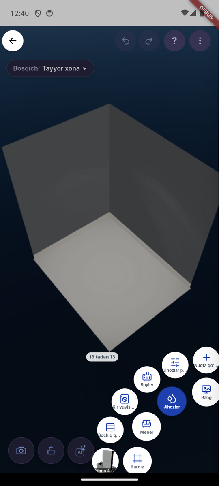
- 02: 
- 03: 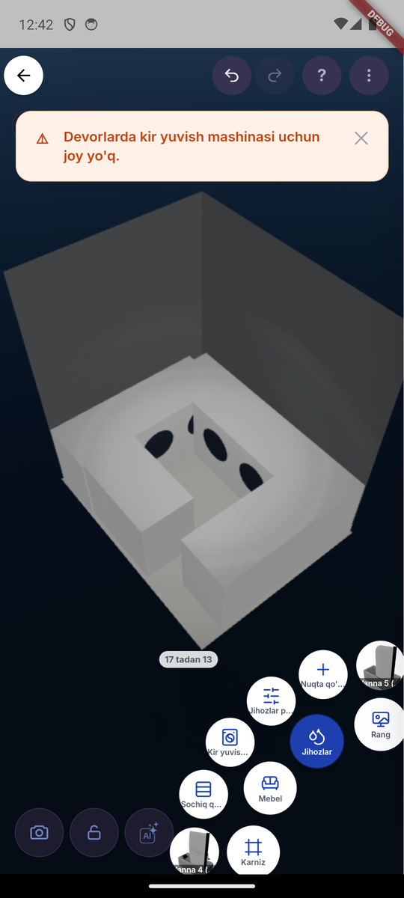
- 04: 
- 05: 
- 06: 
- 07: 
- 08: 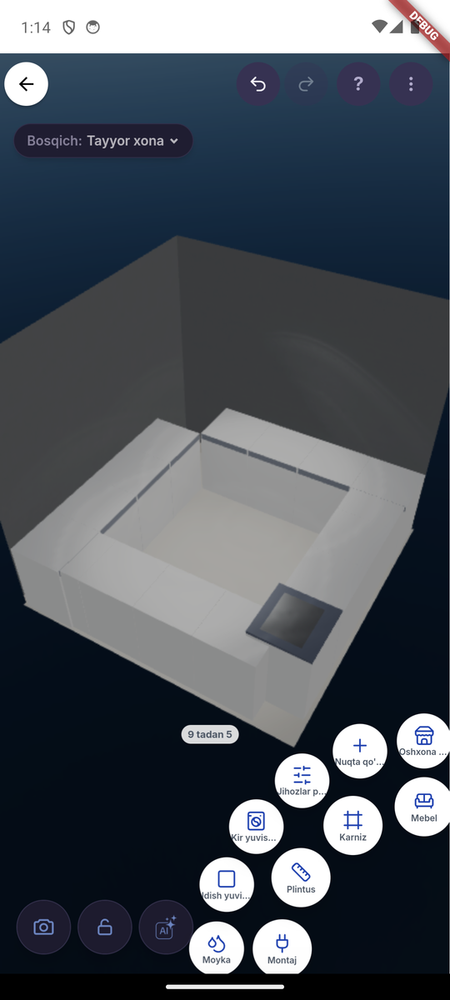
- 09: 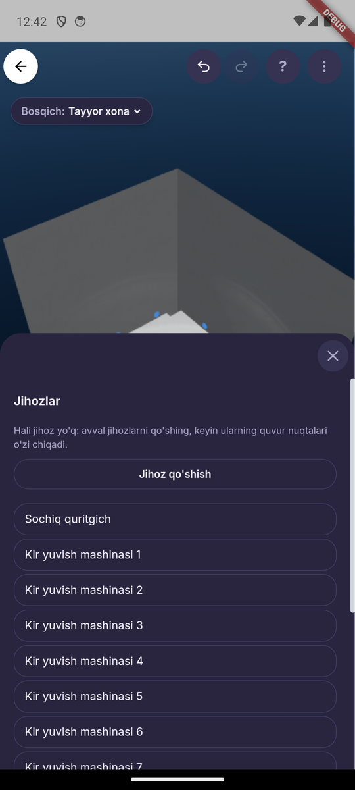
- 10: 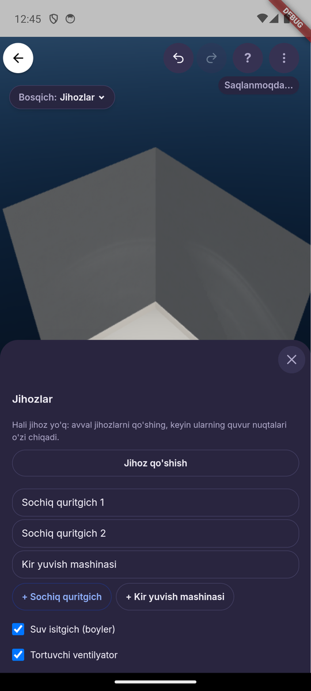
- 11: 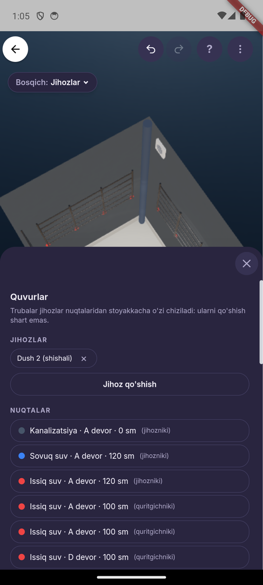
- 12: 
- 13: 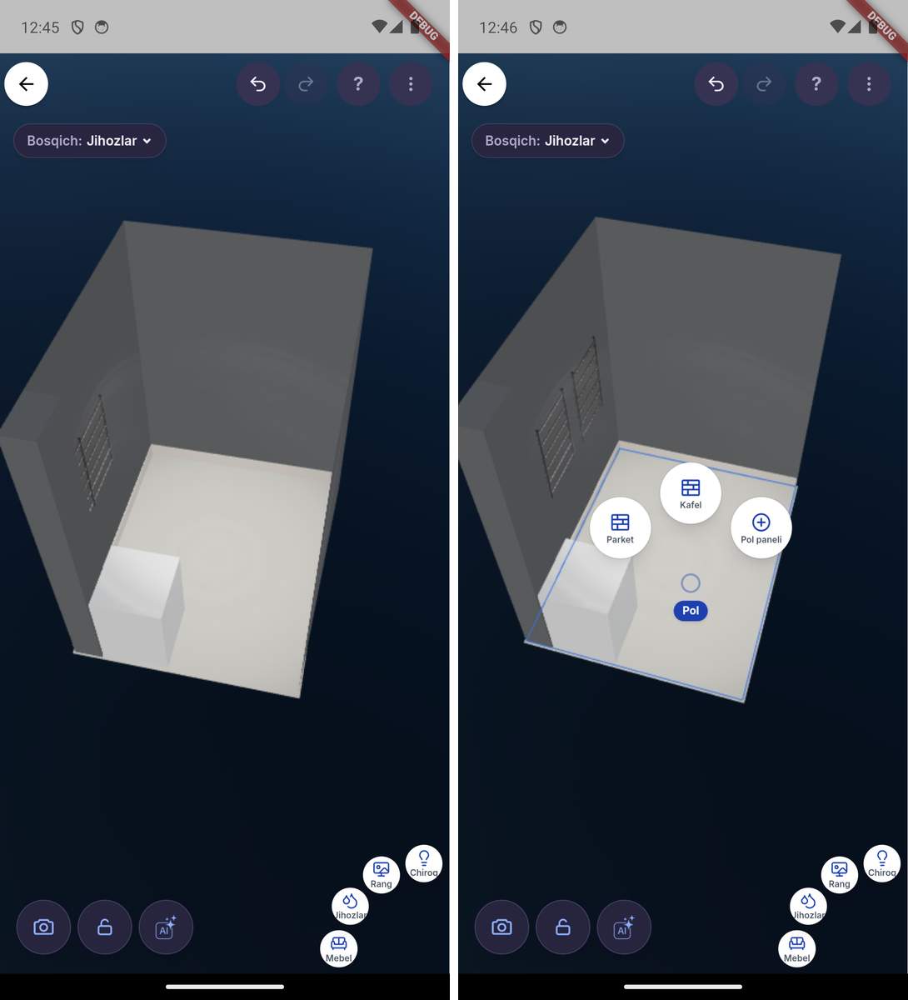
- 14: 
- 15: 
- 16: 
- 17: 
- 18: 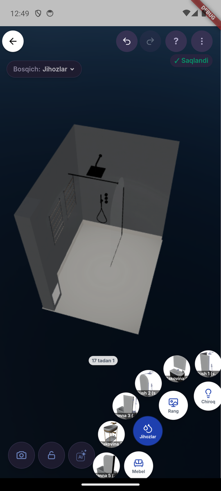
- 19: 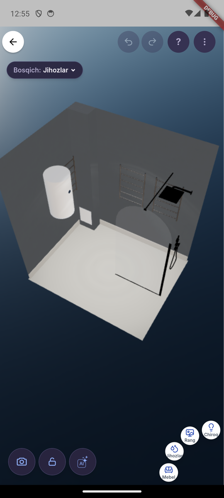
- 20: 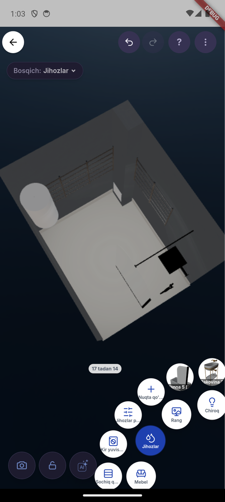
- 21: 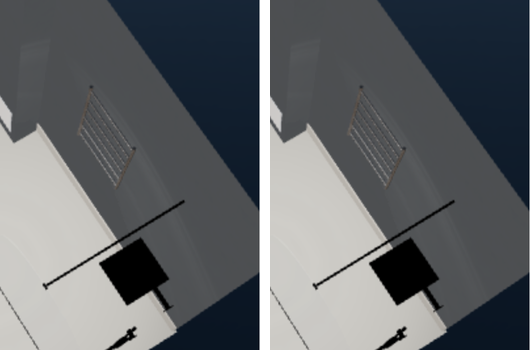
- 22: 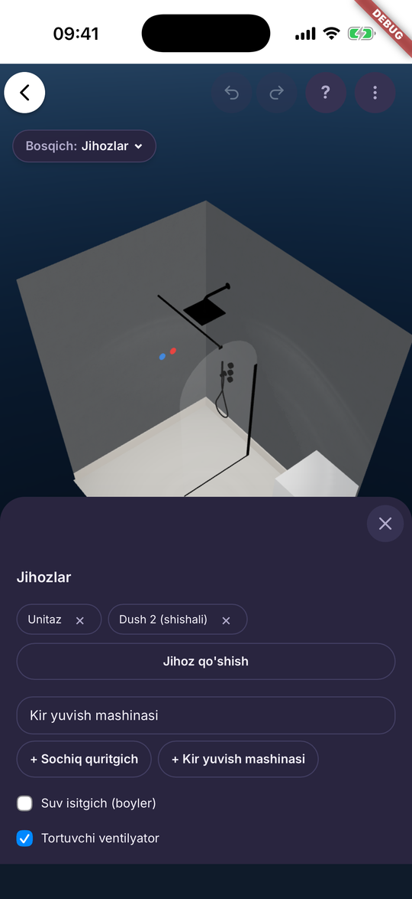
- 23: 
