# Telefon QA: #393 (deploydan keyin), #394 (santexnika tuzatishlari), #395 (halqa yopiladi) — 2026-11-24

**Nima tekshirildi:** QA #392 dan keyin chiqqan uchta web PR, telefon ilovasidagi Studio WebView'da, prod'da (andozaai.uz):
- #393: deploydan keyin Studio o'zi qayta yuklanmaydi; «Yangi versiya tayyor · Saqlab yangilash» banneri; avval saqlash, keyin bosqich va undo/redo'ni tiklash;
- #394: bosib turib o'chirish faqat qimirlamay bosganda; dush quritgich va mashinadan qochadi; dushdagi quritgich qizil (matt); surishda «joy yo'q» toast'i; «Hali jihoz yo'q…» yashirinadi; toast'lar 5 s;
- #395: devor halqasining «Santexnika» bo'limidan tanlanganda halqa yopiladi.

Usul va xona tayyorlash QA #392 (`2026-11-24-385-387-telefon.md`) dagidek.

## Muhit

| | |
|---|---|
| Bundle | `index-DltAkSax.js`: `curl -s https://andozaai.uz/ \| grep -o 'assets/index-[^"]*\.js'` bilan va WebView'dagi `script src` bilan tasdiqlandi. Test davomida deploy bo'lmadi. |
| Android | Emulator AVD `andoza_pixel` (1080×2400, WebView Chrome 113), **mehmon** (ro'yxatdan o'tmagan). Debug APK `andoza_ai_mobile` `main` **49bcd72c** dan yig'ildi (mobil #75 ichida). Prod sozlamalari: `API_URL=https://andozaai.uz/api/v1`, `API_BASE_URL=https://andozaai.uz`, `STUDIO_BASE_URL=https://andozaai.uz`. Ilova tili o'zbekcha. |
| Xona | Yangi mehmon hammomi 2.5 × 2.0 × 2.7 m (5.0 m², `d63dbdc6…`), wizard'da yaratildi. Mehmonda oldindan 4 ta «Mening uyim» loyihasi bor edi, ularga tegilmadi. |
| Teginish | Hamma imo-ishora bandlari **haqiqiy emulator teginishi** bilan: bitta barmoq `adb shell input tap/swipe`, ikki barmoq (pinch, burish, ikkinchi barmoq) emulatorning touch qurilmasiga `sendevent` (Linux multi-touch protocol B, `/dev/input/event1`). CDP faqat o'qish uchun: DOM matni, pointer hodisalari vaqti, xona holati (`GET /rooms/{id}`). |
| GPU | Dasturiy chizishda (`-gpu swiftshader_indirect`) 3D sahna atigi **3 fps**: pointer hodisalari ~0.3–1 s kechikib keladi va 1 s lik bosib turish taymeri bilan poyga qiladi. Shuning uchun **vaqtga bog'liq imo-ishoralar (1, 2, 8-bandlar) host GPU'da (60 fps) qilindi.** Host GPU'da WebGL ekranda chizilmaydi (raycast ishlaydi), shu sababli jihozga mo'ljal hisoblab olindi va har safar qimirlamay bosib, menyu yorlig'i bilan tekshirildi («Kir yuvish mashinasi / O'chirish», «Sochiq quritgich / O'chirish»). Rasmlar va rangga bog'liq bandlar (3, 4, 5, 6, 9, 10) dasturiy chizishda. |
| iOS | Tekshirilmadi: «iPhone 17 Pro (Andoza)» simulyatori o'chiq edi, yoqildi, keyin asosiy sessiya so'rovi bilan video yozish sessiyasiga bo'shatildi. Egasining ilovasi va xonasi ochilmadi, ularga tegilmadi. |

## Natijalar

| # | Band | Natija | Nima ko'rildi |
|---|---|---|---|
| 1 | Quritgich yoki mashina ustida sekin pinch yoki sekin bir barmoq bilan surish «O'chirish» ochmaydi | ✅ / ⚠️ | **Bir barmoq:** quritgichni ~12 px/s da surish (1 s da 12 px, ya'ni eski xato oralig'i 6–20 px): menyu chiqmadi, quritgich 1035 → 733 mm surildi. Mashina ~5 px/s va ~12 px/s da: menyu yo'q, 717 → 978 → 358 mm surildi. Tanlanmagan mashinani 2.5 s da surish: menyu yo'q. **Pinch, birinchi barmoq jihozda:** quritgich va mashina ustida birinchi barmoq, ikkinchisi 0.2 s dan keyin bo'sh joyga tushib sekin uzoqlashdi (~4.7–7 s): menyu yo'q, jihoz joyida. **⚠️ Ikkinchi barmoq jihozga tushsa** (birinchi barmoq allaqachon bo'sh joyda turganda), ikkinchi barmoq sekin harakatlansa (1 s da ~8 px) **«Sochiq quritgich / O'chirish» chiqdi**. Mashinada ham xuddi shunday: «Kir yuvish mashinasi / O'chirish». Ya'ni «ikkinchi barmoq bosib turishni bekor qiladi» faqat bosib turgan barmoq birinchi bo'lganda ishlaydi. Pinch yoki burishda qaysi barmoq jihozga tushishi tasodifiy. Bundan tashqari birinchi soniyada <6 px suriladigan juda sekin surishda (~4 px/s) menyu 1 s da chiqadi va quritgich surilgandan keyin ham ochiq qoladi. Bu ta'rif bo'yicha «qimirlamay bosish», lekin menyu surishdan keyin yopilmaydi. |
| 2 | Qimirlamay ~1 s bosib turish «O'chirish» ochadi (mobil #75) | ✅ | Haqiqiy teginish (`adb input swipe` 0 px, 1.2–1.3 s va `sendevent` hold): **mashinada «Kir yuvish mashinasi / O'chirish»**, **quritgichda «Sochiq quritgich / O'chirish»** chiqdi. Menyu barmoq hali bosib turganda (~1.0–1.2 s) chiqadi. Ham 60 fps (host), ham 3 fps (dasturiy) rejimda (rasm 04, 05). O'chirish bosilmadi. |
| 3 | Quritgich bor xonaga qo'shilgan dush quritgichdan (va mashinalardan) chetda turadi | ✅ | B devorda quritgich (716 mm), C devorda mashina bor xonaga burchak menyusidan «Dush 2 (shishali)» qo'shildi. Dush A devorga, markazi x = 1710 mm, ya'ni B devordan **~0.29 m** narida turdi (qutisi 1.0 m, chizilgani 1.12 m). Quritgich qatorida «tegib turibdi» yo'q, mashina uzoqda (rasm 03). Dush burchakka emas, devordan surilib turadi: kutilgan xatti-harakat, lekin ko'rinishda g'alati bo'lishi mumkin. |
| 4 | Dush ichidagi quritgich Jihozlar bosqichida qizil (matt) ko'rinadi | ✅ (panel ochiq bo'lsa) | Dush «Mebel» bosqichida A devordagi yangi «Sochiq quritgich 3» ustiga surildi. «Jihozlar» bosqichida **Jihozlar paneli ochilganda quritgich aniq qizil, yaltiramaydi (matt)**, panelda «Sochiq quritgich 3 — Mebelga tegib turibdi: Dush 2 (shishali)» (rasm 09). Dush o'chirilgach quritgich yana xrom rangga qaytdi (rasm 10). **Panel yopiq bo'lsa qizil chizilmaydi**: kodda shunday (`plumbingStageOn`: telefonda sheet ochiq bo'lishi kerak). Piksel o'lchovi: panel yopiq paytda dushdagi quritgich (79, 69, 60), boshqasi (86, 76, 68), ya'ni bir xil. |
| 5 | Quritgichni dush ichiga surishda «surib bo'lmaydi / joy yo'q» toast'i | ✅ | A devordagi quritgich dush tomonga surildi: joyidan qimirlamadi (1138 mm qoldi) va **«Quritgichni bu tomonga surib bo'lmaydi: u tomonda 50 sm bo'sh joy yo'q.»** chiqdi (rasm 08). Ikki marta takrorlandi. |
| 6 | Xonada quritgich yoki mashina bo'lsa «Hali jihoz yo'q…» ko'rinmaydi | ✅ | Bo'sh xonada (Quvurlar paneli) matn bor edi. Quritgich va mashina qo'shilgach (katalog jihozi yo'q), DOM'da matn yo'q. Oxirida dush o'chirilib, faqat 3 quritgich va mashina qolganda panel rasmi: «Hali jihoz yo'q…» yo'q (rasm 10). |
| 7 | Ogohlantirish va xato toast'lari ~5 s turadi | ✅ | DOM'da 100 ms qadam bilan o'lchandi: «Quritgichni bu tomonga surib bo'lmaydi…» **5041 ms** va **5142 ms**, «Sochiq quritgich: bu devorda joy yo'q.» **4984 ms** va **4997 ms** (rasm 08, 13). «✓ Saqlandi» belgisi ~2.5 s (bu toast emas). |
| 8 | Ikki barmoq bilan burish quritgich yoki mashinani surmaydi | ✅ / ⚠️ | `sendevent` bilan ikki barmoqli 90° burish (radius ~60 px, ~5 s) mashina ustida: mashina 358 mm da qoldi, undo o'chiq qoldi, menyu yo'q. Quritgich ustida: quritgich 733 mm da qoldi, undo o'chiq. **⚠️ Lekin quritgichda burish oxirida «Sochiq quritgich / O'chirish» chiqdi** (rasm 15). Sabab 1-banddagi bilan bir xil: ikkinchi barmoq quritgichga tushgan. |
| 9 | Devor halqasining «Santexnika» bo'limidan tanlash halqani yopadi, yangi narsaning kartasi ko'rinadi | ✅ | To'rt marta: B devor → Sochiq quritgich (rasm 01), C devor → Kir yuvish mashinasi (rasm 02), D devor → Sochiq quritgich 2 (rasm 06), A devor → Sochiq quritgich 3 (rasm 07). Har safar halqa darhol yopildi va yangi narsa kartasi (Suvli / Elektr / 50×80 sm yoki «0.60 × 0.60 m») ochiq turdi. |
| 10 | Studio ochiq turganda jim qayta yuklanish yo'q. Yangi build bo'lsa «Yangi versiya tayyor · Saqlab yangilash»; bosilganda avval saqlaydi, keyin qayta yuklaydi, bosqich va undo/redo qaytadi | ✅ / ⚠️ (taqlid) | Test paytida deploy bo'lmadi, shuning uchun **faqat emulator ichida taqlid qilindi** (pastda «Taqlid usuli»). **Banner:** «Yangi versiya tayyor. · Saqlab yangilash» chiqdi, sahifa o'zi qayta yuklanmadi (`performance.timeOrigin` o'zgarmadi) (rasm 11). **Saqlash:** saqlanmagan o'zgarish bilan bosilganda **avval `PATCH /rooms/{id}` → 200, keyin hujjat qayta yuklandi** (2 marta, PATCH dan keyin 0.2 s va 1.1 s o'tib). Mashinaning yangi joyi saqlandi. **Undo/redo:** 3 urinishdan 2 tasida qaytdi: undo va redo faol, redo D devordagi quritgichni qaytardi, undo oxirgi surishni qaytardi (991 → 576 mm). 2-urinishda (saqlanmagan o'zgarish bilan) **undo ham, redo ham o'chiq** keldi: o'sha safar eski sahifa qayta yuklanish paytida ikkinchi `PATCH` yuborgan. **⚠️ Bosqich 3 urinishning hech birida tiklanmadi:** bosishdan oldin «Jihozlar», keyin har safar **«Tayyor xona»** (rasm 12). ⚠️ Banner tepadagi undo / redo / ? / ⋮ tugmalarini yopib qo'yadi (rasm 11). |
| 11 | Studio'dan tashqarida yangi versiya so'rovsiz o'zi yangilanadi | ✅ (taqlid) | Ilovada Studio'dan tashqaridagi yagona web sahifa Profil → «Mebel ishlab chiqarish» (`/mebel`). Shu yerda xuddi shu taqlid: **banner chiqmadi, sahifa bir marta o'zi qayta yuklandi** (timeOrigin 11:06:35 → 11:07:06), keyin barqaror. |

### Taqlid usuli (10, 11-bandlar)

Deploy qila olmaganim uchun hammasi faqat emulator WebView'ida qilindi, prod'ga hech narsa yozilmadi (oddiy GET'lar va mehmon xonasining odatdagi saqlanishidan boshqa):
1. CDP `Fetch` faqat shu WebView uchun `fetch('/')` javobidagi `index-DltAkSax.js` nomini `index-QASIMxx.js` ga almashtirdi. Natijada sahifa «men eski build'daman» deb hisobladi (`buildOf` → `old`).
2. Sahifada `navigator.serviceWorker.register('/sw.js?qa=N')` chaqirildi. Server o'sha `sw.js` ni beradi, brauzer uni yangi skript deb o'rnatadi va kutishga qo'yadi. Workbox buni `isExternal` deb ko'rib `onNeedRefresh` ni chaqiradi, keyin haqiqiy `newVersionFound` → `appUpdate.offer` ishlaydi.
3. «Saqlab yangilash» haqiqiy teginish bilan bosildi. Bosishdan oldin `/` almashtirish to'xtatildi, keyin faqat tarmoq jurnali yozildi.
4. Oxirida emulator WebView'idagi SW ro'yxatdan o'chirildi (keyingi ochilishda toza `sw.js` o'rnatiladi).

Haqiqiy deployda ham tekshirish kerak: SW yangilanishi (`registration.update()`) va bosqich tiklanishi.

## Boshqa kuzatuvlar

1. **Bosqich tiklanmaydi** (10-band): «Saqlab yangilash» dan keyin Studio har safar «Tayyor xona» da ochiladi, garchi undo/redo qaytsa ham. Ilova Studio'ni `?app=1&lang=uz` bilan ochadi (`phase` yo'q). Embedded rejimda bosqich `studioResume` dan o'qilmayotgan bo'lishi mumkin.
2. **Undo tarixi ba'zan yo'qoladi** (10-band, 2-urinish): bosishdan 0.5 s oldin mashina surilgan, `PATCH` 200 dan keyin sahifa qayta yuklandi va eski sahifa yana bitta `PATCH` yubordi. Yangi sahifada undo/redo o'chiq edi. Ikkinchi saqlash `updated_at` ni o'zgartirib, «shu saqlangan nusxa» tekshiruvidan o'tkazmagan bo'lishi mumkin.
3. **Ikkinchi barmoq jihozga tushsa bosib turish bekor qilinmaydi** (1, 8-bandlar). Plintusda ham shunday: sekin pinchda ikkinchi barmoq plintusga tushib **«Plintus / O'chirish»** chiqdi (rasm 14).
4. **Banner tepadagi tugmalarni yopadi** (rasm 11): banner ochiq turganda undo/redo'ni bosib bo'lmaydi.
5. **Dush qutisi chizilganidan kichik** (3, 4-bandlar): «Dush 2 (shishali)» kartada 1.12 × 1.00 m, surish chegarasi ham 1.12 bo'yicha (dush B devorga tegib to'xtaydi). Lekin clash qutisi katalogdagi 1.00 × 1.00. Dush B devorga taqalganda shu devordagi quritgich ko'rinishda dush oynasi ichida qoldi, lekin «tegib turibdi» ham, qizil rang ham chiqmadi.
6. **Karta tanlangan quritgichni yopadi** (rasm 07 atrofi): A devordagi quritgich tanlanganda kartasi aynan quritgich ustida turdi. Quritgichga bosish va surish kartaga tushdi (o'lcham select'i fokus oldi). Avval tanlovni olib tashlash kerak bo'ldi.
7. Bir marta «Kameralar → 2-kamera» ga bosilganda kamera o'zgarmadi, buning o'rniga tugma matni tanlandi (Android «Copy / Share / Select all» menyusi, rasm 16). Bu 3 fps rejimida bo'ldi, qayta tekshirib bo'lmadi (emulator yopildi). Matn tanlanganda Android «orqaga» tugmasi tanlovni olib tashladi va Studio'dan ham chiqib ketdi.

## Prod'da o'zgartirilgan narsalar

- **Mehmon xonasi `d63dbdc6…`** (hammom, 5.0 m²): 5 ta quritgich, mashina; dush qo'shildi, surildi, keyin o'chirildi. **Xona o'chirilmadi:** test o'rtasida emulator yopildi, egasining so'zi bilan Android ishi to'xtatildi. Mehmon ma'lumoti sifatida 14 kundan keyin avtomatik tozalanadi. Mehmondagi oldingi 4 ta loyihaga tegilmadi.
- Egasining xonasi va iOS ilovasi: **ochilmadi, o'zgarmadi.**
- Emulator: debug APK (49bcd72c) o'rnatildi, `adb root` yoqildi (`sendevent` uchun). WebView SW ro'yxati o'chirildi. Emulator yopiq.

## Rasmlar

- 01: 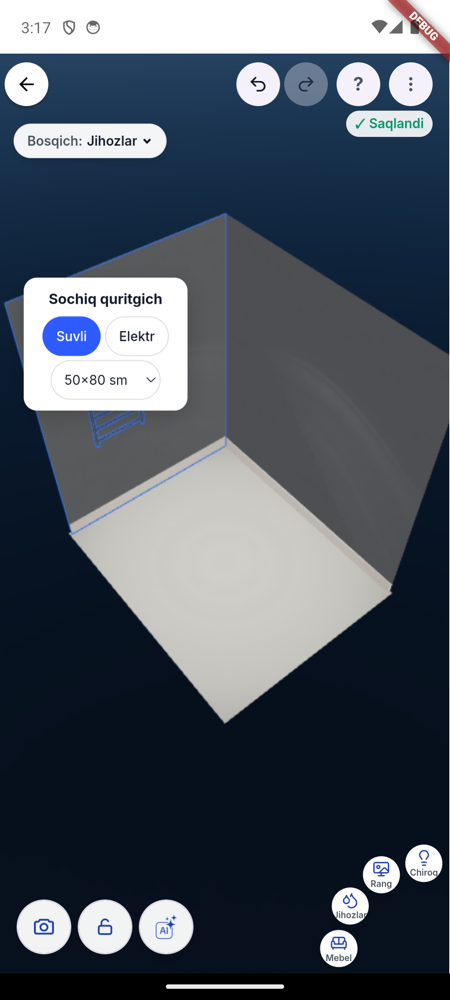
- 02: 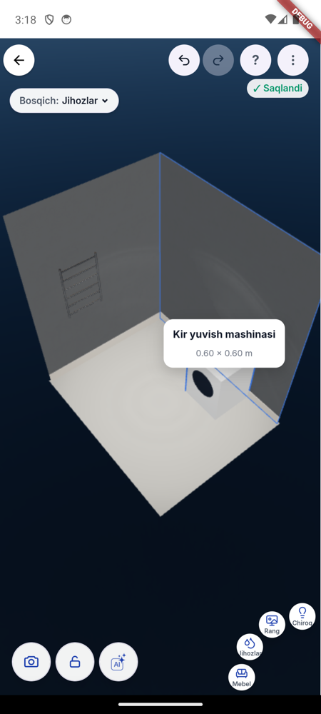
- 03: 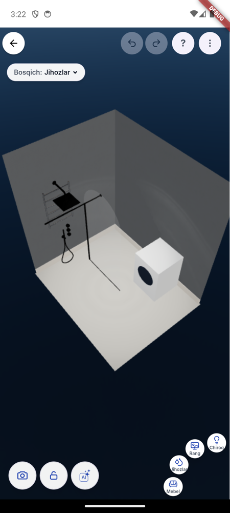
- 04: 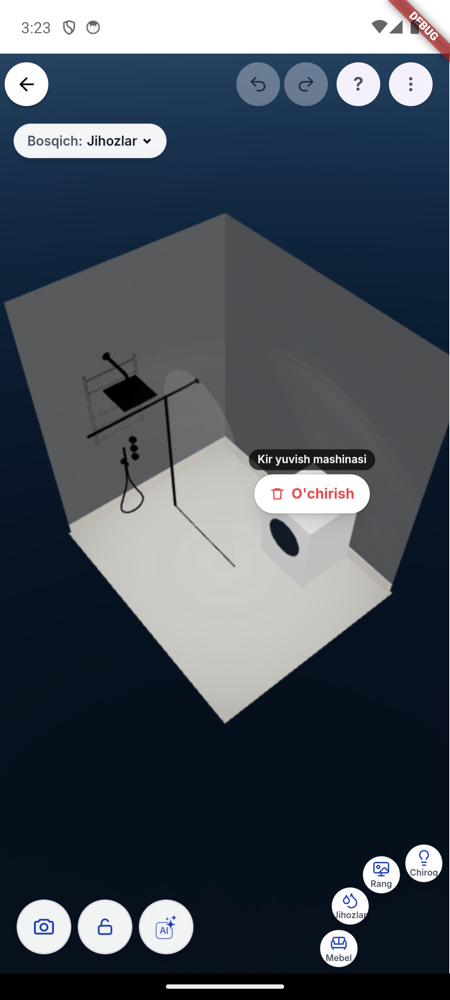
- 05: 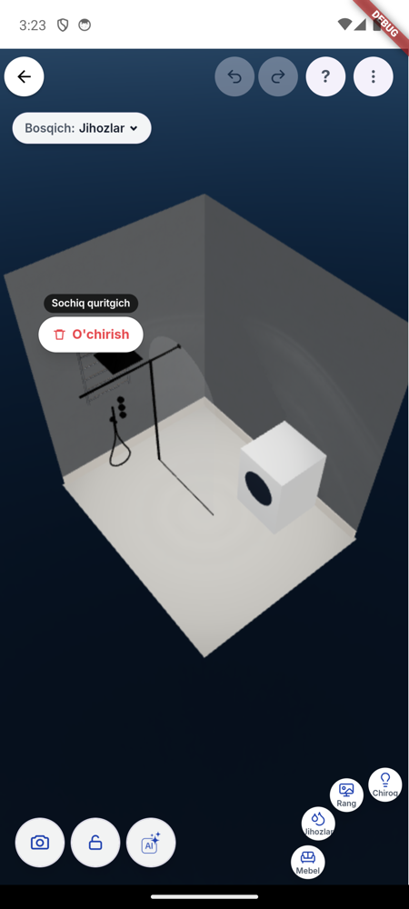
- 06: 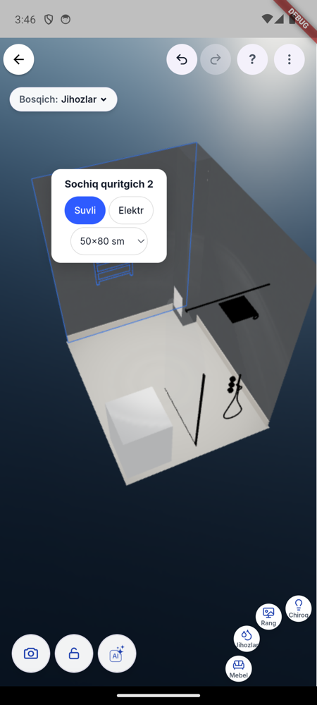
- 07: 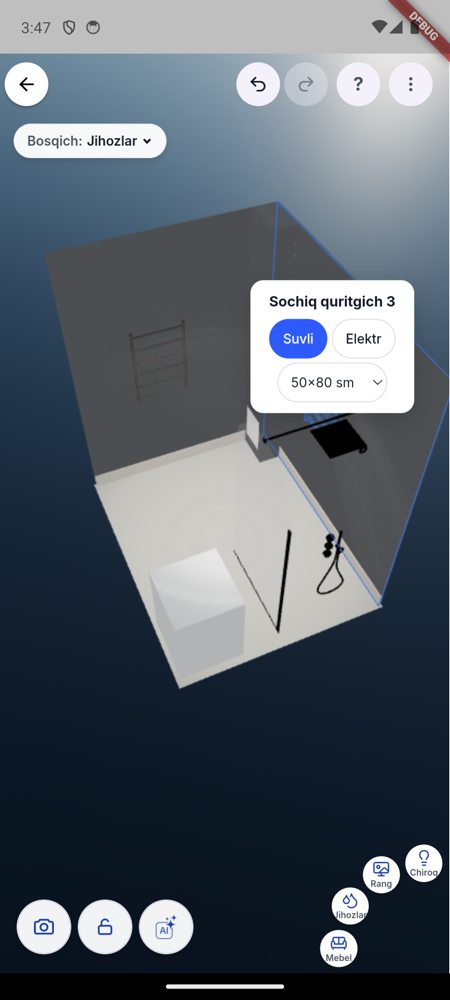
- 08: 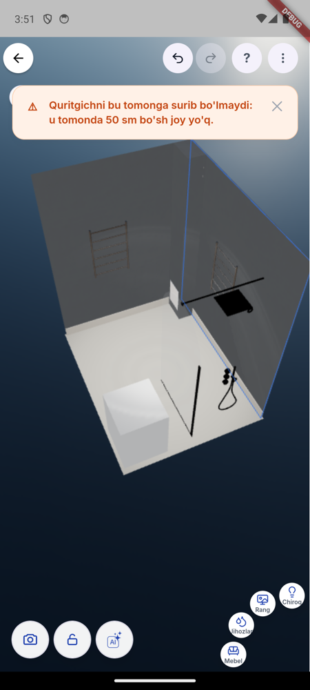
- 09: 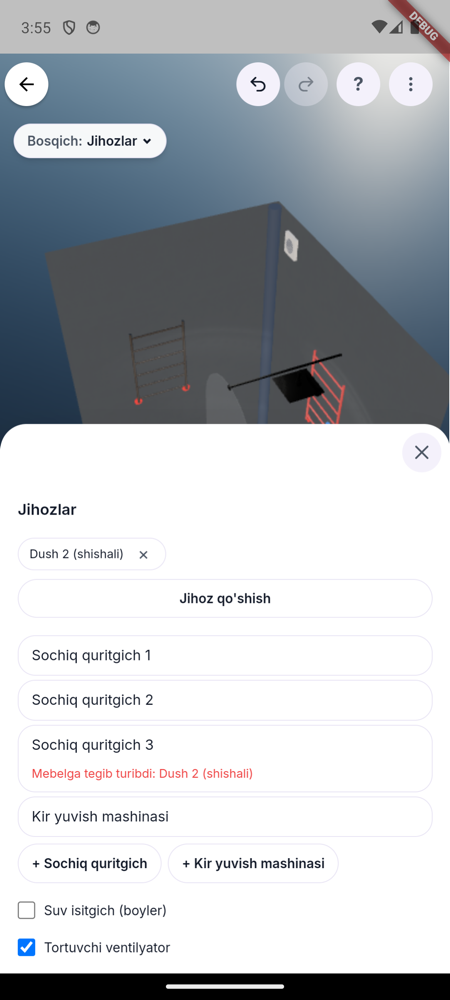
- 10: 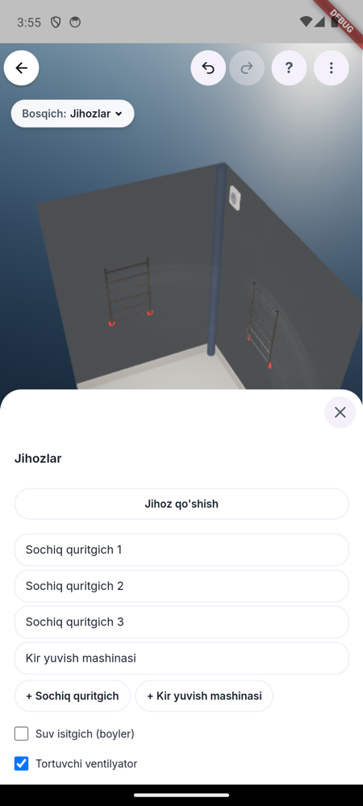
- 11: 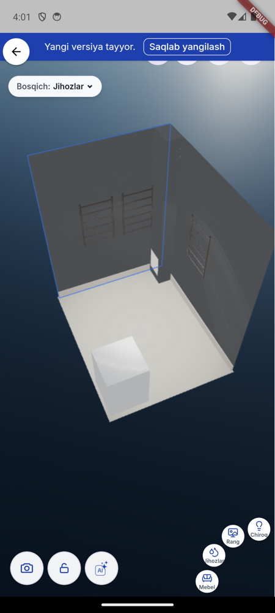
- 12: 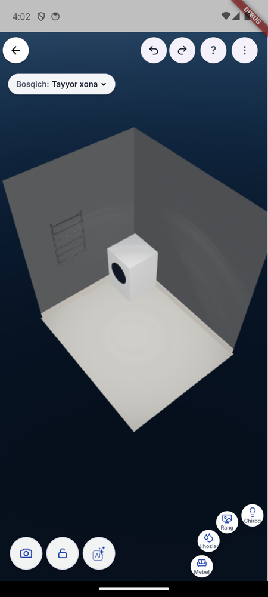
- 13: 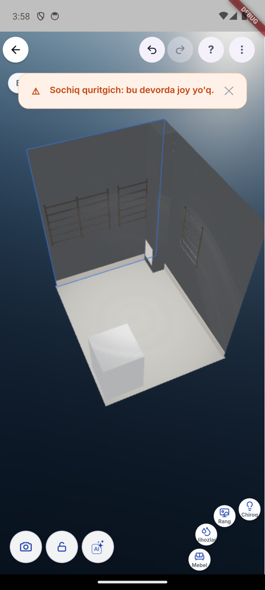
- 14: 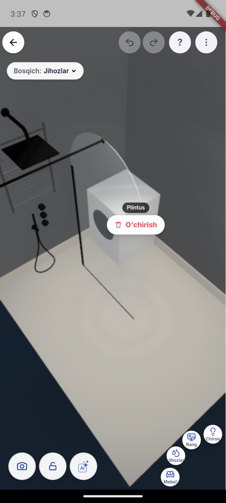 (host GPU, 3D chizilmagan)
- 15: 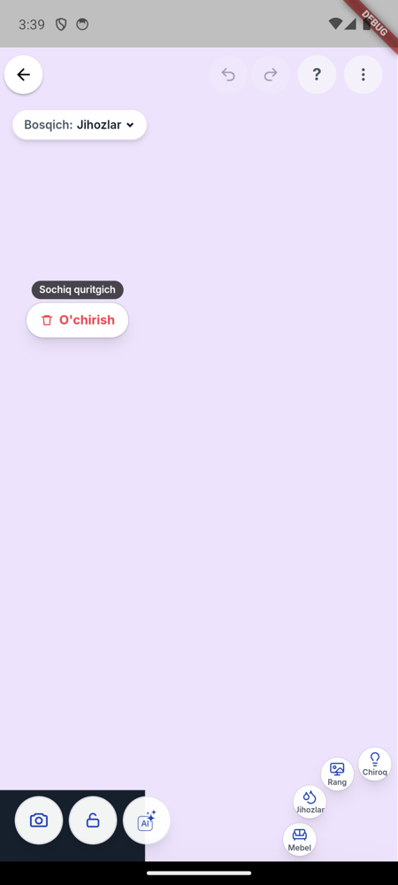 (host GPU, 3D chizilmagan)
- 16: 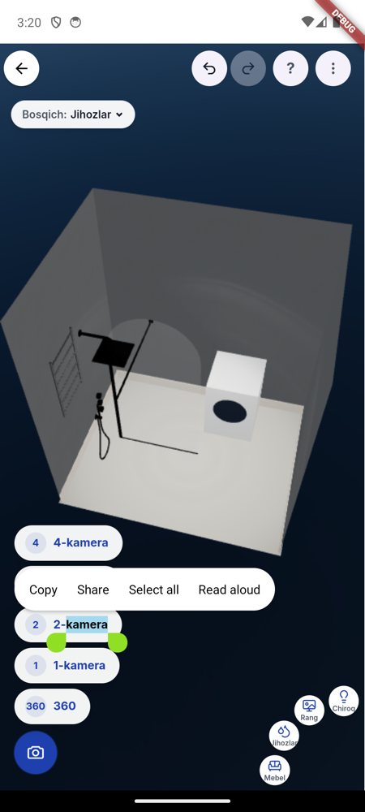
